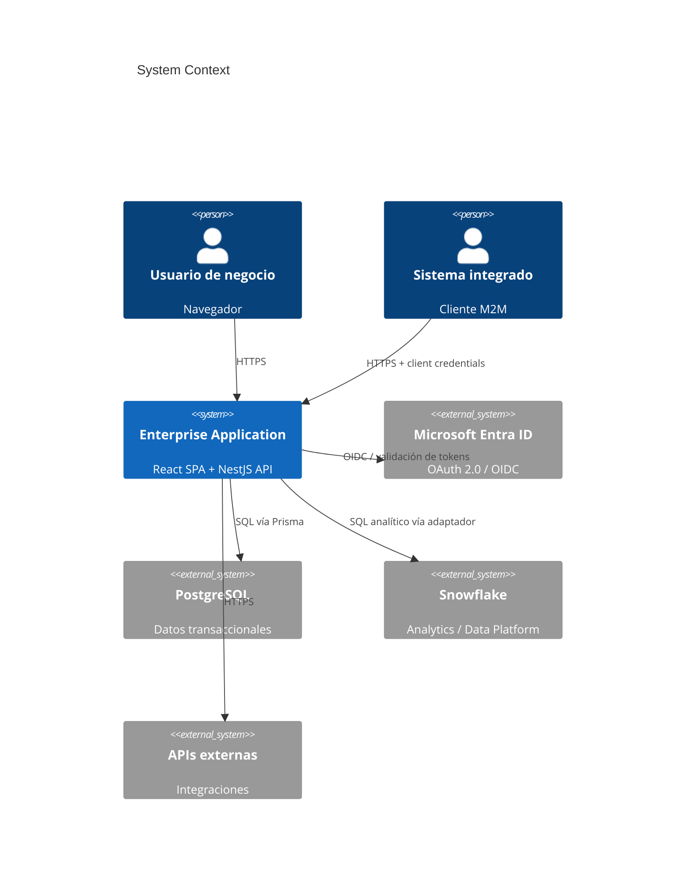
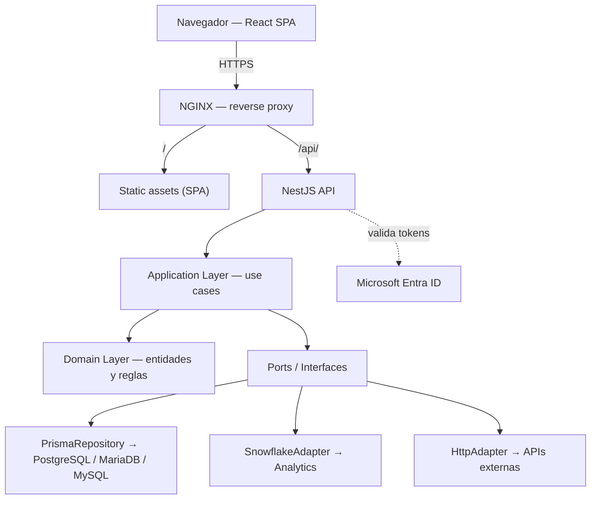
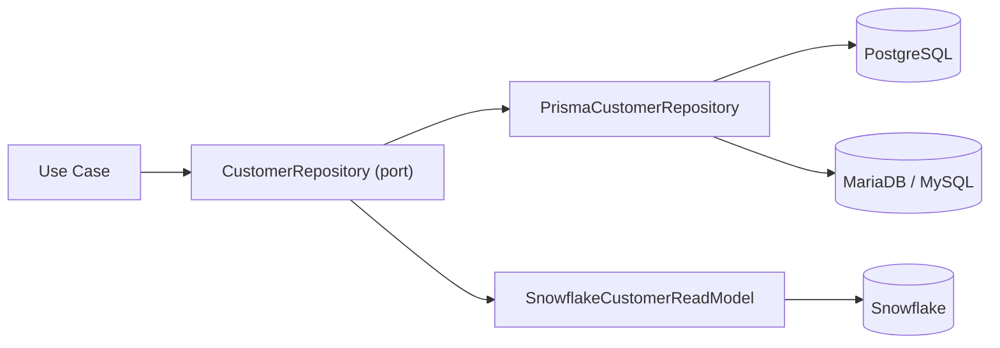
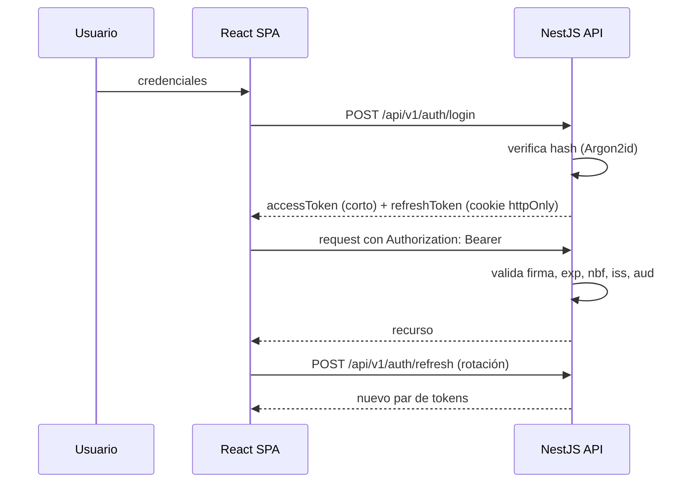
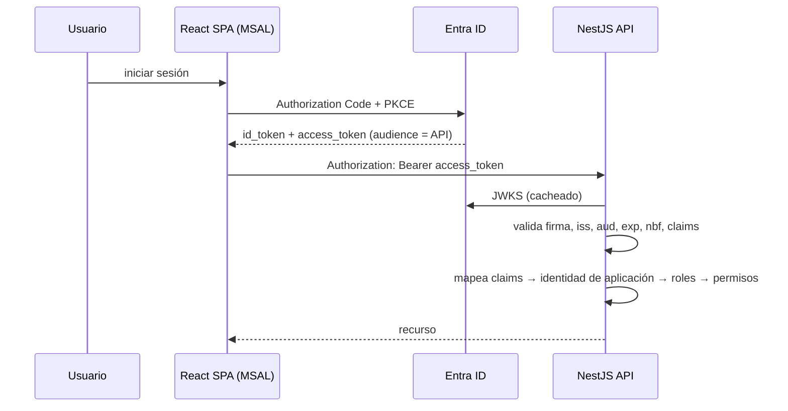
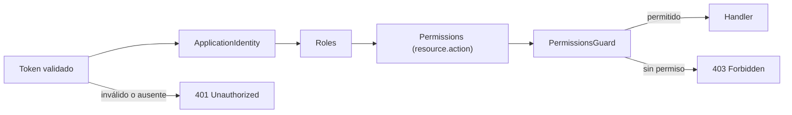
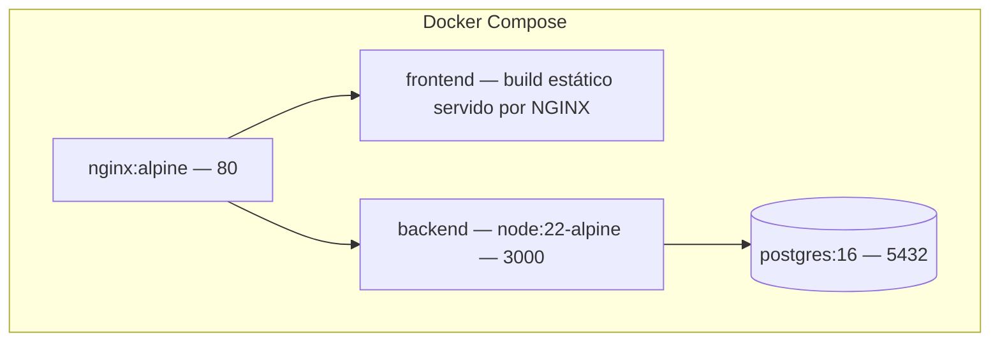
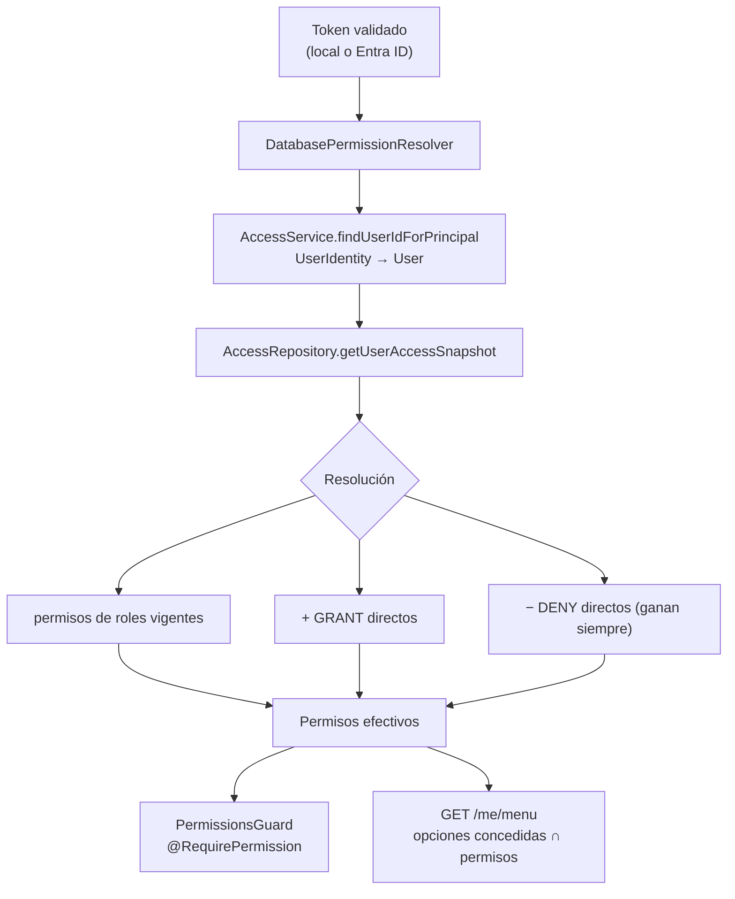
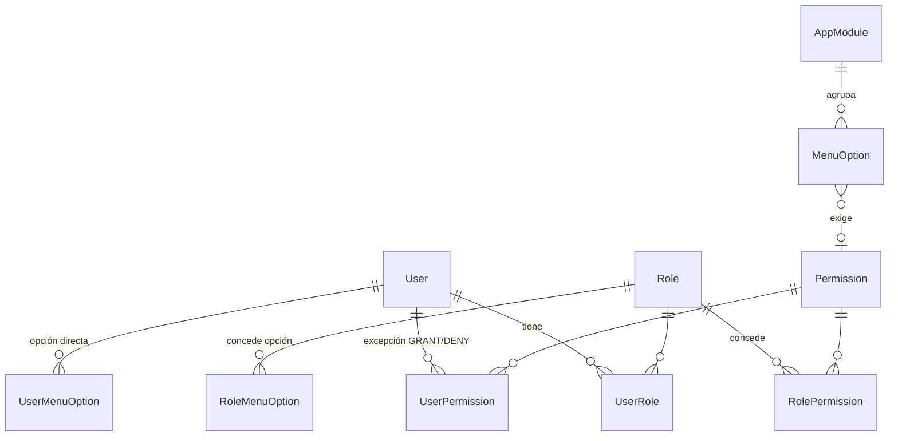

# ARCHITECTURE.md

Arquitectura del **Enterprise Project Template**. Toda modificación estructural requiere ADR
en [`docs/adr/`](docs/adr/).

---

## 1. Principios

1. **Desacoplamiento total frontend/backend.** Única frontera: REST sobre HTTPS descrito en OpenAPI.
2. **Dependencias hacia adentro.** Presentation → Application → Domain. Infrastructure implementa puertos del Domain/Application; nunca al revés.
3. **La persistencia es un detalle.** Prisma, PostgreSQL y Snowflake viven detrás de puertos.
4. **Autenticación intercambiable.** JWT local y Entra ID son adaptadores del mismo puerto.
5. **Autorización explícita.** Todo endpoint declara su permiso.
6. **Sin capas decorativas.** Se aplica Clean Architecture donde agrega valor; un CRUD trivial no necesita cuatro capas (ADR-004, ADR-014).
7. **Observabilidad desde el día uno.** Correlation ID, logging estructurado, health/ready.

---

## 2. System Context



---

## 3. Container Diagram



El frontend **nunca** accede a una base de datos ni conoce credenciales de datos.

---

## 4. Frontier frontend / backend

| | Frontend | Backend |
|---|---|---|
| Fuente de verdad de reglas de negocio | No | **Sí** |
| Validación | UX (Zod) | **Autoritativa (DTO + pipes)** |
| Autorización | Solo oculta UI | **Decide acceso** |
| Estado de servidor | TanStack Query | — |
| Contrato | Consume OpenAPI | **Publica OpenAPI** |

Ocultar un botón en el frontend **no** es un control de seguridad.

---

## 5. Capas del backend

```text
presentation/   Controllers, DTOs, Swagger, guards de ruta
application/    Use cases, orquestación, transacciones, puertos consumidos
domain/         Entidades, value objects, reglas invariantes, puertos definidos
infrastructure/ Prisma, Snowflake, HTTP clients, auth providers, logging
```

Reglas:

- `domain/` no importa nada de `infrastructure/`, ni NestJS, ni Prisma.
- `application/` depende de interfaces, nunca de implementaciones concretas.
- Los módulos simples pueden empezar planos (`module/` con controller + service + repository)
  y evolucionar a cuatro carpetas cuando la complejidad lo justifique (ADR-014).

---

## 6. Data Access



- Puerto transaccional: `*Repository` (escritura + lectura consistente).
- Puerto analítico: `AnalyticsRepository`, `ReportingRepository`, `DataProvider`, `IntegrationRepository`.
- Un caso de uso puede combinar ambos, pero **no** mezcla transacción OLTP con consulta Snowflake
  dentro de la misma unidad de trabajo.

Detalle en ADR-004 y en el Skill `database`.

---

## 7. Flujo de autenticación — Local JWT



## 8. Flujo de autenticación — Microsoft Entra ID



## 9. Flujo de autorización



## 10. Despliegue (entorno local y de referencia)



En Azure DevOps el mismo artefacto se publica como imagen; la topología de producción real
se define por proyecto (ADR-012).

---

## 11. Núcleo de gestión: accesos y menú

El acceso efectivo de un usuario se resuelve en el servidor a partir de la base de datos,
nunca de los claims del token (ADR-018).



Consecuencia de diseño: **el menú y la autorización no pueden divergir**, porque se calculan
con la misma información y en el mismo sitio. El frontend pinta lo que recibe.



Modelo completo en [`docs/database/data-model.md`](docs/database/data-model.md).

---

## 12. Capa visual

La identidad visual proviene del sistema de diseño Grupo AG, portado del CRM de referencia
al tema de Material UI (ADR-017). Los tokens viven en `frontend/src/theme/tokens.ts` y el
shell (topbar, sidebar de tres estados, barra inferior de móvil, encabezado de página) en
`frontend/src/components/layout/`.

Detalle en [`docs/design/DESIGN-SYSTEM.md`](docs/design/DESIGN-SYSTEM.md).

---

## 13. Decisiones registradas

Ver [`docs/adr/`](docs/adr/) — ADR-001 a ADR-018.
