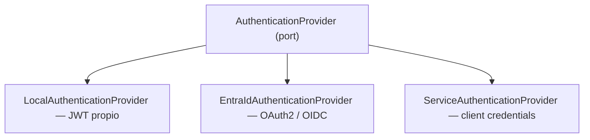

# AUTHENTICATION.md

La autenticación **no** está acoplada a un proveedor. Ver ADR-006 y ADR-007.

---

## 1. Puerto y adaptadores



```typescript
export interface AuthenticationProvider {
  readonly name: AuthProviderName;
  verifyAccessToken(token: string): Promise<AuthenticatedPrincipal>;
}
```

`AuthenticatedPrincipal` es el modelo interno: `{ subjectId, tenantId?, email?, displayName?, rawClaims }`.
El dominio **nunca** conoce Entra ID ni JWT.

## 2. Selección por configuración

```text
AUTH_PROVIDER=local     # JWT emitido por la propia API
AUTH_PROVIDER=entra     # Microsoft Entra ID
AUTH_PROVIDER=hybrid    # ambos (requiere ADR por proyecto, ver ADR-006)
```

Cambiar de proveedor **no** requiere tocar casos de uso, controllers ni dominio.

## 3. Autenticación local

Implementada según [`PLAN-AUTH-LOCAL`](docs/implementation-plans/PLAN-AUTH-LOCAL.md).
Código en `backend/src/modules/auth/`.

```text
POST /auth/login  email + password → Argon2id verify
  → accessToken (15 min, en el cuerpo) + refresh (8 h, cookie HttpOnly)
POST /auth/refresh  cookie → rota el refresh → nuevo accessToken
```

Reglas:

- Hashing con Argon2id (19 MiB, t=2, p=1). Migración transparente del hash al
  entrar si cambian los parámetros. **Nunca** almacenamiento reversible.
- Correo inexistente, sin credencial, contraseña incorrecta y bloqueo temporal
  responden igual (`401 INVALID_CREDENTIALS`) y tardan lo mismo: siempre hay
  una verificación Argon2, real o contra un hash ficticio.
- Bloqueo tras 5 fallos durante 15 minutos (`system_parameters`, ajustable sin
  desplegar). Cada intento reserva su turno de forma atómica **antes** de
  verificar: ni con peticiones simultáneas se verifican más de 5 contraseñas
  por ventana. Durante el bloqueo la contraseña ni se verifica.
- 10 intentos por minuto y por IP en `/auth/login` y `/auth/password/change`.
  La API confía en un solo salto de proxy (NGINX), que sobrescribe
  `X-Forwarded-For` con la IP real: el cliente no puede falsear la suya.
- Refresh token opaco (256 bits), guardado como SHA-256 en `user_sessions`.
  Cookie `refresh_token`: `HttpOnly`, `Secure` (salvo en desarrollo),
  `SameSite=Lax`, `Path=/api/v1/auth`.
- **Rotación en cada uso.** La sesión dura 8 h desde el login; rotar no la
  alarga. Presentar un refresh ya rotado se trata como robo: se revocan
  **todas** las sesiones del usuario y se audita `auth.refresh.reused`. Por eso
  el frontend serializa la renovación entre pestañas.
- Access token solo en memoria del navegador, nunca en `localStorage`.
- Cambiar la contraseña cierra el resto de sesiones del usuario.

### Contraseñas iniciales

Sin infraestructura de correo no hay autoservicio de restablecimiento:

| Quién | De dónde sale | Regla |
|---|---|---|
| Administrador sembrado | `SEED_ADMIN_PASSWORD` | Solo si aún no tiene credencial; la semilla nunca la sobrescribe |
| Altas y restablecimientos por administrador | `AUTH_DEFAULT_PASSWORD` (≥ 12) | `POST /users` y `POST /users/{id}/password/reset` |

Ambas viven solo en `.env` o en el almacén de secretos, nunca en Git, y
**obligan a cambiarse en el primer acceso**: el access token lleva el claim
`pcr` y la API responde `403 PASSWORD_CHANGE_REQUIRED` a todo salvo
`/auth/password/change`. Una cuenta `INVITED` pasa a `ACTIVE` al fijar su
propia contraseña.

La contraseña inicial del administrador está exenta de la política de longitud
por decisión del responsable del proyecto (D11 del plan). La que el
administrador fija al entrar sí la cumple.

## 4. Microsoft Entra ID

Estándares: OAuth 2.0 + OpenID Connect. Prohibido inventar mecanismos propietarios.

**Frontend (MSAL):** Authorization Code Flow + PKCE, sin secretos en el cliente.

```text
VITE_ENTRA_CLIENT_ID      VITE_ENTRA_TENANT_ID     VITE_ENTRA_AUTHORITY
VITE_ENTRA_REDIRECT_URI   VITE_ENTRA_API_SCOPE
```

**Backend:** valida el access token contra JWKS del tenant. Verificación mínima:

- [ ] Firma (JWKS cacheado, rotación de llaves soportada)
- [ ] `iss` coincide con el authority esperado
- [ ] `aud` coincide con el `ENTRA_AUDIENCE` de esta API
- [ ] `exp` y `nbf` dentro de ventana (tolerancia de reloj ≤ 60 s)
- [ ] `tid` esperado (multi-tenant solo si está justificado)
- [ ] Claims requeridos presentes (`sub`/`oid`)

```text
ENTRA_TENANT_ID   ENTRA_CLIENT_ID   ENTRA_AUDIENCE   ENTRA_AUTHORITY   ENTRA_JWKS_URI
```

**Nunca** basta con que el token "sea un JWT válido". Un token emitido para otra audiencia
es un token rechazado.

## 5. Autenticación ≠ Autorización

```text
Entra User → Token Claims → ApplicationIdentity → Roles → Permissions
```

Los roles/grupos del IdP se **traducen** a permisos de la aplicación mediante un mapeo explícito
y versionado. La aplicación no confía en un claim de rol arbitrario para decidir acceso a un recurso
sin mapearlo primero.

## 6. Machine to Machine

Integraciones backend-to-backend usan **OAuth2 Client Credentials**, nunca credenciales de usuario.
El principal de servicio es un tipo distinto de identidad, con sus propios permisos y auditoría.

## 7. JWT local — reglas

| Token | TTL | Reglas |
|---|---|---|
| Access | 15 min (`JWT_ACCESS_TOKEN_TTL`) | HS256 con `JWT_ACCESS_TOKEN_SECRET` (≥ 32 bytes), `iss`, `aud`, `exp`, `nbf`, `jti`. Sin roles ni permisos: salen de la base en cada petición |
| Refresh | 8 h (`JWT_REFRESH_TOKEN_TTL`) | Opaco, no JWT. Rotación en cada uso, revocable, almacenado como hash |

HS256 porque la misma API firma y verifica. Si otro servicio tuviera que
verificar estos tokens, se pasaría a RS256 con un ADR.

Prohibido: tokens sin expiración, secretos en código, tokens en logs o en URLs.

## 8. Logout y expiración

- Local: `POST /auth/logout` revoca la sesión de la cookie y la borra. Funciona
  con el access token caducado.
- Entra ID: logout federado (`end_session_endpoint`) cuando el proyecto lo requiera.
- El frontend maneja `401` de forma centralizada: intenta refresh una vez, luego redirige a login.

## 9. Pendiente

- Restablecimiento por correo e invitaciones con enlace: requieren un ADR de
  correo. Mientras tanto, el administrador restablece a la contraseña inicial.
- Purga periódica de `user_sessions` caducadas.
- MFA: llega con Entra ID.
