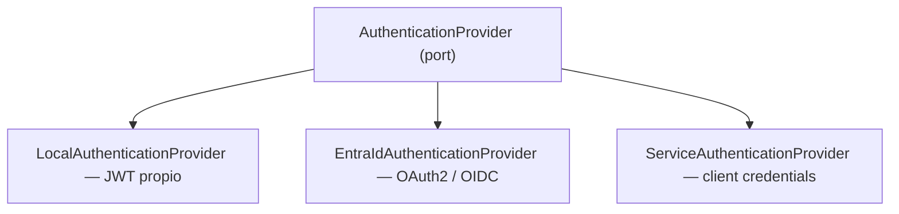

# AUTHENTICATION.md

La autenticación **no** está acoplada a un proveedor. Ver ADR-006 y ADR-007.

---

## 1. Puerto y adaptadores



```typescript
export interface AuthenticationProvider {
  readonly name: AuthProviderName;
  verifyAccessToken(token: string): Promise<AuthenticatedPrincipal>;
}
```

`AuthenticatedPrincipal` es el modelo interno: `{ subjectId, tenantId?, email?, displayName?, rawClaims }`.
El dominio **nunca** conoce Entra ID ni JWT.

## 2. Selección por configuración

```text
AUTH_PROVIDER=local     # JWT emitido por la propia API
AUTH_PROVIDER=entra     # Microsoft Entra ID
AUTH_PROVIDER=hybrid    # ambos (requiere ADR por proyecto, ver ADR-006)
```

Cambiar de proveedor **no** requiere tocar casos de uso, controllers ni dominio.

## 3. Autenticación local

```text
email/username + password → validación → Argon2id verify
→ accessToken (15 min, firmado) + refreshToken (7 días, rotación + revocación)
```

Reglas:

- Hashing con Argon2id. **Nunca** almacenamiento reversible ni MD5/SHA simple.
- Respuesta genérica ante credenciales inválidas (no revelar si el usuario existe).
- Rate limit estricto en `/auth/login`.
- Refresh token en cookie `httpOnly`, `Secure`, `SameSite=Strict`, con rotación y detección de reuso.
- Access token **nunca** en `localStorage` si el proyecto lo puede evitar; preferir memoria.

## 4. Microsoft Entra ID

Estándares: OAuth 2.0 + OpenID Connect. Prohibido inventar mecanismos propietarios.

**Frontend (MSAL):** Authorization Code Flow + PKCE, sin secretos en el cliente.

```text
VITE_ENTRA_CLIENT_ID      VITE_ENTRA_TENANT_ID     VITE_ENTRA_AUTHORITY
VITE_ENTRA_REDIRECT_URI   VITE_ENTRA_API_SCOPE
```

**Backend:** valida el access token contra JWKS del tenant. Verificación mínima:

- [ ] Firma (JWKS cacheado, rotación de llaves soportada)
- [ ] `iss` coincide con el authority esperado
- [ ] `aud` coincide con el `ENTRA_AUDIENCE` de esta API
- [ ] `exp` y `nbf` dentro de ventana (tolerancia de reloj ≤ 60 s)
- [ ] `tid` esperado (multi-tenant solo si está justificado)
- [ ] Claims requeridos presentes (`sub`/`oid`)

```text
ENTRA_TENANT_ID   ENTRA_CLIENT_ID   ENTRA_AUDIENCE   ENTRA_AUTHORITY   ENTRA_JWKS_URI
```

**Nunca** basta con que el token "sea un JWT válido". Un token emitido para otra audiencia
es un token rechazado.

## 5. Autenticación ≠ Autorización

```text
Entra User → Token Claims → ApplicationIdentity → Roles → Permissions
```

Los roles/grupos del IdP se **traducen** a permisos de la aplicación mediante un mapeo explícito
y versionado. La aplicación no confía en un claim de rol arbitrario para decidir acceso a un recurso
sin mapearlo primero.

## 6. Machine to Machine

Integraciones backend-to-backend usan **OAuth2 Client Credentials**, nunca credenciales de usuario.
El principal de servicio es un tipo distinto de identidad, con sus propios permisos y auditoría.

## 7. JWT local — reglas

| Token | TTL | Reglas |
|---|---|---|
| Access | 15 min | Firmado (RS256 preferido), validación completa, sin datos sensibles en claims |
| Refresh | 7 días | Rotación en cada uso, revocable, almacenado hasheado |

Prohibido: tokens sin expiración, secretos en código, tokens en logs o en URLs.

## 8. Logout y expiración

- Local: revocar refresh token en servidor + limpiar estado del cliente.
- Entra ID: logout federado (`end_session_endpoint`) cuando el proyecto lo requiera.
- El frontend maneja `401` de forma centralizada: intenta refresh una vez, luego redirige a login.

## 9. Estado del skeleton

La Foundation entrega **arquitectura y configuración**, no un login funcional:
puerto, providers, guards, decoradores, validación de configuración y puntos de extensión.
Activar un proveedor real requiere configuración externa y se hace en el primer proyecto (ADR-006).
