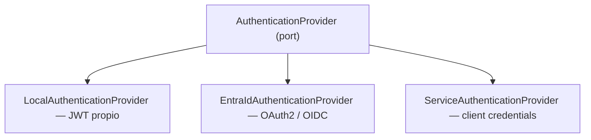

# AUTHENTICATION.md

La autenticación **no** está acoplada a un proveedor. Ver ADR-006, ADR-007 y ADR-027 (alta al primer ingreso y corte a Entra ID).

---

## 1. Puerto y adaptadores



```typescript
export interface AuthenticationProvider {
  readonly name: AuthProviderName;
  verifyAccessToken(token: string): Promise<AuthenticatedPrincipal>;
}
```

`AuthenticatedPrincipal` es el modelo interno: `{ subjectId, tenantId?, email?, displayName?, rawClaims }`.
El dominio **nunca** conoce Entra ID ni JWT.

## 2. Selección por configuración

```text
AUTH_PROVIDER=local     # JWT emitido por la propia API
AUTH_PROVIDER=entra     # Microsoft Entra ID
AUTH_PROVIDER=hybrid    # NO habilitado: lanza error al arrancar (ADR-019, ADR-027: la migración es un corte directo)
```

Cambiar de proveedor **no** requiere tocar casos de uso, controllers ni dominio. Con `entra`, los
endpoints de autenticación local (`/auth/login`, `/auth/refresh`…) responden `404`.

## 3. Autenticación local

Implementada según [`PLAN-AUTH-LOCAL`](docs/implementation-plans/PLAN-AUTH-LOCAL.md).
Código en `backend/src/modules/auth/`.

```text
POST /auth/login  email + password → Argon2id verify
  → accessToken (15 min, en el cuerpo) + refresh (8 h, cookie HttpOnly)
POST /auth/refresh  cookie → rota el refresh → nuevo accessToken
```

Reglas:

- Hashing con Argon2id (19 MiB, t=2, p=1). Migración transparente del hash al
  entrar si cambian los parámetros. **Nunca** almacenamiento reversible.
- Correo inexistente, sin credencial, contraseña incorrecta y bloqueo temporal
  responden igual (`401 INVALID_CREDENTIALS`) y tardan lo mismo: siempre hay
  una verificación Argon2, real o contra un hash ficticio.
- Bloqueo tras 5 fallos durante 15 minutos (`system_parameters`, ajustable sin
  desplegar). Cada intento reserva su turno de forma atómica **antes** de
  verificar: ni con peticiones simultáneas se verifican más de 5 contraseñas
  por ventana. Durante el bloqueo la contraseña ni se verifica.
- 10 intentos por minuto y por IP en `/auth/login` y `/auth/password/change`.
  La API confía en un solo salto de proxy (NGINX), que sobrescribe
  `X-Forwarded-For` con la IP real: el cliente no puede falsear la suya.
- Refresh token opaco (256 bits), guardado como SHA-256 en `user_sessions`.
  Cookie `refresh_token`: `HttpOnly`, `Secure` (salvo en desarrollo),
  `SameSite=Lax`, `Path=/api/v1/auth`.
- **Rotación en cada uso.** La sesión dura 8 h desde el login; rotar no la
  alarga. Presentar un refresh ya rotado se trata como robo: se revocan
  **todas** las sesiones del usuario y se audita `auth.refresh.reused`. Por eso
  el frontend serializa la renovación entre pestañas.
- Access token solo en memoria del navegador, nunca en `localStorage`.
- Cambiar la contraseña cierra el resto de sesiones del usuario.

### Contraseñas iniciales

Sin infraestructura de correo no hay autoservicio de restablecimiento:

| Quién | De dónde sale | Regla |
|---|---|---|
| Administrador sembrado | `SEED_ADMIN_PASSWORD` | Solo si aún no tiene credencial; la semilla nunca la sobrescribe |
| Altas y restablecimientos por administrador | `AUTH_DEFAULT_PASSWORD` (≥ 12) | `POST /users` y `POST /users/{id}/password/reset` |

Ambas viven solo en `.env` o en el almacén de secretos, nunca en Git, y
**obligan a cambiarse en el primer acceso**: el access token lleva el claim
`pcr` y la API responde `403 PASSWORD_CHANGE_REQUIRED` a todo salvo
`/auth/password/change`. Una cuenta `INVITED` pasa a `ACTIVE` al fijar su
propia contraseña.

La contraseña inicial del administrador está exenta de la política de longitud
por decisión del responsable del proyecto (D11 del plan). La que el
administrador fija al entrar sí la cumple.

## 4. Microsoft Entra ID

Estándares: OAuth 2.0 + OpenID Connect. Prohibido inventar mecanismos propietarios.

**Frontend (MSAL):** Authorization Code Flow + PKCE, sin secretos en el cliente.

```text
VITE_ENTRA_CLIENT_ID      VITE_ENTRA_TENANT_ID     VITE_ENTRA_AUTHORITY
VITE_ENTRA_REDIRECT_URI   VITE_ENTRA_API_SCOPE
```

**Backend:** valida el access token contra JWKS del tenant. Verificación mínima:

- [ ] Firma (JWKS cacheado, rotación de llaves soportada)
- [ ] `iss` coincide con el authority esperado
- [ ] `aud` coincide con el `ENTRA_AUDIENCE` de esta API
- [ ] `exp` y `nbf` dentro de ventana (tolerancia de reloj ≤ 60 s)
- [ ] `tid` esperado (multi-tenant solo si está justificado)
- [ ] Claims requeridos presentes (`oid` en forma de GUID; el `sub` no se usa, ADR-027)

```text
ENTRA_TENANT_ID   ENTRA_CLIENT_ID   ENTRA_AUDIENCE   ENTRA_AUTHORITY   ENTRA_JWKS_URI
```

**Nunca** basta con que el token "sea un JWT válido". Un token emitido para otra audiencia
es un token rechazado.

Detalle de lo que el backend exige hoy (`EntraIdAuthenticationProvider`): firma RS256 (único algoritmo
admitido), `iss`, `aud`, `exp` (obligatorio) y `nbf` con 60 s de tolerancia, `tid`, `ver` = `2.0`, un `scp`
no vacío (un token de aplicación, sin `scp`, se rechaza) y un `oid` en forma de GUID. **La identidad es
siempre el `oid`** (se guarda en minúsculas); el `sub` de Entra ID es distinto por aplicación y no se usa:
un token sin `oid` válido responde `401`. Además, siempre que estén configuradas:

```text
ENTRA_REQUIRED_SCOPE=access_as_user              # el scp debe contener este scope
ENTRA_ALLOWED_CLIENT_IDS=<client-id-de-la-SPA>   # el azp debe estar en la lista (separados por comas)
```

Con `NODE_ENV=production` y `AUTH_PROVIDER=entra` **ambas son obligatorias** (la API no arranca sin ellas).
`ENTRA_TENANT_ID` debe ser un GUID, `ENTRA_AUTHORITY` HTTPS con el tenant y terminada en `/v2.0`, y
`ENTRA_JWKS_URI` HTTPS. Un rechazo se registra solo con su código (`authentication_failed`, `reason`), nunca
con el mensaje ni el token.

### 4.1 Del token a la cuenta local (ADR-027)

Un token válido prueba *quién es* la persona, no que tenga cuenta en el CRM. Justo después de verificarlo,
el guard de autenticación aplica la **admisión** (`PrincipalAdmission` → `SsoProvisioningService`):

```text
token válido (oid, correo, nombre)
 └─ ¿existe user_identities (ENTRA_ID, oid)?        ← una consulta por el índice único
     ├─ sí → sigue (aunque el usuario esté suspendido o bloqueado: autentica pero sin permisos)
     └─ no → ¿el token trae un correo utilizable?   no → 403 IDENTITY_INCOMPLETE
              ¿su dominio está en seguridad.sso_dominios_permitidos?  no → 403 IDENTITY_DOMAIN_NOT_ALLOWED
              ¿ya existe un usuario local con ese correo?  sí → 403 IDENTITY_NOT_LINKED
              ¿seguridad.sso_alta_automatica = true?       no → 403 SSO_PROVISIONING_DISABLED
              → se CREA el usuario ACTIVE sin roles, permisos, equipos ni país + su identidad
                (idempotente y a prueba de carreras) y se audita user.provisioned
```

- **Nunca se vincula por correo.** Una cuenta que ya existe se vincula a mano, por `oid`
  (`load:data entra-identities`, §4.3). El correo del directorio puede reasignarse; el `oid` no.
- **El alta no concede acceso.** El usuario nuevo ve solo las opciones públicas del menú y recibe `403` en
  todo endpoint protegido hasta que un administrador le asigne roles (ADR-020). Los administradores los
  encuentran con `GET /users?pendingAccess=true` (cada fila trae `pendingAccess`).
- **Correo utilizable.** ASCII imprimible (o punycode), sin caracteres de control, de ancho cero ni
  bidireccionales. Se toma de `preferred_username` (el UPN) o, si éste no viene o no es un correo, del claim
  `email`. Si `preferred_username` es el UPN de un **invitado** (`#EXT#`), **no** se cae a `email`: responde
  `IDENTITY_INCOMPLETE`.
- **Dominios permitidos.** `seguridad.sso_dominios_permitidos` (STRING, dominios separados por comas, sembrado
  `somosgrupoag.com`; editarlo exige `parametros.configurar`). Comparación sin distinguir mayúsculas y por
  dominio **exacto**: `evil-somosgrupoag.com`, `somosgrupoag.com.evil.io` o un subdominio no valen. Una lista
  vacía o ilegible en la base no autoriza a nadie. Solo frena altas nuevas: quien ya está vinculado entra.
- **Datos del alta.** Correo: el de arriba, en minúsculas. Nombre: claim `name` (el primer término es el nombre, el resto el apellido; con uno solo, el
  apellido es `-`); sin él, la parte local del correo. Idioma y zona horaria: los valores por defecto del
  sistema. Sin credencial local.
- **Interruptor** `seguridad.sso_alta_automatica` (BOOLEAN, `true` por defecto, grupo `seguridad`; editarlo
  exige `parametros.editar` y `parametros.configurar`). Apagado, solo se frena el alta de cuentas nuevas:
  quien ya está vinculado sigue entrando. El parámetro lo crea `prisma:seed`; sin él, rige el defecto `true`.

Errores de admisión (`403`, formato estándar con `code`, `message` y `correlationId`):

| `code` | Significado | Qué hacer |
|---|---|---|
| `IDENTITY_DOMAIN_NOT_ALLOWED` | El dominio del correo no está autorizado. «Tu correo no pertenece a un dominio autorizado. Contacta al administrador.» | Si debe poder entrar: añadir el dominio al parámetro o crear/vincular la cuenta a mano |
| `IDENTITY_NOT_LINKED` | Hay un usuario local con ese correo pero sin vínculo con este `oid`. «Tu cuenta existe pero aún no está vinculada con tu identidad corporativa. Contacta al administrador.» | Un administrador vincula la cuenta por `oid` (§4.3) |
| `IDENTITY_INCOMPLETE` | El token no trae un correo utilizable, así que no se puede crear la cuenta | Revisar el correo del usuario en Entra ID o los claims opcionales del registro de aplicación |
| `SSO_PROVISIONING_DISABLED` | No hay cuenta y el alta automática está apagada | Crear/vincular la cuenta a mano o encender el interruptor |

**Orden de evaluación sin vínculo:** correo utilizable → dominio → correo existente → interruptor → alta.

**Bajo `entra`, `POST /users` crea al usuario `INVITED` sin vínculo**: su primer ingreso por Entra ID responde
`IDENTITY_NOT_LINKED` hasta vincularlo (`load:data entra-identities`). **Vincule ANTES de que la persona
entre.** Un usuario **eliminado** conserva su correo reservado: un primer ingreso con él no se da de alta y
responde `IDENTITY_NOT_LINKED`.

**Alerta recomendada.** Cada alta emite el log estructurado `sso_user_provisioned` (`info`, solo `userId` y
`correlationId`). Alerte cuando haya más de 10 altas en 10 minutos (o el umbral que corresponda a su tamaño:
fuera del corte inicial se esperan pocas por semana): puede ser un alta masiva legítima, o alguien con acceso a
la aplicación empresarial dando de alta cuentas. La respuesta inmediata es apagar `seguridad.sso_alta_automatica`.
Complementos: `sso_admission_denied` (`code`) por picos de rechazos y `sso_provisioning_audit_failed` (`error`)
si una alta quedó sin su evento de auditoría.

Un usuario **suspendido, bloqueado o eliminado** que ya está vinculado autentica pero no recibe permisos:
`GET /me` responde `401` («La cuenta no está habilitada») y los endpoints con permiso, `403`.

### 4.2 Bajas

Las bajas son **manuales** (ADR-027, decisión 3). Quitar a alguien de Entra ID le impide obtener tokens
nuevos, pero **el access token vigente sigue siendo válido hasta que expire** (~1 hora, según el tenant) y
**su cuenta del CRM sigue `ACTIVE`** con sus roles hasta que un administrador la suspenda
(`POST /users/{id}/suspend`, que además revoca sus sesiones). Dar de baja es, por tanto, **dos pasos**:
deshabilitar en Entra ID y suspender en el CRM.

Conciliación periódica recomendada (mensual, o con cada baja de personal si es más frecuente):

1. Exportar los usuarios activos del CRM (`GET /users/export?status=ACTIVE`) y la lista de cuentas
   habilitadas en Entra ID.
2. Cruzarlas por correo (solo para conciliar; la identidad sigue siendo el `oid`) y suspender en el CRM a
   quien ya no esté habilitado.
3. Revisar `GET /users?pendingAccess=true`: quien lleva tiempo sin acceso asignado y ya no pertenece a la
   organización se suspende.
4. Registrar fecha y responsable.

### 4.3 Runbook del corte `local` → `entra`

Corte directo, sin `hybrid`. Hágalo en una ventana acordada; la API reinicia una vez. Desde la raíz del
repositorio (en PowerShell, `'@app/backend'` entre comillas).

**Antes del corte** (la API sigue en `local`)

1. **Registro de aplicación en el tenant** (SPA con redirect URI, API con scope expuesto) y variables
   `ENTRA_*` listas (incluidas `ENTRA_REQUIRED_SCOPE` y `ENTRA_ALLOWED_CLIENT_IDS`, obligatorias en
   producción), y `VITE_ENTRA_*` del frontend (ver §4). Checklist del tenant (ADR-027, «Requisitos del tenant»):
   - la API emite **tokens v2**: `accessTokenAcceptedVersion = 2` en su manifiesto;
   - «Asignación de usuarios requerida» = **Sí** en la aplicación empresarial, asignada solo a quien use el CRM;
   - consentimiento de usuario **desactivado**; consentimiento del scope **por un administrador**;
   - **MFA** por acceso condicional;
   - `preferred_username` = el correo corporativo (`@somosgrupoag.com`); habilite el claim opcional `email`
     en el token de acceso por si el UPN de alguien no es un correo. Los invitados (`#EXT#`) no pueden entrar.
   Compruebe también `seguridad.sso_dominios_permitidos` (hoy `somosgrupoag.com`).
2. **Semilla** (crea `seguridad.sso_alta_automatica` si no existe): `pnpm --filter @app/backend run prisma:seed`.
3. **Obtener los `oid`.** Por cada usuario del CRM, su **Object ID** en Entra ID (Azure Portal > Microsoft
   Entra ID > Usuarios > Id. de objeto; o una exportación del directorio). Incluya **al administrador que
   hará el corte**: sin su vínculo, quedaría fuera.
4. **Plantilla.** `docs/templates/plantilla-vinculos-entra.xlsx` (o `.csv`): columnas «Correo o código de
   colaborador» y «Object ID (oid)», una fila por usuario.
5. **Validar** (no escribe): `pnpm --filter @app/backend run load:data -- validate entra-identities --file ./vinculos.xlsx`.
   Corrija hasta salir con 0 (`UNKNOWN_REFERENCE`, `INVALID_FORMAT`, `DUPLICATE_IN_FILE`, `IDENTITY_TAKEN`).
   El informe **avisa de cuántas filas apuntan a usuarios con rol de administrador** (`ADMINISTRATOR_ROWS`,
   `LINKS_TO_ADMINISTRATOR`): revíselas, porque quien controle ese `oid` entra con todos los permisos.
   **Vincule antes de que la gente entre**: con `entra`, una cuenta creada con `POST /users` queda `INVITED`
   sin vínculo y su primer ingreso es `IDENTITY_NOT_LINKED`.
6. **Aplicar:** `... load:data -- apply entra-identities --file ./vinculos.xlsx --actor <administrador>`.
   Es idempotente: repetirlo reporta «ya existe». Nunca toca roles ni permisos.
7. **Simular la revocación:** `pnpm --filter @app/backend run auth:revoke-local -- validate`. Lista por id
   las cuentas **sin vínculo** y cuántas credenciales y sesiones se retirarían. Vincule a quien falte.

**El corte**

8. Cambiar `AUTH_PROVIDER=entra` (y las `ENTRA_*`) en el entorno de la API y **reiniciar**. Desde ese
   momento `/auth/login` responde `404` y solo valen los tokens de Entra ID.
9. **Probar con el administrador** (entra por Entra ID, `GET /me` con sus roles). No siga si falla: vuelva
   a `AUTH_PROVIDER=local` (las credenciales locales siguen intactas hasta el paso siguiente).
10. **Revocar las credenciales locales** (ADR-019, paso 5):
    `pnpm --filter @app/backend run auth:revoke-local -- apply --confirm --actor <administrador>`.
    **Por defecto aborta sin tocar nada si queda una cuenta `ACTIVE`/`INVITED` sin vincular**; `--allow-unlinked`
    lo omite expresamente (esas cuentas conservan su credencial, inactiva con `entra`). El actor debe ser
    administrador **vinculado por Entra ID**: si no, se rechaza siempre. Exige `AUTH_PROVIDER=entra`. Borra
    `user_credentials` y revoca las sesiones de las cuentas vinculadas **y de las eliminadas**; deja un informe CSV
    con ids internos (sin correos). Código de salida 4: la revocación sí se aplicó pero no se pudo escribir el
    informe (no repita el comando).
11. **Verificar:** `GET /users?pendingAccess=true` (quien entró sin estar vinculado y espera acceso) y la
    bitácora (`user.provisioned`, `user.identity_linked`, `user.local_credentials_revoked`).

**Después.** Tarea periódica: la conciliación de bajas (§4.2). Para volver a `local` hay que restablecer
contraseñas (`POST /users/{id}/password/reset`): las credenciales borradas no se recuperan.

## 5. Autenticación ≠ Autorización

```text
Entra User → Token Claims → ApplicationIdentity → Roles → Permissions
```

Los roles/grupos del IdP se **traducen** a permisos de la aplicación mediante un mapeo explícito
y versionado. La aplicación no confía en un claim de rol arbitrario para decidir acceso a un recurso
sin mapearlo primero.

## 6. Machine to Machine

Integraciones backend-to-backend usan **OAuth2 Client Credentials**, nunca credenciales de usuario.
El principal de servicio es un tipo distinto de identidad, con sus propios permisos y auditoría.

## 7. JWT local — reglas

| Token | TTL | Reglas |
|---|---|---|
| Access | 15 min (`JWT_ACCESS_TOKEN_TTL`) | HS256 con `JWT_ACCESS_TOKEN_SECRET` (≥ 32 bytes), `iss`, `aud`, `exp`, `nbf`, `jti`. Sin roles ni permisos: salen de la base en cada petición |
| Refresh | 8 h (`JWT_REFRESH_TOKEN_TTL`) | Opaco, no JWT. Rotación en cada uso, revocable, almacenado como hash |

HS256 porque la misma API firma y verifica. Si otro servicio tuviera que
verificar estos tokens, se pasaría a RS256 con un ADR.

Prohibido: tokens sin expiración, secretos en código, tokens en logs o en URLs.

## 8. Logout y expiración

- Local: `POST /auth/logout` revoca la sesión de la cookie y la borra. Funciona
  con el access token caducado.
- Entra ID: logout federado (`end_session_endpoint`) cuando el proyecto lo requiera.
- El frontend maneja `401` de forma centralizada: intenta refresh una vez, luego redirige a login.

## 9. Pendiente

- Baja automática (sincronizar el estado de las cuentas con el directorio): hoy es manual, ver §4.2 y ADR-027.
- Restablecimiento por correo e invitaciones con enlace: requieren un ADR de
  correo. Mientras tanto, el administrador restablece a la contraseña inicial.
- Purga periódica de `user_sessions` caducadas.
- MFA: lo aplica la política del tenant de Entra ID, no el CRM.
