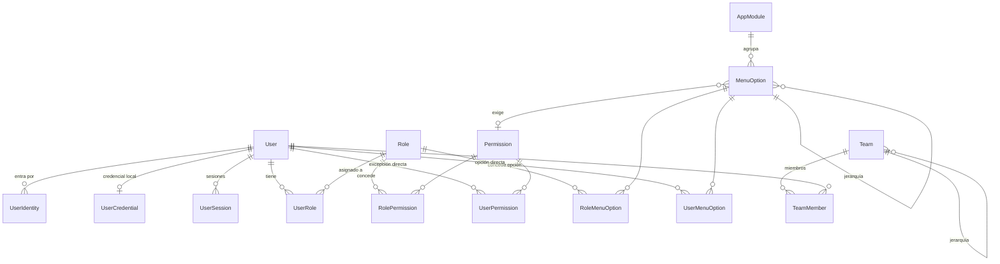

# Modelo de datos — núcleo de gestión y CRM comercial

Esquema con el que arranca cualquier proyecto derivado de la plantilla. Las
decisiones de fondo están en [ADR-018](../adr/ADR-018-identity-access-model.md)
(identidad y acceso), [ADR-003](../adr/ADR-003-postgresql-prisma.md)
(PostgreSQL + Prisma) y [ADR-004](../adr/ADR-004-data-access-abstraction.md)
(el dominio no depende de Prisma).

Fuente de verdad: `backend/prisma/schema.prisma`. Este documento explica el
porqué; el esquema manda sobre los detalles.

Dónde vive esta base en cada entorno, con qué usuario y con qué permisos:
[`docs/deployment/environments.md`](../deployment/environments.md).

---

## 1. Mapa general



---

## 2. Identidad

| Tabla | Para qué |
|---|---|
| `users` | La cuenta. **No guarda contraseñas** |
| `user_identities` | Vínculo con un proveedor (`LOCAL`, `ENTRA_ID`) por `subject` |
| `user_credentials` | Hash Argon2id, caducidad, intentos fallidos, bloqueo |
| `user_sessions` | Refresh token **hasheado**, con cadena de rotación |
| `login_attempts` | Intentos correctos y fallidos: fuerza bruta e incidentes |
| `password_reset_tokens` | Restablecimiento de un solo uso, también hasheado |

Decisiones que conviene no deshacer sin pensarlo:

- **Identidad separada de credencial.** La misma persona puede entrar hoy por
  credencial local y mañana por Entra ID sin duplicar cuenta ni perder
  asignaciones.
- **Nunca se guarda un token, sólo su hash.** Una fuga de base de datos no se
  convierte en suplantación de sesión.
- **`login_attempts.user_id` es nulo si el correo no existe.** La API no debe
  permitir averiguar qué cuentas existen.
- **`email_normalized`** guarda el correo en minúsculas con índice único: evita
  que `Ana@x.com` y `ana@x.com` sean dos cuentas.

---

## 3. Autorización

| Tabla | Para qué |
|---|---|
| `permissions` | Catálogo `recurso.accion` (`usuarios.crear`) |
| `roles` | Agrupación de permisos + alcance de datos |
| `role_permissions` | Qué concede cada rol |
| `user_roles` | Roles del usuario, con caducidad opcional |
| `user_permissions` | Excepción directa `GRANT`/`DENY`, con razón obligatoria |

### Resolución del acceso efectivo

```
permisos = (permisos de roles vigentes y activos)
         + (GRANT directos vigentes)
         - (DENY directos vigentes)
```

`DENY` gana siempre, incluso sobre un permiso heredado de un rol. Está
implementado en `AccessService.resolvePermissions`, que es una función pura y
está cubierta por pruebas unitarias sin base de datos.

### Alcance de datos

`Role.dataScope` ∈ `OWN | TEAM | COUNTRY | ORGANIZATION`. Declara **hasta
dónde ve** el usuario; no es un permiso. `/me` expone el alcance más amplio
entre sus roles (orden: `OWN` < `TEAM` < `COUNTRY` < `ORGANIZATION`).

`COUNTRY` se llamaba `TERRITORY` hasta la migración
`20261010100000_crm_data_scope_country` (`ALTER TYPE … RENAME VALUE`, addendum
de 2026-10-10 a ADR-018). Evalúa el país del usuario (`users.country_id`, un
país por usuario, DM-14). El valor forma parte del contrato público
(`dataScope` en `/me`, `/roles`, `/users`).

**Aplicarlo a las consultas es responsabilidad de cada caso de uso.** La
plantilla no puede filtrar entidades que todavía no existen; cuando un proyecto
cree su primera entidad con dueño, el filtro por alcance se implementa en su
repositorio y se prueba.

---

## 4. Módulos y opciones de menú

| Tabla | Para qué |
|---|---|
| `app_modules` | Primer nivel del menú (Inicio, Administración, y los del proyecto) |
| `menu_options` | La opción: clave, etiqueta, icono, ruta, orden, padre, permiso requerido |

> `menu_options.icon` guarda el nombre en snake_case de Material Symbols
> (`manage_accounts`). El frontend lo resuelve con el registro de
> `components/layout/MaterialSymbol.tsx`: un icono nuevo hay que darlo de alta
> ahí además de en la base de datos.
| `role_menu_options` | Opciones que concede un rol |
| `user_menu_options` | Asignación directa a una persona (`GRANT`/`DENY`) |

Reglas de visibilidad, en orden:

1. La opción debe estar activa y su módulo también.
2. Debe estar concedida (por rol o directamente) **o** ser `isPublic`.
3. Si declara `requiredPermission`, el usuario debe tenerlo.
4. Un nodo `GROUP` que se queda sin hijos visibles no se muestra.

Todo esto ocurre en el servidor (`GET /me/menu`). El frontend pinta lo que
recibe: por eso el menú no puede mostrar algo que el backend luego rechace.

**Para añadir una opción al menú no se toca el frontend:** se da de alta la
`MenuOption`, se asigna a un rol o a una persona, y se crea la ruta que
coincida con su `path`.

---

## 5. Organización

`teams` es jerárquico (`parent_id`) y tiene responsable (`manager_id`).
`team_members` permite pertenecer a varios equipos, con uno marcado como
principal para usarlo por defecto al crear registros.

El alcance `TEAM` debe incluir a los equipos descendientes: al implementarlo,
recorrer la jerarquía, no sólo el equipo directo.

---

## 6. Soporte transversal

| Tabla | Para qué | Nota |
|---|---|---|
| `system_parameters` | Configuración editable en caliente | **Nunca secretos**; van al almacén de secretos |
| `user_preferences` | Preferencias que siguen al usuario entre dispositivos | Desde Ajustes 1 guarda `ui.tema` y `ui.inicio.tarjetas` (§11.2); `localStorage` es solo la caché del navegador para el acceso y el arranque |
| `safety_minutes` | Mensaje institucional por fecha de visualización (Ajustes 1) | Ver §11.1 |
| `catalogs` / `catalog_items` | Listas cortas y estables (motivos, tipos) | Si necesita columnas propias, deja de ser catálogo |
| `sequences` | Folios (`COT-2026-00042`) | Asignar **en transacción con bloqueo de fila**, nunca con `MAX(n)+1` |
| `stored_files` | Metadatos de adjuntos | El binario vive en el almacenamiento de objetos |
| `notifications` | Avisos al usuario | |
| `approval_requests` / `approval_steps` | Aprobaciones genéricas en cadena | Guarda instantánea (`payload`) para que el historial no dependa del estado actual |
| `audit_logs` | Bitácora de seguridad y cambios | |

### Auditoría

`audit_logs.subject_id` es texto, no clave foránea: el registro debe sobrevivir
al borrado del usuario. `changes` guarda la diferencia
(`{campo: {antes, despues}}`), no una copia del registro, y **nunca** datos
sensibles ni contraseñas.

La retención está en `system_parameters` (`auditoria.dias_retencion`, 365 días
por defecto) y debe cuadrar con la política del proyecto
(`docs/security/retention.md`).

**Solo inserción, también en la base** ([ADR-025](../adr/ADR-025-inmutabilidad-de-la-auditoria-con-disparadores.md),
migración `20261014100000_audit_logs_append_only`). La función
`audit_logs_append_only()` y tres disparadores, en SQL escrito a mano (Prisma no
gestiona disparadores ni los ve como deriva):

| Disparador | Momento | Efecto |
|---|---|---|
| `trg_audit_logs_no_update` | `BEFORE UPDATE`, por fila | Siempre rechaza |
| `trg_audit_logs_no_truncate` | `BEFORE TRUNCATE`, por sentencia | Siempre rechaza |
| `trg_audit_logs_delete_after_retention` | `BEFORE DELETE`, por fila | Rechaza las filas con `occurred_at` dentro de la retención; permite purgar las vencidas |

- El rechazo usa el SQLSTATE propio `AU001` y un mensaje que no revela datos de
  la fila.
- La retención se lee en cada `DELETE` de `system_parameters` del **mismo
  esquema** que la tabla (`TG_TABLE_SCHEMA`, no el `search_path`). Si falta, no
  es un entero o es menor que 30, se usa 365: nunca queda más permisivo.
- Un propietario de la tabla o un superusuario puede desactivar los
  disparadores: protegen contra la aplicación y los errores, no contra un
  administrador de base. Reparto de roles recomendado en
  [`docs/deployment/environments.md`](../deployment/environments.md).
- Rollback: `backend/prisma/rollbacks/20261014100000_audit_logs_append_only.down.sql`
  (retira disparadores y función; no toca datos). Probado en
  `backend/test/audit-immutability.e2e.spec.ts` y `crm-rollbacks.e2e.spec.ts`.

**Filtro por campo** (`GET /audit-logs?field=`, Módulo 7): `changes ? 'campo'`
sobre los índices existentes, combinado con fecha y tipo. Sin índice nuevo: un
índice GIN sobre `changes` queda como **mejora medida**, solo si el volumen lo
exige, y sería una migración aditiva en SQL (Prisma no lo expresa; mismo riesgo
de deriva que PLAN-ADMIN §10).

---

## 7. Convenciones del esquema

- Tablas en `snake_case` plural; columnas en `snake_case`.
- Claves primarias UUID.
- **Instantes** `timestamptz(6)`; **fechas de calendario** sin hora (fecha de
  oportunidad, inicio/fin estimados, fecha de decisión, siguiente acción,
  vigencia de un tipo de cambio) `date` (`@db.Date`, DM-31): un `timestamptz`
  las desplazaría de día según la zona horaria.
- Dinero `NUMERIC(19,4)` con su moneda; porcentajes `NUMERIC(5,2)` con CHECK
  0–100; cantidades y tonelajes `NUMERIC(19,4)`; factores de conversión y tipos
  de cambio `NUMERIC(19,8)`.
- Borrado lógico (`deleted_at`) en lo que necesita historial: usuarios, roles,
  equipos, opciones, archivos. Lo demás se borra de verdad.
- Trazabilidad con `created_at`, `updated_at`, `created_by_id`, `updated_by_id`.
- Índices nombrados explícitamente (`idx_tabla_columnas`, únicos `uq_tabla_columnas`).
- `CHECK` nombrados `ck_tabla_regla`, escritos a mano en la migración (Prisma
  no los expresa ni los detecta como deriva).
- **Sin índices únicos parciales** (`WHERE deleted_at IS NULL`): `migrate dev`
  los borraría como deriva. Se usan diseños estructurales (FK compuestas,
  columna `scope_key`).

---

## 8. Semilla

`backend/prisma/seed.ts` con el catálogo declarativo en
`prisma/seed/access-catalog.ts`. Es idempotente: se puede ejecutar cuantas veces
haga falta.

Crea 2 módulos, 30 permisos, 9 opciones de menú, 4 roles
(`administrador`, `gestor-accesos`, `auditor`, `usuario`), 6 parámetros del
sistema y el usuario administrador inicial.

Dos comportamientos a tener presentes:

- **Los valores de los parámetros no se pisan** al re-ejecutar: pueden haber
  sido ajustados por un administrador.
- **Las asignaciones de los roles de sistema sí se reponen enteras.** Si alguien
  le quitó un permiso al administrador, el seed lo devuelve. Un proyecto que
  necesite un administrador distinto crea su propio rol.

El administrador inicial nace en estado `INVITED` y **sin credencial
utilizable**: la plantilla no implementa el login local. Con Entra ID basta con
que exista la cuenta y su `UserIdentity`.

```bash
pnpm --filter @app/backend run prisma:migrate
pnpm --filter @app/backend run prisma:seed
# Correo configurable: SEED_ADMIN_EMAIL=ana@empresa.com pnpm … run prisma:seed
```

---

## 9. Lo que este esquema deliberadamente NO trae

- **Entidades de negocio genéricas.** Las aporta cada proyecto; las de este,
  en la §10 (CRM).
- **Multi-inquilino.** Si el producto lo necesita, es un ADR y afecta a casi
  todas las tablas: mejor decidirlo antes de la primera migración que después.
- **Versionado de registros.** `audit_logs` guarda quién cambió qué, no permite
  reconstruir un registro a una fecha.
- **ACL por registro.** El modelo actual no lo impide, pero tampoco lo
  implementa.

---

## 10. CRM comercial (Fase 0)

Contrato completo, con cada decisión y su porqué:
[`00-modelo-de-datos.md`](../implementation-plans/crm/00-modelo-de-datos.md)
(DM-1…DM-36 resueltas el 2026-10-10; ADR-021, ADR-024 y addendum de ADR-018).
Esta sección resume lo que hay en la base y cómo se protege. Los repositorios,
seeds y servicios del CRM llegan después; la Fase 0 solo crea el esquema.

### 10.1 Tablas

| Bloque | Tablas | Notas |
|---|---|---|
| Monedas y países | `currencies`, `exchange_rates`, `countries` | Moneda base USD (ADR-024). `currencies` usa el código ISO 4217 como PK. Una tasa por moneda y fecha de vigencia; el USD no tiene tasa |
| Usuarios (extensión) | `users.employee_code` (único), `users.country_id` | Ambos nulos en la base (DM-30). Defaults de usuarios **nuevos**: `es-GT` / `America/Guatemala` (DM-2). Desde el Módulo 7: el código se guarda recortado y en mayúsculas; el país solo lo fija un administrador; con un rol comercial ambos son obligatorios en la aplicación (`CRM_PROFILE_INCOMPLETE`), no en la base |
| Productos | `units_of_measure`, `product_families`, `products`, `unit_conversion_rules` | Regla única por (origen, destino, `scope_key`); `scope_key` = `GLOBAL` o el UUID del ámbito |
| Clientes | `customers`, `contacts` | Código de cliente único por país; **NIT sin único** (DM-4: establecimientos que comparten NIT) |
| Proyectos | `projects`, `project_phase_history`, `opportunities`, `opportunity_stage_history`, `opportunity_results`, `opportunity_result_history`, `project_products`, `forecast_lines` | Resultado 0..1 por oportunidad; forecast único por proyecto, producto, año y mes |
| Actividad comercial | `visits`, `visit_events`, `activities`, `interaction_participants` | Una visita es una fila toda su vida (sin `deleted_at`); `visit_events` es su historial |
| Soporte | `attachments`, `customer_imports`, `customer_import_rows`, `sales_targets` | `attachments` enlaza un `stored_files` con exactamente un dueño; `sales_targets` nace vacía (DM-9) |
| Vista | `crm_interactions_v` | `UNION ALL` de visitas y actividades no eliminadas, una fila por origen. Se lee con `$queryRaw` parametrizado |

Las FK hacia entidades comerciales son `Restrict` (nada comercial se borra
físicamente; borrado lógico con `deleted_at`). `created_by_id`/`updated_by_id`
son UUID sin FK, como en el núcleo.

### 10.2 Integridad en la base

- **FK compuestas "pertenece a"**: proyecto del cliente (`visits`, `activities`),
  oportunidad del proyecto (`project_products`, `activities`), contacto del
  cliente (`interaction_participants`, contacto principal), regla que convierte
  desde la unidad de la línea (`projects`, `project_products`, `forecast_lines`).
  Destinos: los únicos `uq_<tabla>_id_<columna>`.
- **Contacto principal** = `customers.primary_contact_id` con la FK compuesta
  circular `(primary_contact_id, id) → contacts(id, customer_id)`: como máximo
  uno (es una columna) y siempre de ese cliente. "Activo" lo garantiza el caso de uso.
- **Cambiar el cliente de un proyecto** con visitas, actividades o participantes
  falla por `ON UPDATE RESTRICT` de esas FK.
- **56 CHECK** `ck_<tabla>_<regla>` (lista completa en las migraciones
  `20261010100100…100600` y en 00 §2): rangos (porcentajes 0–100, mes 1–12,
  cantidades ≥ 0), coherencia (código ⇔ normalizado, tonelaje ⇔ regla, LOST ⇒
  motivo, PARTIAL ⇒ porcentaje, confirmar ⇒ realización previa y ser el dueño),
  "exactamente uno" (`num_nonnulls`: dueño de un adjunto, padre y sujeto de un
  participante, sujeto de una meta) y la estimación en moneda (monto, moneda,
  tasa y USD juntos; en USD tasa 1 y equivalente = monto).
- Lo que la base **no** puede comprobar y queda en los casos de uso: a qué
  catálogo pertenece un `*_id` hacia `catalog_items` (`CatalogReferenceValidator`,
  00 §3.5), que la regla aplicada convierta a la unidad de tonelaje configurada,
  las transiciones de etapa y la unicidad endurecida por parámetro.

Todo ello está probado contra PostgreSQL en `backend/test/crm-schema.e2e.spec.ts`.

### 10.3 Migraciones y reversibilidad

| Migración | Contenido |
|---|---|
| `20261010100000_crm_data_scope_country` | `RENAME VALUE 'TERRITORY' TO 'COUNTRY'` (única no aditiva; sin pérdida) |
| `20261010100100_crm_countries_users` | Monedas, tasas, países; columnas y defaults de `users` |
| `20261010100200_crm_products_units` | Unidades, familias, productos, reglas de conversión |
| `20261010100300_crm_customers_contacts` | Clientes, contactos y FK circular del contacto principal |
| `20261010100400_crm_projects_opportunities` | Proyectos, oportunidades, resultados, productos asociados, forecast |
| `20261010100500_crm_commercial_activity` | Visitas, eventos, actividades, participantes |
| `20261010100600_crm_attachments_imports_targets` | Adjuntos, importaciones, metas; FK `customers.source_import_id` |
| `20261010100700_crm_interactions_view` | Vista `crm_interactions_v` |
| `20261014100000_audit_logs_append_only` | Paso 9 de 00 §9, entregado por el Módulo 7: función y disparadores de `audit_logs` (ADR-025, ver §6) |
| `20261015100000_safety_minutes` | Ajustes 1: tabla `safety_minutes`, índice único por fecha y `CHECK` del mensaje (ver §11.1) |

El SQL de tablas, índices y FK lo generó `prisma migrate diff`; los CHECK, la
vista, el `RENAME VALUE` y los disparadores se escribieron a mano. Prisma no genera *down*: cada
migración tiene su inverso en `backend/prisma/rollbacks/<migración>.down.sql`.

**Procedimiento de rollback** (desde `backend/`, con `DATABASE_URL` apuntando a
la base y esquema que se revierten; respaldo previo obligatorio si hay datos
reales, ver aviso abajo). Para revertir hasta la migración N, por cada
migración de la **más reciente a la N, en orden inverso** (vista primero,
`RENAME VALUE` al final):

```bash
# 1. Aplicar el script inverso
pnpm exec prisma db execute --file prisma/rollbacks/<migración>.down.sql --schema prisma/schema.prisma
# 2. Retirar la migración del historial de Prisma
pnpm exec prisma db execute --stdin --schema prisma/schema.prisma <<'SQL'
DELETE FROM "_prisma_migrations" WHERE migration_name = '<migración>';
SQL
```

Después se despliega el código anterior (DTOs y frontend incluidos: el enum
`data_scope` es parte del contrato). Un `prisma migrate deploy` posterior vuelve
a aplicar lo retirado.

> `prisma migrate resolve --rolled-back <migración>` **no sirve** aquí: solo
> acepta migraciones en estado *fallido* y, con una aplicada, responde `P3012`
> (comprobado con Prisma 6.19). Por eso el paso 2 borra la fila del historial.

Verificado por `backend/test/crm-rollbacks.e2e.spec.ts`: en un esquema propio
aplica todas las del CRM (las ocho de la Fase 0 y las posteriores), ejecuta sus
`.down.sql` en orden inverso con `prisma db execute`, retira sus filas y
comprueba que no queda ninguna tabla ni la vista del CRM, que `data_scope`
vuelve a `TERRITORY`, que `users` pierde `employee_code` y `country_id` y que
`audit_logs` pierde sus disparadores y la función; después `migrate deploy` las
aplica de nuevo. Toda migración nueva desde la primera del CRM necesita su
`.down.sql` (la prueba lo exige).

> **Revertir los pasos 2–8 borra datos comerciales.** Mientras no haya datos
> del CRM es inocuo; tras el primer uso real queda **prohibido sin respaldo
> previo** de la base y de `ATTACHMENTS_STORAGE_PATH`.

Revertir `20261014100000_audit_logs_append_only` no pierde datos: solo retira
la protección de la bitácora en la base.

Revertir `20261015100000_safety_minutes` elimina la tabla y sus mensajes (respaldo previo
si hay que conservarlos) y no limpia permisos, menú ni parámetros sembrados (§11.1).

### 10.4 Datos sensibles

`contacts` (nombre, cargo, teléfono, correo), `customers` (teléfono, correo) y
`customer_import_rows.raw_data` contienen datos personales de terceros:
no se registran en logs, se enmascaran en `audit_logs` (DM-29) y `raw_data` se
purga a los `crm.importaciones.dias_retencion_filas` días (90, DM-28).

---

## 11. Ajustes 1 (minuto de seguridad, preferencias y parámetros de interfaz)

Plan: [`AJUSTES-1.md`](../implementation-plans/AJUSTES-1.md) §5. Una tabla nueva, ninguna tabla
modificada; el resto reutiliza `user_preferences` y `system_parameters`.

### 11.1 `safety_minutes`

Un mensaje institucional por fecha de visualización. Sin datos personales (clasificación:
interno): el mensaje es texto institucional y el rastro de quién lo escribió vive en `audit_logs`.

| Columna | Tipo | Nota |
|---|---|---|
| `id` | `uuid` PK | Lo genera Prisma (`@default(uuid())`), sin valor por defecto en la base |
| `message` | `varchar(1000)` NOT NULL | Texto plano, 1 a 1000 caracteres; las reglas de contenido (sin control ni bidi, al menos un carácter visible) las aplica la API |
| `display_date` | `date` NOT NULL | Fecha de calendario sin hora, en la zona `crm.zona_horaria_negocio` (DM-31) |
| `created_at` | `timestamptz(6)` NOT NULL | Defecto `CURRENT_TIMESTAMP` |
| `updated_at` | `timestamptz(6)` NOT NULL | `@updatedAt` |
| `created_by_id` | `uuid` NULL | **Sin FK**, como `exchange_rates` y el resto de columnas `created_by_id` |
| `updated_by_id` | `uuid` NULL | **Sin FK**; el servicio resuelve el nombre al leer (`updatedBy`) |

- **Índice único** `uq_safety_minutes_display_date` sobre `display_date`: como máximo un mensaje
  por fecha (`409 SAFETY_MINUTE_DUPLICATE` si la carrera llega a la base). Sirve también al filtro
  por rango y al orden por fecha.
- **CHECK** `ck_safety_minutes_message_not_blank`: `btrim(message) <> ''`. Escrito a mano en la
  migración (Prisma no modela `CHECK`); es la última defensa si algo salta la validación de la API.
- **Sin FK en `created_by_id`/`updated_by_id`**: decisión aceptada (ver §16 del plan). El usuario
  puede desactivarse o, en el futuro, anonimizarse sin que la tabla lo impida; `updatedBy` es
  `null` si el usuario ya no existe.
- **Borrado físico** solo de fechas futuras; el estado previo queda en `audit_logs`
  (`safety_minute.deleted`). No hay `deleted_at`.
- **Rollback**: `backend/prisma/rollbacks/20261015100000_safety_minutes.down.sql` hace `DROP TABLE`
  (pierde los mensajes programados: respaldo previo si hay que conservarlos). **No limpia la
  semilla**: tras revertir quedan los permisos `minuto_seguridad.*`, la opción de menú
  `admin-minuto-seguridad` y los parámetros `ui.*`, y la pantalla de mantenimiento respondería
  `500` hasta limpiarlos o reaplicar la migración. Los eventos `safety_minute.*` de `audit_logs`
  no se tocan. Lo verifica `backend/test/crm-rollbacks.e2e.spec.ts`.

### 11.2 `user_preferences`: claves de Ajustes 1

Tabla existente (`user_id`, `key`, `value` JSON, único por `(user_id, key)`, `ON DELETE CASCADE`).
Ajustes 1 es su primer uso. El acceso lo cierra `UserPreferencesService`: el usuario siempre sale
de la sesión.

| Clave | `value` | Quién la escribe |
|---|---|---|
| `ui.tema` | `"light"` o `"dark"` (sin fila = el navegador decide con `prefers-color-scheme`) | `PUT /me/preferences/theme` |
| `ui.inicio.tarjetas` | `{ blocks: [{ key, visible }], kpis: [{ key, visible }] }`, lista completa en orden de pantalla | `PUT`/`DELETE /me/preferences/dashboard-cards` |

Son datos personales de configuración: no se auditan ni se registran en logs. Un valor guardado
ilegible o que quedó desfasado (clave retirada o añadida después) se lee con el lector tolerante
(RN-AJ1.4): se normaliza o se trata como inexistente y deja un aviso sin el valor ni el usuario.

### 11.3 `system_parameters`: grupo `interfaz`

Sembrados por `backend/prisma/seed/access-catalog.ts` (la semilla no pisa un valor editado), todos
con `is_public = false` y sin `parametros.configurar`:

| Clave | Tipo | Defecto |
|---|---|---|
| `ui.inicio.tarjetas` | `JSON` | Composición con todo visible, en el orden de `dashboard-cards.ts` (la composición por defecto de quien no personalizó su panel) |
| `ui.barra_superior.buscar` | `BOOLEAN` | `false` |
| `ui.barra_superior.pantalla_completa` | `BOOLEAN` | `true` |
| `ui.barra_superior.notificaciones` | `BOOLEAN` | `false` |

La misma clave `ui.inicio.tarjetas` nombra el parámetro (global) y la preferencia (por usuario): son
filas de tablas distintas. El usuario nunca lee el parámetro directamente: `GET /me/ui-settings`
devuelve solo la composición efectiva y los tres booleanos de la barra.

### 11.4 Permisos y menú sembrados

Recurso `minuto_seguridad` (módulo `administracion`) con las acciones `ver`, `crear`, `editar` y
`eliminar`, y la opción de menú `admin-minuto-seguridad` (`/administracion/minuto-seguridad`,
requiere `minuto_seguridad.ver`). Ver el mensaje de hoy en Inicio no exige permiso.
