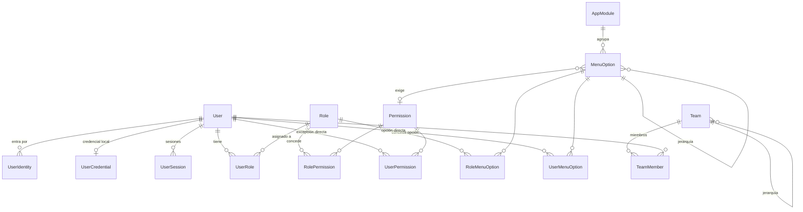

# Modelo de datos — núcleo de gestión

Esquema con el que arranca cualquier proyecto derivado de la plantilla. Las
decisiones de fondo están en [ADR-018](../adr/ADR-018-identity-access-model.md)
(identidad y acceso), [ADR-003](../adr/ADR-003-postgresql-prisma.md)
(PostgreSQL + Prisma) y [ADR-004](../adr/ADR-004-data-access-abstraction.md)
(el dominio no depende de Prisma).

Fuente de verdad: `backend/prisma/schema.prisma`. Este documento explica el
porqué; el esquema manda sobre los detalles.

Dónde vive esta base en cada entorno, con qué usuario y con qué permisos:
[`docs/deployment/environments.md`](../deployment/environments.md).

---

## 1. Mapa general



---

## 2. Identidad

| Tabla | Para qué |
|---|---|
| `users` | La cuenta. **No guarda contraseñas** |
| `user_identities` | Vínculo con un proveedor (`LOCAL`, `ENTRA_ID`) por `subject` |
| `user_credentials` | Hash Argon2id, caducidad, intentos fallidos, bloqueo |
| `user_sessions` | Refresh token **hasheado**, con cadena de rotación |
| `login_attempts` | Intentos correctos y fallidos: fuerza bruta e incidentes |
| `password_reset_tokens` | Restablecimiento de un solo uso, también hasheado |

Decisiones que conviene no deshacer sin pensarlo:

- **Identidad separada de credencial.** La misma persona puede entrar hoy por
  credencial local y mañana por Entra ID sin duplicar cuenta ni perder
  asignaciones.
- **Nunca se guarda un token, sólo su hash.** Una fuga de base de datos no se
  convierte en suplantación de sesión.
- **`login_attempts.user_id` es nulo si el correo no existe.** La API no debe
  permitir averiguar qué cuentas existen.
- **`email_normalized`** guarda el correo en minúsculas con índice único: evita
  que `Ana@x.com` y `ana@x.com` sean dos cuentas.

---

## 3. Autorización

| Tabla | Para qué |
|---|---|
| `permissions` | Catálogo `recurso.accion` (`usuarios.crear`) |
| `roles` | Agrupación de permisos + alcance de datos |
| `role_permissions` | Qué concede cada rol |
| `user_roles` | Roles del usuario, con caducidad opcional |
| `user_permissions` | Excepción directa `GRANT`/`DENY`, con razón obligatoria |

### Resolución del acceso efectivo

```
permisos = (permisos de roles vigentes y activos)
         + (GRANT directos vigentes)
         - (DENY directos vigentes)
```

`DENY` gana siempre, incluso sobre un permiso heredado de un rol. Está
implementado en `AccessService.resolvePermissions`, que es una función pura y
está cubierta por pruebas unitarias sin base de datos.

### Alcance de datos

`Role.dataScope` ∈ `OWN | TEAM | TERRITORY | ORGANIZATION`. Declara **hasta
dónde ve** el usuario; no es un permiso. `/me` expone el alcance más amplio
entre sus roles.

**Aplicarlo a las consultas es responsabilidad de cada caso de uso.** La
plantilla no puede filtrar entidades que todavía no existen; cuando un proyecto
cree su primera entidad con dueño, el filtro por alcance se implementa en su
repositorio y se prueba.

---

## 4. Módulos y opciones de menú

| Tabla | Para qué |
|---|---|
| `app_modules` | Primer nivel del menú (Inicio, Administración, y los del proyecto) |
| `menu_options` | La opción: clave, etiqueta, icono, ruta, orden, padre, permiso requerido |

> `menu_options.icon` guarda el nombre en snake_case de Material Symbols
> (`manage_accounts`). El frontend lo resuelve con el registro de
> `components/layout/MaterialSymbol.tsx`: un icono nuevo hay que darlo de alta
> ahí además de en la base de datos.
| `role_menu_options` | Opciones que concede un rol |
| `user_menu_options` | Asignación directa a una persona (`GRANT`/`DENY`) |

Reglas de visibilidad, en orden:

1. La opción debe estar activa y su módulo también.
2. Debe estar concedida (por rol o directamente) **o** ser `isPublic`.
3. Si declara `requiredPermission`, el usuario debe tenerlo.
4. Un nodo `GROUP` que se queda sin hijos visibles no se muestra.

Todo esto ocurre en el servidor (`GET /me/menu`). El frontend pinta lo que
recibe: por eso el menú no puede mostrar algo que el backend luego rechace.

**Para añadir una opción al menú no se toca el frontend:** se da de alta la
`MenuOption`, se asigna a un rol o a una persona, y se crea la ruta que
coincida con su `path`.

---

## 5. Organización

`teams` es jerárquico (`parent_id`) y tiene responsable (`manager_id`).
`team_members` permite pertenecer a varios equipos, con uno marcado como
principal para usarlo por defecto al crear registros.

El alcance `TEAM` debe incluir a los equipos descendientes: al implementarlo,
recorrer la jerarquía, no sólo el equipo directo.

---

## 6. Soporte transversal

| Tabla | Para qué | Nota |
|---|---|---|
| `system_parameters` | Configuración editable en caliente | **Nunca secretos**; van al almacén de secretos |
| `user_preferences` | Preferencias que siguen al usuario entre dispositivos | El tema del shell vive en `localStorage`; esto es para cuando eso no baste |
| `catalogs` / `catalog_items` | Listas cortas y estables (motivos, tipos) | Si necesita columnas propias, deja de ser catálogo |
| `sequences` | Folios (`COT-2026-00042`) | Asignar **en transacción con bloqueo de fila**, nunca con `MAX(n)+1` |
| `stored_files` | Metadatos de adjuntos | El binario vive en el almacenamiento de objetos |
| `notifications` | Avisos al usuario | |
| `approval_requests` / `approval_steps` | Aprobaciones genéricas en cadena | Guarda instantánea (`payload`) para que el historial no dependa del estado actual |
| `audit_logs` | Bitácora de seguridad y cambios | |

### Auditoría

`audit_logs.subject_id` es texto, no clave foránea: el registro debe sobrevivir
al borrado del usuario. `changes` guarda la diferencia
(`{campo: {antes, despues}}`), no una copia del registro, y **nunca** datos
sensibles ni contraseñas.

La retención está en `system_parameters` (`auditoria.dias_retencion`, 365 días
por defecto) y debe cuadrar con la política del proyecto
(`docs/security/retention.md`).

---

## 7. Convenciones del esquema

- Tablas en `snake_case` plural; columnas en `snake_case`.
- Claves primarias UUID.
- Fechas `timestamptz(6)`; dinero `NUMERIC(19,4)`.
- Borrado lógico (`deleted_at`) en lo que necesita historial: usuarios, roles,
  equipos, opciones, archivos. Lo demás se borra de verdad.
- Trazabilidad con `created_at`, `updated_at`, `created_by_id`, `updated_by_id`.
- Índices nombrados explícitamente (`idx_tabla_columnas`).

---

## 8. Semilla

`backend/prisma/seed.ts` con el catálogo declarativo en
`prisma/seed/access-catalog.ts`. Es idempotente: se puede ejecutar cuantas veces
haga falta.

Crea 2 módulos, 30 permisos, 9 opciones de menú, 4 roles
(`administrador`, `gestor-accesos`, `auditor`, `usuario`), 6 parámetros del
sistema y el usuario administrador inicial.

Dos comportamientos a tener presentes:

- **Los valores de los parámetros no se pisan** al re-ejecutar: pueden haber
  sido ajustados por un administrador.
- **Las asignaciones de los roles de sistema sí se reponen enteras.** Si alguien
  le quitó un permiso al administrador, el seed lo devuelve. Un proyecto que
  necesite un administrador distinto crea su propio rol.

El administrador inicial nace en estado `INVITED` y **sin credencial
utilizable**: la plantilla no implementa el login local. Con Entra ID basta con
que exista la cuenta y su `UserIdentity`.

```bash
pnpm --filter @app/backend run prisma:migrate
pnpm --filter @app/backend run prisma:seed
# Correo configurable: SEED_ADMIN_EMAIL=ana@empresa.com pnpm … run prisma:seed
```

---

## 9. Lo que este esquema deliberadamente NO trae

- **Entidades de negocio.** Las aporta cada proyecto.
- **Multi-inquilino.** Si el producto lo necesita, es un ADR y afecta a casi
  todas las tablas: mejor decidirlo antes de la primera migración que después.
- **Versionado de registros.** `audit_logs` guarda quién cambió qué, no permite
  reconstruir un registro a una fecha.
- **ACL por registro.** El modelo actual no lo impide, pero tampoco lo
  implementa.
