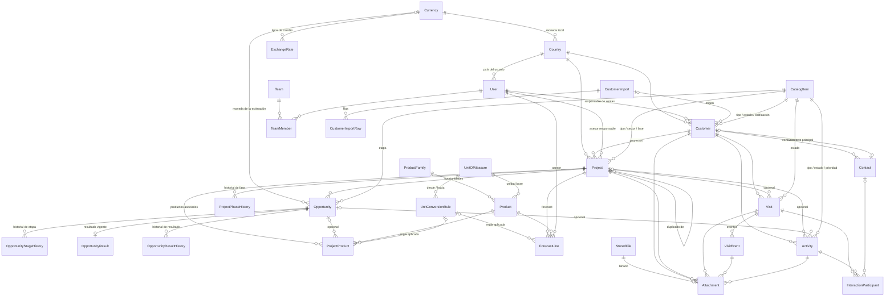

# 00 — Modelo de datos del CRM comercial

- **Fuente del alcance:** [`docs/requirements/crm/ALCANCE-CRM.md`](../../requirements/crm/ALCANCE-CRM.md) (§2, §2.1 y los campos de los 7 módulos)
- **Decisiones que lo enmarcan:** [ADR-003](../../adr/ADR-003-postgresql-prisma.md), [ADR-004](../../adr/ADR-004-data-access-abstraction.md),
  [ADR-008](../../adr/ADR-008-authorization.md), [ADR-018](../../adr/ADR-018-identity-access-model.md),
  [ADR-020](../../adr/ADR-020-asignacion-de-accesos-exclusiva-del-administrador.md),
  [ADR-021](../../adr/ADR-021-almacenamiento-de-adjuntos-en-sistema-de-archivos-montado.md),
  [ADR-024](../../adr/ADR-024-moneda-base-usd-y-tipos-de-cambio.md),
  [ADR-025](../../adr/ADR-025-inmutabilidad-de-la-auditoria-con-disparadores.md)
- **Modelo vigente:** [`backend/prisma/schema.prisma`](../../../backend/prisma/schema.prisma), explicado en [`docs/database/data-model.md`](../../database/data-model.md)
- **Estado:** diseño aprobado. Las decisiones DM-1…DM-36 están **resueltas** (responsable de negocio, 2026-10-10; ver §10 y `decisiones-pendientes.md`). **No se ha tocado `schema.prisma`, ni migraciones, ni seeds, ni código.**
- **Skills aplicados:** `database`, `prisma`, `architecture`, `authorization`, `access-management`, `security`

> Este documento es el **contrato de datos** que siguen las siete especificaciones
> (`01-…` a `07-…`) y la migración de Prisma. Una especificación de módulo puede
> *usar* una entidad de aquí; no puede redefinirla ni crear otra que la duplique.
> Cualquier cambio a este contrato se hace aquí primero.
>
> Las decisiones se numeran **DM-n** (§10) y se consolidan en
> `docs/implementation-plans/crm/decisiones-pendientes.md`. Todas quedaron
> **resueltas el 2026-10-10** por el responsable de negocio: las que respondió
> expresamente (DM-1/DM-35, DM-2, DM-4, DM-8, DM-20 y la nueva DM-36) cambian este
> documento; el resto se aprobó con su valor recomendado.

---

## Índice

1. [Inventario de reutilización](#1-inventario-de-reutilización)
2. [Entidades nuevas](#2-entidades-nuevas)
3. [Catálogos](#3-catálogos)
4. [Seguridad de datos y visibilidad](#4-seguridad-de-datos-y-visibilidad)
5. [Permisos y menú](#5-permisos-y-menú)
6. [Identificadores](#6-identificadores)
7. [Diagrama](#7-diagrama)
8. [Plan de seeds](#8-plan-de-seeds)
9. [Migración](#9-migración)
10. [Decisiones (resueltas el 2026-10-10)](#10-decisiones-resueltas-el-2026-10-10)
11. [Puertos de datos previstos](#11-puertos-de-datos-previstos)
12. [Contradicciones detectadas en el alcance](#12-contradicciones-detectadas-en-el-alcance)

---

## 0. Principios del modelo

| # | Principio | Consecuencia concreta |
|---|---|---|
| P1 | **Ninguna entidad maestra duplicada** (ALCANCE §2) | Usuarios, equipos, roles, permisos, menú, catálogos, parámetros, folios, archivos y auditoría son los de la plantilla. El CRM añade solo lo que no existe |
| P2 | **La integridad vive en la base**, no solo en el código (skill `database`) | FK con `onDelete` explícito, `@@unique`, FK compuestas para "pertenece al mismo cliente/proyecto" y `CHECK` para rangos y coherencia |
| P3 | **Nada comercial se borra físicamente** | Borrado lógico (`deletedAt`) en lo que el alcance permite "eliminar"; cancelación o desactivación en el resto. Por eso las FK hacia entidades comerciales son `Restrict` |
| P4 | **Lo derivado no se almacena** | "Vencida", "abierta/cerrada", "interacciones", "alertas" y "seguimiento" se calculan; no hay tablas ni estados que puedan desincronizarse (salvo `projects.last_activity_at`, justificado en §2.6) |
| P5 | **Los formularios leen datos de la base** (ALCANCE §1 regla 8) | Toda lista seleccionable sale de `catalog_items` o de una tabla maestra. Los `enum` de Prisma se reservan para estados de proceso que nadie elige en un formulario, o para conjuntos cerrados cuyas reglas fija el alcance (ver §3.4) |
| P6 | **Historia funcional ≠ auditoría** | Las tablas `*_history` / `visit_events` son datos de negocio que se muestran y se reportan; `audit_logs` es el rastro de seguridad y se purga por retención (`auditoria.dias_retencion` = 365). Una no sustituye a la otra |
| P7 | **Convenciones del esquema actual** | `@@map` snake_case plural, `@map` snake_case, `String @db.Uuid` con `@default(uuid())`, `@db.Timestamptz(6)`, índices `idx_<tabla>_<cols>`, únicos `uq_<tabla>_<cols>`, `createdById`/`updatedById` como columnas UUID **sin FK** (igual que `User`, `RolePermission`; la trazabilidad completa va en `audit_logs`) |

### Limitaciones de Prisma 6 que condicionan el diseño

| Necesidad | Prisma lo expresa | Cómo se resuelve |
|---|---|---|
| `CHECK` (rangos, coherencia entre columnas) | No | SQL añadido a la migración generada con `--create-only`. Prisma **no** gestiona `CHECK`, así que `migrate dev` no los detecta como deriva ni los borra |
| Índice único parcial (`WHERE deleted_at IS NULL`) | No | **Se evita.** PLAN-ADMIN §10 ya constató que `migrate dev` los borra como deriva. Se usan diseños estructurales (FK compuesta, columna `scope_key`) |
| `NULLS NOT DISTINCT` | No | Igual: columna `scope_key` no nula en lugar de columnas nulas en el único |
| Vistas SQL | Solo con `previewFeatures = ["views"]` | La vista se crea en la migración y se lee con `$queryRaw` parametrizado desde un adaptador de lectura. **No** se activa el preview (sería una dependencia nueva) |
| FK compuesta que comparte columna con otra relación | Sí | Se usa para "el proyecto pertenece al cliente", "la oportunidad pertenece al proyecto", etc. Validar con `prisma validate` en la implementación |

---

## 1. Inventario de reutilización

### 1.1 Modelos existentes

| Modelo (tabla) | Decisión | Detalle |
|---|---|---|
| `User` (`users`) | **Extendido** | Defaults de `locale` y `timeZone` pasan de `es-MX`/`America/Mexico_City` a **`es-GT`/`America/Guatemala`** (DM-2 resuelta, C12; solo afecta a usuarios nuevos: `ALTER COLUMN … SET DEFAULT`, los existentes no se tocan). `employeeCode String? @unique @map("employee_code") @db.VarChar(40)` (código de colaborador, ALCANCE §9.1, único); `countryId String? @map("country_id") @db.Uuid` → `Country`, `onDelete: Restrict`; `@@index([countryId], map: "idx_users_country_id")`. Ambos **nulables en la base** porque el administrador sembrado y los usuarios ya existentes no los tienen; la obligatoriedad para usuarios del CRM la aplica el caso de uso (DM-30). Nombres, apellidos, correo único, teléfono y activo (`status`) ya existen. Back-relations nuevas: dueño de clientes, proyectos, oportunidades, forecast, visitas, actividades y autor de historiales |
| `UserIdentity`, `UserCredential`, `UserSession`, `LoginAttempt`, `PasswordResetToken` | **Tal cual** | Autenticación (ADR-019). El CRM no crea otro sistema de acceso (ALCANCE §9.4) |
| `Team` (`teams`) | **Tal cual** | Equipos comerciales. Jerárquico; el alcance `TEAM` incluye descendientes (data-model §5). Sin columna de país: el alcance no lo exige y el país se evalúa por usuario y por registro (§4). Ver DM-12 |
| `TeamMember` (`team_members`) | **Tal cual** | Pertenencia usuario–equipo. `isPrimary` da el "equipo" que se muestra en Proyectos del equipo (ALCANCE §5.5) |
| `Role` (`roles`) | **Tal cual + filas** | `dataScope` decide la visibilidad. Se siembran `asesor` y `manager` (y `responsable-pais`, DM-11). El enum `DataScope` cambia (§4.1) |
| `Permission`, `RolePermission`, `UserRole`, `UserPermission` | **Tal cual + filas** | Catálogo `recurso.accion` del CRM en §5. ADR-020 sigue vigente: solo el administrador asigna accesos |
| `AppModule`, `MenuOption`, `RoleMenuOption`, `UserMenuOption` | **Tal cual + filas** | Módulos y opciones del CRM en §5.3. El menú sigue saliendo de `GET /me/menu` (ADR-018) |
| `SystemParameter` (`system_parameters`) | **Tal cual + filas** | Alertas, vencimientos, unicidad, duplicidad, obligatorios, valores por defecto, transiciones, conversión (§8.2). Grupo `crm` |
| `Catalog`, `CatalogItem` (`catalogs`, `catalog_items`) | **Tal cual + filas** | Todas las listas cortas del CRM (§3). Sin columnas nuevas: la semántica va en `code` + `metadata`, validada por un registro de semántica en el backend (§3.3) |
| `Sequence` (`sequences`) | **Tal cual + filas** | Códigos humanos de cliente, proyecto, oportunidad, visita, actividad e importación (§6). Falta el **servicio** que asigna folios con bloqueo de fila: se crea en la Fase 0 (no existe hoy en `backend/src`) |
| `StoredFile` (`stored_files`) | **Tal cual** | Metadatos del binario. Para el CRM `ownerType`/`ownerId` quedan **nulos**: la pertenencia la dice `Attachment` con FK reales (§2.11). Su `deletedAt` se usa. `storageKey` es la **ruta relativa generada** dentro del almacenamiento de archivos montado (DM-8 resuelta, ADR-021; §2.11) |
| `AuditLog` (`audit_logs`) | **Tal cual + disparadores** | Auditoría de todas las mutaciones relevantes (ALCANCE §9.5), con `changes = {campo: {antes, despues}}`. `resourceType` con prefijo `crm.` (`crm.customer`, `crm.project`…). Campo, valor anterior y nuevo ya están en `changes`. Inalterable en la base con disparadores (D-07.11, ADR-025) |
| `Notification` (`notifications`) | **No en Fase 0** | Las alertas del CRM se calculan (P4, DM-26). Queda disponible para recordatorios de visitas si se aprueban (DM-27) |
| `ApprovalRequest`, `ApprovalStep` | **No usado** | Ningún flujo del alcance pide aprobación por registro. La "aprobación para habilitación productiva" de la carga masiva es una decisión de proyecto, no un flujo de datos (DM-28) |
| `UserPreference` | **Opcional** | Puede guardar filtros o vista (calendario/listado) de la agenda. No es parte del contrato |

### 1.2 Enums existentes

| Enum | Decisión |
|---|---|
| `DataScope` | **Modificado**: `TERRITORY` → `COUNTRY` (§4.1, DM-10). Es el único cambio no aditivo |
| `UserStatus`, `IdentityProvider`, `AssignmentEffect`, `MenuOptionKind`, `ApprovalStatus`, `NotificationChannel`, `ParameterType` | Tal cual |

---

## 2. Entidades nuevas

Notación: Prisma tal como irá en `schema.prisma`. Los `CHECK` y FK con acciones
que Prisma no expresa se listan debajo de cada modelo como **SQL de migración**.
Por brevedad, `TS` = `@db.Timestamptz(6)` y el bloque de trazabilidad estándar es:

```prisma
  createdAt   DateTime  @default(now()) @map("created_at") @db.Timestamptz(6)
  updatedAt   DateTime  @updatedAt @map("updated_at") @db.Timestamptz(6)
  createdById String?   @map("created_by_id") @db.Uuid
  updatedById String?   @map("updated_by_id") @db.Uuid
```

> **Fechas de calendario** (fecha estimada de decisión, inicio/fin estimados,
> fecha de oportunidad, fecha de siguiente acción, fecha de decisión) usan
> `DateTime @db.Date`: no tienen hora y un `timestamptz` las desplaza de día
> según la zona horaria. CODING-STANDARDS dice `timestamptz` para *instantes*;
> esto lo aclara para *fechas*. Se documenta en CODING-STANDARDS al implementar (DM-31).
>
> **Porcentajes**: `Decimal @db.Decimal(5, 2)` con `CHECK` 0–100.
> **Cantidades y tonelajes**: `Decimal @db.Decimal(19, 4)`. **Factores de
> conversión** y **tipos de cambio**: `Decimal @db.Decimal(19, 8)`. **Dinero**: `Decimal @db.Decimal(19, 4)` + `currencyCode Char(3)` (FK a `currencies`); todo monto en moneda local lleva además su **equivalente en USD** y el tipo de cambio aplicado (moneda base USD, DM-36, §2.16).

### 2.1 Enums nuevos

```prisma
/// Magnitud física de una unidad. Impide sumar unidades incompatibles (kg + m²).
enum UnitDimension {
  MASS
  LENGTH
  AREA
  VOLUME
  COUNT
  OTHER

  @@map("unit_dimension")
}

/// Ámbito de una regla de conversión. Precedencia al resolver:
/// PRODUCT > PRODUCT_FAMILY > PROJECT_TYPE > GLOBAL.
enum ConversionScope {
  GLOBAL
  PRODUCT_FAMILY
  PRODUCT
  PROJECT_TYPE

  @@map("conversion_scope")
}

/// Resultado comercial. Conjunto cerrado: el alcance (§5.9) le asocia reglas
/// (motivo obligatorio en LOST, porcentaje obligatorio en PARTIAL) que la base
/// hace cumplir con CHECK. Las etiquetas salen del catálogo crm.resultado_oportunidad.
enum OpportunityOutcome {
  WON
  LOST
  PARTIAL

  @@map("opportunity_outcome")
}

enum ResultChangeAction {
  RECORDED
  CHANGED
  CLEARED

  @@map("result_change_action")
}

/// Evento del ciclo de vida de una visita. No es una lista de formulario.
enum VisitEventType {
  PLANNED
  RESCHEDULED
  COMPLETED
  CONFIRMED
  CANCELLED

  @@map("visit_event_type")
}

enum ParticipantRole {
  INVITED
  ATTENDED

  @@map("participant_role")
}

enum ImportFileFormat {
  CSV
  XLSX

  @@map("import_file_format")
}

enum ImportStatus {
  UPLOADED
  VALIDATING
  VALIDATED
  IMPORTING
  COMPLETED
  COMPLETED_WITH_ERRORS
  FAILED
  CANCELLED

  @@map("import_status")
}

enum ImportRowStatus {
  PENDING
  VALID
  INVALID
  DUPLICATE_IN_FILE
  DUPLICATE_EXISTING
  IMPORTED
  REJECTED

  @@map("import_row_status")
}

/// DM-9 resuelta: la tabla se crea vacía; la métrica inicial es TONNAGE mensual por
/// usuario. El resto de valores quedan disponibles sin migración.
enum SalesTargetMetric {
  TONNAGE
  AMOUNT
  WON_OPPORTUNITIES
  VISITS
  ACTIVITIES

  @@map("sales_target_metric")
}
```

### 2.2 País — `Country` (`countries`)

Tabla dedicada, no catálogo: la referencian usuarios, clientes, proyectos y metas
con FK, y tiene columnas propias (reglas de validación del identificador fiscal y del
teléfono, moneda). Países resueltos (DM-2, 2026-10-10): Guatemala, El Salvador, Honduras,
Costa Rica, Venezuela y Ecuador (§8.2).

```prisma
model Country {
  id              String   @id @default(uuid()) @db.Uuid
  /// ISO 3166-1 alfa-2 (GT, SV…). Clave estable para seeds e importaciones.
  isoCode         String   @unique @map("iso_code") @db.Char(2)
  name            String   @db.VarChar(120)
  phonePrefix     String?  @map("phone_prefix") @db.VarChar(6)
  /// Cómo se llama el identificador fiscal en el país (NIT, RTN, RUC…). Etiqueta del formulario.
  taxIdLabel      String   @default("NIT") @map("tax_id_label") @db.VarChar(40)
  /// Expresión regular de validación; null = solo longitud y caracteres permitidos (DM-3).
  taxIdPattern    String?  @map("tax_id_pattern") @db.VarChar(200)
  phonePattern    String?  @map("phone_pattern") @db.VarChar(200)
  /// Moneda local del país (ISO 4217): GTQ, USD, HNL, CRC, VES. FK a currencies (DM-36, §2.16).
  /// Es la moneda alternativa que admite una estimación además de la base USD.
  currencyCode    String   @map("currency_code") @db.Char(3)
  timeZone        String?  @map("time_zone") @db.VarChar(60)
  sortOrder       Int      @default(0) @map("sort_order")
  isActive        Boolean  @default(true) @map("is_active")
  createdAt       DateTime @default(now()) @map("created_at") @db.Timestamptz(6)
  updatedAt       DateTime @updatedAt @map("updated_at") @db.Timestamptz(6)

  currency  Currency   @relation(fields: [currencyCode], references: [code], onDelete: Restrict)
  users     User[]
  customers Customer[]
  projects  Project[]

  @@index([isActive, sortOrder], map: "idx_countries_is_active_sort_order")
  @@map("countries")
}
```

Nunca se borra (las FK son `Restrict`); se desactiva. Un país inactivo no se ofrece en formularios nuevos.

### 2.3 Unidades, familias, productos y conversiones

```prisma
model UnitOfMeasure {
  id        String        @id @default(uuid()) @db.Uuid
  /// Clave estable: TON, KG, LB, QQ, M, M2, M3, UND…
  code      String        @unique @db.VarChar(20)
  name      String        @db.VarChar(80)
  symbol    String        @db.VarChar(12)
  dimension UnitDimension
  sortOrder Int           @default(0) @map("sort_order")
  isActive  Boolean       @default(true) @map("is_active")
  createdAt DateTime      @default(now()) @map("created_at") @db.Timestamptz(6)
  updatedAt DateTime      @updatedAt @map("updated_at") @db.Timestamptz(6)

  @@index([isActive, sortOrder], map: "idx_units_of_measure_is_active_sort_order")
  @@map("units_of_measure")
}

model ProductFamily {
  id          String   @id @default(uuid()) @db.Uuid
  code        String   @unique @db.VarChar(40)
  name        String   @db.VarChar(120)
  description String?  @db.VarChar(400)
  sortOrder   Int      @default(0) @map("sort_order")
  isActive    Boolean  @default(true) @map("is_active")
  // + bloque de trazabilidad estándar

  products Product[]

  @@index([isActive, sortOrder], map: "idx_product_families_is_active_sort_order")
  @@map("product_families")
}

/// Maestro de producto (catálogo local; sin SAP). Separado de las cantidades
/// comerciales, que viven en ProjectProduct y ForecastLine (ALCANCE §5.10).
model Product {
  id          String   @id @default(uuid()) @db.Uuid
  /// Código de material o SKU. Se guarda en mayúsculas y sin espacios extremos.
  sku         String   @unique @db.VarChar(60)
  description String   @db.VarChar(300)
  familyId    String   @map("family_id") @db.Uuid
  baseUnitId  String   @map("base_unit_id") @db.Uuid
  isActive    Boolean  @default(true) @map("is_active")
  // + bloque de trazabilidad estándar

  family   ProductFamily @relation(fields: [familyId], references: [id], onDelete: Restrict)
  baseUnit UnitOfMeasure @relation(fields: [baseUnitId], references: [id], onDelete: Restrict)

  @@index([familyId], map: "idx_products_family_id")
  @@index([isActive], map: "idx_products_is_active")
  @@map("products")
}

/// Regla de conversión de una unidad a otra (en la práctica, a toneladas).
/// Única por (origen, destino, ámbito). El factor se copia en cada línea que
/// la usa (conversionFactor), de modo que cambiar un factor no reescribe la historia.
model UnitConversionRule {
  id              String          @id @default(uuid()) @db.Uuid
  fromUnitId      String          @map("from_unit_id") @db.Uuid
  toUnitId        String          @map("to_unit_id") @db.Uuid
  /// cantidad_destino = cantidad_origen × factor
  factor          Decimal         @db.Decimal(19, 8)
  scope           ConversionScope @default(GLOBAL)
  productId       String?         @map("product_id") @db.Uuid
  productFamilyId String?         @map("product_family_id") @db.Uuid
  /// Elemento del catálogo crm.tipo_proyecto.
  projectTypeId   String?         @map("project_type_id") @db.Uuid
  /// 'GLOBAL' o el UUID del producto/familia/tipo. Hace posible el único sin
  /// NULLS NOT DISTINCT; un CHECK garantiza que coincide con la columna de ámbito.
  scopeKey        String          @map("scope_key") @db.VarChar(40)
  description     String?         @db.VarChar(300)
  isActive        Boolean         @default(true) @map("is_active")
  // + bloque de trazabilidad estándar

  fromUnit      UnitOfMeasure  @relation("ConversionFrom", fields: [fromUnitId], references: [id], onDelete: Restrict)
  toUnit        UnitOfMeasure  @relation("ConversionTo", fields: [toUnitId], references: [id], onDelete: Restrict)
  product       Product?       @relation(fields: [productId], references: [id], onDelete: Restrict)
  productFamily ProductFamily? @relation(fields: [productFamilyId], references: [id], onDelete: Restrict)
  projectType   CatalogItem?   @relation("ConversionProjectType", fields: [projectTypeId], references: [id], onDelete: Restrict)

  @@unique([fromUnitId, toUnitId, scopeKey], map: "uq_unit_conversion_rules_from_to_scope")
  /// Destino de las FK compuestas (regla, unidad): garantiza que la regla aplicada
  /// convierte DESDE la unidad de la línea.
  @@unique([id, fromUnitId], map: "uq_unit_conversion_rules_id_from_unit")
  @@index([productId], map: "idx_unit_conversion_rules_product_id")
  @@index([productFamilyId], map: "idx_unit_conversion_rules_product_family_id")
  @@index([projectTypeId], map: "idx_unit_conversion_rules_project_type_id")
  @@map("unit_conversion_rules")
}
```

SQL de migración:

```sql
ALTER TABLE unit_conversion_rules
  ADD CONSTRAINT ck_unit_conversion_rules_factor_positive CHECK (factor > 0),
  -- La identidad TON→TON (factor 1) existe para que "tonelaje no nulo ⇔ regla no nula" valga también en toneladas.
  ADD CONSTRAINT ck_unit_conversion_rules_identity CHECK (from_unit_id <> to_unit_id OR factor = 1),
  ADD CONSTRAINT ck_unit_conversion_rules_scope CHECK (
       (scope = 'GLOBAL'         AND product_id IS NULL AND product_family_id IS NULL AND project_type_id IS NULL AND scope_key = 'GLOBAL')
    OR (scope = 'PRODUCT'        AND product_id IS NOT NULL AND product_family_id IS NULL AND project_type_id IS NULL AND scope_key = product_id::text)
    OR (scope = 'PRODUCT_FAMILY' AND product_family_id IS NOT NULL AND product_id IS NULL AND project_type_id IS NULL AND scope_key = product_family_id::text)
    OR (scope = 'PROJECT_TYPE'   AND project_type_id IS NOT NULL AND product_id IS NULL AND product_family_id IS NULL AND scope_key = project_type_id::text)
  );
```

**Cómo se hace cumplir "no sumar unidades incompatibles" (ALCANCE §5.11, §7.3):**

1. Toda línea con cantidad (`ProjectProduct`, `ForecastLine`, la estimación del `Project`) guarda su `unitId`.
2. El tonelaje solo existe si hay una regla aplicada: `CHECK ((tonnage IS NULL) = (conversion_rule_id IS NULL))`.
3. La FK compuesta `(conversion_rule_id, unit_id) → unit_conversion_rules(id, from_unit_id)` impide aplicar una regla que convierte desde otra unidad.
4. La regla aplicada debe convertir a la unidad de tonelaje configurada (`crm.forecast.unidad_tonelaje` = `TON`): validación del caso de uso, porque el destino es un parámetro.
5. Los totales y acumulados suman **solo `tonnage`** (una sola magnitud). Las cantidades se totalizan **agrupadas por `unit_id`**, nunca mezcladas. Las líneas sin regla se muestran como "sin conversión" y no entran en el total de toneladas.

### 2.4 Cliente — `Customer` (`customers`)

```prisma
model Customer {
  id                     String    @id @default(uuid()) @db.Uuid
  /// Identificador interno CRM, generado con Sequence 'crm.cliente' (CLI-000123). Inmutable.
  crmCode                String    @unique @map("crm_code") @db.VarChar(30)
  /// Código de cliente (introducido por el usuario o la importación). Ver DM-18.
  customerCode           String?   @map("customer_code") @db.VarChar(40)
  /// Mayúsculas, sin espacios ni guiones. Base de la unicidad.
  customerCodeNormalized String?   @map("customer_code_normalized") @db.VarChar(40)
  legalName              String    @map("legal_name") @db.VarChar(200)
  /// Minúsculas, sin acentos, espacios colapsados. Base de la detección de duplicados.
  legalNameNormalized    String    @map("legal_name_normalized") @db.VarChar(200)
  tradeName              String?   @map("trade_name") @db.VarChar(200)
  /// NIT (o el identificador fiscal del país: Country.taxIdLabel). NO es único: varios
  /// establecimientos (sucursales) del mismo cliente comparten NIT (DM-4 resuelta).
  taxId                  String?   @map("tax_id") @db.VarChar(30)
  taxIdNormalized        String?   @map("tax_id_normalized") @db.VarChar(30)
  countryId              String    @map("country_id") @db.Uuid
  /// Texto libre (DM-19).
  city                   String?   @db.VarChar(120)
  address                String?   @db.VarChar(300)
  phone                  String?   @db.VarChar(40)
  email                  String?   @db.VarChar(320)
  /// crm.tipo_empresa
  companyTypeId          String?   @map("company_type_id") @db.Uuid
  /// crm.estado_cliente
  statusId               String    @map("status_id") @db.Uuid
  /// crm.calificacion_cliente
  ratingId               String?   @map("rating_id") @db.Uuid
  /// Responsable de ventas. Dueño del registro para el alcance OWN.
  salesOwnerId           String    @map("sales_owner_id") @db.Uuid
  /// Contacto principal. FK compuesta: solo puede ser un contacto de ESTE cliente.
  primaryContactId       String?   @map("primary_contact_id") @db.Uuid
  /// Importación que lo creó, si vino de la carga masiva.
  sourceImportId         String?   @map("source_import_id") @db.Uuid
  deletedAt              DateTime? @map("deleted_at") @db.Timestamptz(6)
  // + bloque de trazabilidad estándar

  country        Country         @relation(fields: [countryId], references: [id], onDelete: Restrict)
  companyType    CatalogItem?    @relation("CustomerCompanyType", fields: [companyTypeId], references: [id], onDelete: Restrict)
  status         CatalogItem     @relation("CustomerStatus", fields: [statusId], references: [id], onDelete: Restrict)
  rating         CatalogItem?    @relation("CustomerRating", fields: [ratingId], references: [id], onDelete: Restrict)
  salesOwner     User            @relation("CustomerSalesOwner", fields: [salesOwnerId], references: [id], onDelete: Restrict)
  primaryContact Contact?        @relation("CustomerPrimaryContact", fields: [primaryContactId, id], references: [id, customerId], onDelete: NoAction, onUpdate: NoAction)
  sourceImport   CustomerImport? @relation(fields: [sourceImportId], references: [id], onDelete: SetNull)
  contacts       Contact[]       @relation("CustomerContacts")
  projects       Project[]
  visits         Visit[]
  activities     Activity[]
  attachments    Attachment[]

  @@unique([countryId, customerCodeNormalized], map: "uq_customers_country_customer_code")
  /// Búsqueda de NIT repetido (aviso de duplicado blando, §6.2). Índice, no único (DM-4).
  @@index([countryId, taxIdNormalized], map: "idx_customers_country_id_tax_id")
  @@index([salesOwnerId], map: "idx_customers_sales_owner_id")
  @@index([statusId], map: "idx_customers_status_id")
  @@index([countryId, city], map: "idx_customers_country_id_city")
  @@index([legalNameNormalized], map: "idx_customers_legal_name_normalized")
  @@index([deletedAt], map: "idx_customers_deleted_at")
  @@map("customers")
}
```

SQL de migración:

```sql
ALTER TABLE customers
  ADD CONSTRAINT ck_customers_customer_code_normalized CHECK ((customer_code IS NULL) = (customer_code_normalized IS NULL)),
  ADD CONSTRAINT ck_customers_tax_id_normalized       CHECK ((tax_id IS NULL) = (tax_id_normalized IS NULL));
```

Notas:

- **Borrado:** `deletedAt` = eliminación lógica (permiso `clientes.eliminar`), que oculta el registro y conserva todo lo asociado (ALCANCE §4.3). "Desactivar" = cambiar `statusId` a un estado con `metadata.isActive = false`; el cliente sigue visible. Un cliente eliminado **sigue ocupando** su código: se reactiva, no se recrea. Su NIT sigue contando para el aviso de NIT repetido.
- **Establecimientos (DM-4 resuelta, 2026-10-10):** "puede ser el mismo cliente pero con dos establecimientos". Cada establecimiento es una fila de `customers` con su propio código de cliente (único por país, el que lo identifica) y puede compartir NIT con otras. No se modela una entidad "grupo de empresa": el NIT compartido es el vínculo y la búsqueda por NIT los muestra juntos.
- **Unicidad base en la base, endurecible por parámetro:** ver §6.2.
- **`primaryContactId`**: ver §2.5.

### 2.5 Contacto — `Contact` (`contacts`)

```prisma
model Contact {
  id              String    @id @default(uuid()) @db.Uuid
  customerId      String    @map("customer_id") @db.Uuid
  firstName       String    @map("first_name") @db.VarChar(80)
  lastName        String    @map("last_name") @db.VarChar(80)
  jobTitle        String?   @map("job_title") @db.VarChar(120)
  phone           String?   @db.VarChar(40)
  email           String?   @db.VarChar(320)
  emailNormalized String?   @map("email_normalized") @db.VarChar(320)
  /// Estado: activo / inactivo. Dos valores sin semántica adicional → booleano.
  isActive        Boolean   @default(true) @map("is_active")
  comments        String?   @db.VarChar(1000)
  deletedAt       DateTime? @map("deleted_at") @db.Timestamptz(6)
  // + bloque de trazabilidad estándar

  customer          Customer                 @relation("CustomerContacts", fields: [customerId], references: [id], onDelete: Restrict)
  primaryOf         Customer[]               @relation("CustomerPrimaryContact")
  participations    InteractionParticipant[]

  /// Destino de las FK compuestas "contacto de este cliente".
  @@unique([id, customerId], map: "uq_contacts_id_customer")
  /// Duplicado por correo dentro del cliente (DM-5).
  @@unique([customerId, emailNormalized], map: "uq_contacts_customer_email")
  @@index([customerId, isActive], map: "idx_contacts_customer_id_is_active")
  @@map("contacts")
}
```

**"Como máximo un contacto principal activo por cliente" (ALCANCE §4.5) — cómo se garantiza:**

- **"Como máximo uno"** es **estructural**: el principal no es un booleano en `contacts` sino `customers.primary_contact_id`. Una columna solo guarda un valor, así que no puede haber dos principales. No hace falta un índice único parcial (que Prisma borraría como deriva, PLAN-ADMIN §10).
- **"De este cliente"** lo garantiza la FK compuesta `(primary_contact_id, id) → contacts(id, customer_id)`: apuntar al contacto de otro cliente viola la FK. Con `primary_contact_id` nulo la FK no se evalúa (`MATCH SIMPLE`). `onDelete/onUpdate: NoAction` porque `SET NULL` anularía también `customers.id`; los contactos no se borran físicamente.
- **"Activo"** lo garantiza el caso de uso en la misma transacción: desactivar o eliminar el contacto principal limpia `primary_contact_id`; marcar como principal un contacto inactivo devuelve `422`. Prueba de integración obligatoria.
- **Contactos protegidos** (ALCANCE §4.5): un contacto referenciado por `interaction_participants` no se elimina, solo se desactiva (FK `Restrict` + regla del caso de uso).

### 2.6 Proyecto — `Project` (`projects`) y `ProjectPhaseHistory`

```prisma
model Project {
  id                    String    @id @default(uuid()) @db.Uuid
  /// Código de proyecto. Por defecto lo genera Sequence 'crm.proyecto' (DM-17).
  code                  String    @unique @db.VarChar(30)
  name                  String    @db.VarChar(200)
  customerId            String    @map("customer_id") @db.Uuid
  countryId             String    @map("country_id") @db.Uuid
  /// Ciudad o ubicación.
  city                  String?   @db.VarChar(120)
  address               String?   @db.VarChar(300)
  description           String?   @db.Text
  estimatedStartDate    DateTime? @map("estimated_start_date") @db.Date
  estimatedEndDate      DateTime? @map("estimated_end_date") @db.Date
  estimatedDecisionDate DateTime? @map("estimated_decision_date") @db.Date
  /// Asesor responsable. Dueño del registro para el alcance OWN.
  ownerId               String    @map("owner_id") @db.Uuid

  // --- Clasificación (ALCANCE §5.6) ---
  /// crm.tipo_proyecto
  projectTypeId         String?   @map("project_type_id") @db.Uuid
  /// crm.sector_proyecto (sector o uso)
  sectorId              String?   @map("sector_id") @db.Uuid
  /// Unidad en la que se mide el proyecto (m², viviendas, ml…).
  measureUnitId         String?   @map("measure_unit_id") @db.Uuid
  estimatedQuantity     Decimal?  @map("estimated_quantity") @db.Decimal(19, 4)
  /// Regla aplicada para estimar el tonelaje; debe convertir DESDE measureUnitId.
  conversionRuleId      String?   @map("conversion_rule_id") @db.Uuid
  conversionFactor      Decimal?  @map("conversion_factor") @db.Decimal(19, 8)
  /// Calculado con la regla, o estimación manual cuando no hay regla (DM-24).
  estimatedTonnage      Decimal?  @map("estimated_tonnage") @db.Decimal(19, 4)

  // --- Fase del cliente (ALCANCE §5.7), independiente de las oportunidades ---
  /// crm.fase_cliente
  phaseId               String    @map("phase_id") @db.Uuid
  phaseProgress         Decimal   @default(0) @map("phase_progress") @db.Decimal(5, 2)
  phaseUpdatedAt        DateTime  @default(now()) @map("phase_updated_at") @db.Timestamptz(6)
  phaseComment          String?   @map("phase_comment") @db.VarChar(1000)

  /// Proyecto del que se duplicó (ALCANCE §5.3). Solo trazabilidad.
  duplicatedFromId      String?   @map("duplicated_from_id") @db.Uuid
  /// Última actualización funcional (ver nota). Alimenta la alerta de proyecto sin actualizar.
  lastActivityAt        DateTime  @default(now()) @map("last_activity_at") @db.Timestamptz(6)
  deletedAt             DateTime? @map("deleted_at") @db.Timestamptz(6)
  // + bloque de trazabilidad estándar

  customer       Customer            @relation(fields: [customerId], references: [id], onDelete: Restrict)
  country        Country             @relation(fields: [countryId], references: [id], onDelete: Restrict)
  owner          User                @relation("ProjectOwner", fields: [ownerId], references: [id], onDelete: Restrict)
  projectType    CatalogItem?        @relation("ProjectType", fields: [projectTypeId], references: [id], onDelete: Restrict)
  sector         CatalogItem?        @relation("ProjectSector", fields: [sectorId], references: [id], onDelete: Restrict)
  measureUnit    UnitOfMeasure?      @relation(fields: [measureUnitId], references: [id], onDelete: Restrict)
  conversionRule UnitConversionRule? @relation("ProjectConversion", fields: [conversionRuleId, measureUnitId], references: [id, fromUnitId], onDelete: Restrict, onUpdate: Restrict)
  phase          CatalogItem         @relation("ProjectPhase", fields: [phaseId], references: [id], onDelete: Restrict)
  duplicatedFrom Project?            @relation("ProjectDuplication", fields: [duplicatedFromId], references: [id], onDelete: SetNull)
  duplicates     Project[]           @relation("ProjectDuplication")
  phaseHistory   ProjectPhaseHistory[]
  opportunities  Opportunity[]
  products       ProjectProduct[]
  forecastLines  ForecastLine[]
  visits         Visit[]
  activities     Activity[]
  attachments    Attachment[]

  /// Destino de las FK compuestas "proyecto de este cliente".
  @@unique([id, customerId], map: "uq_projects_id_customer")
  @@index([customerId], map: "idx_projects_customer_id")
  @@index([ownerId], map: "idx_projects_owner_id")
  @@index([countryId], map: "idx_projects_country_id")
  @@index([phaseId], map: "idx_projects_phase_id")
  @@index([projectTypeId], map: "idx_projects_project_type_id")
  @@index([estimatedDecisionDate], map: "idx_projects_estimated_decision_date")
  @@index([lastActivityAt], map: "idx_projects_last_activity_at")
  @@index([deletedAt], map: "idx_projects_deleted_at")
  @@map("projects")
}

/// Historial de la fase del cliente (ALCANCE §5.7). Solo inserción.
model ProjectPhaseHistory {
  id           String   @id @default(uuid()) @db.Uuid
  projectId    String   @map("project_id") @db.Uuid
  fromPhaseId  String?  @map("from_phase_id") @db.Uuid
  toPhaseId    String   @map("to_phase_id") @db.Uuid
  fromProgress Decimal? @map("from_progress") @db.Decimal(5, 2)
  toProgress   Decimal  @map("to_progress") @db.Decimal(5, 2)
  comment      String?  @db.VarChar(1000)
  changedById  String   @map("changed_by_id") @db.Uuid
  changedAt    DateTime @default(now()) @map("changed_at") @db.Timestamptz(6)

  project   Project      @relation(fields: [projectId], references: [id], onDelete: Restrict)
  fromPhase CatalogItem? @relation("PhaseHistoryFrom", fields: [fromPhaseId], references: [id], onDelete: Restrict)
  toPhase   CatalogItem  @relation("PhaseHistoryTo", fields: [toPhaseId], references: [id], onDelete: Restrict)
  changedBy User         @relation("PhaseHistoryChangedBy", fields: [changedById], references: [id], onDelete: Restrict)

  @@index([projectId, changedAt], map: "idx_project_phase_history_project_id_changed_at")
  @@map("project_phase_history")
}
```

SQL de migración:

```sql
ALTER TABLE projects
  ADD CONSTRAINT ck_projects_phase_progress     CHECK (phase_progress BETWEEN 0 AND 100),
  ADD CONSTRAINT ck_projects_estimated_dates    CHECK (estimated_end_date IS NULL OR estimated_start_date IS NULL OR estimated_end_date >= estimated_start_date),
  ADD CONSTRAINT ck_projects_quantity           CHECK (estimated_quantity IS NULL OR estimated_quantity >= 0),
  ADD CONSTRAINT ck_projects_tonnage            CHECK (estimated_tonnage IS NULL OR estimated_tonnage >= 0),
  ADD CONSTRAINT ck_projects_conversion         CHECK (conversion_rule_id IS NULL OR (measure_unit_id IS NOT NULL AND estimated_quantity IS NOT NULL AND conversion_factor IS NOT NULL)),
  ADD CONSTRAINT ck_projects_not_self_duplicate CHECK (duplicated_from_id IS NULL OR duplicated_from_id <> id);
ALTER TABLE project_phase_history
  ADD CONSTRAINT ck_project_phase_history_progress CHECK (to_progress BETWEEN 0 AND 100 AND (from_progress IS NULL OR from_progress BETWEEN 0 AND 100));
```

Notas:

- **Fase independiente de la etapa** (ALCANCE §5.7, §5.8): `phaseId` vive en el proyecto; la etapa vive en cada oportunidad. Ningún caso de uso de oportunidades escribe `phaseId`. Prueba explícita.
- **Coherencia de fechas con la de decisión** (ALCANCE §5.1 "coherencia entre fechas"): el `CHECK` cubre inicio ≤ fin; la relación con `estimatedDecisionDate` (¿antes del inicio?) es regla de negocio no escrita → caso de uso con parámetro (DM-16).
- **`lastActivityAt` (desnormalización consciente):** la alerta "proyecto sin actualizaciones dentro del período" (§3.4) y la columna "Última actualización" (§5.5, §7.1) deben coincidir en Inicio y Reportes. Calcular el máximo sobre seis tablas en cada listado es caro y se presta a fórmulas distintas. Se mantiene **en la misma transacción** por cada caso de uso que modifica el proyecto o algo suyo (fase, oportunidad, resultado, producto asociado, forecast, visita o actividad vinculada). La definición de "actualización" es DM-16.
- **Duplicar** (ALCANCE §5.3): crea una fila nueva con código nuevo y `duplicatedFromId`. **No** copia `opportunity_results`, visitas, actividades, auditoría, confirmaciones ni `forecast_lines`. La copia opcional de productos asociados se hace con estado inicial y sin oportunidad.
- **Cambiar el cliente de un proyecto** queda bloqueado por la base si tiene visitas, actividades o participantes (FK compuestas con `onUpdate: Restrict`): protege la historia.

### 2.7 Oportunidad, historial de etapas y resultado

```prisma
model Opportunity {
  id               String    @id @default(uuid()) @db.Uuid
  /// Identificador de oportunidad, Sequence 'crm.oportunidad' (OPO-2026-00042).
  code             String    @unique @db.VarChar(30)
  projectId        String    @map("project_id") @db.Uuid
  /// crm.etapa_oportunidad
  stageId          String    @map("stage_id") @db.Uuid
  /// "Fecha" de la oportunidad (ALCANCE §5.8): fecha de identificación (DM-35).
  opportunityDate  DateTime  @map("opportunity_date") @db.Date
  ownerId          String    @map("owner_id") @db.Uuid
  /// "Estimación" (DM-1 y DM-36 resueltas): monto + moneda + foto del tipo de cambio
  /// + equivalente en USD, y tonelaje opcional. Los cinco campos de monto van juntos (CHECK).
  /// Monto en la moneda elegida: USD (base) o la moneda del país del proyecto.
  estimatedAmount    Decimal?  @map("estimated_amount") @db.Decimal(19, 4)
  currencyCode       String?   @map("currency_code") @db.Char(3)
  /// Tipo de cambio APLICADO: unidades de currencyCode por 1 USD. 1 si la moneda es USD.
  /// Es una foto: corregir después exchange_rates no lo cambia (§2.16).
  exchangeRate       Decimal?  @map("exchange_rate") @db.Decimal(19, 8)
  /// Fecha de vigencia de la fila de exchange_rates aplicada. Nula si la moneda es USD.
  exchangeRateDate   DateTime? @map("exchange_rate_date") @db.Date
  /// estimatedAmount / exchangeRate, 4 decimales HALF_UP. Base de todos los totales e indicadores.
  estimatedAmountUsd Decimal?  @map("estimated_amount_usd") @db.Decimal(19, 4)
  estimatedTonnage   Decimal?  @map("estimated_tonnage") @db.Decimal(19, 4)
  description      String?   @db.VarChar(2000)
  /// Siguiente acción: su ausencia en una oportunidad abierta genera alerta.
  nextAction       String?   @map("next_action") @db.VarChar(300)
  nextActionDate   DateTime? @map("next_action_date") @db.Date
  stageChangedAt   DateTime  @default(now()) @map("stage_changed_at") @db.Timestamptz(6)
  /// Se fija al pasar a una etapa con metadata.isClosed = true; se limpia al reabrir.
  closedAt         DateTime? @map("closed_at") @db.Timestamptz(6)
  deletedAt        DateTime? @map("deleted_at") @db.Timestamptz(6)
  // + bloque de trazabilidad estándar

  project       Project                    @relation(fields: [projectId], references: [id], onDelete: Restrict)
  stage         CatalogItem                @relation("OpportunityStage", fields: [stageId], references: [id], onDelete: Restrict)
  owner         User                       @relation("OpportunityOwner", fields: [ownerId], references: [id], onDelete: Restrict)
  currency      Currency?                  @relation(fields: [currencyCode], references: [code], onDelete: Restrict)
  stageHistory  OpportunityStageHistory[]
  result        OpportunityResult?
  resultHistory OpportunityResultHistory[]
  products      ProjectProduct[]
  activities    Activity[]

  /// Destino de las FK compuestas "oportunidad de este proyecto".
  @@unique([id, projectId], map: "uq_opportunities_id_project")
  @@index([projectId], map: "idx_opportunities_project_id")
  @@index([ownerId, stageId], map: "idx_opportunities_owner_id_stage_id")
  @@index([stageId], map: "idx_opportunities_stage_id")
  @@index([nextActionDate], map: "idx_opportunities_next_action_date")
  @@index([deletedAt], map: "idx_opportunities_deleted_at")
  @@map("opportunities")
}

/// Historial de cambios de etapa (ALCANCE §5.8). Solo inserción. El alta crea la primera fila (from = null).
model OpportunityStageHistory {
  id            String   @id @default(uuid()) @db.Uuid
  opportunityId String   @map("opportunity_id") @db.Uuid
  fromStageId   String?  @map("from_stage_id") @db.Uuid
  toStageId     String   @map("to_stage_id") @db.Uuid
  comment       String?  @db.VarChar(1000)
  changedById   String   @map("changed_by_id") @db.Uuid
  changedAt     DateTime @default(now()) @map("changed_at") @db.Timestamptz(6)

  opportunity Opportunity  @relation(fields: [opportunityId], references: [id], onDelete: Restrict)
  fromStage   CatalogItem? @relation("StageHistoryFrom", fields: [fromStageId], references: [id], onDelete: Restrict)
  toStage     CatalogItem  @relation("StageHistoryTo", fields: [toStageId], references: [id], onDelete: Restrict)
  changedBy   User         @relation("StageHistoryChangedBy", fields: [changedById], references: [id], onDelete: Restrict)

  @@index([opportunityId, changedAt], map: "idx_opportunity_stage_history_opportunity_id_changed_at")
  @@index([toStageId, changedAt], map: "idx_opportunity_stage_history_to_stage_id_changed_at")
  @@map("opportunity_stage_history")
}

/// Resultado comercial vigente (ALCANCE §5.9). 0..1 por oportunidad.
model OpportunityResult {
  id             String             @id @default(uuid()) @db.Uuid
  opportunityId  String             @unique @map("opportunity_id") @db.Uuid
  outcome        OpportunityOutcome
  /// crm.motivo_resultado. Obligatorio si LOST (CHECK).
  reasonId       String?            @map("reason_id") @db.Uuid
  /// Obligatorio si PARTIAL (CHECK).
  awardedPercent Decimal?           @map("awarded_percent") @db.Decimal(5, 2)
  decisionDate   DateTime           @map("decision_date") @db.Date
  comments       String?            @db.VarChar(2000)
  recordedById   String             @map("recorded_by_id") @db.Uuid
  recordedAt     DateTime           @default(now()) @map("recorded_at") @db.Timestamptz(6)
  updatedAt      DateTime           @updatedAt @map("updated_at") @db.Timestamptz(6)
  updatedById    String?            @map("updated_by_id") @db.Uuid

  opportunity Opportunity  @relation(fields: [opportunityId], references: [id], onDelete: Restrict)
  reason      CatalogItem? @relation("ResultReason", fields: [reasonId], references: [id], onDelete: Restrict)
  recordedBy  User         @relation("ResultRecordedBy", fields: [recordedById], references: [id], onDelete: Restrict)

  @@index([outcome, decisionDate], map: "idx_opportunity_results_outcome_decision_date")
  @@map("opportunity_results")
}

/// Cada versión del resultado (registro, cambio, anulación). Solo inserción.
model OpportunityResultHistory {
  id             String              @id @default(uuid()) @db.Uuid
  opportunityId  String              @map("opportunity_id") @db.Uuid
  action         ResultChangeAction
  outcome        OpportunityOutcome?
  reasonId       String?             @map("reason_id") @db.Uuid
  awardedPercent Decimal?            @map("awarded_percent") @db.Decimal(5, 2)
  decisionDate   DateTime?           @map("decision_date") @db.Date
  comments       String?             @db.VarChar(2000)
  changedById    String              @map("changed_by_id") @db.Uuid
  changedAt      DateTime            @default(now()) @map("changed_at") @db.Timestamptz(6)

  opportunity Opportunity  @relation(fields: [opportunityId], references: [id], onDelete: Restrict)
  reason      CatalogItem? @relation("ResultHistoryReason", fields: [reasonId], references: [id], onDelete: Restrict)
  changedBy   User         @relation("ResultHistoryChangedBy", fields: [changedById], references: [id], onDelete: Restrict)

  @@index([opportunityId, changedAt], map: "idx_opportunity_result_history_opportunity_id_changed_at")
  @@map("opportunity_result_history")
}
```

SQL de migración:

```sql
ALTER TABLE opportunities
  ADD CONSTRAINT ck_opportunities_amount        CHECK (estimated_amount IS NULL OR estimated_amount >= 0),
  -- DM-36: monto, moneda, tipo de cambio y equivalente USD van juntos (todos o ninguno).
  ADD CONSTRAINT ck_opportunities_amount_set    CHECK (num_nonnulls(estimated_amount, currency_code, exchange_rate, estimated_amount_usd) IN (0, 4)),
  ADD CONSTRAINT ck_opportunities_exchange_rate CHECK (exchange_rate IS NULL OR exchange_rate > 0),
  ADD CONSTRAINT ck_opportunities_amount_usd    CHECK (estimated_amount_usd IS NULL OR estimated_amount_usd >= 0),
  -- En USD el tipo de cambio es 1, sin fecha de vigencia, y el equivalente es el propio monto.
  ADD CONSTRAINT ck_opportunities_usd_identity  CHECK (currency_code IS DISTINCT FROM 'USD'
                                                      OR (exchange_rate = 1 AND exchange_rate_date IS NULL AND estimated_amount_usd = estimated_amount)),
  ADD CONSTRAINT ck_opportunities_rate_date     CHECK (currency_code IS NULL OR currency_code = 'USD' OR exchange_rate_date IS NOT NULL),
  ADD CONSTRAINT ck_opportunities_tonnage       CHECK (estimated_tonnage IS NULL OR estimated_tonnage >= 0);
ALTER TABLE opportunity_results
  ADD CONSTRAINT ck_opportunity_results_lost_reason     CHECK (outcome <> 'LOST' OR reason_id IS NOT NULL),
  ADD CONSTRAINT ck_opportunity_results_partial_percent CHECK (outcome <> 'PARTIAL' OR awarded_percent IS NOT NULL),
  ADD CONSTRAINT ck_opportunity_results_percent_range   CHECK (awarded_percent IS NULL OR awarded_percent BETWEEN 0 AND 100);
ALTER TABLE opportunity_result_history
  ADD CONSTRAINT ck_opportunity_result_history_payload CHECK (
    action = 'CLEARED' OR (outcome IS NOT NULL AND decision_date IS NOT NULL
      AND (outcome <> 'LOST' OR reason_id IS NOT NULL)
      AND (outcome <> 'PARTIAL' OR awarded_percent IS NOT NULL))),
  ADD CONSTRAINT ck_opportunity_result_history_percent CHECK (awarded_percent IS NULL OR awarded_percent BETWEEN 0 AND 100);
```

Notas:

- **¿Por qué tabla 1:1 para el resultado y no columnas en `opportunities`?** Porque el resultado es opcional y tiene sus propias reglas (CHECK) y su propio historial; mantenerlo aparte deja limpia la oportunidad y hace trivial "oportunidades sin resultado".
- **Etapa y resultado se solapan** (Ganado/Perdido aparecen en los dos): regla de §3.4 (DM-15 aprobada).
- **Transiciones de etapa**: parámetro `crm.oportunidades.transiciones_etapa` (DM-6), validado por el caso de uso. La base no las puede expresar sin disparadores.
- **"Evitar duplicar oportunidades al consultar sus productos"** (ALCANCE §7.2): los conteos se hacen sobre `opportunities`, nunca sobre el `JOIN` con `project_products`. Regla del adaptador de reportes.
- **Estimación en moneda local (DM-36, ADR-024):** el caso de uso de alta/edición de la oportunidad resuelve el tipo de cambio con `ExchangeRateReader.findApplicable(currencyCode, opportunityDate)` (§2.16) y guarda la foto (`exchangeRate`, `exchangeRateDate`) y `estimatedAmountUsd` en la misma transacción. Se recalcula **solo** cuando cambian `estimatedAmount`, `currencyCode` u `opportunityDate`; cualquier otra edición conserva la foto. Monedas admitidas: `USD` o `countries.currency_code` del país del proyecto (`422 CURRENCY_NOT_ALLOWED` en otro caso). Sin tipo de cambio vigente → `422 EXCHANGE_RATE_NOT_FOUND` (no se guarda un monto sin equivalente en USD; el usuario puede registrarlo en USD).
- **Tonelaje estimado (DM-1):** opcional e independiente del monto; no se convierte.

### 2.8 Productos asociados — `ProjectProduct` (`project_products`)

```prisma
/// Cantidad comercial de un producto en un proyecto (y opcionalmente en una de
/// sus oportunidades). El maestro del producto no se copia aquí.
model ProjectProduct {
  id               String    @id @default(uuid()) @db.Uuid
  projectId        String    @map("project_id") @db.Uuid
  opportunityId    String?   @map("opportunity_id") @db.Uuid
  productId        String    @map("product_id") @db.Uuid
  quantity         Decimal   @db.Decimal(19, 4)
  unitId           String    @map("unit_id") @db.Uuid
  conversionRuleId String?   @map("conversion_rule_id") @db.Uuid
  conversionFactor Decimal?  @map("conversion_factor") @db.Decimal(19, 8)
  tonnage          Decimal?  @db.Decimal(19, 4)
  /// crm.estado_producto_asociado
  statusId         String    @map("status_id") @db.Uuid
  notes            String?   @db.VarChar(1000)
  deletedAt        DateTime? @map("deleted_at") @db.Timestamptz(6)
  // + bloque de trazabilidad estándar

  project        Project             @relation(fields: [projectId], references: [id], onDelete: Restrict)
  /// FK compuesta: la oportunidad debe ser de ESTE proyecto.
  opportunity    Opportunity?        @relation(fields: [opportunityId, projectId], references: [id, projectId], onDelete: Restrict, onUpdate: Restrict)
  product        Product             @relation(fields: [productId], references: [id], onDelete: Restrict)
  unit           UnitOfMeasure       @relation("ProjectProductUnit", fields: [unitId], references: [id], onDelete: Restrict)
  conversionRule UnitConversionRule? @relation("ProjectProductConversion", fields: [conversionRuleId, unitId], references: [id, fromUnitId], onDelete: Restrict, onUpdate: Restrict)
  status         CatalogItem         @relation("ProjectProductStatus", fields: [statusId], references: [id], onDelete: Restrict)

  @@index([projectId], map: "idx_project_products_project_id")
  @@index([opportunityId], map: "idx_project_products_opportunity_id")
  @@index([productId], map: "idx_project_products_product_id")
  @@map("project_products")
}
```

```sql
ALTER TABLE project_products
  ADD CONSTRAINT ck_project_products_quantity   CHECK (quantity >= 0),
  ADD CONSTRAINT ck_project_products_tonnage    CHECK (tonnage IS NULL OR tonnage >= 0),
  ADD CONSTRAINT ck_project_products_conversion CHECK ((tonnage IS NULL) = (conversion_rule_id IS NULL)
                                                   AND (conversion_factor IS NULL) = (conversion_rule_id IS NULL));
```

Un mismo producto no se repite activo en el mismo par (proyecto, oportunidad): regla del caso de uso (el único con `opportunity_id` nulo exigiría `NULLS NOT DISTINCT` o índice parcial; ver §0).

### 2.9 Forecast M+6 — `ForecastLine` (`forecast_lines`)

```prisma
model ForecastLine {
  id               String   @id @default(uuid()) @db.Uuid
  projectId        String   @map("project_id") @db.Uuid
  productId        String   @map("product_id") @db.Uuid
  year             Int      @db.SmallInt
  month            Int      @db.SmallInt
  quantity         Decimal  @db.Decimal(19, 4)
  unitId           String   @map("unit_id") @db.Uuid
  conversionRuleId String?  @map("conversion_rule_id") @db.Uuid
  conversionFactor Decimal? @map("conversion_factor") @db.Decimal(19, 8)
  tonnage          Decimal? @db.Decimal(19, 4)
  /// Asesor responsable de la proyección (por defecto, el del proyecto; DM-25).
  ownerId          String   @map("owner_id") @db.Uuid
  notes            String?  @db.VarChar(500)
  // + bloque de trazabilidad estándar (updatedAt = "fecha de actualización" visible)

  project        Project             @relation(fields: [projectId], references: [id], onDelete: Restrict)
  product        Product             @relation(fields: [productId], references: [id], onDelete: Restrict)
  unit           UnitOfMeasure       @relation("ForecastUnit", fields: [unitId], references: [id], onDelete: Restrict)
  conversionRule UnitConversionRule? @relation("ForecastConversion", fields: [conversionRuleId, unitId], references: [id, fromUnitId], onDelete: Restrict, onUpdate: Restrict)
  owner          User                @relation("ForecastOwner", fields: [ownerId], references: [id], onDelete: Restrict)

  /// Línea única por proyecto, producto, año y mes (ALCANCE §5.11).
  @@unique([projectId, productId, year, month], map: "uq_forecast_lines_project_product_period")
  @@index([year, month], map: "idx_forecast_lines_year_month")
  @@index([ownerId, year, month], map: "idx_forecast_lines_owner_id_year_month")
  @@index([productId, year, month], map: "idx_forecast_lines_product_id_year_month")
  @@map("forecast_lines")
}
```

```sql
ALTER TABLE forecast_lines
  ADD CONSTRAINT ck_forecast_lines_month      CHECK (month BETWEEN 1 AND 12),
  ADD CONSTRAINT ck_forecast_lines_year       CHECK (year BETWEEN 2000 AND 2100),
  ADD CONSTRAINT ck_forecast_lines_quantity   CHECK (quantity >= 0),
  ADD CONSTRAINT ck_forecast_lines_tonnage    CHECK (tonnage IS NULL OR tonnage >= 0),
  ADD CONSTRAINT ck_forecast_lines_conversion CHECK ((tonnage IS NULL) = (conversion_rule_id IS NULL)
                                                AND (conversion_factor IS NULL) = (conversion_rule_id IS NULL));
```

**Ventana móvil sin borrar historia:** la tabla guarda períodos absolutos (año, mes). La "ventana M+1…M+6" es un **filtro** calculado con la fecha actual en la zona horaria de negocio (`crm.zona_horaria_negocio`) y el horizonte `crm.forecast.horizonte_meses` (6). Al cambiar de mes, M+1 pasa a ser pasado y deja de ser editable (regla del caso de uso), pero **la fila sigue ahí**. Las líneas no se borran: "quitar" una proyección es dejar la cantidad en 0. Los cambios se auditan en `audit_logs` (`crm.forecast_line`, diferencia de cantidad y tonelaje).

### 2.10 Actividad comercial: visitas, eventos, actividades y participantes

```prisma
model Visit {
  id                    String    @id @default(uuid()) @db.Uuid
  /// Sequence 'crm.visita' (VIS-2026-00042).
  code                  String    @unique @db.VarChar(30)
  customerId            String    @map("customer_id") @db.Uuid
  projectId             String?   @map("project_id") @db.Uuid
  /// Asesor responsable.
  ownerId               String    @map("owner_id") @db.Uuid
  /// crm.estado_visita. Estado vigente; la secuencia de cambios está en visit_events.
  statusId              String    @map("status_id") @db.Uuid

  // --- Planificación (§6.5.1) ---
  /// Fecha y hora planificada VIGENTE. Reprogramar la actualiza aquí y deja la anterior en visit_events.
  scheduledStartAt      DateTime  @map("scheduled_start_at") @db.Timestamptz(6)
  scheduledEndAt        DateTime? @map("scheduled_end_at") @db.Timestamptz(6)
  objective             String    @db.VarChar(1000)
  location              String?   @db.VarChar(300)
  /// Recordatorio: minutos antes del inicio (DM-27).
  reminderMinutesBefore Int?      @map("reminder_minutes_before")
  /// Fecha planificada original; la usan los reportes para medir reprogramaciones.
  originalScheduledAt   DateTime  @map("original_scheduled_at") @db.Timestamptz(6)
  rescheduleCount       Int       @default(0) @map("reschedule_count")

  // --- Realización (§6.5.2) ---
  actualStartAt         DateTime? @map("actual_start_at") @db.Timestamptz(6)
  actualEndAt           DateTime? @map("actual_end_at") @db.Timestamptz(6)
  topics                String?   @db.Text
  agreements            String?   @db.Text
  /// crm.resultado_interaccion (DM-21)
  resultId              String?   @map("result_id") @db.Uuid
  resultSummary         String?   @map("result_summary") @db.VarChar(2000)
  comments              String?   @db.VarChar(2000)
  nextAction            String?   @map("next_action") @db.VarChar(300)
  nextActionDate        DateTime? @map("next_action_date") @db.Date
  completionRecordedById String?  @map("completion_recorded_by_id") @db.Uuid
  completionRecordedAt  DateTime? @map("completion_recorded_at") @db.Timestamptz(6)

  // --- Confirmación (§6.5.3) ---
  confirmedAt           DateTime? @map("confirmed_at") @db.Timestamptz(6)
  confirmedById         String?   @map("confirmed_by_id") @db.Uuid
  confirmationSummary   String?   @map("confirmation_summary") @db.VarChar(2000)

  cancelledAt           DateTime? @map("cancelled_at") @db.Timestamptz(6)
  // + bloque de trazabilidad estándar. SIN deletedAt: una visita nunca se elimina (§6.5.4).

  customer           Customer                 @relation(fields: [customerId], references: [id], onDelete: Restrict)
  /// FK compuesta: el proyecto debe ser de ESTE cliente.
  project            Project?                 @relation(fields: [projectId, customerId], references: [id, customerId], onDelete: Restrict, onUpdate: Restrict)
  owner              User                     @relation("VisitOwner", fields: [ownerId], references: [id], onDelete: Restrict)
  status             CatalogItem              @relation("VisitStatus", fields: [statusId], references: [id], onDelete: Restrict)
  result             CatalogItem?             @relation("VisitResult", fields: [resultId], references: [id], onDelete: Restrict)
  completionRecordedBy User?                  @relation("VisitCompletionRecordedBy", fields: [completionRecordedById], references: [id], onDelete: Restrict)
  confirmedBy        User?                    @relation("VisitConfirmedBy", fields: [confirmedById], references: [id], onDelete: Restrict)
  events             VisitEvent[]
  participants       InteractionParticipant[]
  attachments        Attachment[]

  @@unique([id, customerId], map: "uq_visits_id_customer")
  @@index([ownerId, scheduledStartAt], map: "idx_visits_owner_id_scheduled_start_at")
  @@index([customerId, scheduledStartAt], map: "idx_visits_customer_id_scheduled_start_at")
  @@index([projectId], map: "idx_visits_project_id")
  @@index([statusId, scheduledStartAt], map: "idx_visits_status_id_scheduled_start_at")
  @@map("visits")
}

/// Evento del ciclo de vida de una visita: planificada, reprogramada, realizada,
/// confirmada, cancelada. Solo inserción. Conserva estado anterior y nuevo.
model VisitEvent {
  id                       String         @id @default(uuid()) @db.Uuid
  visitId                  String         @map("visit_id") @db.Uuid
  eventType                VisitEventType @map("event_type")
  fromStatusId             String?        @map("from_status_id") @db.Uuid
  toStatusId               String         @map("to_status_id") @db.Uuid
  previousScheduledStartAt DateTime?      @map("previous_scheduled_start_at") @db.Timestamptz(6)
  newScheduledStartAt      DateTime?      @map("new_scheduled_start_at") @db.Timestamptz(6)
  /// crm.motivo_reprogramacion o crm.motivo_cancelacion según el tipo.
  reasonId                 String?        @map("reason_id") @db.Uuid
  reasonText               String?        @map("reason_text") @db.VarChar(1000)
  comment                  String?        @db.VarChar(2000)
  performedById            String         @map("performed_by_id") @db.Uuid
  occurredAt               DateTime       @default(now()) @map("occurred_at") @db.Timestamptz(6)

  visit       Visit        @relation(fields: [visitId], references: [id], onDelete: Restrict)
  fromStatus  CatalogItem? @relation("VisitEventFromStatus", fields: [fromStatusId], references: [id], onDelete: Restrict)
  toStatus    CatalogItem  @relation("VisitEventToStatus", fields: [toStatusId], references: [id], onDelete: Restrict)
  reason      CatalogItem? @relation("VisitEventReason", fields: [reasonId], references: [id], onDelete: Restrict)
  performedBy User         @relation("VisitEventPerformedBy", fields: [performedById], references: [id], onDelete: Restrict)
  attachments Attachment[]

  @@index([visitId, occurredAt], map: "idx_visit_events_visit_id_occurred_at")
  @@map("visit_events")
}

model Activity {
  id                String    @id @default(uuid()) @db.Uuid
  /// Sequence 'crm.actividad' (ACT-2026-00042).
  code              String    @unique @db.VarChar(30)
  /// crm.tipo_actividad (llamada, reunión, correo, tarea). metadata define los campos del formulario.
  typeId            String    @map("type_id") @db.Uuid
  subject           String    @db.VarChar(200)
  description       String?   @db.Text
  /// Obligatorio (ALCANCE §2).
  customerId        String    @map("customer_id") @db.Uuid
  projectId         String?   @map("project_id") @db.Uuid
  opportunityId     String?   @map("opportunity_id") @db.Uuid
  ownerId           String    @map("owner_id") @db.Uuid
  /// crm.estado_actividad. "Vencida" NO es un estado: es abierta + dueAt < ahora.
  statusId          String    @map("status_id") @db.Uuid
  /// crm.prioridad
  priorityId        String    @map("priority_id") @db.Uuid
  /// "Fecha y hora" de la actividad.
  scheduledAt       DateTime? @map("scheduled_at") @db.Timestamptz(6)
  /// "Fecha de vencimiento".
  dueAt             DateTime? @map("due_at") @db.Timestamptz(6)
  durationMinutes   Int?      @map("duration_minutes")
  /// Resumen de la gestión (llamada, reunión, correo).
  summary           String?   @db.VarChar(2000)
  /// crm.resultado_interaccion (DM-21)
  resultId          String?   @map("result_id") @db.Uuid
  resultNotes       String?   @map("result_notes") @db.VarChar(2000)
  nextAction        String?   @map("next_action") @db.VarChar(300)
  nextActionDate    DateTime? @map("next_action_date") @db.Date
  completedAt       DateTime? @map("completed_at") @db.Timestamptz(6)
  completedById     String?   @map("completed_by_id") @db.Uuid
  completionComment String?   @map("completion_comment") @db.VarChar(2000)
  cancelledAt       DateTime? @map("cancelled_at") @db.Timestamptz(6)
  deletedAt         DateTime? @map("deleted_at") @db.Timestamptz(6)
  // + bloque de trazabilidad estándar

  type         CatalogItem              @relation("ActivityType", fields: [typeId], references: [id], onDelete: Restrict)
  customer     Customer                 @relation(fields: [customerId], references: [id], onDelete: Restrict)
  project      Project?                 @relation(fields: [projectId, customerId], references: [id, customerId], onDelete: Restrict, onUpdate: Restrict)
  opportunity  Opportunity?             @relation(fields: [opportunityId, projectId], references: [id, projectId], onDelete: Restrict, onUpdate: Restrict)
  owner        User                     @relation("ActivityOwner", fields: [ownerId], references: [id], onDelete: Restrict)
  status       CatalogItem              @relation("ActivityStatus", fields: [statusId], references: [id], onDelete: Restrict)
  priority     CatalogItem              @relation("ActivityPriority", fields: [priorityId], references: [id], onDelete: Restrict)
  result       CatalogItem?             @relation("ActivityResult", fields: [resultId], references: [id], onDelete: Restrict)
  completedBy  User?                    @relation("ActivityCompletedBy", fields: [completedById], references: [id], onDelete: Restrict)
  participants InteractionParticipant[]
  attachments  Attachment[]

  @@unique([id, customerId], map: "uq_activities_id_customer")
  @@index([ownerId, statusId, dueAt], map: "idx_activities_owner_id_status_id_due_at")
  @@index([customerId, scheduledAt], map: "idx_activities_customer_id_scheduled_at")
  @@index([projectId], map: "idx_activities_project_id")
  @@index([opportunityId], map: "idx_activities_opportunity_id")
  @@index([typeId], map: "idx_activities_type_id")
  @@index([deletedAt], map: "idx_activities_deleted_at")
  @@map("activities")
}

/// Participantes / asistentes de una visita o actividad. Un contacto debe ser
/// del mismo cliente que la visita o actividad: lo garantizan FK compuestas.
model InteractionParticipant {
  id           String          @id @default(uuid()) @db.Uuid
  visitId      String?         @map("visit_id") @db.Uuid
  activityId   String?         @map("activity_id") @db.Uuid
  /// Copia del cliente del padre: necesaria para las FK compuestas.
  customerId   String          @map("customer_id") @db.Uuid
  role         ParticipantRole @default(INVITED)
  contactId    String?         @map("contact_id") @db.Uuid
  userId       String?         @map("user_id") @db.Uuid
  /// Asistente externo no registrado como contacto (solo nombre).
  externalName String?         @map("external_name") @db.VarChar(160)
  createdAt    DateTime        @default(now()) @map("created_at") @db.Timestamptz(6)
  createdById  String?         @map("created_by_id") @db.Uuid

  visit    Visit?    @relation(fields: [visitId, customerId], references: [id, customerId], onDelete: Cascade, onUpdate: Cascade)
  activity Activity? @relation(fields: [activityId, customerId], references: [id, customerId], onDelete: Cascade, onUpdate: Cascade)
  contact  Contact?  @relation(fields: [contactId, customerId], references: [id, customerId], onDelete: Restrict, onUpdate: Restrict)
  user     User?     @relation("ParticipantUser", fields: [userId], references: [id], onDelete: Restrict)

  @@index([visitId], map: "idx_interaction_participants_visit_id")
  @@index([activityId], map: "idx_interaction_participants_activity_id")
  @@index([contactId], map: "idx_interaction_participants_contact_id")
  @@map("interaction_participants")
}
```

SQL de migración:

```sql
ALTER TABLE visits
  ADD CONSTRAINT ck_visits_scheduled_range  CHECK (scheduled_end_at IS NULL OR scheduled_end_at >= scheduled_start_at),
  ADD CONSTRAINT ck_visits_actual_range     CHECK (actual_end_at IS NULL OR (actual_start_at IS NOT NULL AND actual_end_at >= actual_start_at)),
  ADD CONSTRAINT ck_visits_confirm_requires CHECK (confirmed_at IS NULL OR (actual_start_at IS NOT NULL AND confirmed_by_id IS NOT NULL
                                                   AND (confirmation_summary IS NOT NULL OR result_summary IS NOT NULL OR comments IS NOT NULL))),
  -- DM-20 resuelta: confirma el propio asesor dueño de la visita, no el manager.
  ADD CONSTRAINT ck_visits_confirmed_by_owner CHECK (confirmed_by_id IS NULL OR confirmed_by_id = owner_id),
  ADD CONSTRAINT ck_visits_reschedule_count CHECK (reschedule_count >= 0),
  ADD CONSTRAINT ck_visits_reminder         CHECK (reminder_minutes_before IS NULL OR reminder_minutes_before >= 0);
ALTER TABLE visit_events
  ADD CONSTRAINT ck_visit_events_reschedule CHECK (event_type <> 'RESCHEDULED'
                                                   OR (previous_scheduled_start_at IS NOT NULL AND new_scheduled_start_at IS NOT NULL)),
  ADD CONSTRAINT ck_visit_events_reason     CHECK (event_type NOT IN ('RESCHEDULED', 'CANCELLED')
                                                   OR reason_id IS NOT NULL OR reason_text IS NOT NULL);
ALTER TABLE activities
  ADD CONSTRAINT ck_activities_opportunity_needs_project CHECK (opportunity_id IS NULL OR project_id IS NOT NULL),
  ADD CONSTRAINT ck_activities_duration     CHECK (duration_minutes IS NULL OR duration_minutes >= 0),
  -- "Exigir resultado para completar" (§6.6.3)
  ADD CONSTRAINT ck_activities_completion   CHECK (completed_at IS NULL OR (completed_by_id IS NOT NULL
                                                   AND (result_id IS NOT NULL OR result_notes IS NOT NULL)));
ALTER TABLE interaction_participants
  ADD CONSTRAINT ck_interaction_participants_parent  CHECK (num_nonnulls(visit_id, activity_id) = 1),
  ADD CONSTRAINT ck_interaction_participants_subject CHECK (num_nonnulls(contact_id, user_id, external_name) = 1);
```

**Visitas sin borrado físico y sin duplicar las reprogramadas** (ALCANCE §6.5.4, §7.4):

- Una visita es **una fila** toda su vida. Reprogramar actualiza `scheduledStartAt`, incrementa `rescheduleCount` e inserta un `VisitEvent(RESCHEDULED)` con fecha anterior, fecha nueva, motivo, usuario y estados anterior/nuevo. Nunca se crea una visita nueva por reprogramar, así que el reporte cuenta una sola vez.
- Cancelar pone el estado `CANCELADA`, fija `cancelledAt` e inserta `VisitEvent(CANCELLED)`. La fila no se borra (no hay `deletedAt`, no hay permiso `visitas.eliminar`).
- Planificar, registrar como realizada y confirmar insertan también su evento: `visit_events` es el historial completo.
- **Quién confirma (DM-20 resuelta, 2026-10-10):** el **mismo asesor dueño** de la visita (`owner_id`), con `visitas.cerrar`; el manager no confirma visitas ajenas (`visitas.administrar` no alcanza a confirmar). Lo garantizan el caso de uso y `ck_visits_confirmed_by_owner`. Una visita confirmada es de solo lectura (no se reasigna), así que el CHECK sigue cierto. Los cinco estados (`PROGRAMADA`, `REPROGRAMADA`, `REALIZADA`, `CONFIRMADA`, `CANCELADA`) quedan aprobados.
- Los adjuntos de una reprogramación, cancelación o confirmación cuelgan del `VisitEvent` (§2.11).
- **Conflictos de horario** (ALCANCE §6.5.1, "preparar sin bloquear"): el índice `(owner_id, scheduled_start_at)` soporta la consulta de solapes; el parámetro `crm.visitas.validar_conflicto_horario` (`AVISAR` por defecto, valores `NO|AVISAR|BLOQUEAR`) decide qué hace el caso de uso.

### 2.11 Adjuntos — `Attachment` (`attachments`)

**Decisión: una tabla de vínculo con una FK nulable por tipo de dueño y un `CHECK` de "exactamente uno"**, reutilizando `StoredFile` para el binario.

| Alternativa | Por qué no |
|---|---|
| `StoredFile.ownerType/ownerId` polimórfico (ya existe) | Sin integridad referencial: un `ownerId` puede apuntar a un registro inexistente, a otro tipo o sobrevivir a su dueño. El alcance pide restricciones de integridad (§2) |
| Una tabla de unión por dueño (`customer_attachments`, `project_attachments`…) | Cinco tablas con la misma forma y cinco consultas para "adjuntos relacionados" de la agenda |
| **Tabla única con FK por dueño + `num_nonnulls(...) = 1`** | Integridad completa, una sola tabla, una sola consulta, índices por dueño. Añadir un tipo de dueño es una columna aditiva |

```prisma
model Attachment {
  id           String    @id @default(uuid()) @db.Uuid
  /// Un archivo pertenece a un solo vínculo.
  storedFileId String    @unique @map("stored_file_id") @db.Uuid
  customerId   String?   @map("customer_id") @db.Uuid
  projectId    String?   @map("project_id") @db.Uuid
  visitId      String?   @map("visit_id") @db.Uuid
  visitEventId String?   @map("visit_event_id") @db.Uuid
  activityId   String?   @map("activity_id") @db.Uuid
  description  String?   @db.VarChar(300)
  createdAt    DateTime  @default(now()) @map("created_at") @db.Timestamptz(6)
  createdById  String?   @map("created_by_id") @db.Uuid
  deletedAt    DateTime? @map("deleted_at") @db.Timestamptz(6)
  deletedById  String?   @map("deleted_by_id") @db.Uuid

  storedFile StoredFile  @relation(fields: [storedFileId], references: [id], onDelete: Restrict)
  customer   Customer?   @relation(fields: [customerId], references: [id], onDelete: Restrict)
  project    Project?    @relation(fields: [projectId], references: [id], onDelete: Restrict)
  visit      Visit?      @relation(fields: [visitId], references: [id], onDelete: Restrict)
  visitEvent VisitEvent? @relation(fields: [visitEventId], references: [id], onDelete: Restrict)
  activity   Activity?   @relation(fields: [activityId], references: [id], onDelete: Restrict)

  @@index([customerId], map: "idx_attachments_customer_id")
  @@index([projectId], map: "idx_attachments_project_id")
  @@index([visitId], map: "idx_attachments_visit_id")
  @@index([visitEventId], map: "idx_attachments_visit_event_id")
  @@index([activityId], map: "idx_attachments_activity_id")
  @@map("attachments")
}
```

```sql
ALTER TABLE attachments
  ADD CONSTRAINT ck_attachments_single_owner CHECK (num_nonnulls(customer_id, project_id, visit_id, visit_event_id, activity_id) = 1);
```

- `StoredFile` necesita la back-relation `attachment Attachment?`. Sus columnas `ownerType/ownerId` quedan nulas para el CRM (no se duplica la pertenencia).
- Eliminar un adjunto = `deletedAt` en `attachments` y en `stored_files`; el binario se purga después según la política de retención. Los adjuntos de visitas confirmadas o eventos no se eliminan (historia).
- La visibilidad de un adjunto es la de su dueño (§4).

**Almacenamiento del binario (DM-8 resuelta el 2026-10-10, [ADR-021](../../adr/ADR-021-almacenamiento-de-adjuntos-en-sistema-de-archivos-montado.md)).** El responsable decidió "una carpeta dentro del proyecto que se mapeará a un almacenamiento en el servidor":

| Aspecto | Regla |
|---|---|
| Puerto | `FileStorage` (`backend/src/infrastructure/storage/file-storage.port.ts`): `save(stream, { storageKey, maxBytes }) → { sizeBytes, checksum }`, `openRead(storageKey) → stream`, `delete(storageKey)`. El dominio y los casos de uso no conocen rutas ni el sistema de archivos |
| Adaptador | `LocalFileSystemStorage`: escribe bajo la ruta base `ATTACHMENTS_STORAGE_PATH` (variable de entorno; por defecto `./storage/attachments` relativo al directorio de trabajo del backend, carpeta **ignorada por Git**). Se añade a `.env.example` y a la validación de configuración al implementar |
| Docker | El `docker-compose` monta un volumen en esa ruta (p. ej. `/app/storage/attachments`); en el servidor ese volumen apunta al almacenamiento definitivo. La imagen no contiene adjuntos |
| `stored_files.storage_key` | **Ruta relativa generada por el servidor**: `<año>/<mes>/<uuid>` (sin el nombre ni la extensión del usuario). Única (`@unique` existente). Nunca se construye con datos del cliente |
| `stored_files.file_name` | Nombre original **solo para mostrar** y para `Content-Disposition` (saneado: sin separadores de ruta ni caracteres de control, máx. 255) |
| `stored_files.mime_type` | Tipo **detectado** por la firma del contenido (magic bytes) y cotejado con la extensión y con la lista blanca; no se confía en el `Content-Type` del navegador |
| `stored_files.checksum` | SHA-256 del contenido, calculado al guardar |
| Límites | `crm.adjuntos.max_mb` = 10; tipos `crm.adjuntos.tipos_permitidos`: PDF, JPEG, PNG, Word (`.docx`) y Excel (`.xlsx`) (§8.2). Exceso de tamaño `413`, tipo no admitido `422 ATTACHMENT_TYPE_NOT_ALLOWED` (DC-4) |
| Descarga | **Nunca se sirve como estático** (ni NGINX ni `express.static`). Se transmite por la API (`GET …/attachments/{aid}/content`, rutas por dueño, DC-2) **después** de comprobar permiso y visibilidad del dueño, con `Content-Disposition: attachment`, `X-Content-Type-Options: nosniff` y el `Content-Type` guardado. Sin URL firmada |
| Ruta segura | El adaptador resuelve `path.resolve(base, storageKey)` y rechaza cualquier resultado fuera de la base (defensa ante *path traversal* aunque la clave sea generada); no sigue enlaces simbólicos |
| Escritura | A un temporal dentro de la base y `rename` al final; si la transacción de base falla, se borra el binario (y viceversa: fila sin binario → error registrado). El tamaño se corta en streaming al superar el máximo |
| Borrado | Lógico (`deletedAt`); el binario se purga después con la retención. Los adjuntos de visitas confirmadas y de eventos no se eliminan |
| Respaldo | Responsabilidad del almacenamiento del servidor (fuera de la aplicación), coordinado con el respaldo de la base |
| Antivirus | Sin antivirus en esta versión (no hay servicio aprobado); mitigación: lista blanca por firma, descarga como `attachment`, nunca ejecución ni vista previa en línea. Añadir un escáner sería un adaptador nuevo con ADR |

### 2.12 Historial de interacciones — **vista derivada**, no tabla

**Decisión: vista SQL `crm_interactions_v` (UNION ALL de visitas y actividades), leída por un adaptador de lectura.** No se crea una tabla de interacciones.

| Alternativa | Valoración |
|---|---|
| Tabla `interactions` solo inserción, escrita al registrar cada visita/actividad | Duplica datos ya guardados; dos escrituras que pueden divergir (editar el resumen de una actividad deja la interacción desactualizada); el alcance pide expresamente "sin generar duplicaciones" (§6.3) y "evitar duplicar eventos históricos" (§6.4). **Rechazada** |
| **Vista derivada** | Una sola fuente de verdad; cada visita y cada actividad aparecen **una vez** (una visita reprogramada sigue siendo una fila); se actualiza sola; conserva el identificador de origen para navegar (§6.4 "consultar el registro de origen"). **Elegida** |

```sql
CREATE VIEW crm_interactions_v AS
SELECT 'VISIT'::text                                    AS source_type,
       v.id                                             AS source_id,
       v.code                                           AS source_code,
       COALESCE(v.actual_start_at, v.scheduled_start_at) AS occurred_at,
       NULL::uuid                                       AS type_id,
       v.status_id, v.owner_id AS user_id, v.customer_id, v.project_id,
       NULL::uuid                                       AS opportunity_id,
       v.objective                                      AS subject,
       COALESCE(v.confirmation_summary, v.result_summary) AS summary,
       v.result_id,
       v.next_action, v.next_action_date
  FROM visits v
UNION ALL
SELECT 'ACTIVITY', a.id, a.code,
       COALESCE(a.completed_at, a.scheduled_at, a.due_at),
       a.type_id, a.status_id, a.owner_id, a.customer_id, a.project_id, a.opportunity_id,
       a.subject, COALESCE(a.summary, a.result_notes), a.result_id,
       a.next_action, a.next_action_date
  FROM activities a
 WHERE a.deleted_at IS NULL;
```

- Qué estados cuentan como "interacción" (¿solo realizadas/completadas?, ¿tareas?) lo decide la consulta usando la semántica del catálogo (`metadata.isInteraction` del tipo, `isDone`/`isCompleted` del estado), no la vista (DM-22).
- **Seguimiento comercial** (§6.3): última interacción = `MAX(occurred_at)` de la vista por cliente/proyecto; próxima acción = la `next_action_date` futura más cercana. Calculado, sin tabla.
- **Actividad reciente de Inicio** (§3.3) = esta vista + `opportunity_stage_history` + `project_phase_history`, en el adaptador de lectura de Inicio.
- Se lee con `$queryRaw` parametrizado (plantilla, nunca `Unsafe`), con filtros de alcance y `LIMIT`. Índices de soporte: los de `visits` y `activities` por cliente, dueño y fecha.

### 2.13 Alertas — **calculadas**, no tabla

Las cuatro alertas de §3.4 (actividad vencida, visita realizada sin confirmar, proyecto sin actualizar, oportunidad abierta sin siguiente acción) son **consultas** parametrizadas por `crm.alertas.*`. Así "no generar alertas duplicadas" y "actualizarse cuando cambie el origen" se cumplen por construcción: una condición produce como mucho una alerta porque la alerta *es* la condición. Si se pide marcar alertas como vistas o descartarlas, se añade una tabla `alert_acknowledgements` (DM-26).

### 2.14 Importación de clientes — `CustomerImport` y `CustomerImportRow`

```prisma
model CustomerImport {
  id               String           @id @default(uuid()) @db.Uuid
  /// Sequence 'crm.importacion' (IMP-2026-00007).
  code             String           @unique @db.VarChar(30)
  format           ImportFileFormat
  originalFileName String           @map("original_file_name") @db.VarChar(255)
  /// Nulo: el original se procesa en memoria y no se guarda (D-06.8 resuelta; §2.14).
  sourceFileId     String?          @map("source_file_id") @db.Uuid
  /// Archivo de errores descargable (§8.1 punto 16). Nulo (D-06.8 resuelta):
  /// el archivo de errores se genera al vuelo desde raw_data (06 D-06.8).
  errorFileId      String?          @map("error_file_id") @db.Uuid
  status           ImportStatus     @default(UPLOADED)
  templateVersion  String?          @map("template_version") @db.VarChar(20)
  totalRows        Int              @default(0) @map("total_rows")
  validRows        Int              @default(0) @map("valid_rows")
  invalidRows      Int              @default(0) @map("invalid_rows")
  importedRows     Int              @default(0) @map("imported_rows")
  failureReason    String?          @map("failure_reason") @db.VarChar(500)
  startedById      String           @map("started_by_id") @db.Uuid
  validatedAt      DateTime?        @map("validated_at") @db.Timestamptz(6)
  confirmedById    String?          @map("confirmed_by_id") @db.Uuid
  confirmedAt      DateTime?        @map("confirmed_at") @db.Timestamptz(6)
  completedAt      DateTime?        @map("completed_at") @db.Timestamptz(6)
  createdAt        DateTime         @default(now()) @map("created_at") @db.Timestamptz(6)
  updatedAt        DateTime         @updatedAt @map("updated_at") @db.Timestamptz(6)

  sourceFile  StoredFile?         @relation("ImportSourceFile", fields: [sourceFileId], references: [id], onDelete: SetNull)
  errorFile   StoredFile?         @relation("ImportErrorFile", fields: [errorFileId], references: [id], onDelete: SetNull)
  startedBy   User                @relation("ImportStartedBy", fields: [startedById], references: [id], onDelete: Restrict)
  confirmedBy User?               @relation("ImportConfirmedBy", fields: [confirmedById], references: [id], onDelete: Restrict)
  rows        CustomerImportRow[]
  customers   Customer[]

  @@index([startedById, createdAt], map: "idx_customer_imports_started_by_id_created_at")
  @@index([status, createdAt], map: "idx_customer_imports_status_created_at")
  @@map("customer_imports")
}

model CustomerImportRow {
  id                    String          @id @default(uuid()) @db.Uuid
  importId              String          @map("import_id") @db.Uuid
  /// Número de fila en el archivo (1 = primera fila de datos).
  rowNumber             Int             @map("row_number")
  /// Valores leídos, tal cual. Contiene datos de contacto: se purga por retención (DM-28).
  rawData               Json            @map("raw_data")
  status                ImportRowStatus @default(PENDING)
  /// [{ field, code, message, severity: "ERROR" | "WARNING" }] (06 RN-06.18, D-06.6).
  /// WARNING = duplicado blando ("avisar"): la fila queda VALID y solo se importa si la
  /// confirmación lo pide expresamente. Sin cambio de esquema (es JSON).
  errors                Json?
  duplicateOfCustomerId String?         @map("duplicate_of_customer_id") @db.Uuid
  duplicateOfRowNumber  Int?            @map("duplicate_of_row_number")
  /// Cliente creado al importar la fila.
  customerId            String?         @map("customer_id") @db.Uuid
  createdAt             DateTime        @default(now()) @map("created_at") @db.Timestamptz(6)
  updatedAt             DateTime        @updatedAt @map("updated_at") @db.Timestamptz(6)

  import            CustomerImport @relation(fields: [importId], references: [id], onDelete: Cascade)
  duplicateOf       Customer?      @relation("ImportRowDuplicateOf", fields: [duplicateOfCustomerId], references: [id], onDelete: SetNull)
  customer          Customer?      @relation("ImportRowCustomer", fields: [customerId], references: [id], onDelete: SetNull)

  @@unique([importId, rowNumber], map: "uq_customer_import_rows_import_row")
  @@index([importId, status], map: "idx_customer_import_rows_import_id_status")
  @@map("customer_import_rows")
}
```

```sql
ALTER TABLE customer_imports
  ADD CONSTRAINT ck_customer_imports_counters CHECK (total_rows >= 0 AND valid_rows >= 0 AND invalid_rows >= 0 AND imported_rows >= 0
                                                     AND valid_rows + invalid_rows <= total_rows AND imported_rows <= valid_rows);
ALTER TABLE customer_import_rows
  ADD CONSTRAINT ck_customer_import_rows_row_number CHECK (row_number >= 1),
  ADD CONSTRAINT ck_customer_import_rows_imported   CHECK ((status = 'IMPORTED') = (customer_id IS NOT NULL));
```

- "Mantener integridad ante errores parciales" (§8.1): cada fila válida se inserta en su propia transacción (o en lotes con *savepoint*); una fila fallida queda `REJECTED` con su error, sin deshacer las demás. Los contadores se recalculan al cerrar.
- Los clientes importados son filas normales de `customers` (con `sourceImportId`) y pasan por el **mismo** caso de uso de alta (validaciones, folio, auditoría).
- **Anotado en la consolidación (06 D-06.6, D-06.8):** cada incidencia de `errors` lleva `severity` (`ERROR` | `WARNING`). **D-06.8 resuelta (2026-10-10):** aunque ya existe almacenamiento (ADR-021), se aprueba el valor recomendado: la carga **no guarda** el archivo original (se procesa en memoria) y el de errores se genera al vuelo desde `raw_data`; `source_file_id` y `error_file_id` quedan nulos. Guardarlos más adelante no cambia el esquema (las columnas y sus FK se conservan).
- **NIT repetido en la carga (DM-4 resuelta):** coincidir en NIT con un cliente existente del mismo país, o con otra fila del archivo, es un **aviso** (`severity: WARNING`, código `DUPLICATE_TAX_ID`), no un rechazo: la fila queda `VALID` y se importa solo si la confirmación incluye las filas con advertencias (D-06.6). El código de cliente repetido sigue siendo error.

### 2.15 Metas comerciales — `SalesTarget` (`sales_targets`) — DM-9 resuelta

El Inicio muestra "metas y cumplimiento, **cuando existan metas configuradas**" (§3.2), pero el alcance no incluye pantalla de mantenimiento de metas ni define su granularidad. **Aprobado (2026-10-10):** tabla vacía, metas mensuales de toneladas por persona, carga por script:

```prisma
model SalesTarget {
  id              String            @id @default(uuid()) @db.Uuid
  metric          SalesTargetMetric
  year            Int               @db.SmallInt
  /// null = meta anual.
  month           Int?              @db.SmallInt
  /// Sujeto de la meta: exactamente uno (CHECK).
  userId          String?           @map("user_id") @db.Uuid
  teamId          String?           @map("team_id") @db.Uuid
  countryId       String?           @map("country_id") @db.Uuid
  productFamilyId String?           @map("product_family_id") @db.Uuid
  /// Toneladas, cantidad o, si metric = AMOUNT, USD (moneda base, DM-36). Sin columna de moneda.
  targetValue     Decimal           @map("target_value") @db.Decimal(19, 4)
  notes           String?           @db.VarChar(500)
  deletedAt       DateTime?         @map("deleted_at") @db.Timestamptz(6)
  // + bloque de trazabilidad estándar
  // relaciones: user/team/country/productFamily, todas onDelete: Restrict

  @@index([year, month], map: "idx_sales_targets_year_month")
  @@index([userId], map: "idx_sales_targets_user_id")
  @@index([teamId], map: "idx_sales_targets_team_id")
  @@map("sales_targets")
}
```

```sql
ALTER TABLE sales_targets
  ADD CONSTRAINT ck_sales_targets_subject  CHECK (num_nonnulls(user_id, team_id, country_id) = 1),
  ADD CONSTRAINT ck_sales_targets_month    CHECK (month IS NULL OR month BETWEEN 1 AND 12),
  ADD CONSTRAINT ck_sales_targets_value    CHECK (target_value >= 0);
```

**Aprobado (DM-9):** crear la tabla en la migración de la Fase 0 (vacía, sin seed esencial) para que Inicio y Reportes tengan una fuente estable; con cero filas la tarjeta muestra "Sin metas configuradas" y **no inventa valores**. La carga inicial sería por script versionado hasta que se decida una pantalla.

### 2.16 Monedas y tipos de cambio — `Currency` y `ExchangeRate` (DM-36, ADR-024)

**Decisión del responsable (2026-10-10):** "moneda base USD, con la capacidad de usar un
tipo de cambio a la moneda del país". Todo total, indicador y reporte se expresa en USD; una
estimación puede capturarse en la moneda local del país del proyecto y se guarda con su
equivalente en USD y la foto del tipo de cambio aplicado (§2.7).

**Diseño mínimo elegido:** una tabla pequeña de monedas (para que `countries.currency_code`,
`opportunities.currency_code` y `exchange_rates.currency_code` tengan FK real y la moneda
tenga nombre, símbolo y decimales para mostrar) y una tabla de tipos de cambio por fecha de
vigencia. Se descartan: solo el código ISO sin tabla (sin integridad ni datos de
presentación), un catálogo genérico (`catalog_items` no puede ser destino de una FK por
código ni guarda decimales con significado) y una tabla de pares de monedas (no hace falta:
la base es siempre USD).

```prisma
/// Moneda ISO 4217. Clave natural de 3 letras como PK: es estable, es lo que viaja en la
/// API y evita una unión en cada lectura (excepción justificada a P7, como hace isoCode en Country).
model Currency {
  /// ISO 4217 (USD, GTQ, HNL, CRC, VES).
  code      String   @id @db.Char(3)
  name      String   @db.VarChar(60)
  symbol    String   @db.VarChar(8)
  /// Decimales de presentación (2 para las cinco iniciales). El almacenamiento siempre es (19, 4).
  decimals  Int      @default(2) @db.SmallInt
  isActive  Boolean  @default(true) @map("is_active")
  createdAt DateTime @default(now()) @map("created_at") @db.Timestamptz(6)
  updatedAt DateTime @updatedAt @map("updated_at") @db.Timestamptz(6)

  countries     Country[]
  exchangeRates ExchangeRate[]
  opportunities Opportunity[]

  @@map("currencies")
}

/// Tipo de cambio de una moneda frente al USD con fecha de vigencia. Rige desde
/// effectiveDate hasta la siguiente fila de la misma moneda.
model ExchangeRate {
  id            String   @id @default(uuid()) @db.Uuid
  currencyCode  String   @map("currency_code") @db.Char(3)
  effectiveDate DateTime @map("effective_date") @db.Date
  /// Unidades de la moneda por 1 USD (p. ej. GTQ 7,75000000).
  ratePerUsd    Decimal  @map("rate_per_usd") @db.Decimal(19, 8)
  /// Origen del dato (banco central, tesorería, "carga inicial"…). Texto libre.
  source        String   @db.VarChar(120)
  notes         String?  @db.VarChar(500)
  // + bloque de trazabilidad estándar (createdAt, updatedAt, createdById, updatedById)

  currency Currency @relation(fields: [currencyCode], references: [code], onDelete: Restrict)

  /// Una sola tasa por moneda y fecha; también sirve a la búsqueda "última vigente ≤ fecha".
  @@unique([currencyCode, effectiveDate], map: "uq_exchange_rates_currency_effective_date")
  @@map("exchange_rates")
}
```

SQL de migración:

```sql
ALTER TABLE currencies
  ADD CONSTRAINT ck_currencies_code     CHECK (code ~ '^[A-Z]{3}$'),
  ADD CONSTRAINT ck_currencies_decimals CHECK (decimals BETWEEN 0 AND 4);
ALTER TABLE exchange_rates
  ADD CONSTRAINT ck_exchange_rates_rate     CHECK (rate_per_usd > 0),
  -- El USD es la base: su tasa es siempre 1 y no se guarda.
  ADD CONSTRAINT ck_exchange_rates_not_base CHECK (currency_code <> 'USD');
```

**Regla de búsqueda** (puerto `ExchangeRateReader`, Fase 0):

- `findApplicable(currencyCode, date)`: si `currencyCode = 'USD'` → tasa 1, sin fila. Si no,
  la fila de esa moneda con **mayor `effective_date` ≤ `date`** (`ORDER BY effective_date DESC LIMIT 1`,
  servida por el único). La fecha de referencia es `opportunities.opportunity_date` (DM-35).
- Sin fila → `422 EXCHANGE_RATE_NOT_FOUND` (con `currencyCode` y `date` en `details`).
- Fila más antigua que `crm.tipos_cambio.dias_aviso_antiguedad` (31) respecto a la fecha
  de referencia → se guarda, y la respuesta incluye el aviso no bloqueante
  `EXCHANGE_RATE_STALE` para que el usuario lo vea.
- Conversión: `amountUsd = round(amount / ratePerUsd, 4, HALF_UP)` con aritmética decimal
  en el backend (nunca `number` de JavaScript).

**Foto, no referencia.** La oportunidad guarda el valor de la tasa y su fecha, no una FK a
`exchange_rates`: corregir o añadir una tasa después no altera estimaciones ya guardadas
ni los totales históricos. Para revaluar, se edita el monto, la moneda o la fecha.

**Mantenimiento.** Siembra inicial (§8.2) y pantalla en Administración, dentro de F-46
§9.4 "Conversiones y estimaciones comerciales", con `parametros.ver` (consultar) y
`parametros.configurar` (crear y corregir): **extensión de alcance aprobada por el
responsable** (07). Las tasas no se borran ni se desactivan: se corrigen (auditado
`crm.exchange_rate.created/updated`) o se añade una nueva fecha.

**Presentación.** Totales e indicadores en USD. Donde se muestra un monto concreto, se
enseñan el monto original con su moneda y el equivalente en USD. Los reportes pueden
mostrar, como referencia, la moneda local cuando el filtro se reduce a **un solo país**
(05), convirtiendo el total USD con la tasa vigente a la fecha de corte y rotulándolo así.

---

## 3. Catálogos

### 3.1 Criterio

La regla de la plantilla (`schema.prisma`, comentario de `Catalog`): **lista corta y estable → `Catalog`/`CatalogItem`; si necesita columnas propias o relaciones, es una tabla.** ALCANCE §9.3 exige además que el mantenimiento genérico (ya construido en PLAN-ADMIN) opere sobre los catálogos sembrados, sin estructuras paralelas.

| Lista | Dónde | Por qué |
|---|---|---|
| Países | Tabla `countries` | FK desde usuarios, clientes, proyectos; columnas propias (patrones de validación, prefijo, moneda, zona) |
| Unidades de medida | Tabla `units_of_measure` | Columna `dimension` que la lógica usa para no mezclar magnitudes; FK desde reglas y líneas |
| Familias de producto | Tabla `product_families` | FK desde productos, reglas de conversión y metas |
| Productos | Tabla `products` | Entidad maestra con FK |
| Reglas de conversión | Tabla `unit_conversion_rules` | Factor, ámbito y FK |
| Monedas | Tabla `currencies` | Destino de FK por código ISO; decimales de presentación (§2.16) |
| Tipos de cambio | Tabla `exchange_rates` | Valor decimal con fecha de vigencia y FK (§2.16) |
| Equipos | Tabla `teams` (existe) | — |
| Todo lo demás de §3.2 | `catalog_items` | Listas cortas, editables por el mantenimiento genérico |

### 3.2 Catálogos genéricos del CRM

Todos con `Catalog.isSystem = true` (no se borran ni cambian de `key`; PLAN-ADMIN D9). Las `key` llevan el prefijo `crm.`. Los `code` son inmutables (PLAN-ADMIN §10) y son la referencia estable desde el código y las importaciones.

| `Catalog.key` | Usado por | Elementos iniciales (`code` → etiqueta) | `metadata` (claves con semántica) |
|---|---|---|---|
| `crm.tipo_empresa` | `customers.company_type_id` | `CONSTRUCTORA`, `DESARROLLADORA`, `DISTRIBUIDOR`, `FERRETERIA`, `INDUSTRIA`, `GOBIERNO`, `OTRO` | — |
| `crm.estado_cliente` | `customers.status_id` | `PROSPECTO`, `ACTIVO`, `INACTIVO` | `isActive: boolean` (obligatorio) |
| `crm.calificacion_cliente` | `customers.rating_id` | `A`, `B`, `C` | `rank: number` |
| `crm.tipo_proyecto` | `projects.project_type_id`, `unit_conversion_rules.project_type_id` | `VIVIENDA`, `EDIFICIO`, `INFRAESTRUCTURA`, `INDUSTRIAL`, `COMERCIAL` | — |
| `crm.sector_proyecto` | `projects.sector_id` | `RESIDENCIAL`, `COMERCIAL`, `INDUSTRIAL`, `PUBLICO`, `MIXTO` | — |
| `crm.fase_cliente` | `projects.phase_id`, `project_phase_history` | `DISENO` Diseño, `COTIZACION` Cotización, `CONSTRUCCION` Construcción, `FINALIZADO` Finalizado | `order: number`, `isFinal: boolean`, `defaultProgress?: number` |
| `crm.etapa_oportunidad` | `opportunities.stage_id`, `opportunity_stage_history` | `CONTACTADO` Contactado, `COTIZANDO` Cotizando, `GANADO` Ganado, `PERDIDO` Perdido | `order: number`, `isClosed: boolean`, `outcome: "WON" \| "LOST" \| null`, `inFunnel: boolean` |
| `crm.resultado_oportunidad` | Etiquetas del enum `OpportunityOutcome` | `WON` Ganado, `LOST` Perdido, `PARTIAL` Parcial | `requiresReason`, `requiresAwardedPercent`, `stageOutcome: "WON" \| "LOST"`. **Conjunto cerrado** (§3.4) |
| `crm.motivo_resultado` | `opportunity_results.reason_id` | `PRECIO`, `PLAZO_ENTREGA`, `COMPETENCIA`, `ESPECIFICACION_TECNICA`, `CREDITO`, `PROYECTO_CANCELADO`, `OTRO` | `appliesTo: ("WON"\|"LOST"\|"PARTIAL")[]` |
| `crm.estado_producto_asociado` | `project_products.status_id` | `PROPUESTO`, `COTIZADO`, `ADJUDICADO`, `DESCARTADO` (DM-23) | `isActive: boolean` (si suma en totales) |
| `crm.tipo_actividad` | `activities.type_id` | `LLAMADA`, `REUNION`, `CORREO`, `TAREA` | `isInteraction: boolean`, `fields: string[]` (campos específicos del formulario: `durationMinutes`, `participants`, `summary`, `nextAction`…) |
| `crm.estado_actividad` | `activities.status_id` | `PENDIENTE`, `EN_PROCESO`, `COMPLETADA`, `CANCELADA` | `isOpen`, `isCompleted`, `isCancelled` (exactamente uno `true`) |
| `crm.estado_visita` | `visits.status_id`, `visit_events` | `PROGRAMADA`, `REPROGRAMADA`, `REALIZADA`, `CONFIRMADA`, `CANCELADA` (DM-20) | `isPending`, `isDone`, `isConfirmed`, `isCancelled` |
| `crm.prioridad` | `activities.priority_id`; prioridad de alertas | `ALTA`, `MEDIA`, `BAJA` | `weight: number` (orden de bandejas) |
| `crm.motivo_reprogramacion` | `visit_events.reason_id` | `SOLICITUD_CLIENTE`, `AGENDA_ASESOR`, `CLIMA`, `OTRO` | — |
| `crm.motivo_cancelacion` | `visit_events.reason_id` | `CANCELA_CLIENTE`, `PROYECTO_SUSPENDIDO`, `DUPLICADA`, `OTRO` | — |
| `crm.resultado_interaccion` | `visits.result_id`, `activities.result_id` | `POSITIVO`, `NEUTRAL`, `NEGATIVO`, `SIN_CONTACTO` (DM-21) | — |

"Tipos, estados y calificaciones de clientes", "tipos y sectores de proyectos", "fases", "etapas", "resultados y motivos", "tipos de actividades", "estados de actividades y visitas" y "prioridades" de ALCANCE §2.1 quedan cubiertos.

### 3.3 Cómo se guarda y protege la semántica

1. **El código referencia semántica, no listas.** La lógica pregunta "¿esta etapa está cerrada?" (`metadata.isClosed`), "¿esta fase es final?" (`metadata.isFinal`), "¿este estado de actividad está abierto?" (`metadata.isOpen`). Así un administrador puede añadir una etapa `NEGOCIANDO` (`isClosed: false, order: 3`) y todo funciona sin desplegar. Nunca se compara contra etiquetas ni contra UUID.
2. **Referencia por código solo donde el alcance fija la regla.** P. ej., el estado inicial de una visita es el elemento con `isPending` y menor `sortOrder`; el de "completada" es el que tiene `isCompleted`. El único sitio con códigos fijos es el conjunto cerrado de resultados (§3.4).
3. **Registro de semántica en el backend** (`backend/src/modules/catalogs/catalog-semantics.registry.ts`, mismo patrón que `app-routes.registry.json`): por cada `key` del CRM declara el **esquema de `metadata`** (claves, tipos, obligatoriedad) y los **invariantes**:
   - `crm.etapa_oportunidad`: al menos un elemento activo con `isClosed=false`, uno con `outcome="WON"` y uno con `outcome="LOST"`; `outcome` solo en cerrados.
   - `crm.estado_actividad` / `crm.estado_visita`: exactamente un indicador `true` por elemento; al menos un elemento activo por indicador.
   - `crm.fase_cliente`: al menos una fase activa no final y una final.
   - `crm.resultado_oportunidad`: **conjunto cerrado**: no se crean ni desactivan elementos; solo cambian etiqueta y orden.
   El servicio de catálogos existente (`catalogs.service.ts`, que ya valida tamaño y profundidad de `metadata`) consulta el registro en `POST/PATCH /catalogs/{id}/items`: `422 INVALID_CATALOG_METADATA` si el `metadata` no cumple el esquema, `409 CATALOG_INVARIANT` si la operación rompe un invariante. Es una extensión del módulo de catálogos, no una estructura paralela, y no cambia el esquema.
4. **Orden**: `CatalogItem.sortOrder` para presentar; `metadata.order` solo donde el orden tiene significado de flujo (fases, etapas, embudo).

### 3.4 Conjuntos cerrados: resultado de oportunidad

`WON / LOST / PARTIAL` llevan reglas del alcance (motivo obligatorio si perdido, porcentaje obligatorio si parcial) que la base puede hacer cumplir **solo si el valor es una columna enum** (`CHECK outcome <> 'LOST' OR reason_id IS NOT NULL`). Por eso `opportunity_results.outcome` es el enum `OpportunityOutcome` y el catálogo `crm.resultado_oportunidad` aporta solo etiqueta y orden para el formulario (códigos = valores del enum, conjunto cerrado protegido por el registro). El formulario sigue leyendo la lista de la base (ALCANCE §1 regla 8).

**Relación etapa ↔ resultado (aprobada, DM-15):** registrar un resultado exige que la oportunidad pase a una etapa cerrada cuyo `metadata.outcome` sea `stageOutcome` del resultado: `WON` y `PARTIAL` → etapa con `outcome="WON"` (Ganado); `LOST` → etapa con `outcome="LOST"` (Perdido). Pasar a una etapa cerrada exige registrar el resultado en la misma operación. Reabrir (volver a una etapa abierta) anula el resultado (`OpportunityResultHistory.action = CLEARED`). Así "Parcial" no genera una etapa nueva (§5.9) y nunca hay una oportunidad "Ganada" sin resultado.

### 3.5 Guardia "el elemento pertenece al catálogo X"

Una FK a `catalog_items` no puede comprobar **a qué catálogo** pertenece el elemento (un `status_id` podría apuntar a una prioridad). La base no lo garantiza sin disparadores. Guardia de aplicación:

- Puerto compartido `CatalogReferenceValidator` con `assertItem(catalogKey, itemId, { requireActive })` (una consulta `catalog_items JOIN catalogs WHERE id = $1 AND key = $2`). Lo invoca **todo** caso de uso que escribe una columna `*_id` hacia `catalog_items`, antes de la escritura, dentro de la transacción. Error: `422 INVALID_CATALOG_VALUE` con el campo.
- En el alta se exige `isActive = true`; en una edición que no cambia el valor, un elemento ya desactivado se conserva (los registros históricos no se rompen al desactivar).
- La importación usa el mismo validador (por `code` en lugar de `id`).
- Prueba de integración por cada columna: enviar un elemento de otro catálogo → `422`.
- **Refuerzo opcional** (no en Fase 0): un disparador `BEFORE INSERT OR UPDATE` por tabla que compruebe la clave del catálogo. Se deja como mejora si aparece un camino de escritura fuera de los casos de uso.

---

## 4. Seguridad de datos y visibilidad

### 4.1 Alcances: `DataScope`

| Alcance del ALCANCE §9.2 | `DataScope` | Cambio |
|---|---|---|
| Registros propios | `OWN` | — |
| Equipo | `TEAM` | — |
| País | `COUNTRY` | **`TERRITORY` se renombra a `COUNTRY`** (DM-10 resuelta; addendum a ADR-018) |
| Ámbito administrativo autorizado | `ORGANIZATION` | — |

**Aprobado (DM-10, 2026-10-10; addendum de 2026-10-10 a [ADR-018](../../adr/ADR-018-identity-access-model.md)):** `ALTER TYPE data_scope RENAME VALUE 'TERRITORY' TO 'COUNTRY';` en una migración escrita a mano (Prisma generaría `DROP/CREATE TYPE` con conversión, que falla si alguna fila usa el valor). Es atómico, instantáneo y reversible (`RENAME VALUE 'COUNTRY' TO 'TERRITORY'`). Ningún rol sembrado usa hoy `TERRITORY`.

**Coste:** cambia el **contrato público** (`dataScope` aparece como enum en `profile.dto.ts`, `role.dto.ts`, `user.dto.ts` y en el frontend: `roles.api.ts`, `roles-format.ts`, `users.api.ts`, `access.types.ts`, `HomePage.tsx`, más `access.service.ts` y `access-catalog.ts`). Por CLAUDE.md §11 lleva **addendum a ADR-018** (aprobado) y se publica en el CHANGELOG. La alternativa sin migración (mantener `TERRITORY` interpretado como "país") se descartó: el sistema aún no está en producción y un nombre que no dice lo que hace es deuda permanente.

### 4.2 Columnas que evalúan el alcance, por entidad

`/me` ya expone el alcance **más amplio** entre los roles del usuario. Cada repositorio del CRM recibe un `VisibilityScope` resuelto (no Prisma) y lo traduce a filtros:

- `OWN` → `ownerIds = [yo]`
- `TEAM` → `ownerIds` = miembros de los equipos donde soy miembro o responsable (`teams.manager_id`), **incluidos los subequipos** (data-model §5; DM-12 resuelta). Se resuelve primero a una lista de usuarios (acotada) y se filtra por `owner_id IN (…)`. Cambiar miembros, responsable o jerarquía de un equipo, o el país de un usuario, es asignación de acceso y es exclusivo del administrador (addendum de 2026-10-10 a [ADR-020](../../adr/ADR-020-asignacion-de-accesos-exclusiva-del-administrador.md), D-07.2).
- `COUNTRY` → `countryIds = [users.country_id]` (DM-14 resuelta: un país por usuario).
- `ORGANIZATION` → sin filtro.

| Entidad | Dueño (OWN/TEAM) | País (COUNTRY) | Herencia (DM-13 aprobada: solo lectura) |
|---|---|---|---|
| `customers` | `sales_owner_id` | `country_id` | También visible si el usuario ve algún proyecto del cliente (un asesor necesita ver la cuenta de sus proyectos) |
| `contacts` | — | — | Visibilidad del cliente |
| `projects` | `owner_id` | `country_id` | — |
| `opportunities` | `owner_id` | `projects.country_id` | También visible si el proyecto es visible |
| `opportunity_results`, `*_history` | — | — | Visibilidad del padre |
| `project_products`, `forecast_lines` | `forecast_lines.owner_id` | `projects.country_id` | Visibilidad del proyecto |
| `visits`, `activities` | `owner_id` | `customers.country_id` | También visibles si el proyecto vinculado es visible |
| `attachments` | — | — | Visibilidad del dueño del adjunto |
| `customer_imports` | `started_by_id` | — | `importaciones.ver` con alcance `ORGANIZATION` ve todas |
| `sales_targets` | `user_id` / `team_id` | `country_id` | — |
| `currencies`, `exchange_rates` | — | — | Configuración sin alcance: los casos de uso los leen; el mantenimiento exige `parametros.*` (§2.16) |

El "Equipo" que muestra Proyectos del equipo (§5.5) es el equipo principal (`team_members.is_primary`) del asesor responsable: se deriva, no se copia en `projects`. Si el asesor cambia de equipo, sus registros "se mueven" con él (comportamiento habitual en un CRM; DM-12 resuelta **sin** foto histórica del equipo).

**Precisiones de implementación (2026-10-11, `VisibilityScopeResolver`).** Criterios técnicos
aplicados donde el contrato no decía nada; no cambian ninguna regla escrita:

- El alcance efectivo es el **más amplio** entre los roles que conceden el permiso; un permiso
  concedido directamente al usuario, sin rol, da `OWN`.
- `TEAM` y `COUNTRY` incluyen siempre los registros propios del usuario.
- `TEAM` cubre al usuario, a los miembros y responsables de sus equipos y de todos sus subequipos
  (consulta recursiva). Un equipo inactivo o eliminado no concede nada ni hereda a sus subequipos.
- Un principal sin usuario local no ve nada.

### 4.3 Visibilidad ≠ edición

ALCANCE §5.5: "un usuario autorizado para consultar proyectos del equipo no necesariamente debe poder modificarlos". Regla aprobada (DM-34):

- **Ver**: permiso `<recurso>.ver` **y** registro dentro del alcance.
- **Editar**: permiso `<recurso>.editar` **y** registro propio (`owner_id = yo`).
- **Administrar**: permiso `<recurso>.administrar` **y** registro dentro del alcance → editar registros ajenos, reasignar responsable.
- Fuera del alcance → `404` (no se revela la existencia, ADR-008); dentro del alcance sin permiso → `403`.

### 4.4 Roles

| Rol del alcance | Rol del sistema | `dataScope` | Acción |
|---|---|---|---|
| Asesor | `asesor` (nuevo, `isSystem`) | `OWN` | Sembrar |
| Manager | `manager` (nuevo, `isSystem`) | `TEAM` | Sembrar. Cubre "Jefe" y "Supervisor" de §5.5 (DM-11) |
| Responsable de país (§5.5) | `responsable-pais` (nuevo, `isSystem`) | `COUNTRY` | Sembrar (DM-11 aprobada) |
| Administrador | `administrador` (**existente**) | `ORGANIZATION` | Se reutiliza. Con `permissions: '*'` y `menuOptions: '*'` recibe automáticamente todo lo del CRM |
| — | `gestor-accesos`, `auditor`, `usuario` (existentes) | — | **No se tocan ni se borran.** `usuario` sigue siendo el rol sin permisos que un no administrador puede asignar en el alta (ADR-020). Si el negocio no los quiere visibles, se desactivan, no se borran (DM-11) |

> **Resuelto (DM-11 · D-07.1, 2026-10-10):** los roles CRM son **de sistema** (`isSystem = true`): el sistema fija sus permisos y la semilla los repone; para variar un perfil se **duplica** el rol. Se descarta la variante `isSystem = false` de 07 D-07.1 (contradicción E1 cerrada).

ADR-020 sigue rigiendo: solo el administrador asigna roles. La pregunta abierta de ADR-020 sobre equipos quedó **resuelta** (DM-12, D-07.2): cambiar miembros, responsable o jerarquía de un equipo, y el país de un usuario, es asignación de acceso y exclusivo del administrador (addendum de 2026-10-10 a ADR-020).

### 4.5 Datos sensibles

| Dato | Clasificación | Tratamiento |
|---|---|---|
| Contactos: nombre, correo, teléfono | Personal (PII) | Visibles solo con `contactos.ver` y dentro del alcance; exportación solo vía `reportes.exportar`; en `audit_logs.changes` se registra que el campo cambió, con el valor enmascarado (DM-29) |
| `customer_import_rows.raw_data` | Puede contener PII | Purga por `crm.importaciones.dias_retencion_filas` (90); nunca se registra en logs |
| Correo/teléfono de clientes (empresa) | Dato de empresa | Normal |
| Usuarios: `employee_code`, `country_id` | Interno | Igual que el resto del usuario |

Además: las tablas de historial (`*_history`, `visit_events`) y `audit_logs` son de solo inserción. `audit_logs` lo hace cumplir **en la base** con disparadores (D-07.11 resuelta, [ADR-025](../../adr/ADR-025-inmutabilidad-de-la-auditoria-con-disparadores.md)). Recomendación para despliegue: el usuario de la aplicación sin `UPDATE`/`DELETE` sobre ellas; la purga por retención con otro rol (`docs/deployment/environments.md`).

**Adjuntos:** el binario vive fuera de la base, en el almacenamiento montado (ADR-021); su confidencialidad depende de que solo la API lo lea (sin servicio estático) y de los permisos del sistema de archivos del servidor.

---

## 5. Permisos y menú

### 5.1 Acciones

ALCANCE §9.2: crear, editar, consultar, cerrar, eliminar, exportar, administrar. En `access-catalog.ts`, `consultar` = `ver` (ya existe). Se añaden a `ACTIONS`/`ACTION_LABELS`:

| Acción | Etiqueta | Significado |
|---|---|---|
| `cerrar` | Cerrar | Registrar resultado de oportunidad, completar actividad, confirmar visita |
| `administrar` | Administrar | Operar sobre registros ajenos dentro del alcance; reasignar responsable (§4.3) |

### 5.2 Catálogo de permisos del CRM (41)

| Recurso (`resource`) | `resourceLabel` | Módulo | Acciones |
|---|---|---|---|
| `clientes` | clientes | `clientes` | `ver`, `crear`, `editar`, `eliminar`, `administrar` |
| `contactos` | contactos | `clientes` | `ver`, `crear`, `editar`, `eliminar` |
| `proyectos` | proyectos | `proyectos` | `ver`, `crear`, `editar`, `eliminar`, `administrar` |
| `oportunidades` | oportunidades | `proyectos` | `ver`, `crear`, `editar`, `cerrar`, `eliminar`, `administrar` |
| `productos` | catálogo de productos | `proyectos` | `ver`, `configurar` (`configurar` = mantenimiento del maestro, DM-23) |
| `forecast` | forecast comercial | `proyectos` | `ver`, `editar`, `administrar` |
| `visitas` | visitas | `actividad-comercial` | `ver`, `crear`, `editar`, `cerrar`, `administrar` (sin `eliminar`: no se eliminan) |
| `actividades` | actividades | `actividad-comercial` | `ver`, `crear`, `editar`, `cerrar`, `eliminar`, `administrar` |
| `reportes` | reportes comerciales | `reportes` | `ver`, `exportar` |
| `importaciones` | cargas masivas de clientes | `integraciones` | `ver`, `crear` |
| `metas` | metas comerciales | `inicio` | `ver` (carga por script, sin pantalla de mantenimiento: DM-9 resuelta) |

Notas: los productos asociados y la clasificación se gobiernan con `proyectos.editar`; duplicar proyecto exige `proyectos.crear` + `proyectos.ver` del origen. Exportar existe solo en Reportes (§7.6). Los catálogos, parámetros y usuarios del Módulo 7 usan los permisos de administración **existentes** (`catalogos.*`, `parametros.*`, `usuarios.*`); el mantenimiento de tipos de cambio también (`parametros.ver` / `parametros.configurar`, §2.16), así que el catálogo sigue en 41 permisos.

### 5.3 Módulos y opciones de menú

Módulos nuevos en `MODULES` (Inicio y Administración ya existen):

| `key` | Nombre | Icono | `sortOrder` |
|---|---|---|---|
| `clientes` | Clientes | `business` | 20 |
| `proyectos` | Proyectos | `apartment` | 30 |
| `actividad-comercial` | Actividad comercial | `event_note` | 40 |
| `reportes` | Reportes | `bar_chart` | 50 |
| `integraciones` | Integraciones | `upload_file` | 60 |

Opciones (`MenuOptionSeed`), cada una con su ruta que se registra en `app-routes.registry.json` **y** en `frontend/src/routes/app-routes.tsx` cuando se construye la pantalla (PLAN-ADMIN D6). Los iconos nuevos se dan de alta también en `MaterialSymbol.tsx`.

| `key` | Módulo | Etiqueta | `path` | `requiredPermission` |
|---|---|---|---|---|
| `clientes-buscar` | clientes | Clientes | `/clientes` | `clientes.ver` |
| `proyectos-buscar` | proyectos | Proyectos | `/proyectos` | `proyectos.ver` |
| `proyectos-equipo` | proyectos | Proyectos del equipo | `/proyectos/equipo` | `proyectos.ver` |
| `proyectos-oportunidades` | proyectos | Oportunidades | `/proyectos/oportunidades` | `oportunidades.ver` |
| `proyectos-forecast` | proyectos | Forecast M+6 | `/proyectos/forecast` | `forecast.ver` |
| `actividad-agenda` | actividad-comercial | Agenda | `/actividad/agenda` | `actividades.ver` |
| `actividad-pendientes` | actividad-comercial | Pendientes | `/actividad/pendientes` | `actividades.ver` |
| `actividad-seguimiento` | actividad-comercial | Seguimiento | `/actividad/seguimiento` | `actividades.ver` |
| `actividad-historial` | actividad-comercial | Historial de interacciones | `/actividad/historial` | `actividades.ver` |
| `actividad-visitas` | actividad-comercial | Visitas | `/actividad/visitas` | `visitas.ver` |
| `actividad-actividades` | actividad-comercial | Actividades | `/actividad/actividades` | `actividades.ver` |
| `reportes-proyectos` | reportes | Proyectos | `/reportes/proyectos` | `reportes.ver` |
| `reportes-oportunidades` | reportes | Oportunidades | `/reportes/oportunidades` | `reportes.ver` |
| `reportes-forecast` | reportes | Forecast | `/reportes/forecast` | `reportes.ver` |
| `reportes-visitas` | reportes | Visitas | `/reportes/visitas` | `reportes.ver` |
| `reportes-actividades` | reportes | Actividades | `/reportes/actividades` | `reportes.ver` |
| `reportes-dashboard` | reportes | Dashboard comercial | `/reportes/dashboard` | `reportes.ver` |
| `reportes-embudo` | reportes | Embudo comercial | `/reportes/embudo` | `reportes.ver` |
| `integraciones-clientes` | integraciones | Carga masiva de clientes | `/integraciones/clientes` | `importaciones.ver` |

La agenda muestra visitas y actividades: el backend filtra cada tipo por su propio permiso. Las fichas (`/clientes/:id`, `/proyectos/:id`…) son rutas hijas, no opciones de menú.

**Cuándo se siembran (DM-32):** los **permisos y roles** en la Fase 0 (son datos y no llevan a ninguna pantalla); cada **opción de menú y su ruta registrada**, con el módulo que entrega la pantalla. Una opción sembrada antes de que exista su pantalla lleva a un 404, que es justo lo que D6 evita.

### 5.4 Matriz rol → permiso (aprobada, DM-11; fija para los roles de sistema)

| Permiso | asesor (OWN) | manager (TEAM) | responsable-pais (COUNTRY) | administrador |
|---|---|---|---|---|
| `clientes.ver/crear/editar` | sí | sí | sí | * |
| `clientes.eliminar`, `clientes.administrar` | — | sí | sí | * |
| `contactos.ver/crear/editar` | sí | sí | sí | * |
| `contactos.eliminar` | — | sí | sí | * |
| `proyectos.ver/crear/editar` | sí | sí | sí | * |
| `proyectos.eliminar`, `proyectos.administrar` | — | sí | sí | * |
| `oportunidades.ver/crear/editar/cerrar` | sí | sí | sí | * |
| `oportunidades.eliminar`, `oportunidades.administrar` | — | sí | sí | * |
| `productos.ver` | sí | sí | sí | * |
| `productos.configurar` | — | — | — | * |
| `forecast.ver/editar` | sí | sí | sí | * |
| `forecast.administrar` | — | sí | sí | * |
| `visitas.ver/crear/editar` | sí | sí | sí | * |
| `visitas.cerrar` (confirmar **sus propias** visitas, DM-20) | sí | sí | sí | * |
| `visitas.administrar` | — | sí | sí | * |
| `actividades.ver/crear/editar/cerrar` | sí | sí | sí | * |
| `actividades.eliminar`, `actividades.administrar` | — | sí | sí | * |
| `reportes.ver` | sí | sí | sí | * |
| `reportes.exportar` | — | sí | sí | * |
| `importaciones.ver/crear` | — | — | — | * |
| `metas.ver` | sí | sí | sí | * |

`visitas.cerrar` solo permite confirmar visitas de las que el actor es dueño (DM-20 resuelta): ni `visitas.administrar` ni el comodín del administrador confirman la visita de otro (`ck_visits_confirmed_by_owner`, §2.10).

---

## 6. Identificadores

### 6.1 Claves y códigos

- **PK:** UUID (`@default(uuid()) @db.Uuid`) en todas las tablas. Es el identificador de la API y de las FK.
- **Códigos humanos:** con el `Sequence` existente, asignados en la **misma transacción** que el alta con `SELECT … FOR UPDATE` sobre la fila de la secuencia (nunca `MAX()+1`). Se crea un puerto `SequenceGenerator.next(key)` en `infrastructure/database` (hoy no existe servicio de folios). El código es **inmutable** tras el alta.

| `Sequence.key` | Entidad / columna | `prefix` | `pattern` | `padding` | `resetPolicy` | Ejemplo |
|---|---|---|---|---|---|---|
| `crm.cliente` | `customers.crm_code` | `CLI` | `{prefix}-{seq}` | 6 | `NONE` | `CLI-000123` |
| `crm.proyecto` | `projects.code` | `PRY` | `{prefix}-{year}-{seq}` | 5 | `YEAR` | `PRY-2026-00042` |
| `crm.oportunidad` | `opportunities.code` | `OPO` | `{prefix}-{year}-{seq}` | 5 | `YEAR` | `OPO-2026-00042` |
| `crm.visita` | `visits.code` | `VIS` | `{prefix}-{year}-{seq}` | 5 | `YEAR` | `VIS-2026-00042` |
| `crm.actividad` | `activities.code` | `ACT` | `{prefix}-{year}-{seq}` | 6 | `YEAR` | `ACT-2026-000042` |
| `crm.importacion` | `customer_imports.code` | `IMP` | `{prefix}-{year}-{seq}` | 4 | `YEAR` | `IMP-2026-0007` |

Con `resetPolicy = YEAR` el año forma parte del código, así que la unicidad global se mantiene.

### 6.2 Unicidad de código de cliente y NIT

"Validar código de cliente y NIT conforme a las reglas de unicidad configuradas" (§4.2). La base **no puede** obedecer un parámetro, así que se separan dos niveles:

**DM-4 resuelta (2026-10-10):** "puede ser el mismo cliente pero con dos establecimientos". El NIT **no es único**; el código de cliente sí (identifica cada establecimiento).

1. **Mínimo garantizado por la base** (siempre cierto): `uq_customers_country_customer_code (country_id, customer_code_normalized)`: dos clientes del mismo país no comparten código. Los nulos no colisionan (el código sigue siendo opcional, DM-18). Incluye eliminados lógicos (se reactivan, no se recrean). **No hay único de NIT**: `idx_customers_country_id_tax_id (country_id, tax_id_normalized)` es un índice de búsqueda.
2. **Endurecimiento por parámetro** (solo puede ser más estricto que la base):
   - `crm.clientes.unicidad_codigo` ∈ `PAIS` (defecto) | `GLOBAL`. Con `GLOBAL`, el caso de uso comprueba además en todos los países, bajo bloqueo consultivo (`pg_advisory_xact_lock` por valor normalizado), igual que PLAN-ADMIN hace con `LAST_ADMIN`.
   - `crm.clientes.unicidad_nit` **se elimina** de la propuesta: un parámetro no puede imponer una unicidad que el negocio descartó.
3. **Duplicados "blandos"** (§4.2 "verificar duplicados antes de guardar"): `crm.clientes.reglas_duplicidad` (JSON), por defecto `{"razonSocialNormalizada": "AVISAR", "nit": "AVISAR"}` → el caso de uso devuelve `409 POSSIBLE_DUPLICATE` con los candidatos (motivo `TAX_ID` para el NIT, mismo país) y el usuario continúa con un indicador explícito de confirmación: **avisa, no bloquea**. Para la clave `nit` el registro de parámetros solo admite `AVISAR` o `NO` (nunca `BLOQUEAR`, DM-4). En la carga masiva el mismo caso es una advertencia `DUPLICATE_TAX_ID` (§2.14, D-06.6). Se apoya en `idx_customers_legal_name_normalized` e `idx_customers_country_id_tax_id`. Búsqueda difusa (`pg_trgm`) **no** se propone: es una extensión nueva y requeriría ADR.
4. **Normalización** (una función de dominio compartida por alta, edición e importación): código → mayúsculas sin espacios ni guiones; NIT → mayúsculas, sin espacios, guiones ni puntos; razón social → minúsculas, sin acentos, espacios colapsados; correo → minúsculas. Validación de formato por país con `countries.tax_id_pattern` / `phone_pattern` (DM-3).

Contactos: `uq_contacts_customer_email (customer_id, email_normalized)` + `crm.contactos.reglas_duplicidad` (DM-5). Usuarios: `employee_code` único global (§9.1) y `email_normalized` único (existe).

---

## 7. Diagrama



Los usuarios responsables de visitas, actividades y oportunidades, y los autores de historiales, se omiten del diagrama por legibilidad; todos son FK a `User` con `onDelete: Restrict`.

---

## 8. Plan de seeds

### 8.1 Dos semillas separadas

| | Esencial | Demostración |
|---|---|---|
| Entrada | `backend/prisma/seed.ts` (existente, ampliada) | `backend/prisma/seed-demo.ts` (nuevo) |
| Datos declarativos | `seed/access-catalog.ts` (ampliado) + `seed/crm-catalogs.ts`, `seed/crm-masters.ts`, `seed/crm-parameters.ts` | `seed/demo/*.ts` |
| Comando | `pnpm --filter @app/backend run prisma:seed` (lo ejecuta el despliegue) | `pnpm --filter @app/backend run prisma:seed:demo` (manual, nunca en pipeline ni en el `entrypoint` del contenedor) |
| Entornos | Todos | Solo desarrollo y QA |

**Guardia de la semilla de demostración** (todas deben cumplirse; si una falla, termina con código ≠ 0 sin escribir nada):

1. `NODE_ENV !== 'production'`.
2. Variable explícita `SEED_DEMO=true` (vacía en `.env.example`).
3. Parámetro en base `sistema.permite_datos_demo = true`. La semilla esencial lo crea con `false` y, como no pisa valores, en producción nunca cambia salvo acción deliberada de un administrador (auditada).
4. El script no se referencia desde `package.json#prisma.seed` (que apunta a la esencial) ni desde `azure-pipelines`/`Dockerfile`.

**Identificables y purgables:** todo dato de demo lleva marca: códigos con prefijo `DEMO-` (`DEMO-CLI-0001`, no consume las secuencias reales), usuarios con correo `@demo.invalid`, equipos con código `DEMO-…`. `seed-demo.ts --purge` borra en orden inverso solo lo marcado (único caso de borrado físico, permitido porque es dato ficticio en entorno no productivo).

### 8.2 Semilla esencial (configuración)

Idempotencia: `upsert` por clave natural (`isoCode`, `code`, `key`, `sku`, `(catalogId, code)`, `(fromUnit, toUnit, scopeKey)`). Mismo criterio que hoy: nombres y descripciones se actualizan; **valores de parámetros no se pisan**; **`Sequence.currentValue` nunca se pisa** (`update: {}`); los elementos de catálogo **no se reactivan** si un administrador los desactivó (`update` sin `isActive`); los roles de sistema reponen sus asignaciones (comportamiento actual).

| Maestro (ALCANCE §2.1) | Fuente | Valores |
|---|---|---|
| Monedas | `crm-masters.ts` | `USD` Dólar estadounidense ($), `GTQ` Quetzal (Q), `HNL` Lempira (L), `CRC` Colón costarricense (₡), `VES` Bolívar (Bs.), todas con 2 decimales (DM-36) |
| Países | `crm-masters.ts` | **DM-2 resuelta (2026-10-10):** GT Guatemala (+502, NIT, GTQ, America/Guatemala), SV El Salvador (+503, NIT, USD, America/El_Salvador), HN Honduras (+504, RTN, HNL, America/Tegucigalpa), CR Costa Rica (+506, Cédula jurídica, CRC, America/Costa_Rica), VE Venezuela (+58, RIF, VES, America/Caracas), EC Ecuador (+593, RUC, USD, America/Guayaquil). **No** se siembran Nicaragua ni Panamá |
| Tipos de cambio iniciales | `crm-exchange-rates.ts` (datos) | Una fila por moneda distinta de USD (GTQ, HNL, CRC, VES) con fecha de vigencia y fuente. **Los valores los entrega el negocio antes del primer despliegue** (no se inventan); la semilla es idempotente por `(currency_code, effective_date)` y no pisa una tasa ya corregida. Después se mantienen desde Administración (§2.16) |
| Roles y permisos | `access-catalog.ts` | §5.2 y §5.4; acciones `cerrar` y `administrar` |
| Módulos y opciones | `access-catalog.ts` | §5.3, según el módulo entregado (DM-32) |
| Catálogos (tipos, estados, calificaciones de clientes; tipos y sectores de proyecto; fases; etapas; resultados y motivos; tipos y estados de actividades; estados de visitas; prioridades; motivos de reprogramación/cancelación; resultado de interacción; estado de producto asociado) | `crm-catalogs.ts` | §3.2 |
| Unidades de medida | `crm-masters.ts` | `TON` tonelada (t, MASS), `KG` (MASS), `LB` libra (MASS), `QQ` quintal (MASS), `M` metro (LENGTH), `M2` (AREA), `M3` (VOLUME), `UND` unidad (COUNT), `VAR` varilla (COUNT) |
| Reglas de conversión (genéricas, exactas) | `crm-masters.ts` | `TON→TON` 1 (identidad); `KG→TON` 0,001; `LB→TON` 0,00045359237; `QQ→TON` 0,045359237 (quintal de 100 lb). Las reglas por producto, familia o tipo de proyecto son **datos de negocio** (DM-24) |
| Familias y productos | — | **No en la esencial** mientras no exista el catálogo real (DM-23); van en la demo |
| Equipos | — | **No en la esencial** mientras no se entregue la estructura real (DM-12); van en la demo |
| Secuencias | `crm-masters.ts` | §6.1 |
| Parámetros de alertas y vencimientos (y demás del CRM) | `crm-parameters.ts` | Tabla siguiente |

Parámetros (`group = 'crm'` salvo indicación; `isSystem = true`):

| `key` | `type` | Valor por defecto | Uso |
|---|---|---|---|
| `crm.zona_horaria_negocio` | STRING | `America/Guatemala` | Límites de mes del forecast, "hoy" de vencimientos (DM-2) |
| `crm.moneda_base` | STRING | `USD` | Moneda de todos los totales e indicadores (DM-36). **Estructural y de solo lectura** en el registro de parámetros: cambiarla invalidaría `estimated_amount_usd` (sustituye a `crm.moneda_por_defecto`) |
| `crm.tipos_cambio.dias_aviso_antiguedad` | NUMBER | `31` (rango 1–366) | Antigüedad a partir de la cual el tipo de cambio aplicado genera el aviso `EXCHANGE_RATE_STALE` (§2.16) |
| `crm.alertas.actividad_por_vencer_horas` | NUMBER | `48` | "Próximas a vencer" (§6.2) |
| `crm.alertas.visita_sin_confirmar_horas` | NUMBER | `48` | Visita realizada sin confirmar (§3.4) |
| `crm.alertas.proyecto_sin_actualizar_dias` | NUMBER | `30` | Proyecto sin actualizaciones (§3.4) |
| `crm.alertas.oportunidad_sin_siguiente_accion` | BOOLEAN | `true` | Habilita la alerta (§3.4) |
| `crm.alertas.prioridades` | JSON | `{"ACTIVIDAD_VENCIDA":"ALTA","VISITA_SIN_CONFIRMAR":"MEDIA","PROYECTO_SIN_ACTUALIZAR":"MEDIA","OPORTUNIDAD_SIN_SIGUIENTE_ACCION":"ALTA"}` | Prioridad de cada alerta (códigos de `crm.prioridad`) |
| `crm.visitas.validar_conflicto_horario` | STRING | `AVISAR` | `NO \| AVISAR \| BLOQUEAR` (§6.5.1) |
| `crm.visitas.duracion_por_defecto_minutos` | NUMBER | `60` | Fin planificado por defecto |
| `crm.oportunidades.transiciones_etapa` | JSON | `{"CONTACTADO":["COTIZANDO","GANADO","PERDIDO"],"COTIZANDO":["CONTACTADO","GANADO","PERDIDO"],"GANADO":[],"PERDIDO":[]}` + reabrir solo con `oportunidades.administrar` | DM-6 |
| `crm.proyectos.reglas_avance` | JSON | `{"FINALIZADO":{"progresoMinimo":100}}` | Coherencia fase/porcentaje (§9.4 "reglas de avance") |
| `crm.clientes.unicidad_codigo` | STRING | `PAIS` | §6.2 |
| `crm.clientes.reglas_duplicidad` | JSON | `{"razonSocialNormalizada":"AVISAR","nit":"AVISAR"}` | §6.2. NIT repetido = aviso, nunca bloqueo (DM-4) |
| `crm.contactos.reglas_duplicidad` | JSON | `{"correo":"BLOQUEAR","nombreCompleto":"AVISAR"}` | DM-5 |
| `crm.campos_obligatorios` | JSON | `{"customer":["legalName","countryId","statusId","salesOwnerId"],"project":["name","customerId","countryId","ownerId"],"visit":["customerId","scheduledStartAt","ownerId","objective"],"activity":["typeId","subject","customerId","ownerId","priorityId"]}` | §9.4. Solo puede **añadir** obligatorios a los que ya exige la base |
| `crm.valores_por_defecto` | JSON | `{"customer.statusId":"PROSPECTO","project.phaseId":"DISENO","opportunity.stageId":"CONTACTADO","activity.priorityId":"MEDIA"}` | §9.4 (códigos de catálogo) |
| `crm.forecast.horizonte_meses` | NUMBER | `6` | M+1…M+6 |
| `crm.forecast.unidad_tonelaje` | STRING | `TON` | Unidad destino de las conversiones |
| `crm.importaciones.habilitada` | BOOLEAN | `false` | Habilitación productiva de la carga masiva (§8.1, DM-28) |
| `crm.importaciones.max_filas` | NUMBER | `5000` | Límite por archivo |
| `crm.importaciones.max_mb` | NUMBER | `10` | Tamaño máximo |
| `crm.importaciones.dias_retencion_filas` | NUMBER | `90` | Purga de `raw_data` |
| `crm.adjuntos.max_mb` | NUMBER | `10` | DM-8 resuelta (ADR-021). No puede superar el límite de cuerpo de NGINX |
| `crm.adjuntos.tipos_permitidos` | JSON | `["application/pdf","image/jpeg","image/png","application/vnd.openxmlformats-officedocument.spreadsheetml.sheet","application/vnd.openxmlformats-officedocument.wordprocessingml.document"]` | DM-8 resuelta: PDF, imágenes, Word y Excel |
| `crm.inicio.visitas_proximas_dias` | NUMBER | `7` (rango 1–60) | Horizonte de "visitas próximas" (KPI-07 de Inicio y reporte de visitas). D-01.5 resuelta (parámetro aprobado); D-05.6: no se crea otro |
| `crm.reportes.max_filas_exportacion` | NUMBER | `100000` | Tope de filas de una exportación XLSX; por encima `422 EXPORT_TOO_LARGE`, nunca archivo truncado. D-05.3 resuelta |
| `sistema.permite_datos_demo` (group `sistema`) | BOOLEAN | `false` | Guardia de la demo (§8.1) |

**Propuestas de los módulos que no son parámetros nuevos** (aprobadas el 2026-10-10 con su valor recomendado): la clave `visitCompletion` dentro de `crm.campos_obligatorios` existe pero **no se siembra** (04 D-04.4: solo la fecha real es obligatoria); el indicador `isRescheduled` en el `metadata` de `crm.estado_visita` se adopta como mejora (04 D-04.3; cambia el registro de semántica de §3.3, no el esquema).

**Configuración de despliegue (no es parámetro):** `ATTACHMENTS_STORAGE_PATH` (ruta base del almacenamiento de adjuntos, ADR-021) se añade a `.env.example` con el valor de ejemplo `./storage/attachments` al implementar el Módulo 2, y esa carpeta a `.gitignore`.

### 8.3 Semilla de demostración

Datos ficticios (sin nombres reales de clientes ni personas; dominios `.invalid`/`example.com`). Las fechas se calculan **relativas a la fecha de ejecución** para que siempre haya forecast M+1…M+6, vencidas y próximas; re-ejecutar recoloca las fechas sin duplicar filas.

| Bloque | Contenido | Estados de §2.1 cubiertos |
|---|---|---|
| Equipos | `DEMO-GT-NORTE`, `DEMO-GT-SUR` (hijo de `DEMO-GT`), `DEMO-SV` | Jerarquía para `TEAM` con descendientes |
| Usuarios | 2 responsables de país (GT y SV), 2 managers (uno por país, `DEMO-GT` y `DEMO-SV`), 4 asesores (3 GT, 1 SV), con `employeeCode` `DEMO-E001…E008`, país y equipo principal. Contraseña **solo** de `SEED_DEMO_PASSWORD` (sin valor en el repositorio; no cae a `AUTH_DEFAULT_PASSWORD`); sin ella, cuentas `INVITED` sin credencial. *Ajuste de la semilla (2026-10-11): el texto original pedía 1 responsable de país (GT); se siembran 2 para probar el alcance `COUNTRY` en los dos países demo* | Los tres alcances |
| Familias y productos | `VARILLA` (varilla corrugada #3, #4, #5), `ALAMBRE` (alambre de amarre), `PERFILES` (viga, angular), `MALLA` (malla electrosoldada): ~10 SKU `DEMO-…` con unidad base | — |
| Reglas de demo | `VAR→TON` por producto (p. ej. #3 de 6 m: 0,00336), `M→TON` por familia, `M2→TON` por tipo `VIVIENDA` (estimación) — **factores ilustrativos, marcados como demo** | Las tres precedencias |
| Clientes | 8 clientes en GT y SV: todos los tipos de empresa, estados `PROSPECTO/ACTIVO/INACTIVO`, calificaciones A/B/C; uno eliminado lógicamente | Tipos, estados, calificaciones |
| Contactos | 2–3 por cliente; uno principal; uno inactivo | Principal, inactivo |
| Proyectos | 10 proyectos: fases `DISENO`, `COTIZACION`, `CONSTRUCCION` (con oportunidades abiertas, demuestra la independencia fase/etapa), `FINALIZADO`; uno duplicado de otro; uno con `lastActivityAt` > 30 días (alerta) | Diferentes fases |
| Historial de fase | 2–4 cambios por proyecto | Historiales |
| Oportunidades | `CONTACTADO`, `COTIZANDO` (una sin siguiente acción → alerta), `GANADO` + `WON`, `GANADO` + `PARTIAL` (60 %), `PERDIDO` + `LOST` (motivo `PRECIO`); una con resultado cambiado (2 filas de historial) | Abiertas, ganadas, perdidas, parciales |
| Productos asociados | 2–4 por proyecto, varios ligados a oportunidad; uno sin regla de conversión (sin tonelaje) | Asociados, "no sumar incompatibles" |
| Forecast | Líneas M+1…M+6 para 5 proyectos + 3 meses pasados (historia), con varias unidades | Forecast M+6 |
| Visitas | `PROGRAMADA` futura; `REPROGRAMADA` (2 eventos `RESCHEDULED`); `REALIZADA` sin confirmar > 48 h (alerta); `CONFIRMADA`; `CANCELADA` (evento con motivo) | Programadas, realizadas, reprogramadas, canceladas |
| Actividades | De los 4 tipos: `PENDIENTE` futura, `PENDIENTE` por vencer (< 48 h), `PENDIENTE` vencida, `COMPLETADA` con resultado, `CANCELADA`; con participantes | Pendientes, completadas, vencidas |
| Interacciones | Salen solas de la vista con lo anterior | Historiales e interacciones |
| Importación | `DEMO-IMP-0001` `COMPLETED_WITH_ERRORS`: 10 filas (7 importadas, 1 inválida, 1 duplicada en archivo, 1 duplicada con existente) | Historial de cargas |
| Tipos de cambio | Una tasa por moneda local para los últimos 3 meses (valores **ilustrativos, marcados como demo** en `source`) | Estimaciones en GTQ y USD; aviso de antigüedad |
| Adjuntos | 2–3 archivos ficticios pequeños (PDF y PNG generados por el script) en clientes, proyectos y una visita, escritos en `ATTACHMENTS_STORAGE_PATH`; `--purge` borra también sus binarios. **Aplazado** (2026-10-11): se siembran cuando existan el adaptador `FileStorage` y `ATTACHMENTS_STORAGE_PATH` (Módulo 2, ADR-021); la semilla de Fase 0 no crea adjuntos | Descarga autorizada |

---

## 9. Migración

Orden propuesto (cada paso deja el repositorio en verde; se pueden fusionar si se prefiere una sola migración de esquema). El SQL de `CHECK` y la vista se añaden a la migración generada con `prisma migrate dev --create-only` y se revisan antes de aplicar.

| # | Migración | Tipo | Contenido |
|---|---|---|---|
| 1 | `…_crm_data_scope_country` | **No aditiva** (escrita a mano) | `ALTER TYPE data_scope RENAME VALUE 'TERRITORY' TO 'COUNTRY';` + cambio del enum en `schema.prisma` y en el código y contrato (§4.1). **Rollback:** `ALTER TYPE data_scope RENAME VALUE 'COUNTRY' TO 'TERRITORY';` y revertir el código. Sin pérdida de datos. Requiere el addendum a ADR-018 aprobado |
| 2 | `…_crm_countries_users` | Aditiva | `currencies`, `exchange_rates` (+ CHECK), `countries` (con `currency_code` FK); `users.employee_code` (único, nulo), `users.country_id` (FK, nulo) + índice; defaults de `users.locale` = `es-GT` y `users.time_zone` = `America/Guatemala` (`ALTER COLUMN … SET DEFAULT`, C12). **Rollback:** restaurar defaults `es-MX`/`America/Mexico_City`, `DROP COLUMN` ×2, `DROP TABLE countries, exchange_rates, currencies` |
| 3 | `…_crm_products_units` | Aditiva | Enums `unit_dimension`, `conversion_scope`; `units_of_measure`, `product_families`, `products`, `unit_conversion_rules` + CHECK |
| 4 | `…_crm_customers_contacts` | Aditiva | `customers` (sin la FK del contacto principal), `contacts`, después `ALTER TABLE customers ADD CONSTRAINT … FOREIGN KEY (primary_contact_id, id) REFERENCES contacts(id, customer_id)` (FK circular: Prisma la ordena; verificar el SQL) + CHECK |
| 5 | `…_crm_projects_opportunities` | Aditiva | Enums `opportunity_outcome`, `result_change_action`; `projects`, `project_phase_history`, `opportunities`, `opportunity_stage_history`, `opportunity_results`, `opportunity_result_history`, `project_products`, `forecast_lines` + CHECK |
| 6 | `…_crm_commercial_activity` | Aditiva | Enums `visit_event_type`, `participant_role`; `visits`, `visit_events`, `activities`, `interaction_participants` + CHECK |
| 7 | `…_crm_attachments_imports_targets` | Aditiva | Enums de importación y `sales_target_metric`; `customer_imports`, `customer_import_rows`, `attachments`, `sales_targets` + CHECK; FK `customers.source_import_id` |
| 8 | `…_crm_interactions_view` | Aditiva | `CREATE VIEW crm_interactions_v` (§2.12) |
| 9 | `…_audit_logs_append_only` | Aditiva (SQL a mano) | Función y disparadores de inmutabilidad de `audit_logs` (D-07.11, ADR-025). La entrega el Módulo 7 (F-47; 07 D.1). **Rollback:** `DROP TRIGGER` ×3 y `DROP FUNCTION` |

**Reversibilidad.** Prisma no genera *down*. Para cada migración se guarda su script inverso en `backend/prisma/rollbacks/<nombre>.down.sql` (generado con `prisma migrate diff --from-schema-datamodel <nuevo> --to-schema-datamodel <anterior> --script` y revisado a mano: orden inverso de FK, `DROP VIEW` antes que las tablas, `DROP TYPE` al final). Los pasos 2–8 son reversibles sin pérdida mientras no haya datos del CRM; tras el primer uso real, revertir borra datos comerciales y queda prohibido sin respaldo previo (se documenta en `docs/database/`).

**Sin bloqueos relevantes:** todas las tablas son nuevas; los únicos `ALTER` sobre una tabla existente con datos son `users` (columnas nulas sin valor por defecto y cambio de default de dos columnas: operaciones de metadatos en PostgreSQL) y el `RENAME VALUE` (instantáneo).

**Después de migrar:** semilla esencial (§8.2); actualizar `docs/database/data-model.md` (nuevas secciones CRM, `DataScope`, fechas `date`) y el CHANGELOG; pruebas de repositorio contra base efímera que verifiquen cada `CHECK`, cada FK compuesta y la vista.

---

## 10. Decisiones (resueltas el 2026-10-10)

Todas las decisiones DM-n quedaron **resueltas por el responsable de negocio el 2026-10-10**. La columna "Valor final" recoge su respuesta cuando la dio expresamente (marcada **Respuesta del responsable**) y, en el resto, el valor recomendado, que quedó aprobado. Se conservan los identificadores; el detalle y el índice están en `decisiones-pendientes.md`.

| # | Pregunta | Valor final (resuelta 2026-10-10) | Impacto si cambia |
|---|---|---|---|
| **DM-1** | ¿Qué es la "estimación" de una oportunidad: monto, toneladas o ambos? ¿En qué moneda? | **Respuesta del responsable:** monto con moneda (USD o la moneda del país del proyecto) + foto del tipo de cambio + equivalente en USD, y tonelaje estimado opcional. Los reportes totalizan en USD (DM-36, §2.7, §2.16) | Solo toneladas: se eliminan las columnas de monto. Sin conversión: se pierden los totales en USD |
| **DM-2** | Lista de países de Grupo AG | **Respuesta del responsable:** Guatemala, El Salvador, Honduras, Costa Rica, Venezuela y Ecuador (no Nicaragua ni Panamá). Zona y locale por defecto de Guatemala: `crm.zona_horaria_negocio` = `America/Guatemala` y defaults de `users` `es-GT`/`America/Guatemala` para usuarios nuevos (C12) | Solo datos de la semilla; un país nuevo es una fila y su moneda |
| **DM-3** | Validación de NIT y teléfono por país | Patrones en `countries.tax_id_pattern`/`phone_pattern`; en Fase 0 solo longitud y caracteres permitidos (NIT GT con dígito verificador módulo 11 si se confirma) | Solo datos y una función de validación; sin cambio de esquema |
| **DM-4** | Reglas de duplicidad de clientes (alcance de unicidad de código y NIT; criterios blandos) | **Respuesta del responsable:** los establecimientos de un mismo cliente **pueden compartir NIT**. Código de cliente único por país (base, `PAIS` endurecible a `GLOBAL`); **NIT sin único**, solo índice; NIT repetido en el mismo país = aviso no bloqueante en alta, edición e importación; razón social normalizada → aviso (§6.2) | Volver a exigir NIT único requeriría depurar datos y un único nuevo |
| **DM-5** | Duplicidad de contactos | Mismo correo en el mismo cliente → bloqueo (único en base); mismo nombre completo → aviso | Si se permite el mismo correo, se quita `uq_contacts_customer_email` |
| **DM-6** | Transiciones de etapa permitidas | Desde una etapa abierta a cualquier otra; desde una cerrada solo reabrir, con `oportunidades.administrar` | Solo parámetro |
| **DM-7** | Umbrales y prioridades de alertas | 48 h por vencer, 48 h sin confirmar, 30 días sin actualizar; prioridades de §8.2 | Solo parámetros |
| **DM-8** | Backend de almacenamiento de adjuntos (local, Azure Blob…), tamaño, tipos, antivirus | **Respuesta del responsable:** carpeta del proyecto mapeada a un almacenamiento del servidor. Puerto `FileStorage` + adaptador de sistema de archivos con ruta base `ATTACHMENTS_STORAGE_PATH`, volumen Docker hacia el almacenamiento del servidor; 10 MB; PDF, imágenes, Word y Excel; descarga solo por la API tras autorizar; claves generadas; respaldo a cargo del servidor ([ADR-021](../../adr/ADR-021-almacenamiento-de-adjuntos-en-sistema-de-archivos-montado.md), §2.11) | Otro almacenamiento (p. ej. Azure Blob) = otro adaptador del mismo puerto; el esquema no cambia |
| **DM-9** | Metas comerciales: ¿existen?, ¿por usuario, equipo o país?, ¿qué métrica?, ¿quién las carga? | Crear `sales_targets` vacía en Fase 0; métrica `TONNAGE` mensual por usuario; carga por script hasta que haya pantalla | Si no hay metas, se elimina la tabla y la tarjeta queda oculta. Si cambia la granularidad, cambia la tabla antes de usarse |
| **DM-10** | `TERRITORY` → `COUNTRY` | Renombrar con `RENAME VALUE` + addendum a ADR-018 | Si se reinterpreta, sin migración; solo etiquetas |
| **DM-11** | Roles: Asesor/Manager/Administrador vs Jefe/Supervisor/Responsable de país (§5.5); qué hacer con `gestor-accesos`, `auditor`, `usuario` | `asesor` (OWN), `manager` (TEAM, cubre jefe y supervisor), `responsable-pais` (COUNTRY), reutilizar `administrador`; conservar los tres existentes | Solo semilla y matriz §5.4 |
| **DM-12** | Alcance TEAM: ¿miembros o también responsable?, ¿subequipos?, ¿cambiar miembros de un equipo es "asignar acceso" (pregunta abierta de ADR-020)?, ¿foto histórica del equipo en los registros? | Miembros + responsable + subequipos; **sí**, cambiar miembros de un equipo comercial pasa a ser exclusivo del administrador (addendum ADR-020); sin foto histórica | **Resuelta (2026-10-10): valor recomendado aprobado** (addendum ADR-020). Ya no bloquea Clientes. La foto histórica, si se pidiera más adelante, añadiría `team_id` a 5 tablas |
| **DM-13** | Herencia de visibilidad (¿ve el asesor el cliente de su proyecto, o la oportunidad de un proyecto ajeno que él gestiona?) | Herencias de la tabla §4.2 | Solo repositorios; sin cambio de esquema |
| **DM-14** | ¿Un responsable de país puede cubrir varios países? | Un país por usuario (`users.country_id`) | Varios países → tabla `user_countries` (aditiva) |
| **DM-15** | Relación etapa ↔ resultado; ¿un parcial cuenta como "ganada" en Inicio y Reportes?; ¿WON implica 100 %? | §3.4: PARTIAL bajo etapa Ganado; "ganadas" = WON + PARTIAL con desglose de parciales; WON sin porcentaje (implícito 100 %) | Fórmulas de indicadores de Inicio y Reportes (deben ser idénticas) |
| **DM-16** | Definiciones de "proyecto activo", "estado comercial del proyecto", "última actualización" y coherencia de la fecha de decisión con las demás | Activo = no eliminado y fase con `isFinal=false`. Estado comercial = etapa abierta de mayor `order` entre sus oportunidades; si no hay abiertas, "Ganado" si alguna WON/PARTIAL, si no "Perdido"; "Sin oportunidades" si no tiene. Última actualización = `last_activity_at` (§2.6). Fecha de decisión sin restricción respecto a inicio/fin | Fórmulas de Inicio, Proyectos y Reportes |
| **DM-17** | Código de proyecto: ¿generado o introducido? (§5.3 pide "nuevo nombre o código" al duplicar) | Generado por `crm.proyecto`; editable solo con `proyectos.administrar` y único | Si es manual, se quita la secuencia; el único se mantiene |
| **DM-18** | Código de cliente: ¿obligatorio?, ¿de dónde sale (sin SAP)?, ¿editable? | Opcional, introducido por el usuario, editable con `clientes.administrar` | Si es obligatorio, `customer_code` pasa a no nulo (antes de tener datos) |
| **DM-19** | Ciudad: ¿texto libre o catálogo por país? | Texto libre | Catálogo de ciudades → tabla `cities` con FK y carga de datos por país |
| **DM-20** | Estados de visita (¿`REPROGRAMADA` es un estado o solo un evento?); ¿quién confirma (el propio asesor o su manager)?; ¿se puede confirmar sin registrar antes la realización? | **Respuesta del responsable:** 5 estados de §3.2; **confirma el mismo asesor dueño de la visita** (con `visitas.cerrar`, que ahora tiene el asesor), no el manager; confirmar exige realización previa (CHECK `ck_visits_confirm_requires`) y ser el dueño (`ck_visits_confirmed_by_owner`) | Matriz de permisos y dos CHECK |
| **DM-21** | Resultado de visitas y actividades: ¿catálogo o texto? | Catálogo `crm.resultado_interaccion` opcional + texto; completar exige al menos uno | Solo catálogo y CHECK |
| **DM-22** | ¿Qué entra en el historial de interacciones: solo realizadas/completadas?, ¿tareas?, ¿cancelaciones y reprogramaciones? | Visitas realizadas/confirmadas y actividades completadas de tipos con `isInteraction=true`; cancelaciones visibles en el historial de la visita, no en interacciones | Solo consulta |
| **DM-23** | Catálogo real de productos y familias (origen, carga, mantenimiento: el Módulo 7 no tiene pantalla de productos); estados del producto asociado | Carga por script versionado desde un archivo del negocio; mantenimiento con `productos.configurar` en el Módulo 7 como catálogo adicional; estados `PROPUESTO/COTIZADO/ADJUDICADO/DESCARTADO` | Añadir pantalla al Módulo 7; sin cambio de esquema |
| **DM-24** | Factores de conversión reales por producto, familia y tipo de proyecto; ¿se permite tonelaje manual sin regla? | Factores los entrega el negocio; sin tonelaje manual en productos y forecast (CHECK); estimación manual permitida solo en el proyecto | Si se permite tonelaje manual en líneas, se relaja el CHECK `tonnage ⇔ regla` y se marca `is_manual_tonnage` |
| **DM-25** | Forecast: ¿el producto debe estar asociado al proyecto?, ¿el asesor de la línea puede ser distinto del del proyecto?, ¿se editan meses pasados? | Sí debe estar asociado (validación del caso de uso); asesor = el del proyecto por defecto, editable con `forecast.administrar`; meses pasados de solo lectura | Solo casos de uso |
| **DM-26** | Alertas: ¿calculadas o persistidas?, ¿se pueden marcar como vistas o descartar? | Calculadas; sin descarte | Descarte → tabla `alert_acknowledgements` (aditiva) |
| **DM-27** | Recordatorio de visita: ¿genera notificación?, ¿por qué canal?, ¿quién lo dispara? | Se guarda `reminder_minutes_before`; aviso en Inicio. Sin envío de correo ni planificador en Fase 0 | Notificaciones reales requieren un planificador de tareas (posible ADR) |
| **DM-28** | Carga masiva: habilitación productiva, regla de sobrescritura, retención de filas | `crm.importaciones.habilitada=false` en producción hasta aprobación; nunca sobrescribe; filas purgadas a 90 días | Solo parámetros |
| **DM-29** | ¿Se enmascaran los datos personales de contactos en `audit_logs`? | Sí: se registra el campo cambiado y el valor enmascarado (`a***@d***.com`) | Implementación del servicio de auditoría |
| **DM-30** | ¿`employeeCode` y `countryId` obligatorios para todo usuario? | Obligatorios para usuarios con rol del CRM (validación del caso de uso); nulos permitidos en la base | Si se exigen en base, migración con relleno previo de los usuarios existentes |
| **DM-31** | Fechas de calendario como `date` | `@db.Date` para fechas sin hora; aclaración en CODING-STANDARDS | Si se impone `timestamptz`, las fechas se guardan a medianoche en la zona de negocio |
| **DM-32** | Momento de sembrar el menú del CRM | Permisos y roles en Fase 0; opciones y rutas con cada módulo | Si se siembran todas al inicio, deben ir `isActive=false` (la semilla tendría que gestionar `isActive`) |
| **DM-33** | Eliminación de clientes, proyectos, oportunidades y actividades: ¿siempre lógica?, ¿bloqueada si hay historia? | Siempre lógica; bloqueada (`409`) si el registro tiene hijos activos (proyectos, oportunidades abiertas, visitas no canceladas) | Solo casos de uso |
| **DM-34** | Significado de `editar` vs `administrar` | §4.3: `editar` = propios; `administrar` = ajenos dentro del alcance | Matriz de permisos y guardas de los casos de uso |
| **DM-35** | "Fecha" de la oportunidad (§5.8) | Fecha de identificación (`opportunity_date`); es además la fecha de referencia del tipo de cambio (DM-36) | Renombrar la columna si significa otra cosa |
| **DM-36** | *(nueva, 2026-10-10)* Moneda base y tipos de cambio | **Respuesta del responsable:** moneda base **USD** con capacidad de usar el tipo de cambio a la moneda del país. Tablas `currencies` y `exchange_rates` (tasa por 1 USD, fecha de vigencia, fuente; única por moneda y fecha); `countries.currency_code`; foto de tasa y equivalente USD en la oportunidad; búsqueda "última vigente ≤ fecha de la oportunidad", sin tasa → `422`; indicadores en USD; mantenimiento en Administración (F-46, extensión aprobada) ([ADR-024](../../adr/ADR-024-moneda-base-usd-y-tipos-de-cambio.md), §2.16) | Cambiar la moneda base exige recalcular todos los equivalentes |

---

## 11. Puertos de datos previstos

Siguiendo ADR-004 (los casos de uso dependen del puerto; Prisma solo en `infrastructure/database/prisma/`). Cada especificación de módulo detalla los métodos.

| Puerto | Tipo | Módulo dueño | Nota |
|---|---|---|---|
| `SequenceGenerator` | Transaccional, transversal | Fase 0 | `next(key)` dentro de la transacción del alta |
| `CatalogReferenceValidator` | Transaccional, transversal | Fase 0 | §3.5 |
| `VisibilityScopeResolver` | Lectura, transversal | Fase 0 | Usuario → `{ownerIds?, countryIds?}` (§4.2) |
| `UnitConversionResolver` | Lectura, transversal | Fase 0 | Resuelve la regla por precedencia y devuelve factor y regla |
| `CustomerRepository`, `ContactRepository` | Transaccional | Clientes | Incluye búsqueda de duplicados |
| `ProjectRepository`, `OpportunityRepository`, `ProjectProductRepository`, `ForecastRepository` | Transaccional | Proyectos | |
| `VisitRepository`, `ActivityRepository` | Transaccional | Actividad comercial | |
| `InteractionReadModel` | Lectura (`$queryRaw` sobre la vista) | Actividad comercial | Usado también por Inicio |
| `DashboardReadModel`, `AlertsReadModel` | Lectura | Inicio | Actividad reciente y alertas; los **conteos** salen de `CommercialMetricsService` (abajo), igual que en Reportes (DM-15, DM-16) |
| `ReportingRepository` | Lectura (PostgreSQL) | Reportes | ADR-004. **No** usa Snowflake: el alcance exige datos del CRM y nada de BI externo |
| `CustomerImportRepository` | Transaccional | Integraciones | Reutiliza el caso de uso de alta de clientes |
| `FileStorage` | Infraestructura, transversal | Módulo 2 (primer consumidor) | Adaptador `LocalFileSystemStorage` sobre `ATTACHMENTS_STORAGE_PATH` (ADR-021, §2.11) |
| `ExchangeRateReader` | Lectura, transversal | Fase 0 | `findApplicable(currencyCode, date)` (§2.16); lo usan Proyectos (oportunidades) y Reportes (moneda local de referencia). El mantenimiento (`ExchangeRateRepository`) es del Módulo 7 |
| `ParameterReader` | Lectura, transversal | Fase 0 (`backend/src/modules/parameters/parameter-reader.ts`) | `get<T>(key)` tipado; lo define 02 F.6.5 y 07 F.9 le añade la validación del registro de parámetros. Añadido en la consolidación |
| `CatalogLookupService` | Lectura, transversal | Fase 0 (`backend/src/modules/catalogs/catalog-lookup.service.ts`) | Elementos activos por `key` para los endpoints `form-options` de cada módulo (07 D-07.12, D-02.1). Añadido en la consolidación |
| `AttachmentsService` | Transaccional, transversal | Módulo 2 (`backend/src/modules/attachments/`) | `owner = { type, id }` sobre `attachments` (§2.11); la autorización la decide el módulo dueño. Usa `FileStorage` (ADR-021) |
| `CommercialMetricsService` + `metric-definitions.ts` | Lectura, transversal | `backend/src/modules/commercial-metrics/`: el Módulo 3 crea `metric-definitions.ts` (DEF-A/B/C/G), el Módulo 1 crea el módulo y el servicio, Reportes lo amplía | Fuente única de los indicadores de Inicio y Reportes (01 F.2, 05 G.3). Resuelto en la consolidación (D-01.2) |

---

## 12. Contradicciones detectadas en el alcance

| # | Contradicción | Dónde | Resolución (aprobada el 2026-10-10) |
|---|---|---|---|
| C1 | Las etapas del pipeline incluyen **Ganado** y **Perdido**, y el resultado también tiene **Ganado/Perdido/Parcial**: dos fuentes de verdad para lo mismo, y "Parcial" no tiene etapa | §5.8 vs §5.9 | §3.4 y DM-15: la etapa cerrada y el resultado se registran juntos; Parcial vive bajo la etapa Ganado |
| C2 | §9.2 fija tres roles iniciales (Asesor, Manager, Administrador) pero §5.5 contempla cinco perfiles (Asesor, Jefe, Supervisor, Responsable de país, Administrador) | §5.5 vs §9.2 | DM-11: tres roles + `responsable-pais`; Jefe y Supervisor = `manager` |
| C3 | "Los mantenimientos administrativos serán lo último" y "no implementar pantallas administrativas antes del último módulo", pero usuarios, roles, catálogos, parámetros y auditoría **ya están construidos** (PLAN-ADMIN). Además, el mantenimiento de usuarios actual no tiene código de colaborador ni país | §1 regla 7, §11 vs PLAN-ADMIN | El Módulo 7 pasa a ser una **extensión** de lo existente (campos `employeeCode` y país, validación de semántica de catálogos, parámetros del CRM), no una construcción nueva. Lo especifica `07-administracion.md` |
| C4 | Se habla siempre de **NIT**, que es el identificador de Guatemala y El Salvador; en un modelo multipaís cada país tiene el suyo (RTN, cédula jurídica, RIF, RUC) | §4.2, §8.1 | `customers.tax_id` + `countries.tax_id_label` (etiqueta por país); DM-2/DM-3. El NIT no es único (DM-4) |
| C5 | Existe `DataScope.TERRITORY`; el alcance pide "País" | §9.2 vs ADR-018 | DM-10 |
| C6 | "Tipo de autenticación o ingreso permitido" como **parámetro editable**, cuando el proveedor se fija por configuración de despliegue (`AUTH_PROVIDER`, ADR-019) y el propio alcance prohíbe un sistema paralelo | §9.4 | El parámetro solo puede **mostrar** la configuración vigente o ajustar aspectos funcionales del login local (intentos, bloqueo, que ya existen). Cambiar de proveedor sigue siendo un despliegue. Lo detalla `07-administracion.md` |
| C7 | "Fecha estimada de decisión" en el proyecto y "Fecha de decisión" en el resultado de la oportunidad; el reporte de oportunidades muestra "Fecha de decisión" | §5.1, §5.9, §7.2 | Son dos datos distintos: estimada (proyecto) y real (resultado). El reporte de oportunidades muestra la real y, si no hay resultado, la estimada del proyecto, identificada como tal |
| C8 | En los datos de demostración se piden "actividades **vencidas**" como si fuera un estado, y §6.6 dice que los estados salen de catálogo | §2.1, §6.2 | "Vencida" es derivada (abierta + vencimiento pasado); no es un elemento del catálogo de estados (P4) |
| C9 | "Eliminar cliente" frente a "no eliminar información histórica" | §4.3 | Eliminación siempre lógica (DM-33) |
| C10 | La carga masiva debe implementarse completa, pero "requiere confirmación de viabilidad y aprobación para su habilitación productiva" | §8.1 vs §1 regla 9 | Se implementa entera tras el parámetro `crm.importaciones.habilitada` (`false` en producción) (DM-28) |
| C11 | El forecast tiene "asesor responsable" por línea, distinto del asesor del proyecto, sin regla de cuál manda en visibilidad | §5.11, §2 | DM-25: por defecto el del proyecto; la visibilidad sigue al proyecto |
| C12 | La plantilla trae por defecto `locale = es-MX` y `time_zone = America/Mexico_City` en `users`, incoherente con una operación centroamericana | `schema.prisma` | DM-2 resuelta: defaults `es-GT` / `America/Guatemala` para usuarios nuevos (migración 2) |
