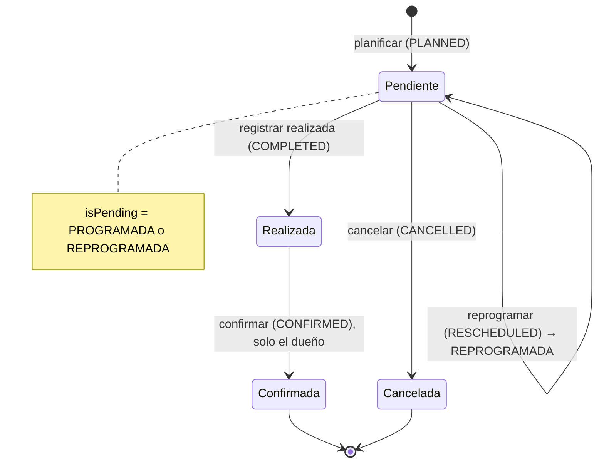

# 04 — Actividad comercial

- **Fuente del alcance:** [`ALCANCE-CRM.md`](../../requirements/crm/ALCANCE-CRM.md) §6 (6.1–6.6.3), con §1, §2, §10–§13
- **Contrato de datos:** [`00-modelo-de-datos.md`](00-modelo-de-datos.md) §2.10 (visitas, eventos, actividades, participantes), §2.11 (adjuntos), §2.12 (vista de interacciones), §3.2–§3.5 (catálogos), §4 (visibilidad), §5 (permisos y menú), §6 (folios), §8.2 (parámetros)
- **Funcionalidades:** F-21 … F-33 de la [matriz de trazabilidad](matriz-trazabilidad.md)
- **Decisiones que lo enmarcan:** [ADR-004](../../adr/ADR-004-data-access-abstraction.md), [ADR-005](../../adr/ADR-005-rest-api-standard.md), [ADR-008](../../adr/ADR-008-authorization.md), [ADR-014](../../adr/ADR-014-modular-clean-architecture.md), [ADR-017](../../adr/ADR-017-design-system-grupo-ag.md), [ADR-018](../../adr/ADR-018-identity-access-model.md), [ADR-020](../../adr/ADR-020-asignacion-de-accesos-exclusiva-del-administrador.md), [ADR-021](../../adr/ADR-021-almacenamiento-de-adjuntos-en-sistema-de-archivos-montado.md) (adjuntos), addendum [ADR-008](../../adr/ADR-008-authorization.md) (`@RequireAnyPermission`)
- **Estado:** decisiones del módulo resueltas por el responsable de negocio el 2026-10-10. Backend completo (2026-10-12): `@RequireAnyPermission`, dominio puro, actividades, bandeja y opciones (K.2 pasos 1–3); visitas, modelos de lectura (agenda, interacciones, seguimiento), `CommercialActivityUsageQuery`, adjuntos por dueño y rutas registradas con sus opciones de menú (K.2 pasos 4, 5 y 8 y el registro de E.1). Frontend, primera mitad (2026-10-12): piezas comunes de `commercial-activity/common/`, actividades (E.9, E.10), bandeja de pendientes (E.3) y puntos de entrada de E.11 integrados en la ficha del cliente. Faltan las pantallas de agenda, seguimiento, historial y visitas (E.2, E.4–E.8; sus rutas siguen con el marcador provisional), la integración de E.11 en la ficha del proyecto (Módulo 3, otra rama) y el E2E. Sin cambios de `schema.prisma` ni migraciones. Ver [Precisiones de implementación (2026-10-12)](#precisiones-de-implementación-2026-10-12).
- **Skills aplicables:** `feature-development`, `requirements-analysis`, `user-story`, `api-design`, `authorization`, `access-management`, `backend-nestjs`, `database`, `prisma`, `frontend-react`, `design-system`, `security`, `observability`, `testing`, `documentation`

> Este módulo **usa** las entidades de `00` (`Visit`, `VisitEvent`, `Activity`,
> `InteractionParticipant`, `Attachment`, vista `crm_interactions_v`). No crea
> tablas, columnas, estados ni catálogos nuevos. Donde una necesidad del módulo
> no cabe en el contrato de `00`, se registra como decisión `D-04.n` y se
> propone el cambio en `00` primero, sin aplicarlo aquí.

---

## Índice

- [A. Objetivo](#a-objetivo)
- [B. Alcance completo](#b-alcance-completo)
- [C. Reglas de negocio](#c-reglas-de-negocio)
- [D. Modelo de datos](#d-modelo-de-datos)
- [E. Pantallas y componentes](#e-pantallas-y-componentes)
- [F. Servicios y contratos](#f-servicios-y-contratos)
- [G. Relaciones internas](#g-relaciones-internas)
- [H. Seguridad](#h-seguridad)
- [I. Criterios de aceptación](#i-criterios-de-aceptación)
- [J. Pruebas funcionales](#j-pruebas-funcionales)
- [K. Dependencias y orden](#k-dependencias-y-orden)
- [L. Archivos de código](#l-archivos-de-código)
- [Decisiones del módulo (resueltas el 2026-10-10)](#decisiones-del-módulo-resueltas-el-2026-10-10)
- [Precisiones de implementación (2026-10-12)](#precisiones-de-implementación-2026-10-12)
- [Filas para la matriz](#filas-para-la-matriz)

---

## A. Objetivo

Dar al equipo comercial un único lugar donde **planificar, registrar, confirmar
y consultar** su trabajo con clientes y proyectos: visitas (con todo su ciclo de
vida) y actividades (llamadas, reuniones, correos y tareas), y derivar de esos
registros —sin duplicarlos— la agenda, la bandeja de pendientes, el seguimiento
por cliente y proyecto y el historial de interacciones.

### Responsabilidades

| El módulo es dueño de | El módulo **no** es dueño de |
|---|---|
| Visitas y su historial de eventos (`visits`, `visit_events`) | Clientes y contactos (Módulo 2) |
| Actividades (`activities`) | Proyectos y oportunidades (Módulo 3) |
| Participantes de visitas y actividades (`interaction_participants`) | Usuarios, equipos, roles, catálogos y parámetros (Fase 0 / Módulo 7) |
| Vínculo de adjuntos con visitas, eventos de visita y actividades (`attachments.visit_id`, `visit_event_id`, `activity_id`) | Almacenamiento de archivos (puerto `FileStorage` y adaptador `LocalFileSystemStorage`, DM-8, ADR-021) |
| Lectura de la vista `crm_interactions_v` (`InteractionReadModel`) | Indicadores y alertas de Inicio (Módulo 1) y reportes (Módulo 5), que **consumen** estos datos |
| Los puntos de entrada "Nueva actividad" / "Planificar visita" que se insertan en las fichas de cliente y proyecto | Las fichas de cliente y proyecto en sí |

Las visitas y actividades conservan su identificador (UUID) y su código
(`VIS-…`, `ACT-…`) y su historial **independientemente del módulo desde el que
se consulten** (ALCANCE §6, relaciones del módulo).

---

## B. Alcance completo

Inventario exhaustivo de §6. Cada elemento tiene regla (C), pantalla (E),
contrato (F) y criterio (I). Nada se excluye. Las decisiones que lo enmarcan quedaron
resueltas el 2026-10-10 (ver la sección de decisiones).

| F-xx | Alcance | Elementos que se implementan | Decisiones (resueltas el 2026-10-10) |
|---|---|---|---|
| F-21 | §6.1 Agenda general | Vista **calendario** (mes / semana / día) y vista **listado**. Muestra fecha y hora, responsable, tipo de actividad, cliente, proyecto, estado, asunto y adjuntos relacionados. Filtros por fecha, asesor, país, tipo de actividad y estado. Navegación al detalle de cada evento. Visibilidad por permisos y alcance | D-04.1 (calendario sin librería), D-04.12 (tope), DM-8 (adjuntos, ADR-021) |
| F-22 | §6.2 Actividades pendientes | Bandeja con actividad, fecha de vencimiento, prioridad, responsable, cliente, proyecto y estado. Identifica pendientes, vencidas y próximas a vencer. Orden por prioridad y vencimiento. Las completadas no aparecen | DM-7 (umbral) |
| F-23 | §6.3 Seguimiento comercial | Vista por cliente y por proyecto: última interacción, próxima acción, responsable, fecha de próxima acción, notas y adjuntos. Trazabilidad de las gestiones. Derivado de visitas y actividades, sin duplicar | D-04.9, DM-22 |
| F-24 | §6.4 Historial de interacciones | Historial cronológico con fecha, tipo, usuario, cliente, proyecto, resumen, resultado y actividad o visita relacionada. Acceso al registro de origen. Sin eventos duplicados | DM-22 |
| F-25 | §6.5 Visitas comerciales | Gestión de visitas con cliente, proyecto, fecha y hora, asesor responsable, objetivo, participantes, ubicación, estado, resultado, comentarios y adjuntos. Listado, detalle con historial de eventos, edición de la planificación | DM-20 |
| F-26 | §6.5.1 Planificar visita | Fecha y hora, cliente, proyecto, responsable, objetivo, ubicación, recordatorio y adjuntos. Validación de obligatorios. Validación de conflictos horarios **preparada sin bloquear** (aviso, tras parámetro) | D-04.2, DM-27, DM-8 (ADR-021) |
| F-27 | §6.5.2 Registrar visita realizada | Fecha real, asistentes, temas tratados, acuerdos, resultado, comentarios, próxima acción y adjuntos. Registra el usuario que ingresa. Actualiza el seguimiento | D-04.4, D-04.5 |
| F-28 | §6.5.3 Confirmar visita | Estado, fecha de confirmación, usuario, resultado o resumen y adjuntos. Exige información mínima. **Confirma el asesor dueño de la visita** (DM-20). Actualiza agenda e indicadores | DM-20 |
| F-29 | §6.5.4 Reprogramar o cancelar | Motivo, nueva fecha y hora (al reprogramar), usuario, fecha del cambio, estado anterior, estado nuevo, adjuntos. Conserva historial. Sin eliminación física. Actualiza la agenda | D-04.3 |
| F-30 | §6.6 Actividades comerciales | Entidad única para llamadas, reuniones, correos y tareas: tipo, asunto, descripción, cliente, proyecto (y oportunidad, ALCANCE §2), responsable, fecha y hora, vencimiento, estado, prioridad, resultado, adjuntos. Tipos y estados de catálogo. Listado, detalle, edición, cancelación y eliminación lógica | D-04.7 |
| F-31 | §6.6.1 Crear actividad | Desde el menú de Actividad comercial, la ficha del cliente y la ficha del proyecto, con preselección de cliente o proyecto. Validación de relaciones | D-04.14 |
| F-32 | §6.6.2 Llamadas, reuniones y correos | Formulario con campos específicos por tipo: fecha, duración, participantes, resumen, resultado, siguiente acción, adjuntos. Cada gestión entra en el historial. **Sin** envío ni recepción real de correos | D-04.8 |
| F-33 | §6.6.3 Confirmar realización | Completar con estado, fecha de finalización, resultado, comentarios, usuario y adjuntos. Exige resultado. Actualiza pendientes, agenda, historial e indicadores de Inicio | D-04.6 |

### Fuera de alcance (explícito en ALCANCE o en `00`)

- Envío o recepción real de correos (§6.6.2) y cualquier integración con
  calendarios externos (Outlook, Google): ALCANCE §1 regla 10.
- Notificaciones activas del recordatorio (correo, push, planificador): DM-27.
  El dato se guarda y se muestra (RN-04.13).
- Mantenimiento de catálogos de tipos, estados, prioridades y motivos: Módulo 7
  (operan sobre los sembrados).
- Indicadores y alertas calculados para Inicio y Reportes: este módulo provee
  los datos y las definiciones (RN-04.30–RN-04.33); las pantallas son de 01 y 05.

---

## C. Reglas de negocio

Cada regla indica su origen: **ALCANCE** (literal), **00** (contrato de datos)
o **propuesta** (buena práctica documentada; si toca negocio, lleva su `D-04.n`
o `DM-n`). Ninguna regla de negocio no escrita se aplica sin estar marcada.

### C.1 Comunes

| # | Regla | Origen |
|---|---|---|
| RN-04.1 | Toda visita y toda actividad pertenecen a **un cliente** válido, no eliminado (`customers.deleted_at IS NULL`). El proyecto es opcional y, si se informa, debe ser **de ese cliente** (FK compuesta `(project_id, customer_id)`). La oportunidad (solo actividades) exige proyecto y debe ser **de ese proyecto** (FK compuesta + `ck_activities_opportunity_needs_project`). El caso de uso lo valida antes de escribir y devuelve `422` con código propio; la FK es la última barrera. El cliente se valida con `CustomerReferenceGuard.assertUsableCustomer(customerId, actor, { requireActive })` del Módulo 2 (02 F.6.3): inexistente, eliminado o no visible → `404 RESOURCE_NOT_FOUND`; en altas, un cliente con estado inactivo → `422 CUSTOMER_INACTIVE` (D-02.16; en ediciones que no cambian el cliente no se exige `requireActive`) | ALCANCE §2, §6.6.1 "validar relaciones"; 00 §2.10 |
| RN-04.2 | Un proyecto u oportunidad eliminados lógicamente no se pueden asociar a una visita o actividad **nueva**; los registros existentes conservan el vínculo | 00 P3 |
| RN-04.3 | Tipos, estados, prioridades, motivos y resultados se leen de `catalog_items` (`crm.tipo_actividad`, `crm.estado_actividad`, `crm.estado_visita`, `crm.prioridad`, `crm.motivo_reprogramacion`, `crm.motivo_cancelacion`, `crm.resultado_interaccion`). Cada escritura de una columna `*_id` hacia catálogo pasa por `CatalogReferenceValidator.assertItem(key, id, { requireActive })` → `422 INVALID_CATALOG_VALUE`. En altas se exige elemento activo; en ediciones que no cambian el valor se conserva un elemento ya desactivado | ALCANCE §1 regla 8, §6.6; 00 §3.5 |
| RN-04.4 | La lógica nunca compara etiquetas ni UUID: usa la semántica de `metadata` (`isOpen`, `isCompleted`, `isCancelled`, `isPending`, `isDone`, `isConfirmed`, `weight`, `isInteraction`, `fields`). El estado `REPROGRAMADA` se identifica por el indicador `isRescheduled` de su `metadata` (D-04.3 aprobada, 00 §8.2), no por código ni etiqueta | 00 §3.3, §8.2 |
| RN-04.5 | El **responsable** (`owner_id`) es por defecto el usuario autenticado. Asignar otro responsable exige `visitas.administrar` / `actividades.administrar`, que el usuario destino esté **activo** y **dentro del alcance** del actor (un asesor con alcance `OWN` solo puede asignarse a sí mismo) → `422 OWNER_NOT_ELIGIBLE` | 00 §4.3 (DM-34) |
| RN-04.6 | Participantes (`interaction_participants`): exactamente uno de contacto, usuario o nombre externo (`ck_interaction_participants_subject`). Un contacto debe ser **del mismo cliente** (FK compuesta) → `422 INVALID_CONTACT`; al añadirlo, debe estar activo y no eliminado → `422 CONTACT_INACTIVE` / `422 INVALID_CONTACT` (códigos de `CustomerReferenceGuard.assertContactOfCustomer`, 02 F.6.3). Un usuario participante debe estar activo. Un contacto desactivado después sigue figurando en los registros históricos | ALCANCE §4.5 "proteger contactos con historia"; 00 §2.5, §2.10 |
| RN-04.7 | Los campos obligatorios base son los de la base (`00` §2.10) más los que añada `crm.campos_obligatorios` (`visit`, `activity`). El parámetro solo **añade** obligatorios → `422 REQUIRED_FIELD_MISSING` con la lista de campos | ALCANCE §6.5.1 "validar obligatorios", §9.4; 00 §8.2 |
| RN-04.8 | Valores por defecto desde `crm.valores_por_defecto` (p. ej. `activity.priorityId = MEDIA`). El estado inicial de una visita es el elemento activo de `crm.estado_visita` con `isPending` y menor `sortOrder`; el de una actividad, el de `crm.estado_actividad` con `isOpen` y menor `sortOrder` | 00 §3.3 punto 2, §8.2 |
| RN-04.9 | Los instantes (`*_at`) se guardan en UTC (`timestamptz`) y se muestran en la zona del usuario. Las fechas de calendario (`next_action_date`) son `date`; "hoy" se calcula en `crm.zona_horaria_negocio` | 00 §2 (DM-31); D-04.17 |
| RN-04.10 | Toda mutación de visita, evento, actividad, participante o adjunto escribe `audit_logs` con `resourceType` `crm.visit` / `crm.activity` / `crm.attachment` y la diferencia `{campo: {antes, despues}}`. Los nombres externos de participantes y datos de contacto se registran enmascarados (DM-29) | ALCANCE §9.5; 00 §1.1, §4.5 |
| RN-04.11 | Si la visita o actividad está vinculada a un proyecto, cada mutación actualiza `projects.last_activity_at` **en la misma transacción** | 00 §2.6 (DM-16) |
| RN-04.12 | Las transiciones de estado se aplican con actualización condicionada al estado leído (`WHERE id = $1 AND status_id = $esperado`). Si otro usuario cambió el estado entretanto → `409 INVALID_STATUS_TRANSITION` (dos confirmaciones simultáneas no generan dos eventos) | Propuesta (integridad) |

### C.2 Visitas

| # | Regla | Origen |
|---|---|---|
| RN-04.13 | **Planificar** (§6.5.1): obligatorios cliente, fecha y hora de inicio, responsable y objetivo. Fin opcional; si falta, la duración por defecto es `crm.visitas.duracion_por_defecto_minutos` (solo para mostrar y para el cálculo de conflictos; no se guarda como fin). Si hay fin, `scheduled_end_at ≥ scheduled_start_at` → `422 INVALID_DATE_RANGE`. Se genera `code` con `SequenceGenerator.next('crm.visita')`, `original_scheduled_at = scheduled_start_at`, estado inicial (RN-04.8) y `VisitEvent(PLANNED, from=null, to=estado inicial)`. **Recordatorio**: `reminder_minutes_before` entero ≥ 0 o nulo; se guarda y se muestra; **no** dispara ningún envío (DM-27). La interfaz pide un número de minutos u horas, sin lista fija de opciones | ALCANCE §6.5.1; 00 §2.10, §6.1 |
| RN-04.14 | **Conflictos horarios** ("preparar … sin bloquear"): con `crm.visitas.validar_conflicto_horario` = `NO` no se evalúa; `AVISAR` (defecto) evalúa y **guarda igualmente**, devolviendo los solapes como `scheduleConflicts` en la respuesta; `BLOQUEAR` devuelve `409 SCHEDULE_CONFLICT`. Solape = otra visita del **mismo responsable**, no cancelada (`isCancelled = false`), cuyo intervalo `[inicio, fin efectivo)` se cruza con el de la nueva. Se evalúa al planificar, reprogramar y reasignar responsable. El valor `BLOQUEAR` está implementado y probado pero **no se activa** (D-04.2 aprobada: modo `AVISAR`; activar el bloqueo es solo un cambio de parámetro) | ALCANCE §6.5.1; 00 §2.10 |
| RN-04.15 | **Editar la planificación** (`PATCH`): solo en estado `isPending`. Campos editables: proyecto, fin, objetivo, ubicación, recordatorio, participantes invitados y responsable (este último con RN-04.5). La **fecha de inicio no se edita**: se cambia reprogramando, para que quede en el historial → `422 USE_RESCHEDULE`. Una visita realizada, confirmada o cancelada no se edita por esta vía → `409 RECORD_READ_ONLY` | 00 §2.10; propuesta |
| RN-04.16 | **Registrar realizada** (§6.5.2): solo desde `isPending` → estado `isDone` (`REALIZADA`). Obligatoria la **fecha real** (`actual_start_at`), no futura → `422 ACTUAL_DATE_IN_FUTURE`; fin real opcional y coherente (`ck_visits_actual_range`). Opcionales: asistentes (participantes `ATTENDED`), temas, acuerdos, resultado (`result_id` de `crm.resultado_interaccion` y/o `result_summary`), comentarios, próxima acción y su fecha, adjuntos (D-04.4). Se fijan `completion_recorded_by_id` = usuario y `completion_recorded_at` = ahora, y se inserta `VisitEvent(COMPLETED)` | ALCANCE §6.5.2; 00 §2.10 |
| RN-04.17 | Los datos de realización de una visita `REALIZADA` aún **no confirmada** se pueden corregir (mismo endpoint de realización con `PUT`), con `visitas.editar` sobre una visita propia o `visitas.administrar`. Cada corrección queda en `audit_logs`; no genera un segundo evento `COMPLETED` (D-04.6) | D-04.6 (aprobada) |
| RN-04.18 | **Confirmar** (§6.5.3): solo desde `isDone` → `isConfirmed` (`CONFIRMADA`). Exige `confirmation_summary`, **o** que la visita ya tenga `result_summary` o `comments` (`ck_visits_confirm_requires`) → `422 CONFIRMATION_SUMMARY_REQUIRED`. Confirmar desde un estado pendiente (sin realización previa) → `409 INVALID_STATUS_TRANSITION` (DM-20). **Solo el dueño** de la visita (`owner_id` = usuario autenticado) puede confirmarla, con `visitas.cerrar` (DM-20 resuelta: el asesor, el manager y el responsable de país lo tienen, cada uno sobre sus propias visitas). Ni `visitas.administrar` ni el administrador confirman una visita ajena → `403 VISIT_CONFIRMATION_OWNER_ONLY`. Orden de comprobación: fuera del alcance → `404`; sin `visitas.cerrar` → `403 PERMISSION_DENIED`; no dueño → `403 VISIT_CONFIRMATION_OWNER_ONLY`; estado → `409`. Se fijan `confirmed_at`, `confirmed_by_id` = dueño y se inserta `VisitEvent(CONFIRMED)`. Última barrera en base: `ck_visits_confirmed_by_owner` (`confirmed_by_id = owner_id`) | ALCANCE §6.5.3; 00 §2.10, §5.4, DM-20 |
| RN-04.19 | **Reprogramar** (§6.5.4): solo desde `isPending`. Obligatorios nueva fecha y hora (distinta de la vigente → `422 RESCHEDULE_SAME_DATE`; no pasada → `422 DATE_IN_PAST`, D-04.5) y motivo (`reason_id` de `crm.motivo_reprogramacion` o `reason_text`) → `422 REASON_REQUIRED`. Fin nuevo opcional (si se informa, coherente; si no, se desplaza conservando la duración planificada). En la **misma fila**: `scheduled_start_at` = nueva, `reschedule_count + 1`, estado `REPROGRAMADA`: el elemento activo de `crm.estado_visita` con `isRescheduled = true` (D-04.3 aprobada; si está inactivo, la visita queda en el estado pendiente inicial). Se inserta `VisitEvent(RESCHEDULED)` con `previous_scheduled_start_at`, `new_scheduled_start_at`, `from_status_id`, `to_status_id`, motivo, comentario, usuario y `occurred_at` (= fecha del cambio). **Nunca** se crea otra visita | ALCANCE §6.5.4, §7.4 "no duplicar reprogramadas"; 00 §2.10 |
| RN-04.20 | **Cancelar** (§6.5.4): solo desde `isPending`. Motivo obligatorio (`crm.motivo_cancelacion` o texto). Estado `isCancelled` (`CANCELADA`), `cancelled_at` = ahora, `VisitEvent(CANCELLED)` con estados anterior y nuevo. La fila **no se elimina**: no existe `DELETE /visits/{id}` ni permiso `visitas.eliminar`. Una visita cancelada no se reactiva (D-04.6) | ALCANCE §6.5.4; 00 §2.10 |
| RN-04.21 | Estados terminales: `CONFIRMADA` y `CANCELADA` son de solo lectura (salvo consultar y descargar adjuntos). Cualquier operación de ciclo de vida sobre ellas → `409 INVALID_STATUS_TRANSITION` | 00 §2.10; D-04.6 (aprobada) |
| RN-04.22 | Una visita pendiente cuya hora planificada ya pasó se muestra como **"Sin registrar"** (derivado, no estado). No es "vencida" ni genera alerta en este módulo (D-04.16) | D-04.16 (aprobada); 00 P4 |

Transiciones de visita (semántica del catálogo, DM-20):

### C.3 Actividades

| # | Regla | Origen |
|---|---|---|
| RN-04.23 | **Crear** (§6.6.1): obligatorios tipo, asunto, cliente, responsable y prioridad (más `crm.campos_obligatorios.activity`). `code` con `SequenceGenerator.next('crm.actividad')`. Estado inicial (RN-04.8). Relaciones según RN-04.1. Desde una ficha, el cliente o proyecto llegan preseleccionados; el backend los valida igual que si se hubieran elegido a mano (visibilidad incluida) | ALCANCE §6.6, §6.6.1; 00 §2.10 |
| RN-04.24 | **Campos por tipo** (§6.6.2): `crm.tipo_actividad.metadata.fields` declara qué campos específicos admite el tipo (`scheduledAt`, `durationMinutes`, `participants`, `summary`, `resultId`, `resultNotes`, `nextAction`, `nextActionDate`). Enviar un campo específico que el tipo no admite → `422 FIELD_NOT_APPLICABLE`. Los campos generales (asunto, descripción, cliente, proyecto, oportunidad, responsable, vencimiento, estado, prioridad) valen para todos. Valores aprobados de `fields` en D-04.8 | ALCANCE §6.6.2; 00 §3.2 |
| RN-04.25 | `duration_minutes` entero ≥ 0 (`ck_activities_duration`). No hay restricción de orden entre `scheduled_at` y `due_at` (no escrita) | 00 §2.10 |
| RN-04.26 | **Tipo correo**: la actividad `CORREO` **registra** un correo gestionado fuera del CRM (asunto, destinatarios como participantes, resumen). El sistema no envía, no recibe y no lee buzones | ALCANCE §6.6.2 |
| RN-04.27 | **Editar** (`PATCH`): solo actividades abiertas (`isOpen`). Cambiar de un estado abierto a otro abierto (`PENDIENTE` ↔ `EN_PROCESO`) es edición; pasar a completada o cancelada solo por sus operaciones → `422 USE_LIFECYCLE_OPERATION`. Cambiar el **tipo** revalida RN-04.24 sobre los campos ya guardados. Completadas y canceladas → `409 RECORD_READ_ONLY` (D-04.6) | D-04.6 (aprobada) |
| RN-04.28 | **Completar** (§6.6.3): solo desde `isOpen` → `isCompleted` (`COMPLETADA`). **Exige resultado**: `result_id` o `result_notes` (`ck_activities_completion`) → `422 RESULT_REQUIRED`. Fecha de finalización (`completed_at`) por defecto ahora; si se informa, no futura → `422 ACTUAL_DATE_IN_FUTURE`. Comentario opcional (`completion_comment`). `completed_by_id` = usuario. Ya completada o cancelada → `409 INVALID_STATUS_TRANSITION` | ALCANCE §6.6.3; 00 §2.10 |
| RN-04.29 | **Registrar una gestión ya realizada** en un solo paso: el alta admite un bloque `completion` opcional que crea y completa en la misma transacción (exige además `actividades.cerrar`). Así una llamada hecha no pasa por "pendiente" (D-04.14) | D-04.14 (aprobada) |
| RN-04.30 | **Cancelar**: solo desde `isOpen` → `isCancelled`, `cancelled_at` = ahora; comentario opcional que se guarda en la auditoría (no hay columna de motivo, D-04.7). **Eliminar** (`DELETE`): lógico (`deleted_at`), permiso `actividades.eliminar`, solo actividades abiertas o canceladas; una completada no se elimina porque es historia (DM-33, D-04.7). Una eliminada desaparece de todas las vistas (la vista la excluye) | 00 §2.10, §5.2; DM-33 |

### C.4 Derivados (no se almacenan, 00 P4)

| # | Regla | Origen |
|---|---|---|
| RN-04.31 | **Clasificación de una actividad abierta** (`isOpen`, no eliminada) en la bandeja: **Vencida** si `due_at < ahora`; **Próxima a vencer** si `ahora ≤ due_at ≤ ahora + crm.alertas.actividad_por_vencer_horas`; **Pendiente** en otro caso (incluye las que no tienen vencimiento). Completadas y canceladas **nunca** aparecen. "Vencida" no es un estado del catálogo | ALCANCE §6.2; 00 P4, C8 |
| RN-04.32 | **Orden de la bandeja**: `crm.prioridad.metadata.weight` descendente, después `due_at` ascendente (sin vencimiento al final), después `scheduled_at` ascendente, después `code` | ALCANCE §6.2 |
| RN-04.33 | **Interacción** (historial y seguimiento, DM-22): visitas en estado `isDone` o `isConfirmed` y actividades `isCompleted` cuyo tipo tiene `isInteraction = true`, no eliminadas. Fecha = `occurred_at` de la vista. Las reprogramaciones y cancelaciones se ven en el historial **de la visita** (`visit_events`), no como interacciones. Cada visita y cada actividad aparece **una sola vez** | ALCANCE §6.4; 00 §2.12, DM-22 |
| RN-04.34 | **Seguimiento por cliente / proyecto**: última interacción = la de mayor `occurred_at` (RN-04.33); **próxima acción** = la `next_action` con `next_action_date ≥ hoy` más cercana entre las visitas y actividades del cliente/proyecto (si ninguna tiene fecha, la `next_action` de la última interacción, sin fecha); responsable = dueño del registro que aporta la próxima acción (o de la última interacción si no hay); notas = resumen de la última interacción; adjuntos = adjuntos activos de las visitas, eventos y actividades del cliente/proyecto. Por cliente agrupa **todas** sus interacciones (con y sin proyecto); por proyecto, solo las del proyecto (D-04.9) | ALCANCE §6.3; 00 §2.12 |
| RN-04.35 | **Estado en la agenda** (filtro y color): grupo derivado de la semántica: `PENDING` (`isPending` / `isOpen`), `OVERDUE` (actividad abierta vencida, RN-04.31), `DONE` (`isDone` / `isCompleted`), `CONFIRMED` (`isConfirmed`), `CANCELLED` (`isCancelled`). Además se puede filtrar por un `statusId` concreto de cualquiera de los dos catálogos | ALCANCE §6.1 |
| RN-04.36 | **Fecha en la agenda**: visita = `actual_start_at` si está realizada o confirmada, si no `scheduled_start_at` (una reprogramada aparece **una vez**, en su fecha vigente); actividad = `scheduled_at`, si no `due_at`. Una actividad sin ninguna de las dos no aparece en el calendario (sí en el listado de actividades y en la bandeja) | ALCANCE §6.1, §6.5.4 "actualizar su representación" |

---

## D. Modelo de datos

**Ninguna tabla, columna, enum, catálogo ni parámetro nuevo.** Todo según `00`.

### D.1 Entidades propias (escribe este módulo)

| Entidad (tabla) | `00` | Uso en el módulo |
|---|---|---|
| `Visit` (`visits`) | §2.10 | Una fila por visita durante toda su vida. Sin `deletedAt`. Código `VIS-AAAA-NNNNN` |
| `VisitEvent` (`visit_events`) | §2.10 | Solo inserción. Un evento por planificar, reprogramar, realizar, confirmar y cancelar. Estado anterior y nuevo, fechas anterior y nueva, motivo, usuario, fecha |
| `Activity` (`activities`) | §2.10 | Llamadas, reuniones, correos y tareas. Borrado lógico. Código `ACT-AAAA-NNNNNN` |
| `InteractionParticipant` (`interaction_participants`) | §2.10 | Invitados (`INVITED`) y asistentes (`ATTENDED`) de visitas y actividades |
| `Attachment` (`attachments`) — columnas `visit_id`, `visit_event_id`, `activity_id` | §2.11 | Adjuntos de visita, de un evento (reprogramación, cancelación, confirmación, realización) y de actividad. Exactamente un dueño (`ck_attachments_single_owner`) |

### D.2 Entidades compartidas (solo lectura)

| Entidad | Dueño | Para qué |
|---|---|---|
| `Customer`, `Contact` | Módulo 2 | Cliente obligatorio; participantes; país para el alcance `COUNTRY` y el filtro de país |
| `Project`, `Opportunity` | Módulo 3 | Vínculo opcional; escritura de `projects.last_activity_at` (RN-04.11, única escritura fuera de lo propio, mandatada por 00 §2.6) |
| `User`, `Team`, `TeamMember` | Fase 0 | Responsables, participantes internos, alcance `TEAM` |
| `Country` | Fase 0 | Filtro de país |
| `Catalog`, `CatalogItem` | Fase 0 / M7 | Tipos, estados, prioridades, motivos, resultados |
| `SystemParameter` | Fase 0 / M7 | Ver D.5 |
| `Sequence` | Fase 0 | Folios `crm.visita`, `crm.actividad` |
| `StoredFile` | Fase 0 | Metadatos del binario del adjunto (`storage_key` generado `<año>/<mes>/<uuid>`, tipo detectado, SHA-256; DM-8, ADR-021) |
| `AuditLog` | Fase 0 | Auditoría |
| Vista `crm_interactions_v` | 00 §2.12 (migración 8) | Historial y seguimiento, leída por `InteractionReadModel` con `$queryRaw` parametrizado |

### D.3 Claves, relaciones e integridad que el módulo debe respetar

| Restricción (00) | Qué protege | Error de aplicación previo |
|---|---|---|
| FK compuesta `visits(project_id, customer_id) → projects(id, customer_id)` | Proyecto del mismo cliente | `422 PROJECT_CUSTOMER_MISMATCH` |
| FK compuesta `activities(project_id, customer_id)` y `activities(opportunity_id, project_id)` + `ck_activities_opportunity_needs_project` | Proyecto del cliente, oportunidad del proyecto | `422 PROJECT_CUSTOMER_MISMATCH`, `422 OPPORTUNITY_PROJECT_MISMATCH`, `422 OPPORTUNITY_REQUIRES_PROJECT` |
| FK compuestas de `interaction_participants` (padre y contacto con el mismo `customer_id`) + `ck_..._parent`, `ck_..._subject` | Participante del mismo cliente; un solo sujeto | `422 INVALID_CONTACT`, `400 VALIDATION_FAILED` |
| `ck_visits_scheduled_range`, `ck_visits_actual_range` | Coherencia de fechas | `422 INVALID_DATE_RANGE` |
| `ck_visits_confirm_requires` | Confirmación con realización y resumen | `409 INVALID_STATUS_TRANSITION`, `422 CONFIRMATION_SUMMARY_REQUIRED` |
| `ck_visits_confirmed_by_owner` | Solo el dueño confirma (`confirmed_by_id = owner_id`, DM-20) | `403 VISIT_CONFIRMATION_OWNER_ONLY` |
| `ck_visit_events_reschedule`, `ck_visit_events_reason` | Reprogramación con fechas; motivo en reprogramación y cancelación | `422 REASON_REQUIRED` |
| `ck_activities_completion` | Completar con resultado y usuario | `422 RESULT_REQUIRED` |
| `ck_visits_reminder`, `ck_activities_duration`, `ck_visits_reschedule_count` | Rangos | `400 VALIDATION_FAILED` |
| `uq_visits_id_customer`, `uq_activities_id_customer` | Destino de las FK de participantes | — |
| FK `Restrict` desde visitas/actividades a cliente/proyecto/oportunidad | Un cliente o proyecto con historia no se borra físicamente | — (lo gestionan 02 y 03) |
| `onUpdate: Restrict` de las FK compuestas | No se puede cambiar el cliente de un proyecto con visitas o actividades | — (lo gestiona 03) |

### D.4 Catálogos usados (claves de 00 §3.2)

| `Catalog.key` | Columna | Semántica usada |
|---|---|---|
| `crm.tipo_actividad` | `activities.type_id` | `isInteraction`, `fields` |
| `crm.estado_actividad` | `activities.status_id` | `isOpen`, `isCompleted`, `isCancelled` |
| `crm.estado_visita` | `visits.status_id`, `visit_events.from/to_status_id` | `isPending`, `isDone`, `isConfirmed`, `isCancelled`, `isRescheduled` (D-04.3 aprobada) |
| `crm.prioridad` | `activities.priority_id` | `weight` |
| `crm.motivo_reprogramacion` | `visit_events.reason_id` (RESCHEDULED) | — |
| `crm.motivo_cancelacion` | `visit_events.reason_id` (CANCELLED) | — |
| `crm.resultado_interaccion` | `visits.result_id`, `activities.result_id` | — (DM-21) |

Guardia de catálogo correcto en cada columna: `CatalogReferenceValidator` (00 §3.5). El motivo de un evento se valida contra el catálogo que corresponde al tipo de evento.

### D.5 Parámetros usados (00 §8.2)

| `key` | Uso |
|---|---|
| `crm.zona_horaria_negocio` | "Hoy" para `next_action_date` (RN-04.9, RN-04.34) |
| `crm.alertas.actividad_por_vencer_horas` | Próximas a vencer (RN-04.31) |
| `crm.visitas.validar_conflicto_horario` | `NO \| AVISAR \| BLOQUEAR` (RN-04.14) |
| `crm.visitas.duracion_por_defecto_minutos` | Fin efectivo para mostrar y para conflictos (RN-04.13) |
| `crm.campos_obligatorios` (`visit`, `activity`) | RN-04.7 |
| `crm.valores_por_defecto` (`activity.priorityId`) | RN-04.8 |
| `crm.adjuntos.max_mb`, `crm.adjuntos.tipos_permitidos` | Adjuntos (DM-8 resuelta: 10 MB; PDF, JPEG, PNG, `.docx`, `.xlsx`) |

### D.6 Folios

`crm.visita` (`VIS-{year}-{seq}`, 5) y `crm.actividad` (`ACT-{year}-{seq}`, 6) con `SequenceGenerator.next(key)` dentro de la transacción del alta (00 §6.1). Inmutables.

---

## E. Pantallas y componentes

Todas bajo el shell, con `PageHeader`, mobile-first (DESIGN-SYSTEM §6), sin hex,
duraciones ni píxeles a mano (CLAUDE.md §8.12) y con los **cuatro estados**:
cargando (esqueleto), vacío (mensaje y acción principal si hay permiso), error
(`describeApiError` + reintentar, con `correlationId`) y sin permiso (la ruta
protegida con `RequirePermission` muestra `AccessDeniedPage`; las acciones sin
permiso se ocultan). Listas con paginación, orden y filtros en el servidor y en
la URL (patrón `use-table-query-state`, ver D-04.11). Formularios con React Hook
Form + Zod; todas las listas seleccionables vienen de la base.

### E.1 Rutas y menú

Opciones de menú de `00` §5.3 (se siembran **con este módulo**, DM-32) y rutas
hijas. Todas se registran en `app-routes.registry.json` y en el router (D-04.13
para las rutas con parámetro).

| Ruta | Pantalla | Opción de menú | Permiso de la ruta |
|---|---|---|---|
| `/actividad/agenda` | Agenda (calendario + listado) | `actividad-agenda` | `actividades.ver` |
| `/actividad/pendientes` | Bandeja de pendientes | `actividad-pendientes` | `actividades.ver` |
| `/actividad/seguimiento` | Seguimiento comercial | `actividad-seguimiento` | `actividades.ver` |
| `/actividad/historial` | Historial de interacciones | `actividad-historial` | `actividades.ver` |
| `/actividad/visitas` | Listado de visitas | `actividad-visitas` | `visitas.ver` |
| `/actividad/visitas/nueva` | Planificar visita | — (hija) | `visitas.crear` |
| `/actividad/visitas/:visitId` | Detalle de visita | — (hija) | `visitas.ver` |
| `/actividad/actividades` | Listado de actividades | `actividad-actividades` | `actividades.ver` |
| `/actividad/actividades/nueva` | Crear actividad | — (hija) | `actividades.crear` |
| `/actividad/actividades/:activityId` | Detalle / edición de actividad | — (hija) | `actividades.ver` |

Preselección por query string: `/actividad/actividades/nueva?customerId=…&projectId=…&opportunityId=…&typeId=…` y `/actividad/visitas/nueva?customerId=…&projectId=…`.

### E.2 Agenda (F-21) — `/actividad/agenda`

- **Conmutador de vista**: Calendario | Listado (se recuerda en la URL `view=`; opcionalmente en `UserPreference`, 00 §1.1).
- **Calendario** (D-04.1): vistas **Mes**, **Semana** y **Día**; navegación anterior / hoy / siguiente; en `< md` la vista por defecto es **Día / lista del día** con una tira de días de la semana (mobile-first), y Mes muestra solo indicadores por día con el detalle debajo. Cada evento muestra hora, icono por tipo (visita o tipo de actividad; Material Symbols), asunto/objetivo, cliente y un indicador de adjuntos (`attach_file` + número). El estado se distingue por color semántico **y** por texto/icono (no solo color, accesibilidad): cancelado tachado, confirmado con check, vencido con aviso, "Reprogramada" como etiqueta. Un clic o `Enter` abre un **panel de resumen** (drawer) con fecha y hora, responsable, tipo, cliente, proyecto, estado, asunto, adjuntos y botón "Ver detalle".
- **Listado**: tabla (tarjetas en `< sm`) con columnas fecha y hora, tipo, asunto, cliente, proyecto, responsable, estado, adjuntos. Ordenable por fecha, tipo, cliente, responsable, estado.
- **Filtros** (comunes a las dos vistas, combinables, en la URL): rango de fechas (el calendario lo fija según la vista; el listado lo pide), asesor (usuarios dentro del alcance), país, tipo (Visita + tipos de `crm.tipo_actividad`), estado (grupos de RN-04.35). Chips de filtros activos con "Limpiar".
- **Acciones**: "Planificar visita" (`visitas.crear`), "Nueva actividad" (`actividades.crear`).
- **Estados**: cargando (esqueleto de la cuadrícula), vacío ("No hay visitas ni actividades en este periodo" + acciones), error, sin permiso. Aviso no bloqueante si el rango supera el tope (D-04.12): "Se muestran los primeros 500 eventos; acota los filtros".

### E.3 Bandeja de pendientes (F-22) — `/actividad/pendientes`

- Pestañas o segmentado con contador: **Todas**, **Vencidas**, **Próximas a vencer**, **Pendientes** (RN-04.31).
- Tabla/tarjetas: actividad (código + asunto + icono de tipo), vencimiento (relativo y absoluto: "vence en 5 h", "venció hace 2 días"), prioridad (chip), responsable, cliente, proyecto, estado. Orden fijo RN-04.32 (el usuario puede cambiarlo a vencimiento).
- Filtros: asesor, tipo, prioridad, cliente.
- Acciones por fila: "Completar" (abre E.10 completar; `actividades.cerrar`), "Ver".
- Al completar o cancelar, la fila desaparece de inmediato (invalidación de consultas). No se ofrece "Deshacer": la operación es definitiva (RN-04.27, D-04.6).
- Estados: vacío ("No tienes actividades pendientes"), etc.

### E.4 Seguimiento comercial (F-23) — `/actividad/seguimiento`

- Selector **Por cliente | Por proyecto** (RN-04.34).
- Tabla: cliente (y proyecto en la vista por proyecto), última interacción (fecha, tipo, enlace), próxima acción (texto), fecha de próxima acción (resaltada si es hoy o ya pasó), responsable, notas (resumen truncado con "ver más"), adjuntos (número).
- Filtros: cliente, proyecto, asesor, país, "sin próxima acción", rango de última interacción.
- Clic → **drawer de trazabilidad**: línea de tiempo cronológica (E.5 reutilizado, filtrado por cliente/proyecto) + próximas visitas y actividades abiertas + lista de adjuntos. Cada elemento navega a su registro de origen.
- Estados: vacío ("Aún no hay interacciones registradas").

### E.5 Historial de interacciones (F-24) — `/actividad/historial`

- Línea de tiempo agrupada por día (o tabla en `≥ md`, conmutable): fecha, tipo, usuario, cliente, proyecto, resumen, resultado, enlace "Ver visita VIS-…" / "Ver actividad ACT-…".
- Filtros: rango de fechas, cliente, proyecto, oportunidad, usuario, tipo (Visita / tipo de actividad), resultado.
- Orden: más reciente primero (se puede invertir).
- Componente reutilizable **`InteractionTimeline`** (props `customerId?`, `projectId?`, `opportunityId?`, `compact?`) usado aquí, en el drawer de seguimiento y en las fichas de cliente y proyecto (G).

### E.6 Listado de visitas (F-25) — `/actividad/visitas`

- Tabla/tarjetas: código, fecha y hora vigente (y "Reprogramada ×N" si `rescheduleCount > 0`), cliente, proyecto, responsable, objetivo, estado, resultado, adjuntos.
- Filtros: rango de fechas, estado (catálogo `crm.estado_visita`), asesor, cliente, proyecto, país, "sin registrar" (RN-04.22), "pendientes de confirmar".
- Acción: "Planificar visita".

### E.7 Planificar / editar visita (F-26, F-25) — `/actividad/visitas/nueva`

- Secciones (`FormSection`): **Cuándo** (fecha y hora de inicio, fin opcional — entradas `datetime-local` nativas, D-04.1), **Con quién** (cliente — selector con búsqueda; proyecto — filtrado por cliente; participantes invitados — contactos del cliente, usuarios, nombre externo), **Qué** (objetivo, ubicación), **Responsable** (por defecto yo; editable con `visitas.administrar`), **Recordatorio** (número + unidad minutos/horas; texto de ayuda: "Se mostrará en la agenda; no se envían notificaciones"), **Adjuntos** (E.12).
- Cambiar el cliente limpia proyecto y participantes de contacto.
- **Aviso de conflicto** (RN-04.14): al fijar fecha/fin/responsable se consulta `GET /visits/schedule-conflicts` (con *debounce*) y, si hay solapes, se muestra un `Alert` de advertencia con la lista ("Ya tienes VIS-2026-00031 de 10:00 a 11:00 con …") **sin deshabilitar** "Guardar". Tras guardar, si la respuesta trae `scheduleConflicts`, se muestra el mismo aviso en el detalle.
- Validación en cliente (UX) con los mismos obligatorios; errores del backend mapeados a campos (`details[].field`).
- Edición de la planificación (desde el detalle) reutiliza el formulario en un diálogo, sin el campo fecha de inicio (texto: "Para cambiar la fecha, reprograma la visita").

### E.8 Detalle de visita (F-25, F-27, F-28, F-29) — `/actividad/visitas/:visitId`

- Cabecera: código, estado (chip), cliente → ficha, proyecto → ficha, responsable, fecha vigente (y original si fue reprogramada).
- Pestañas/secciones: **Planificación** (objetivo, ubicación, fin, recordatorio, invitados), **Realización** (fecha real, asistentes, temas, acuerdos, resultado, comentarios, próxima acción, registrada por y cuándo), **Confirmación** (fecha, usuario, resumen), **Historial** (línea de tiempo de `visit_events`: tipo, estado anterior → nuevo, fecha anterior → nueva, motivo, comentario, usuario, fecha, adjuntos del evento), **Adjuntos**.
- Acciones según estado y permiso (RN-04.15–21):

| Estado | Acciones visibles |
|---|---|
| Pendiente (`PROGRAMADA` / `REPROGRAMADA`) | Editar planificación · Registrar realizada · Reprogramar · Cancelar |
| `REALIZADA` | Corregir realización · Confirmar (`visitas.cerrar` y **solo el dueño** de la visita, DM-20) |
| `CONFIRMADA` / `CANCELADA` | Ninguna (solo lectura) |

- **Diálogo Registrar realizada** (F-27): fecha y hora real (por defecto la planificada si ya pasó, si no ahora), fin real, asistentes (preseleccionados con los invitados, editables), temas, acuerdos, resultado (catálogo) + resumen, comentarios, próxima acción + fecha, adjuntos.
- **Diálogo Confirmar** (F-28): solo se ofrece al dueño de la visita (`allowedActions` incluye `CONFIRM`); un manager o administrador que consulta la visita de otro no ve la acción. Resumen de confirmación (obligatorio si la realización no tiene resumen ni comentarios; el diálogo lo indica), adjuntos. Muestra la realización en solo lectura para revisar.
- **Diálogo Reprogramar** (F-29): nueva fecha y hora, nuevo fin opcional, motivo (catálogo) y/o texto, comentario, adjuntos; aviso de conflicto como en E.7.
- **Diálogo Cancelar** (F-29): motivo (catálogo) y/o texto, comentario, adjuntos; `ConfirmDialog` destructivo ("La visita quedará cancelada y no podrá reactivarse").
- Estados: 404 → "La visita no existe o no tienes acceso" (no se distingue, ADR-008).

### E.9 Listado de actividades (F-30) — `/actividad/actividades`

- Tabla/tarjetas: código, tipo, asunto, cliente, proyecto, responsable, fecha y hora, vencimiento (con marca vencida/próxima), prioridad, estado, resultado, adjuntos.
- Filtros: tipo, estado (catálogo), prioridad, asesor, cliente, proyecto, oportunidad, rango de fecha, rango de vencimiento, "vencidas".
- Acción: "Nueva actividad" (menú desplegable por tipo: Llamada, Reunión, Correo, Tarea — leído del catálogo, no fijo).

### E.10 Crear / editar / completar actividad (F-31, F-32, F-33)

- **Formulario** `/actividad/actividades/nueva` y edición en `/actividad/actividades/:activityId` (modo edición si está abierta y hay permiso):
  - Paso 1: **Tipo** (del catálogo). El tipo determina las secciones visibles (`metadata.fields`, RN-04.24): `ActivityTypeFields` pinta solo los campos del tipo.
  - Generales: asunto, descripción, cliente, proyecto (filtrado por cliente), oportunidad (filtrada por proyecto), responsable, vencimiento, prioridad, estado (solo estados abiertos).
  - Específicos según tipo: fecha y hora, duración, participantes, resumen, resultado, siguiente acción + fecha.
  - Casilla **"Ya realizada"** (RN-04.29, visible con `actividades.cerrar`): despliega fecha de finalización, resultado (obligatorio) y comentario; al guardar se crea completada.
  - Preselección (F-31): con `customerId` el cliente aparece fijado (cambiable con aviso); con `projectId` se fijan proyecto **y** su cliente; con `opportunityId`, oportunidad, proyecto y cliente. Si el registro preseleccionado no existe o no es visible, el formulario muestra el error y deja el campo vacío.
  - Correo (RN-04.26): texto de ayuda "Registro de un correo enviado o recibido fuera del CRM. No se envía nada".
- **Detalle**: datos generales y específicos, participantes, resultado y finalización, adjuntos, auditoría resumida (creado/modificado por). Acciones: Editar, Completar (`actividades.cerrar`), Cancelar (`actividades.editar` propio / `administrar`), Eliminar (`actividades.eliminar`, `ConfirmDialog` destructivo).
- **Diálogo Completar** (F-33): estado destino (el de `isCompleted`; no elegible), fecha de finalización (por defecto ahora), resultado (catálogo) y/o notas — al menos uno, comentario, adjuntos. Reutilizado desde la bandeja y la agenda.

### E.11 Puntos de entrada en fichas (F-31) — componentes exportados

Este módulo entrega, y las fichas de 02 y 03 insertan:

| Componente | Props | Dónde lo usa |
|---|---|---|
| `NewActivityButton` | `customerId`, `projectId?`, `opportunityId?` | Ficha del cliente (02), ficha del proyecto y oportunidad (03) |
| `PlanVisitButton` | `customerId`, `projectId?` | Ficha del cliente y del proyecto |
| `CommercialActivitySection` | `customerId?` o `projectId?` | Sección "Seguimiento comercial" de la ficha del proyecto (ALCANCE §5.2) y actividad en la ficha del cliente: resumen de seguimiento (RN-04.34), próximas visitas/actividades y `InteractionTimeline` compacto |

Los botones navegan a las rutas de E.1 con la preselección; se ocultan sin el permiso de creación. La sección se oculta sin `actividades.ver` ni `visitas.ver`.

### E.12 Adjuntos (todas las pantallas) — DM-8 resuelta (ADR-021)

Componente `AttachmentsPanel` (`owner`: visita, evento de visita o actividad): lista (nombre, tamaño, autor, fecha), subir, descargar, eliminar (solo si el dueño es editable, RN-04.21; los adjuntos de eventos no se eliminan). Antes de subir valida en el cliente tamaño (`crm.adjuntos.max_mb`, 10 MB) y extensión (PDF, JPEG, PNG, `.docx`, `.xlsx`) como ayuda de UX; la decisión es del backend (tipo detectado por firma) y sus errores se muestran con `describeApiError` (`413 ATTACHMENT_TOO_LARGE`, `422 ATTACHMENT_TYPE_NOT_ALLOWED`). La descarga usa la ruta del dueño (`…/attachments/{aid}/content`, F.4) a través del cliente de API autenticado; no hay vista previa en línea. Los diálogos de reprogramar, cancelar y confirmar suben sus archivos al evento recién creado (ventana de D-04.18); el diálogo Completar de actividad sube los archivos a la actividad **antes** de enviar la finalización, mientras sigue abierta. La columna "Adjuntos" de agenda y listados muestra `attachmentCount`.

---

## F. Servicios y contratos

Todos bajo `/api/v1`, `Authorization: Bearer`, formato de error de
`API-STANDARDS.md` §8 con `correlationId`, `ValidationPipe` con `whitelist` y
`forbidNonWhitelisted`. Colecciones: `{ data, pagination }`, `page` (base 1),
`pageSize` (20, máx. 100), `sortBy` contra lista blanca, `sortOrder`. Fechas ISO
8601 UTC; `date` como `YYYY-MM-DD`. Identificadores UUID. Cada endpoint se
documenta en OpenAPI (`@ApiTags('commercial-activity')`, respuestas `ErrorResponseDto`).

### F.1 Operaciones propias — Visitas

| Método | Ruta | Permiso | Éxito | Errores principales |
|---|---|---|---|---|
| GET | `/visits` | `visitas.ver` | 200 `Paginated<VisitListItemDto>` | 400 |
| GET | `/visits/{id}` | `visitas.ver` | 200 `VisitDetailDto` | 404 |
| GET | `/visits/{id}/events` | `visitas.ver` | 200 `VisitEventDto[]` (sin paginar, orden cronológico) | 404 |
| GET | `/visits/schedule-conflicts` | `visitas.crear` o `visitas.editar` | 200 `{ mode, conflicts: ScheduleConflictDto[] }` | 400 |
| POST | `/visits` | `visitas.crear` (+ `visitas.administrar` si `ownerId ≠ yo`) | 201 `VisitDetailDto` + `Location` (+ `scheduleConflicts`) | 400, 409 `SCHEDULE_CONFLICT` (solo `BLOQUEAR`), 422 |
| PATCH | `/visits/{id}` | `visitas.editar` propio / `visitas.administrar` | 200 `VisitDetailDto` | 404, 409 `RECORD_READ_ONLY` / `SCHEDULE_CONFLICT`, 422 `USE_RESCHEDULE` |
| POST | `/visits/{id}/completion` | `visitas.editar` propio / `visitas.administrar` | 200 `VisitDetailDto` | 404, 409 `INVALID_STATUS_TRANSITION`, 422 `ACTUAL_DATE_IN_FUTURE` |
| PUT | `/visits/{id}/completion` | ídem | 200 `VisitDetailDto` (corrige, RN-04.17) | 404, 409 |
| POST | `/visits/{id}/confirmation` | `visitas.cerrar` (solo visitas propias, DM-20) | 200 `VisitDetailDto` | 403 `PERMISSION_DENIED` / `VISIT_CONFIRMATION_OWNER_ONLY`, 404, 409, 422 `CONFIRMATION_SUMMARY_REQUIRED` |
| POST | `/visits/{id}/rescheduling` | `visitas.editar` propio / `visitas.administrar` | 200 `VisitDetailDto` (+ `scheduleConflicts`) | 404, 409, 422 `RESCHEDULE_SAME_DATE` / `DATE_IN_PAST` / `REASON_REQUIRED` |
| POST | `/visits/{id}/cancellation` | `visitas.editar` propio / `visitas.administrar` | 200 `VisitDetailDto` | 404, 409, 422 `REASON_REQUIRED` |

No existe `DELETE /visits/{id}` (RN-04.20): la ruta no se declara; una petición recibe `404` del enrutador.

**Query de `GET /visits`** (`VisitQueryDto extends PaginationQueryDto`): `from`, `to` (sobre la fecha de agenda RN-04.36), `statusId[]`, `ownerId[]`, `customerId`, `projectId`, `countryId`, `statusGroup[]` (grupos de RN-04.35 aplicables a visitas: `PENDING`, `DONE`, `CONFIRMED`, `CANCELLED`; destino de la tarjeta K6 de Inicio, 01 E.3), `unregistered` (bool, RN-04.22), `pendingConfirmation` (bool), `search` (código, objetivo, razón social del cliente). `sortBy` ∈ `scheduledStartAt` (defecto), `code`, `customerName`, `ownerName`, `status`.

**`CreateVisitDto`**

| Campo | Tipo | Regla |
|---|---|---|
| `customerId` | uuid | obligatorio |
| `projectId` | uuid \| null | opcional; del cliente |
| `ownerId` | uuid | opcional (defecto: yo); RN-04.5 |
| `scheduledStartAt` | ISO datetime | obligatorio |
| `scheduledEndAt` | ISO datetime \| null | ≥ inicio |
| `objective` | string 1..1000 | obligatorio |
| `location` | string ≤ 300 | opcional |
| `reminderMinutesBefore` | int ≥ 0 \| null | opcional, máx. 43 200 (30 días; límite técnico) |
| `participants` | `ParticipantInputDto[]` ≤ 50 | `{ contactId? , userId?, externalName? }` exactamente uno |

`UpdateVisitDto` (PATCH): los mismos salvo `customerId` y `scheduledStartAt` (si llega `scheduledStartAt` → `422 USE_RESCHEDULE`; `customerId` no está en el DTO → `400`). `participants` reemplaza la lista de invitados.

**`VisitCompletionDto`**: `actualStartAt` (obligatorio), `actualEndAt?`, `attendees: ParticipantInputDto[]`, `topics?` (≤ 10 000), `agreements?` (≤ 10 000), `resultId?`, `resultSummary?` (≤ 2000), `comments?` (≤ 2000), `nextAction?` (≤ 300), `nextActionDate?` (date).

**`VisitConfirmationDto`**: `confirmationSummary?` (≤ 2000; obligatorio si la visita no tiene `resultSummary` ni `comments`).

**`VisitReschedulingDto`**: `newScheduledStartAt` (obligatorio), `newScheduledEndAt?`, `reasonId?`, `reasonText?` (≤ 1000; al menos uno de los dos), `comment?` (≤ 2000).

**`VisitCancellationDto`**: `reasonId?`, `reasonText?` (al menos uno), `comment?`.

**`VisitDetailDto`** (respuesta; nunca el modelo Prisma): `id`, `code`, `customer {id, crmCode, legalName}`, `project {id, code, name} | null`, `owner {id, displayName}`, `status {id, code, label, group}` (`group` = RN-04.35), `scheduledStartAt`, `scheduledEndAt`, `effectiveEndAt` (calculado), `originalScheduledAt`, `rescheduleCount`, `objective`, `location`, `reminderMinutesBefore`, `reminderAt` (calculado = inicio − minutos), `participants: ParticipantDto[]` (`{ id, role, kind: CONTACT|USER|EXTERNAL, contactId?, userId?, displayName }`), `completion { actualStartAt, actualEndAt, topics, agreements, result {id,label} | null, resultSummary, comments, nextAction, nextActionDate, recordedBy, recordedAt } | null`, `confirmation { confirmedAt, confirmedBy, summary } | null`, `cancelledAt`, `isUnregistered`, `attachmentCount`, `allowedActions: string[]` (`EDIT`, `COMPLETE`, `CORRECT_COMPLETION`, `CONFIRM`, `RESCHEDULE`, `CANCEL`, calculado con estado + permisos + propiedad; `CONFIRM` solo aparece si el usuario es el dueño y tiene `visitas.cerrar`; la interfaz lo usa para mostrar botones, el backend vuelve a decidir), `scheduleConflicts?: ScheduleConflictDto[]`, `createdAt`, `updatedAt`.

**`VisitEventDto`**: `id`, `eventType` (`PLANNED | RESCHEDULED | COMPLETED | CONFIRMED | CANCELLED`), `fromStatus`, `toStatus`, `previousScheduledStartAt`, `newScheduledStartAt`, `reason {id,label} | null`, `reasonText`, `comment`, `performedBy {id, displayName}`, `occurredAt`, `attachmentCount`.

**`GET /visits/schedule-conflicts`**: query `ownerId` (defecto yo), `start`, `end?`, `excludeVisitId?`. Respuesta `{ mode: 'NO' | 'AVISAR' | 'BLOQUEAR', conflicts: [{ visitId, code, scheduledStartAt, effectiveEndAt, customerName }] }`. Con `mode = NO` devuelve lista vacía. Solo devuelve visitas que el actor puede ver; si el solape es con una visita no visible para él, se informa como `{ visitId: null, code: null, … "Otra visita del responsable" }` sin datos del cliente (no filtra información fuera del alcance).

### F.2 Operaciones propias — Actividades

| Método | Ruta | Permiso | Éxito | Errores principales |
|---|---|---|---|---|
| GET | `/activities` | `actividades.ver` | 200 `Paginated<ActivityListItemDto>` | 400 |
| GET | `/activities/pending` | `actividades.ver` | 200 `Paginated<PendingActivityDto>` + `counts` | 400 |
| GET | `/activities/{id}` | `actividades.ver` | 200 `ActivityDetailDto` | 404 |
| POST | `/activities` | `actividades.crear` (+ `actividades.cerrar` si trae `completion`; + `actividades.administrar` si `ownerId ≠ yo`) | 201 `ActivityDetailDto` + `Location` | 400, 422 |
| PATCH | `/activities/{id}` | `actividades.editar` propio / `actividades.administrar` | 200 `ActivityDetailDto` | 404, 409 `RECORD_READ_ONLY`, 422 `FIELD_NOT_APPLICABLE` / `USE_LIFECYCLE_OPERATION` |
| POST | `/activities/{id}/completion` | `actividades.cerrar` (propio o en alcance con `administrar`) | 200 `ActivityDetailDto` | 404, 409, 422 `RESULT_REQUIRED` |
| POST | `/activities/{id}/cancellation` | `actividades.editar` propio / `actividades.administrar` | 200 `ActivityDetailDto` | 404, 409 |
| DELETE | `/activities/{id}` | `actividades.eliminar` (en alcance) | 204 | 404, 409 `RECORD_READ_ONLY` (completada) |

`/activities/pending` se declara **antes** de `/activities/{id}` (y `{id}` usa `ParseUUIDPipe`).

**Query de `GET /activities`**: `typeId[]`, `statusId[]`, `priorityId[]`, `ownerId[]`, `customerId`, `projectId`, `opportunityId`, `countryId`, `scheduledFrom`, `scheduledTo`, `dueFrom`, `dueTo`, `overdue` (bool), `search` (código, asunto, razón social). `sortBy` ∈ `scheduledAt`, `dueAt` (defecto), `code`, `priority`, `customerName`, `ownerName`, `status`.

**Query de `GET /activities/pending`**: `bucket` (repetible) ∈ `ALL` (defecto) `| OVERDUE | DUE_SOON | PENDING` (`bucket=DUE_SOON&bucket=PENDING` = "pendientes" de Inicio KPI-08, destino de la tarjeta K7, 01 E.3), `ownerId[]`, `typeId[]`, `priorityId[]`, `customerId`. `sortBy` ∈ `priority` (defecto, RN-04.32), `dueAt`. Respuesta: `{ data, pagination, counts: { overdue, dueSoon, pending, total } }` (los contadores ignoran `bucket` pero respetan los demás filtros y el alcance). `PendingActivityDto`: `id`, `code`, `type`, `subject`, `dueAt`, `bucket`, `priority {id,label,weight}`, `owner`, `customer`, `project`, `status`, `allowedActions`.

**`CreateActivityDto`**

| Campo | Tipo | Regla |
|---|---|---|
| `typeId` | uuid | obligatorio; `crm.tipo_actividad` activo |
| `subject` | string 1..200 | obligatorio |
| `description` | string ≤ 10 000 | opcional |
| `customerId` | uuid | obligatorio |
| `projectId` | uuid \| null | del cliente |
| `opportunityId` | uuid \| null | exige `projectId`; del proyecto |
| `ownerId` | uuid | defecto yo; RN-04.5 |
| `priorityId` | uuid | obligatorio (defecto por parámetro en la interfaz) |
| `statusId` | uuid | opcional; solo estados `isOpen` (defecto RN-04.8) |
| `scheduledAt`, `dueAt` | ISO datetime \| null | — |
| `durationMinutes` | int ≥ 0, ≤ 1440 | según tipo |
| `participants` | `ParticipantInputDto[]` ≤ 50 | según tipo |
| `summary` | ≤ 2000 | según tipo |
| `resultId`, `resultNotes` (≤ 2000) | — | según tipo |
| `nextAction` (≤ 300), `nextActionDate` (date) | — | según tipo |
| `completion` | `{ completedAt?, resultId?, resultNotes?, comment? }` \| null | RN-04.29 |

`UpdateActivityDto` (PATCH): todos opcionales salvo `customerId` (si cambia, revalida proyecto, oportunidad y participantes; permitido solo si no hay participantes de contacto del cliente anterior → `422 INVALID_CONTACT`). `ActivityCompletionDto`: `completedAt?`, `resultId?`, `resultNotes?` (al menos uno de los dos), `comment?` (≤ 2000). `ActivityCancellationDto`: `comment?` (≤ 1000).

**`ActivityDetailDto`**: `id`, `code`, `type {id, code, label, fields, isInteraction}`, `subject`, `description`, `customer`, `project`, `opportunity {id, code} | null`, `owner`, `status {id, code, label, group}`, `priority`, `scheduledAt`, `dueAt`, `dueBucket` (`OVERDUE | DUE_SOON | PENDING | null` si no está abierta), `durationMinutes`, `participants`, `summary`, `result`, `resultNotes`, `nextAction`, `nextActionDate`, `completion { completedAt, completedBy, comment } | null`, `cancelledAt`, `attachmentCount`, `allowedActions` (`EDIT`, `COMPLETE`, `CANCEL`, `DELETE`), `createdAt`, `createdBy`, `updatedAt`.

### F.3 Consultas propias (modelos de lectura)

| Método | Ruta | Permiso | Respuesta |
|---|---|---|---|
| GET | `/agenda` | `actividades.ver` o `visitas.ver` (cada tipo se filtra por su permiso) | 200 `Paginated<AgendaItemDto>` (vista listado) |
| GET | `/agenda/calendar` | ídem | 200 `{ data: AgendaItemDto[], truncated: boolean }` (sin paginar, D-04.12) |
| GET | `/interactions` | `actividades.ver` o `visitas.ver` | 200 `Paginated<InteractionDto>` |
| GET | `/follow-ups` | `actividades.ver` o `visitas.ver` | 200 `Paginated<FollowUpRowDto>` |
| GET | `/follow-ups/trace` | ídem | 200 `FollowUpTraceDto` |
| GET | `/visits/form-options` | `visitas.ver` | 200 `{ statuses, rescheduleReasons, cancellationReasons, results, conflictMode, defaultDurationMinutes, requiredFields }` (catálogos activos de D.4, D-04.10) |
| GET | `/activities/form-options` | `actividades.ver` | 200 `{ types (con fields, isInteraction), statuses, priorities, results, defaults, requiredFields, dueSoonHours }` |
| GET | `/commercial-activity/owner-options` | `visitas.ver` o `actividades.ver` | 200 `Paginated<{ id, displayName }>`: usuarios activos dentro del alcance del actor (`search` por nombre) |

**`GET /agenda`** y **`/agenda/calendar`**: `from`, `to` (obligatorios en `calendar`, rango ≤ 42 días → `400 RANGE_TOO_WIDE`), `ownerId[]`, `countryId[]`, `kind[]` (`VISIT`, `ACTIVITY`), `activityTypeId[]`, `statusGroup[]` (RN-04.35), `statusId[]`, `customerId`, `projectId`. Listado: `sortBy` ∈ `date` (defecto, asc), `kind`, `customerName`, `ownerName`, `status`. `AgendaItemDto`: `kind`, `id`, `code`, `date` (RN-04.36), `endDate`, `typeLabel` ("Visita" o etiqueta del tipo), `typeId`, `subject` (objetivo o asunto), `customer {id, legalName}`, `project {id, name} | null`, `owner {id, displayName}`, `status {id, label, group}`, `isRescheduled`, `isUnregistered`, `hasReminder`, `attachmentCount`, `detailPath` (`/actividad/visitas/{id}` o `/actividad/actividades/{id}`). Implementación: dos consultas acotadas (visitas, actividades) con el mismo filtro de alcance, mezcladas y ordenadas en el adaptador; el total del listado es la suma de dos `COUNT`.

**`GET /interactions`**: `from`, `to`, `customerId`, `projectId`, `opportunityId`, `userId[]`, `sourceType[]` (`VISIT`, `ACTIVITY`), `typeId[]`, `resultId[]`. `sortBy` = `occurredAt` (desc por defecto). Lee `crm_interactions_v` con los criterios RN-04.33. `InteractionDto`: `sourceType`, `sourceId`, `sourceCode`, `occurredAt`, `typeLabel`, `user {id, displayName}`, `customer`, `project`, `opportunity`, `subject`, `summary`, `result {id,label} | null`, `nextAction`, `nextActionDate`, `sourcePath`.

**`GET /follow-ups`**: `groupBy` ∈ `CUSTOMER` (defecto) `| PROJECT`, `customerId`, `projectId`, `ownerId[]`, `countryId[]`, `withoutNextAction` (bool), `lastInteractionFrom`, `lastInteractionTo`. `sortBy` ∈ `lastInteractionAt` (defecto desc), `nextActionDate`, `customerName`. `FollowUpRowDto`: `customer`, `project | null`, `lastInteraction { sourceType, sourceId, sourceCode, occurredAt, typeLabel, summary } | null`, `nextAction`, `nextActionDate`, `nextActionSource {sourceType, sourceId, sourceCode} | null`, `responsible {id, displayName} | null`, `notes`, `attachmentCount`. Solo aparecen clientes/proyectos visibles con al menos una visita o actividad (no eliminada).

**`GET /follow-ups/trace`**: `customerId` o `projectId` (exactamente uno). `FollowUpTraceDto`: `row: FollowUpRowDto`, `interactions: InteractionDto[]` (las 50 últimas; más en `/interactions`), `upcoming: AgendaItemDto[]` (visitas pendientes y actividades abiertas futuras, máx. 20), `attachments: AttachmentDto[]` (máx. 50).

### F.4 Adjuntos (DM-8 resuelta, ADR-021; rutas por dueño, DC-2)

Las rutas cuelgan **del dueño** (DC-2 resuelta): la autorización la decide este módulo con la política de la visita, del evento o de la actividad, y el `AttachmentsService` transversal de 02 (F.6.5) solo guarda, lista, transmite y marca como eliminado. No existen rutas genéricas `/attachments/{aid}`. Un `attachmentId` que no pertenece al dueño de la ruta → `404 RESOURCE_NOT_FOUND`.

| Método | Ruta | Permiso | Éxito | Errores principales |
|---|---|---|---|---|
| GET | `/visits/{id}/attachments` · `/visits/{id}/events/{eventId}/attachments` · `/activities/{id}/attachments` | `visitas.ver` · `visitas.ver` · `actividades.ver` (dueño dentro del alcance) | 200 `Paginated<AttachmentDto>` | 404 |
| POST | `/visits/{id}/attachments` · `/activities/{id}/attachments` (`multipart/form-data`, `file` + `description?` ≤ 300) | `visitas.editar` / `actividades.editar` (propio; ajeno con `administrar`) | 201 `AttachmentDto` + `Location` | 403, 404, 409 `RECORD_READ_ONLY` (visita confirmada/cancelada, actividad completada/cancelada), 413 `ATTACHMENT_TOO_LARGE`, 422 `ATTACHMENT_TYPE_NOT_ALLOWED` |
| POST | `/visits/{id}/events/{eventId}/attachments` (`multipart/form-data`) | Quien ejecutó el evento (`performed_by_id` = usuario), en los 15 minutos siguientes a `occurred_at` (D-04.18) | 201 `AttachmentDto` + `Location` | 403 `PERMISSION_DENIED` (otro usuario), 404, 409 `RECORD_READ_ONLY` (ventana vencida), 413, 422 |
| GET | `/visits/{id}/attachments/{attachmentId}/content` · `/visits/{id}/events/{eventId}/attachments/{attachmentId}/content` · `/activities/{id}/attachments/{attachmentId}/content` | Permiso de ver del dueño (dueño dentro del alcance) | 200 flujo binario con el `Content-Type` guardado, `Content-Disposition: attachment; filename*=…` (nombre saneado) y `X-Content-Type-Options: nosniff` | 404 |
| DELETE | `/visits/{id}/attachments/{attachmentId}` · `/activities/{id}/attachments/{attachmentId}` | Editar el dueño (propio; ajeno con `administrar`) | 204 (borrado lógico de `attachments` y `stored_files`) | 403, 404, 409 `RECORD_READ_ONLY` (visita confirmada/cancelada o actividad completada, 00 §2.11) |

Los adjuntos de un evento de visita **no se eliminan** (historia, 00 §2.11): no se declara `DELETE` para ellos.

Reglas de almacenamiento (00 §2.11, ADR-021): tamaño máximo `crm.adjuntos.max_mb` (10 MB, cortado en streaming) → `413 ATTACHMENT_TOO_LARGE`; tipos de `crm.adjuntos.tipos_permitidos` (PDF, JPEG, PNG, `.docx`, `.xlsx`) detectados por la firma del contenido y cotejados con la extensión → `422 ATTACHMENT_TYPE_NOT_ALLOWED` (DC-4); `storage_key` generado por el servidor; el binario **nunca** se sirve como estático (ni NGINX ni `express.static`) ni por URL firmada: solo por estas rutas tras autorizar. La subida usa el servicio transversal de adjuntos de 02 (D-04.10) sobre el puerto `FileStorage`.

### F.5 Códigos de error del módulo

| Código | Status | Cuándo |
|---|---|---|
| `VALIDATION_FAILED` | 400 | DTO o query inválidos (`ValidationPipe`), incluido `sortBy` fuera de lista blanca |
| `RESOURCE_NOT_FOUND` | 404 | No existe **o** está fuera del alcance (ADR-008) |
| `PERMISSION_DENIED` | 403 | Dentro del alcance sin el permiso, o editar un registro ajeno sin `administrar` |
| `VISIT_CONFIRMATION_OWNER_ONLY` | 403 | Confirmar una visita de la que el usuario no es dueño, aunque tenga `visitas.administrar` o sea administrador (RN-04.18, DM-20, `ck_visits_confirmed_by_owner`) |
| `INVALID_CATALOG_VALUE` | 422 | 00 §3.5 |
| `REQUIRED_FIELD_MISSING` | 422 | RN-04.7 |
| `UNKNOWN_REFERENCE` | 422 | Proyecto, oportunidad o usuario inexistente o no visible (código existente, PLAN-ADMIN §10). El **cliente** no usa este código: lo valida `CustomerReferenceGuard` (02 F.6.3) y responde `404 RESOURCE_NOT_FOUND` |
| `CUSTOMER_INACTIVE` | 422 | Cliente con estado inactivo en el alta de una visita o actividad (D-02.16, código del Módulo 2) |
| `INVALID_CONTACT`, `CONTACT_INACTIVE` | 422 | Contacto de otro cliente o eliminado / contacto inactivo al añadirlo (códigos de `assertContactOfCustomer`, 02 F.6.3) |
| `INACTIVE_REFERENCE` | 422 | Usuario inactivo o proyecto/oportunidad eliminados en un alta |
| `PROJECT_CUSTOMER_MISMATCH`, `OPPORTUNITY_PROJECT_MISMATCH`, `OPPORTUNITY_REQUIRES_PROJECT` | 422 | RN-04.1 |
| `OWNER_NOT_ELIGIBLE` | 422 | RN-04.5 |
| `INVALID_DATE_RANGE`, `ACTUAL_DATE_IN_FUTURE`, `DATE_IN_PAST`, `RESCHEDULE_SAME_DATE` | 422 | RN-04.13, 16, 19, 28 |
| `REASON_REQUIRED`, `CONFIRMATION_SUMMARY_REQUIRED`, `RESULT_REQUIRED` | 422 | RN-04.18–20, 28 |
| `FIELD_NOT_APPLICABLE` | 422 | RN-04.24 |
| `USE_RESCHEDULE`, `USE_LIFECYCLE_OPERATION` | 422 | RN-04.15, RN-04.27 |
| `INVALID_STATUS_TRANSITION` | 409 | Operación no permitida desde el estado actual o carrera (RN-04.12) — código existente |
| `RECORD_READ_ONLY` | 409 | Editar terminal (RN-04.21, RN-04.27) |
| `SCHEDULE_CONFLICT` | 409 | Solo con `BLOQUEAR` (RN-04.14) |
| `RANGE_TOO_WIDE` | 400 | Calendario > 42 días |
| `ATTACHMENT_TOO_LARGE` / `ATTACHMENT_TYPE_NOT_ALLOWED` | 413 / 422 | Adjuntos: tamaño excedido / tipo no admitido por firma (DC-4; códigos de 02 F.6.5) |

Los mensajes del frontend salen de `describeApiError` con *overrides* en español por código; nunca se muestra `message` del backend.

### F.6 Puertos (ADR-004)

| Puerto | Métodos principales | Adaptador |
|---|---|---|
| `VisitRepository` | `findById(id, scope)`, `list(query, scope)`, `create(visit, event, participants)`, `updatePlanning`, `transition(id, expectedStatusId, patch, event)` (condicionada, RN-04.12), `findOverlapping(ownerId, start, end, excludeId)` | `prisma-visit.repository.ts` |
| `ActivityRepository` | `findById`, `list`, `listPending(query, scope, now, dueSoonHours)`, `create`, `update`, `transition`, `softDelete` | `prisma-activity.repository.ts` |
| `InteractionReadModel` | `list(query, scope)`, `lastByCustomer/Project`, `followUps(query, scope, today)` | `prisma-interaction-read-model.ts` (`$queryRaw` con plantilla parametrizada, nunca `Unsafe`, con `LIMIT`) |
| `AgendaReadModel` | `list(query, scope)`, `calendar(range, query, scope, cap)` | `prisma-agenda-read-model.ts` |
| `CommercialActivityUsageQuery` (para 02/03) | `countOpenByCustomer(customerId)`, `countOpenByProject(projectId)`, `countByContact(contactId)` | `prisma-activity.repository.ts` |
| Transversales (Fase 0) | `SequenceGenerator`, `CatalogReferenceValidator`, `VisibilityScopeResolver`, `ParameterReader` (02 F.6.5), `AuditService`, unidad de trabajo / transacción | existentes o de Fase 0 |

Todas las escrituras de un caso de uso (fila + evento + participantes + `last_activity_at` + folio) van en **una transacción**. La auditoría sigue el patrón vigente (PLAN-ADMIN §10, "auditoría fuera de la transacción") hasta que exista la unidad de trabajo.

### F.7 Consultas a otros módulos (no se implementan aquí)

| Necesidad | Contrato esperado | Dueño |
|---|---|---|
| Buscar cliente para el selector | `GET /customers?search=&activeOnly=true&pageSize=` (visibles; `activeOnly` excluye clientes inactivos en altas, D-02.16) | 02 |
| Contactos activos del cliente | `GET /customers/{id}/contacts?status=ACTIVE` (02 F9); validación en escritura con `assertContactOfCustomer` / `assertUsableCustomer` que expone 02 | 02 |
| Proyectos del cliente | `GET /projects?customerId=` | 03 |
| Oportunidades del proyecto | `GET /projects/{id}/opportunities` | 03 |
| Elementos de catálogo y usuarios asignables para formularios | Resueltos por endpoints propios `form-options` / `owner-options` (F.3, D-04.10) mientras no exista un lookup transversal | Este módulo (o Fase 0) |
| Países para el filtro | Lista de países activos (la que publique 02 en sus `form-options` o Fase 0) | 02 / Fase 0 |

Si el contrato definitivo de 02/03 difiere, prevalece el suyo y este módulo se adapta en su cliente de API.

---

## G. Relaciones internas

### G.1 Consume

| De | Qué | Identificador | Cómo |
|---|---|---|---|
| Clientes (02) | Cliente (obligatorio), país del cliente, contactos (participantes) | `customers.id`, `contacts.id` | FK + lookups F.7 |
| Proyectos (03) | Proyecto y oportunidad (opcionales) | `projects.id`, `opportunities.id` | FK compuestas + lookups |
| Fase 0 / Administración | Usuarios, equipos (alcance), roles/permisos, catálogos, parámetros, secuencias, auditoría | `users.id`, `catalog_items.id`, `system_parameters.key` | Puertos transversales |
| Almacenamiento (DM-8, ADR-021) | Binarios | `stored_files.id` | `AttachmentsService` de 02 sobre `FileStorage` / `LocalFileSystemStorage` |

### G.2 Provee

| A | Qué | Cómo |
|---|---|---|
| Clientes (02) — ficha | Botones de alta con preselección y sección de actividad comercial (E.11); conteos para bloquear eliminación (DM-33) | Componentes exportados; `CommercialActivityUsageQuery` |
| Proyectos (03) — ficha | Sección "Seguimiento comercial" (ALCANCE §5.2), botones de alta; `last_activity_at` actualizado (RN-04.11); conteos para bloqueo de eliminación | Componentes; puerto |
| Inicio (01) | Visitas pendientes y próximas, actividades pendientes y vencidas (§3.2), actividades recientes, próximas visitas y últimas interacciones (§3.3), alertas "actividad vencida" y "visita realizada sin confirmar" (§3.4; responsable de la segunda = dueño de la visita, que es quien la confirma, DM-20) | Mismas definiciones RN-04.31, RN-04.33, RN-04.35; `InteractionReadModel` reutilizado (00 §11); enlaces `detailPath`/`sourcePath` a las pantallas de este módulo |
| Reportes (05) | Reporte de visitas (§7.4: planificada = `original_scheduled_at`/vigente, real, confirmación, sin duplicar reprogramadas) y de actividades (§7.5: pendientes, realizadas, vencidas) | Leen las tablas con su `ReportingRepository` aplicando **las mismas definiciones** de este documento (C.4); ningún reporte escribe |

Las definiciones de C.4 son **la referencia única**: 01 y 05 las citan, no las redefinen. Para evitar divergencias, las funciones puras de clasificación (`activity-due-status.ts`, `agenda-status.ts`) se ubican en el módulo y se exponen para que los adaptadores de 01/05 usen los mismos umbrales y semánticas.

### G.3 Comportamiento con dependencias ausentes

| Situación | Comportamiento |
|---|---|
| Inicio y Reportes aún no implementados (orden §11) | Nada se rompe: los datos y el `InteractionReadModel` quedan disponibles; no se construye ninguna pantalla de 01/05 aquí |
| Administración (M7) sin pantallas nuevas | Catálogos y parámetros vienen de la semilla esencial; un cambio hecho con la pantalla genérica de catálogos ya existente se refleja sin desplegar (RN-04.3/4) |
| Adjuntos (DM-8 resuelta, ADR-021) | Sin bloqueo: rutas F.4 y panel se entregan con el módulo cuando el `AttachmentsService` y el adaptador `FileStorage` de 02 están disponibles (K.2 paso 8) |
| Fichas de 02/03 no desplegadas en un entorno | Los componentes de E.11 no se renderizan; la creación desde el menú funciona con selección manual |
| Proyecto u oportunidad eliminados | Siguen mostrándose en registros existentes (con marca "eliminado"); no se ofrecen en altas |
| Lookups transversales no publicados por Fase 0 (D-04.10) | El módulo usa sus propios `form-options` / `owner-options`; nada se bloquea |

---

## H. Seguridad

### H.1 Autenticación y autorización

- Todos los endpoints exigen sesión (`401` sin token). Ninguno es público ni `@AuthenticatedOnly`.
- Cada endpoint declara `@RequirePermission` (F.1–F.4). Donde la operación admite dos caminos (propio con `editar`, ajeno con `administrar`), el guard exige el mínimo (`editar`) y el caso de uso aplica la regla de propiedad → `403 PERMISSION_DENIED`.
- Deny by default: un permiso no listado no se infiere.
- Los endpoints que admiten **uno de varios** permisos (`/agenda`, `/agenda/calendar`, `/interactions`, `/follow-ups`, `/follow-ups/trace`, `/commercial-activity/owner-options`: `actividades.ver` **o** `visitas.ver`; `/visits/schedule-conflicts`: `visitas.crear` **o** `visitas.editar`) usan el decorador `@RequireAnyPermission` (D-01.1 aprobada, addendum a [ADR-008](../../adr/ADR-008-authorization.md)). Como este módulo se implementa **antes** que Inicio, el decorador se entrega antes del Módulo 4 (K.1).
- El frontend protege rutas con el mismo permiso que su opción de menú y oculta acciones con `usePermission`/`useCan` y `allowedActions`, pero **la decisión es del backend** (ALCANCE §9.2 "no limitar la seguridad a ocultar botones").

### H.2 Matriz de permisos (00 §5.2, §5.4)

| Operación | Permiso | Propiedad |
|---|---|---|
| Ver visitas (listado, detalle, eventos, agenda) | `visitas.ver` | Dentro del alcance |
| Planificar | `visitas.crear` | Responsable = yo, o `visitas.administrar` |
| Editar planificación, registrar/corregir realizada, reprogramar, cancelar | `visitas.editar` | Propia; ajena en alcance con `visitas.administrar` |
| Confirmar | `visitas.cerrar` | **Solo visitas propias** (`owner_id` = usuario), dentro del alcance. DM-20 resuelta: confirma el asesor dueño; asesor, manager y responsable de país tienen `visitas.cerrar` sobre sus propias visitas (00 §5.4). `visitas.administrar` y el comodín del administrador **no** confirman visitas ajenas → `403 VISIT_CONFIRMATION_OWNER_ONLY` (`ck_visits_confirmed_by_owner`) |
| Ver actividades, bandeja, historial, seguimiento | `actividades.ver` (`visitas.ver` para la parte de visitas) | Dentro del alcance |
| Crear actividad | `actividades.crear` (+ `cerrar` con `completion`) | Responsable = yo, o `actividades.administrar` |
| Editar / cancelar | `actividades.editar` | Propia; ajena con `actividades.administrar` |
| Completar | `actividades.cerrar` | Propia; ajena con `actividades.administrar` |
| Eliminar (lógico) | `actividades.eliminar` | Dentro del alcance |
| Listar y descargar adjuntos | Permiso de ver del dueño | Dentro del alcance del dueño |
| Subir / eliminar adjuntos | Permiso de editar del dueño | Propio; ajeno con `administrar`; evento: quien lo ejecutó, 15 minutos (D-04.18) |

Sin acción `visitas.eliminar` (00 §5.2). Matriz por rol: 00 §5.4 (DM-11).

### H.3 Visibilidad (00 §4.2, DM-13)

`VisibilityScopeResolver` entrega `{ ownerIds?, countryIds? }` y el repositorio lo traduce a filtros (nunca en el controlador):

| Alcance | Visitas / actividades visibles |
|---|---|
| `OWN` | `owner_id = yo` **o** proyecto vinculado visible para mí (herencia DM-13) |
| `TEAM` | `owner_id ∈` miembros y responsables de mis equipos y subequipos (DM-12) **o** proyecto visible |
| `COUNTRY` | `customers.country_id = users.country_id` (DM-14) **o** proyecto visible |
| `ORGANIZATION` | Todas |

- Eventos, participantes y adjuntos heredan la visibilidad de su visita/actividad.
- La vista de interacciones, la agenda y el seguimiento aplican **el mismo filtro** en SQL (no se filtra en memoria después de paginar).
- Fuera del alcance → `404` (no revela existencia). Dentro sin permiso → `403`.
- La comprobación de conflictos no revela datos de visitas fuera del alcance (F.1).
- DM-12 resuelta (2026-10-10): `TEAM` = miembros + responsable + subequipos; cambiar miembros, responsable o jerarquía de un equipo es asignación de acceso, exclusiva del administrador (addendum ADR-020). Ya no bloquea.

### H.4 Validación y datos sensibles

- DTOs con `class-validator`, longitudes máximas, UUID con `ParseUUIDPipe`, arrays acotados (≤ 50 participantes), `sortBy` en lista blanca, rango de calendario acotado (≤ 42 días, ≤ 500 eventos).
- La vista se consulta con `$queryRaw` de plantilla (parámetros enlazados), nunca concatenación.
- Datos personales: nombres de contactos y participantes externos son PII; se muestran solo dentro del alcance; en `audit_logs` se enmascaran (DM-29); **no** se escriben en logs de aplicación (solo ids y `correlationId`).
- Textos libres (temas, acuerdos, resúmenes) se renderizan como texto (sin HTML) en el frontend.
- Adjuntos (ADR-021): lista blanca por firma del contenido, 10 MB, `storage_key` generado sin datos del usuario, protección ante *path traversal* en el adaptador, descarga solo por la API tras autorizar sobre el dueño con `Content-Disposition: attachment` y `nosniff`; nunca estático ni vista previa en línea; sin antivirus (mitigación de ADR-021).
- Rate limiting global existente; sin endpoints de exportación en este módulo (exportar es de Reportes, 00 §5.2).

### H.5 Auditoría

| Operación | `resourceType` / acción |
|---|---|
| Planificar, editar, realizar, corregir, confirmar, reprogramar, cancelar | `crm.visit` · `create`, `update`, `complete`, `correct_completion`, `confirm`, `reschedule`, `cancel` |
| Crear, editar, completar, cancelar, eliminar | `crm.activity` · `create`, `update`, `complete`, `cancel`, `delete` |
| Subir / eliminar adjunto | `crm.attachment` · `create`, `delete` |

`changes = {campo: {antes, despues}}`; participantes como lista de ids; PII enmascarada (DM-29). `visit_events` es historia funcional, no sustituye a `audit_logs` (00 P6).

### H.6 Observabilidad

Logs estructurados por operación de ciclo de vida (`visit.rescheduled`, `activity.completed`) con ids, actor y `correlationId`, sin textos libres ni PII. Advertencia de conflicto registrada como `info` (`visit.schedule_conflict_warned`) con ids.

---

## I. Criterios de aceptación

Formato Given/When/Then resumido. Cada uno es verificable por al menos una prueba de J.

### F-21 Agenda general

| ID | Criterio |
|---|---|
| AC-04.1 | **Dado** un asesor con `actividades.ver` y `visitas.ver` y visitas y actividades propias en la semana, **cuando** abre la agenda en vista calendario (mes, semana o día), **entonces** ve cada evento en su fecha (RN-04.36) con hora, responsable, tipo, cliente, proyecto, estado, asunto e indicador de adjuntos. (F-21) |
| AC-04.2 | **Cuando** cambia a vista listado, **entonces** ve los mismos eventos del rango, paginados (`{ data, pagination }`) y ordenables por fecha, tipo, cliente, responsable y estado. (F-21) |
| AC-04.3 | **Dado** cualquier combinación de filtros fecha, asesor, país, tipo y estado, **cuando** se aplican, **entonces** ambas vistas muestran solo los eventos que cumplen todos, y los filtros quedan en la URL (recargar conserva la vista). (F-21) |
| AC-04.4 | **Cuando** el usuario selecciona un evento, **entonces** puede navegar al detalle de la visita o actividad (`detailPath`). (F-21) |
| AC-04.5 | **Dado** un usuario `OWN`, **entonces** no ve eventos de otros asesores salvo los de proyectos visibles para él; **dado** un usuario sin `visitas.ver`, **entonces** la agenda no incluye visitas. (F-21) |
| AC-04.6 | **Dada** una visita reprogramada dos veces, **entonces** aparece **una sola vez**, en su fecha vigente, marcada "Reprogramada"; **dada** una visita cancelada, **entonces** aparece como cancelada (distinguible por texto e icono) y se puede excluir con el filtro de estado; tras cualquier operación de ciclo de vida la agenda se refresca sin recargar la página. (F-21, F-29) |

### F-22 Actividades pendientes

| ID | Criterio |
|---|---|
| AC-04.7 | **Dado** un usuario con actividades abiertas, **cuando** abre la bandeja, **entonces** ve actividad, vencimiento, prioridad, responsable, cliente, proyecto y estado de cada una, dentro de su alcance. (F-22) |
| AC-04.8 | **Dado** `crm.alertas.actividad_por_vencer_horas = 48`, **entonces** una actividad abierta con vencimiento pasado se identifica como **vencida**, una que vence en las próximas 48 h como **próxima a vencer** y las demás (incluidas sin vencimiento) como **pendientes**; los contadores por grupo coinciden con las filas. Cambiar el parámetro cambia la clasificación sin desplegar. (F-22) |
| AC-04.9 | **Entonces** la bandeja se ordena por peso de prioridad descendente y, a igual prioridad, por vencimiento ascendente con las que no tienen vencimiento al final. (F-22) |
| AC-04.10 | **Cuando** una actividad se completa o se cancela, **entonces** deja de aparecer en la bandeja y en sus contadores inmediatamente. (F-22, F-33) |

### F-23 Seguimiento comercial

| ID | Criterio |
|---|---|
| AC-04.11 | **Dado** un cliente con visitas y actividades, **cuando** se abre el seguimiento por cliente, **entonces** su fila muestra última interacción, próxima acción, responsable, fecha de próxima acción, notas y número de adjuntos calculados según RN-04.34; la vista por proyecto muestra solo las interacciones de cada proyecto. (F-23) |
| AC-04.12 | **Entonces** no existe tabla de seguimiento: editar el resumen de la última actividad cambia las notas mostradas y no se crea ningún registro adicional. (F-23) |
| AC-04.13 | **Cuando** se abre la trazabilidad de una fila, **entonces** se ve la línea de tiempo cronológica de sus interacciones, las próximas visitas y actividades y los adjuntos, cada uno con acceso a su registro de origen. (F-23) |
| AC-04.14 | **Cuando** se registra una visita como realizada con próxima acción y fecha futura, **entonces** el seguimiento del cliente (y del proyecto, si lo tiene) muestra esa visita como última interacción y esa próxima acción. (F-23, F-27) |

### F-24 Historial de interacciones

| ID | Criterio |
|---|---|
| AC-04.15 | **Cuando** se abre el historial, **entonces** cada interacción muestra fecha, tipo, usuario, cliente, proyecto, resumen, resultado y registro relacionado, ordenadas de la más reciente a la más antigua (invertible). (F-24) |
| AC-04.16 | **Cuando** se elige "Ver visita"/"Ver actividad", **entonces** se navega al registro de origen; si el usuario no puede verlo, el historial no lo lista. (F-24) |
| AC-04.17 | **Dada** una visita reprogramada y luego realizada, **entonces** aparece **una sola vez**; **dada** una actividad cuyo resumen se edita, **entonces** el historial muestra el resumen nuevo en la misma entrada (sin duplicados). (F-24) |
| AC-04.18 | **Entonces** solo figuran visitas realizadas/confirmadas y actividades completadas de tipos con `isInteraction = true` (DM-22); los filtros por fecha, cliente, proyecto, oportunidad, usuario, tipo y resultado se combinan. (F-24) |

### F-25 Visitas comerciales (gestión)

| ID | Criterio |
|---|---|
| AC-04.19 | **Cuando** se abre el listado de visitas, **entonces** se ven código, fecha vigente, cliente, proyecto, responsable, objetivo, estado, resultado y adjuntos, con filtros y orden en el servidor. (F-25) |
| AC-04.20 | **Cuando** se abre el detalle, **entonces** se ven todos los campos generales (cliente, proyecto, fecha y hora, responsable, objetivo, participantes, ubicación, estado, resultado, comentarios, adjuntos) y el historial completo de eventos en orden cronológico. (F-25) |
| AC-04.21 | **Entonces** cada visita tiene un código `VIS-AAAA-NNNNN` único e inmutable, es **una fila** toda su vida y no existe forma de eliminarla (no hay `DELETE`). (F-25, F-29) |
| AC-04.22 | **Dada** una visita pendiente propia, **cuando** el asesor edita objetivo, ubicación, proyecto o participantes, **entonces** se guarda y se audita; **cuando** intenta cambiar la fecha de inicio por edición, **entonces** recibe `422 USE_RESCHEDULE`; **dada** una visita confirmada o cancelada, **entonces** la edición devuelve `409 RECORD_READ_ONLY`. (F-25) |
| AC-04.23 | **Cuando** se asocia un proyecto de otro cliente o un contacto de otro cliente, **entonces** se rechaza con `422 PROJECT_CUSTOMER_MISMATCH` / `INVALID_CONTACT`. (F-25) |

### F-26 Planificar visita

| ID | Criterio |
|---|---|
| AC-04.24 | **Dado** un asesor con `visitas.crear`, **cuando** planifica con cliente, fecha y hora, objetivo (y opcionalmente proyecto, ubicación, recordatorio, participantes), **entonces** recibe `201` con `Location`, la visita queda en el estado pendiente inicial, responsable = él, y existe un evento `PLANNED` y un registro de auditoría. (F-26) |
| AC-04.25 | **Cuando** falta un obligatorio base, **entonces** `400`/`422` con el campo; **dado** que `crm.campos_obligatorios.visit` añade `location`, **cuando** falta, **entonces** `422 REQUIRED_FIELD_MISSING`. (F-26) |
| AC-04.26 | **Dado** `validar_conflicto_horario = AVISAR` y otra visita del mismo responsable que se solapa, **cuando** planifica, **entonces** la visita **se guarda** y la respuesta incluye `scheduleConflicts`; la interfaz muestra la advertencia antes y después de guardar sin impedir guardar. Con `NO` no se evalúa; con `BLOQUEAR`, `409 SCHEDULE_CONFLICT` (comportamiento disponible pero no activado). Una visita cancelada no cuenta como conflicto. (F-26) |
| AC-04.27 | **Cuando** se informa un recordatorio de N minutos, **entonces** se guarda, se muestra en el detalle y en la agenda (`hasReminder`, `reminderAt`) y **no** se envía ninguna notificación. (F-26) |
| AC-04.28 | **Dado** el responsable de una visita pendiente, **cuando** adjunta un archivo permitido (PDF, JPEG, PNG, `.docx` o `.xlsx` de hasta `crm.adjuntos.max_mb`), **entonces** queda vinculado a la visita y se descarga por `GET /visits/{id}/attachments/{aid}/content` como `attachment`; **cuando** supera el tamaño, **entonces** `413 ATTACHMENT_TOO_LARGE`; **cuando** su contenido no es de un tipo admitido (aunque la extensión lo sea), **entonces** `422 ATTACHMENT_TYPE_NOT_ALLOWED`. (F-26, F-25) |

### F-27 Registrar visita realizada

| ID | Criterio |
|---|---|
| AC-04.29 | **Dada** una visita pendiente, **cuando** el responsable registra fecha real, asistentes, temas, acuerdos, resultado, comentarios y próxima acción, **entonces** pasa a `REALIZADA`, se guardan `completionRecordedBy` = usuario y `completionRecordedAt`, y se inserta el evento `COMPLETED`. (F-27) |
| AC-04.30 | **Cuando** la fecha real es futura, **entonces** `422 ACTUAL_DATE_IN_FUTURE`; **cuando** la visita no está pendiente, **entonces** `409 INVALID_STATUS_TRANSITION`. (F-27) |
| AC-04.31 | **Entonces** los asistentes quedan como participantes `ATTENDED` (contactos del cliente, usuarios o externos) y la próxima acción con su fecha queda disponible para el seguimiento. (F-27) |
| AC-04.32 | **Entonces**, si la visita tiene proyecto, `projects.last_activity_at` se actualiza en la misma transacción, y la visita aparece en el historial de interacciones. Antes de confirmar, el responsable puede corregir la realización sin generar un segundo evento. (F-27) |

### F-28 Confirmar visita

| ID | Criterio |
|---|---|
| AC-04.33 | **Dado** el asesor dueño de una visita `REALIZADA`, con `visitas.cerrar`, **cuando** la confirma con un resumen, **entonces** pasa a `CONFIRMADA` con `confirmedAt`, `confirmedBy` = él, resumen y evento `CONFIRMED`, y queda en solo lectura. (F-28) |
| AC-04.34 | **Cuando** confirma sin resumen y la realización no tiene resumen ni comentarios, **entonces** `422 CONFIRMATION_SUMMARY_REQUIRED`; **cuando** la visita está pendiente (sin realización), **entonces** `409 INVALID_STATUS_TRANSITION`. (F-28) |
| AC-04.35 | **Dado** un usuario sin `visitas.cerrar`, **entonces** la acción no se muestra y el endpoint devuelve `403`; dos confirmaciones simultáneas producen un solo evento y la otra recibe `409`. (F-28) |
| AC-04.36 | **Entonces** la agenda muestra la visita como confirmada y deja de contarse como "realizada pendiente de confirmación" en la consulta que alimenta la alerta de Inicio. (F-28) |
| AC-04.61 | **Dado** un manager (o responsable de país) dueño de una visita `REALIZADA`, **cuando** la confirma, **entonces** `200` y `confirmedBy` = él: `visitas.cerrar` vale para las visitas propias de cualquier rol que lo tenga (DM-20, 00 §5.4). (F-28) |
| AC-04.62 | **Dado** un manager con `visitas.cerrar` y `visitas.administrar` y una visita `REALIZADA` de un asesor de su equipo (visible para él), **cuando** intenta confirmarla, **entonces** `403 VISIT_CONFIRMATION_OWNER_ONLY`, la visita sigue `REALIZADA`, no se inserta evento y la acción "Confirmar" no se le muestra (`allowedActions` sin `CONFIRM`). (F-28) |
| AC-04.63 | **Dado** un administrador (comodín de permisos, alcance `ORGANIZATION`) y la visita `REALIZADA` de otro usuario, **cuando** intenta confirmarla, **entonces** `403 VISIT_CONFIRMATION_OWNER_ONLY` y nada cambia; en base, `ck_visits_confirmed_by_owner` impide cualquier `confirmed_by_id` distinto de `owner_id`. (F-28) |

### F-29 Reprogramar o cancelar visita

| ID | Criterio |
|---|---|
| AC-04.37 | **Cuando** se reprograma una visita pendiente con nueva fecha y motivo, **entonces** la **misma fila** cambia su fecha vigente, `rescheduleCount` aumenta en 1, el estado pasa a `REPROGRAMADA` y se inserta un evento `RESCHEDULED` con fecha anterior, fecha nueva, estado anterior, estado nuevo, motivo, usuario y fecha del cambio; el número de visitas no cambia. (F-29) |
| AC-04.38 | **Cuando** falta el motivo, **entonces** `422 REASON_REQUIRED`; **cuando** la fecha nueva es igual a la vigente, **entonces** `422 RESCHEDULE_SAME_DATE`; **cuando** es pasada, `422 DATE_IN_PAST`. (F-29) |
| AC-04.39 | **Cuando** se cancela una visita pendiente con motivo, **entonces** pasa a `CANCELADA` con `cancelledAt` y evento `CANCELLED` (estados anterior y nuevo, motivo, usuario), y la fila sigue existiendo y consultable. (F-29) |
| AC-04.40 | **Dada** una visita realizada, confirmada o cancelada, **cuando** se intenta reprogramar o cancelar, **entonces** `409 INVALID_STATUS_TRANSITION`. (F-29) |
| AC-04.41 | **Cuando** quien ejecutó la reprogramación o la cancelación adjunta un archivo en los 15 minutos siguientes, **entonces** queda vinculado al evento y se ve en el historial de la visita; pasado ese plazo, `409 RECORD_READ_ONLY`; otro usuario, `403`. (F-29) |

### F-30 Actividades comerciales (entidad)

| ID | Criterio |
|---|---|
| AC-04.42 | **Cuando** se abre el listado de actividades, **entonces** se ven tipo, asunto, cliente, proyecto, responsable, fecha y hora, vencimiento, prioridad, estado, resultado y adjuntos, con filtros, orden y paginación en el servidor; el detalle muestra todos los campos. (F-30) |
| AC-04.43 | **Entonces** tipos, estados y prioridades del formulario y de los filtros vienen de los catálogos: un tipo nuevo activado en el catálogo aparece sin desplegar y uno desactivado deja de ofrecerse en altas; enviar un elemento de otro catálogo → `422 INVALID_CATALOG_VALUE`. (F-30) |
| AC-04.44 | **Entonces** una actividad exige cliente; un proyecto de otro cliente, una oportunidad de otro proyecto o una oportunidad sin proyecto se rechazan con `422` y código específico. (F-30) |
| AC-04.45 | **Dada** una actividad abierta propia, **cuando** el asesor la edita, **entonces** se guarda y audita; una ajena exige `actividades.administrar` (`403` sin él); una completada o cancelada → `409 RECORD_READ_ONLY`; eliminar exige `actividades.eliminar`, es lógico y la actividad desaparece de listados, agenda, bandeja e historial; una completada no se elimina (`409`). "Vencida" nunca aparece como estado guardado. (F-30) |

### F-31 Crear actividad

| ID | Criterio |
|---|---|
| AC-04.46 | **Dado** `actividades.crear`, **cuando** se crea desde el menú de Actividad comercial con los obligatorios, **entonces** `201`, código `ACT-AAAA-NNNNNN`, estado abierto inicial y prioridad por defecto del parámetro si no se eligió. (F-31) |
| AC-04.47 | **Cuando** se pulsa "Nueva actividad" en la ficha de un cliente, **entonces** el formulario abre con ese cliente preseleccionado. (F-31) |
| AC-04.48 | **Cuando** se pulsa en la ficha de un proyecto (o de una oportunidad), **entonces** se preseleccionan el proyecto (y la oportunidad) **y** su cliente. (F-31) |
| AC-04.49 | **Dada** una preselección de un registro inexistente o fuera del alcance, **entonces** el formulario informa el error y no lo preselecciona, y el backend rechaza cualquier relación inválida (`422`/`404`) aunque venga preseleccionada. (F-31) |

### F-32 Llamadas, reuniones y correos

| ID | Criterio |
|---|---|
| AC-04.50 | **Cuando** se elige el tipo, **entonces** el formulario muestra solo los campos específicos que declara su `metadata.fields` (fecha, duración, participantes, resumen, resultado, siguiente acción, adjuntos) y cambia al cambiar de tipo, sin listas fijas en el frontend. (F-32) |
| AC-04.51 | **Cuando** se envía un campo que el tipo no admite (p. ej. duración en una tarea), **entonces** `422 FIELD_NOT_APPLICABLE`. (F-32) |
| AC-04.52 | **Dada** una llamada registrada como "ya realizada" con resultado, **entonces** se crea completada en un paso y aparece en el historial de interacciones y en el seguimiento. (F-32, F-24) |
| AC-04.53 | **Dada** una actividad de tipo correo, **entonces** se guarda como registro y **no** se envía, recibe ni consulta ningún correo (no hay integración saliente). (F-32) |

### F-33 Confirmar realización de actividad

| ID | Criterio |
|---|---|
| AC-04.54 | **Dado** `actividades.cerrar` y una actividad abierta propia, **cuando** la completa con resultado (catálogo o notas), comentario y fecha de finalización, **entonces** pasa al estado `isCompleted` con `completedAt`, `completedBy` = usuario y comentario, y se audita. (F-33) |
| AC-04.55 | **Cuando** se completa sin resultado, **entonces** `422 RESULT_REQUIRED`; **cuando** ya está completada o cancelada, **entonces** `409 INVALID_STATUS_TRANSITION`; **cuando** la fecha de finalización es futura, `422 ACTUAL_DATE_IN_FUTURE`. (F-33) |
| AC-04.56 | **Entonces**, tras completar, la actividad sale de la bandeja de pendientes, la agenda la muestra como realizada, aparece en el historial (si su tipo es interacción) y deja de contarse como pendiente/vencida en la consulta que alimenta los indicadores de Inicio. (F-33) |
| AC-04.57 | **Dado** un usuario sin `actividades.cerrar`, **entonces** no ve la acción y el endpoint devuelve `403`. (F-33) |

### Transversales

| ID | Criterio |
|---|---|
| AC-04.58 | **Entonces** todo endpoint del módulo devuelve `401` sin token y `403` con token sin el permiso declarado. (F-21…F-33) |
| AC-04.59 | **Dado** un registro fuera del alcance del usuario, **entonces** cualquier endpoint de detalle u operación devuelve `404`, y ningún listado, agenda, historial, seguimiento ni comprobación de conflictos revela sus datos. (F-21…F-33) |
| AC-04.60 | **Entonces** cada mutación deja un registro en `audit_logs` con el usuario, la acción y la diferencia, sin PII en claro de contactos (DM-29); cada operación de ciclo de vida de una visita deja exactamente un `visit_event`. (F-25…F-33) |
| AC-04.64 | **Dados** adjuntos de una visita, de un evento y de una actividad, **entonces** se listan, descargan y eliminan solo por las rutas de su dueño (DC-2): la descarga responde con `Content-Disposition: attachment` y `nosniff`; un `attachmentId` de otro dueño en la ruta, o un dueño fuera del alcance, → `404`; eliminar un adjunto de una visita confirmada o de una actividad completada → `409 RECORD_READ_ONLY`; los adjuntos de eventos no tienen ruta de borrado; ningún archivo es accesible por una URL estática. (F-21, F-25…F-33) |

---

## J. Pruebas funcionales

Tipos: **U** unitaria (backend, Jest, sin base), **I** integración (backend, `backend/test/*.e2e.spec.ts` contra PostgreSQL efímero, `support/test-app.ts`), **F** frontend (Vitest + RTL, `mockApi`), **E** E2E (Playwright, `frontend/tests/e2e/`). **+** positivo, **−** negativo, **↔** integración entre módulos.

| ID | Tipo | Caso | AC |
|---|---|---|---|
| PF-04.1 | U | `activity-due-status`: vencida, próxima (límite exacto de 48 h), pendiente, sin vencimiento, completada → null | AC-04.8 |
| PF-04.2 | U | Orden de bandeja por `weight`, vencimiento, nulos al final | AC-04.9 |
| PF-04.3 | U | `visit-lifecycle`: transiciones permitidas y prohibidas desde cada grupo semántico (tabla completa) | AC-04.30, 34, 40 |
| PF-04.4 | U | `schedule-conflict`: solape parcial, contiguo (fin = inicio no solapa), sin fin (duración por defecto), cancelada excluida, `excludeVisitId`, modos `NO/AVISAR/BLOQUEAR` | AC-04.26 |
| PF-04.5 | U | `activity-type-fields`: campos admitidos por tipo, `FIELD_NOT_APPLICABLE`, revalidación al cambiar de tipo | AC-04.50, 51 |
| PF-04.6 | U | `agenda-status`: grupo derivado y fecha de agenda (RN-04.35/36) | AC-04.1, 6 |
| PF-04.7 | U | Seguimiento: selección de última interacción y próxima acción (fecha ≥ hoy en zona de negocio, sin fecha, ninguna) | AC-04.11 |
| PF-04.8 | I + | `POST /visits` → 201, `Location`, folio, estado inicial, evento `PLANNED`, auditoría | AC-04.24, 60 |
| PF-04.9 | I − | `POST /visits` sin objetivo → 400; con `crm.campos_obligatorios.visit` ampliado → 422 `REQUIRED_FIELD_MISSING` | AC-04.25 |
| PF-04.10 | I − | Proyecto de otro cliente → 422 `PROJECT_CUSTOMER_MISMATCH`; contacto de otro cliente → 422; contacto inactivo → 422 `CONTACT_INACTIVE` | AC-04.23 |
| PF-04.11 | I + | Conflicto con `AVISAR`: guarda y devuelve `scheduleConflicts`; con `NO`: sin lista; con `BLOQUEAR`: 409 y nada escrito | AC-04.26 |
| PF-04.12 | I + | Recordatorio guardado y devuelto con `reminderAt`; ninguna fila en `notifications` | AC-04.27 |
| PF-04.13 | I − | Asesor `OWN` planifica con `ownerId` ajeno sin `administrar` → 403/422 `OWNER_NOT_ELIGIBLE`; manager asigna a miembro de su equipo → 201 | AC-04.24, 59 |
| PF-04.14 | I + / − | `PATCH /visits/{id}` pendiente → 200 + auditoría; con `scheduledStartAt` → 422 `USE_RESCHEDULE`; confirmada → 409 `RECORD_READ_ONLY` | AC-04.22 |
| PF-04.15 | I + | `POST /visits/{id}/completion` → `REALIZADA`, `completionRecordedBy`, evento `COMPLETED`, asistentes `ATTENDED`, `last_activity_at` del proyecto actualizado | AC-04.29, 31, 32 |
| PF-04.16 | I − | Realización con fecha futura → 422; sobre visita cancelada → 409 | AC-04.30 |
| PF-04.17 | I + | `PUT /visits/{id}/completion` corrige sin segundo evento; tras confirmar → 409 | AC-04.32 |
| PF-04.18 | I + | Confirmar con resumen → `CONFIRMADA`, evento `CONFIRMED`; sin resumen pero con `comments` previos → 200 | AC-04.33 |
| PF-04.19 | I − | Confirmar sin resumen ni comentarios → 422; desde pendiente → 409; sin `visitas.cerrar` → 403 | AC-04.34, 35 |
| PF-04.20 | I − | Dos confirmaciones concurrentes: una 200, otra 409; un solo evento | AC-04.35 |
| PF-04.21 | I + | Reprogramar dos veces: una sola fila, `rescheduleCount = 2`, dos eventos con fechas anterior/nueva y estados, `originalScheduledAt` intacta | AC-04.37 |
| PF-04.22 | I − | Reprogramar sin motivo, misma fecha, fecha pasada → 422 con código; reprogramar una realizada → 409 | AC-04.38, 40 |
| PF-04.23 | I + | Cancelar con motivo → `CANCELADA`, `cancelledAt`, evento; `GET /visits/{id}` sigue devolviendo la visita; `DELETE /visits/{id}` → 404 (ruta inexistente) | AC-04.39, 21 |
| PF-04.24 | I − | Cancelar una confirmada → 409; motivo de catálogo de reprogramación usado en cancelación → 422 `INVALID_CATALOG_VALUE` | AC-04.40 |
| PF-04.25 | I + | `GET /visits/{id}/events` en orden cronológico con todos los campos | AC-04.20 |
| PF-04.26 | I + | `POST /activities` (cada uno de los 4 tipos) → 201, folio `ACT-`, estado inicial, prioridad por defecto | AC-04.46 |
| PF-04.27 | I − | Actividad con oportunidad sin proyecto → 422 `OPPORTUNITY_REQUIRES_PROJECT`; oportunidad de otro proyecto → 422; tipo de otro catálogo → 422 | AC-04.43, 44 |
| PF-04.28 | I − | Tarea con `durationMinutes` → 422 `FIELD_NOT_APPLICABLE` | AC-04.51 |
| PF-04.29 | I + | Alta con `completion` (llamada ya realizada) → completada en un paso; sin `actividades.cerrar` → 403 | AC-04.52 |
| PF-04.30 | I + | Correo registrado: ninguna llamada a servicios externos (no hay adaptador de correo invocado) | AC-04.53 |
| PF-04.31 | I + / − | `PATCH /activities/{id}` propia abierta → 200; ajena sin `administrar` → 403; completada → 409; `statusId` a completada por PATCH → 422 `USE_LIFECYCLE_OPERATION` | AC-04.45 |
| PF-04.32 | I + | Completar con resultado → estado completado, `completedBy`, auditoría | AC-04.54 |
| PF-04.33 | I − | Completar sin resultado → 422; dos veces → 409; fecha futura → 422; sin `actividades.cerrar` → 403 | AC-04.55, 57 |
| PF-04.34 | I + | `DELETE /activities/{id}` abierta → 204 y desaparece de `/activities`, `/activities/pending`, `/agenda`, `/interactions`; completada → 409 | AC-04.45 |
| PF-04.35 | I + | `/activities/pending`: buckets y contadores con datos de vencida, próxima y pendiente; completada y cancelada excluidas | AC-04.7, 8, 10 |
| PF-04.36 | I + | Cambiar `crm.alertas.actividad_por_vencer_horas` cambia la clasificación | AC-04.8 |
| PF-04.37 | I + | `/agenda` y `/agenda/calendar`: mezcla visitas y actividades, filtros combinados (fecha, asesor, país, tipo, estado), visita reprogramada una sola vez | AC-04.1–3, 6 |
| PF-04.38 | I − | `/agenda/calendar` con rango de 60 días → 400 `RANGE_TOO_WIDE`; más de 500 eventos → `truncated: true` | AC-04.1 |
| PF-04.39 | I + | Usuario solo con `actividades.ver` no recibe visitas en la agenda | AC-04.5 |
| PF-04.40 | I + | `/interactions`: solo realizadas/confirmadas y completadas de tipos interacción; editar el resumen cambia la misma entrada; reprogramada aparece una vez | AC-04.15, 17, 18 |
| PF-04.41 | I + | `/follow-ups` por cliente y por proyecto; tras registrar realizada con próxima acción, la fila cambia | AC-04.11, 12, 14 |
| PF-04.42 | I + | `/follow-ups/trace` devuelve interacciones, próximos y adjuntos del cliente | AC-04.13 |
| PF-04.43 | I − | Visibilidad: asesor A no ve (404) ni lista visitas/actividades de B; las ve si el proyecto de B es visible para A (DM-13); manager ve las de su equipo y subequipo; `COUNTRY` filtra por país del cliente | AC-04.5, 59 |
| PF-04.44 | I − | `schedule-conflicts` no revela datos de una visita fuera del alcance | AC-04.59 |
| PF-04.45 | I − | Todos los endpoints: 401 sin token, 403 sin permiso | AC-04.58 |
| PF-04.46 | I + | Cada mutación escribe `audit_logs` con diferencia; nombre externo enmascarado | AC-04.60 |
| PF-04.47 | I ↔ | Proyecto con visita: no se puede cambiar su cliente (FK `onUpdate Restrict`) y `CommercialActivityUsageQuery.countOpenByProject` > 0 | G.2 |
| PF-04.48 | F + | Agenda: conmutar calendario/listado, navegar mes/semana/día, filtros en URL, panel de resumen y enlace al detalle; vista móvil (día) con `matchMedia` | AC-04.1–4 |
| PF-04.49 | F + | Agenda: estados cargando, vacío, error con reintento, aviso de truncado | AC-04.1 |
| PF-04.50 | F + | Bandeja: pestañas con contadores, acción completar oculta sin `actividades.cerrar`, la fila desaparece tras completar | AC-04.7, 10, 57 |
| PF-04.51 | F + | Formulario de visita: obligatorios, cambio de cliente limpia proyecto y contactos, aviso de conflicto visible sin deshabilitar "Guardar", recordatorio sin lista fija | AC-04.24–27 |
| PF-04.52 | F + | Detalle de visita: acciones según estado y `allowedActions`; diálogos de realizar, confirmar (resumen obligatorio condicionado), reprogramar y cancelar mapean errores del backend | AC-04.29–40 |
| PF-04.53 | F + | Formulario de actividad: campos por tipo desde `metadata.fields`, preselección por query string (cliente; proyecto + cliente; error de preselección), "Ya realizada" exige resultado | AC-04.47–52 |
| PF-04.54 | F + | `NewActivityButton`/`PlanVisitButton` ocultos sin permiso y con la URL de preselección correcta; `CommercialActivitySection` con datos y vacío | AC-04.47, 48 |
| PF-04.55 | F + | Historial y seguimiento: orden, enlaces al origen, drawer de trazabilidad | AC-04.13, 15, 16 |
| PF-04.56 | F + | `AttachmentsPanel`: lista, validación previa de tamaño y extensión, mapeo de `413`/`422` a mensajes, descarga por la ruta del dueño, "Eliminar" oculto si el dueño no es editable y en adjuntos de eventos | AC-04.28, 64 |
| PF-04.57 | F + | `route-registry.spec.ts` sigue en verde con las rutas nuevas | E.1 |
| PF-04.58 | E ↔ | Asesor: desde la ficha de un proyecto crea una llamada "ya realizada" → aparece en historial y seguimiento del proyecto | AC-04.48, 52, 14 |
| PF-04.59 | E ↔ | Asesor planifica una visita (con aviso de conflicto), la reprograma, la registra realizada y él mismo la confirma; su manager, al abrir la visita, no ve "Confirmar"; la agenda refleja cada paso y el historial muestra una sola entrada | AC-04.26, 37, 29, 33, 62, 6, 17 |
| PF-04.60 | E − | Usuario con `visitas.ver` y sin `visitas.cerrar` no ve "Confirmar" en una visita `REALIZADA`; usuario sin opciones del módulo no ve el menú de Actividad comercial | AC-04.35, 58 |
| PF-04.61 | E + | Bandeja: completar una actividad vencida la retira de la bandeja y la agenda la muestra realizada | AC-04.10, 56 |
| PF-04.62 | I | Adjuntos (almacenamiento en carpeta temporal de prueba): subir a visita, a evento (dentro de 15 min → 201; fuera → 409; otro usuario → 403) y a actividad; tipo no permitido por firma (extensión `.pdf` con contenido ejecutable) → 422 `ATTACHMENT_TYPE_NOT_ALLOWED`; mayor de `crm.adjuntos.max_mb` → 413 `ATTACHMENT_TOO_LARGE` sin binario huérfano; eliminar en visita confirmada → 409 | AC-04.28, 41, 64 |
| PF-04.63 | I + | Asesor dueño confirma su visita `REALIZADA` → 200, `confirmedBy` = dueño, evento `CONFIRMED`; manager dueño de una visita propia la confirma → 200 | AC-04.33, 61 |
| PF-04.64 | I − | Manager con `visitas.administrar` confirma la visita `REALIZADA` de un asesor de su equipo → 403 `VISIT_CONFIRMATION_OWNER_ONLY`; estado y eventos sin cambios; `allowedActions` del manager sin `CONFIRM` | AC-04.62 |
| PF-04.65 | I − | Administrador confirma la visita de otro usuario → 403 `VISIT_CONFIRMATION_OWNER_ONLY`; nada cambia | AC-04.63 |
| PF-04.66 | I − | Repositorio contra base efímera: actualizar `confirmed_by_id` con un usuario distinto de `owner_id` viola `ck_visits_confirmed_by_owner` | AC-04.63 |
| PF-04.67 | I + / − | Descarga `GET …/attachments/{aid}/content` de visita, evento y actividad: 200 con `Content-Type` guardado, `Content-Disposition: attachment` y `nosniff`; `attachmentId` de otro dueño → 404; dueño fuera del alcance → 404; `DELETE` de adjunto de actividad abierta → 204 y deja de listarse; no existe ruta `/attachments/{aid}` | AC-04.64 |
| PF-04.68 | F + | Detalle de visita `REALIZADA`: "Confirmar" visible para el dueño y oculto para el manager o el administrador que la consultan (según `allowedActions`); un `403 VISIT_CONFIRMATION_OWNER_ONLY` se muestra con su mensaje en español | AC-04.61, 62, 63 |

---

## K. Dependencias y orden

### K.1 Requisitos previos (bloqueantes)

| # | Dependencia | Dueño | Bloquea |
|---|---|---|---|
| 1 | Migraciones 6 (`crm_commercial_activity`), 7 (`attachments`) y 8 (vista `crm_interactions_v`) de 00 §9, con sus `CHECK` | Fase 0 | Todo |
| 2 | Semilla esencial: catálogos de 00 §3.2 (con `metadata.fields` de `crm.tipo_actividad`, D-04.8), parámetros de 00 §8.2, secuencias `crm.visita`/`crm.actividad`, permisos `visitas.*`/`actividades.*` | Fase 0 | Todo |
| 3 | `SequenceGenerator`, `CatalogReferenceValidator`, `VisibilityScopeResolver`, registro de semántica de catálogos | Fase 0 | Todo |
| 4 | DM-12 — **resuelta el 2026-10-10** (miembros + responsable + subequipos; addendum ADR-020) | Responsable | Ya no bloquea; la visibilidad `TEAM` la implementa Fase 0 |
| 5 | Clientes (02): clientes, contactos, búsqueda y ficha | Módulo 2 | Formularios, E.11 |
| 6 | Proyectos (03): proyectos, oportunidades, ficha | Módulo 3 | Vínculos, E.11 |
| 7 | Lista de países activos para el filtro (02 o Fase 0); D-04.10 aprobada | 02 / Fase 0 | Filtro de país |
| 8 | Componentes compartidos del frontend en `frontend/src/components/data/` — D-04.11 aprobada (con D-02.11) | Transversal | Pantallas |
| 9 | Almacenamiento de adjuntos — DM-8 resuelta, [ADR-021](../../adr/ADR-021-almacenamiento-de-adjuntos-en-sistema-de-archivos-montado.md): `FileStorage` + `LocalFileSystemStorage` y `AttachmentsService` (entregados con 02) | 02 | **Solo** adjuntos (paso 8 abajo) |
| 10 | Calendario — D-04.1 aprobada: calendario propio sin librería, sin ADR | — | Nada |
| 11 | Decorador `@RequireAnyPermission` (D-01.1, addendum ADR-008 aprobado) | Transversal (autorización) | Endpoints de H.1 con permiso "uno de varios" |

### K.2 Orden interno

1. Dominio puro y pruebas unitarias: `visit-lifecycle`, `activity-due-status`, `activity-type-fields`, `agenda-status`, `schedule-conflict` (PF-04.1–7).
2. Puertos y adaptadores Prisma de visitas y actividades; módulo Nest registrado; permisos ya sembrados.
3. Actividades: CRUD, completar, cancelar, eliminar, bandeja (PF-04.26–36).
4. Visitas: planificar, editar, realizar, confirmar, reprogramar, cancelar, eventos, conflictos (PF-04.8–25).
5. Modelos de lectura: agenda, interacciones, seguimiento (PF-04.37–44).
6. Frontend: rutas + menú (opciones sembradas con el módulo, DM-32) + pantallas E.2–E.10 (PF-04.48–57).
7. Puntos de entrada E.11 integrados en las fichas de 02 y 03 (coordinado con sus dueños).
8. Adjuntos (DM-8 resuelta, ADR-021): rutas por dueño de F.4, `AttachmentsPanel` (PF-04.56, PF-04.62, PF-04.67).
9. E2E (PF-04.58–61), OpenAPI, `docs/api/README.md`, CHANGELOG, matriz → `especificada`/`en desarrollo`/`completada` según corresponda.

### K.3 Dependencias futuras (quién depende de este módulo)

Inicio (01): indicadores de visitas y actividades, actividad reciente, alertas de actividad vencida y visita sin confirmar. Reportes (05): reportes de visitas y actividades, dashboard comercial. Ambos dependen de las definiciones C.4 y del `InteractionReadModel`.

---

## L. Archivos de código

Rutas reales según la estructura vigente (`backend/src/modules/<módulo>`,
adaptadores en `backend/src/infrastructure/database/prisma/repositories/`,
`frontend/src/features/<feature>/<área>`). **No** se crean ahora.

### L.1 Backend — nuevo

| Archivo | Contenido |
|---|---|
| `backend/src/modules/commercial-activity/commercial-activity.module.ts` | Módulo Nest; enlaza puertos con adaptadores |
| `backend/src/modules/commercial-activity/visits.controller.ts` | F.1 |
| `backend/src/modules/commercial-activity/activities.controller.ts` | F.2 |
| `backend/src/modules/commercial-activity/agenda.controller.ts` | `/agenda`, `/agenda/calendar` |
| `backend/src/modules/commercial-activity/interactions.controller.ts` | `/interactions` |
| `backend/src/modules/commercial-activity/follow-ups.controller.ts` | `/follow-ups`, `/follow-ups/trace` |
| `backend/src/modules/commercial-activity/form-options.controller.ts` (+ servicio) | `/visits/form-options`, `/activities/form-options`, `/commercial-activity/owner-options` (D-04.10) |
| `backend/src/modules/commercial-activity/attachments.controller.ts` | F.4 (rutas por dueño, DC-2), delegando en el módulo común de adjuntos que propone 02 (`backend/src/modules/attachments`) |
| `backend/src/modules/commercial-activity/visits.service.ts` (+ `.spec.ts`) | Casos de uso de visitas |
| `backend/src/modules/commercial-activity/activities.service.ts` (+ `.spec.ts`) | Casos de uso de actividades y bandeja |
| `backend/src/modules/commercial-activity/agenda.service.ts` (+ `.spec.ts`) | Agenda |
| `backend/src/modules/commercial-activity/interactions.service.ts` (+ `.spec.ts`) | Historial y seguimiento |
| `backend/src/modules/commercial-activity/schedule-conflict.ts` (+ `.spec.ts`) | Cálculo de solapes y modo (RN-04.14) |
| `backend/src/modules/commercial-activity/visit-lifecycle.ts` (+ `.spec.ts`) | Transiciones por semántica |
| `backend/src/modules/commercial-activity/activity-due-status.ts` (+ `.spec.ts`) | RN-04.31/32 (referencia para 01/05) |
| `backend/src/modules/commercial-activity/activity-type-fields.ts` (+ `.spec.ts`) | RN-04.24 |
| `backend/src/modules/commercial-activity/agenda-status.ts` (+ `.spec.ts`) | RN-04.35/36 |
| `backend/src/modules/commercial-activity/dto/visit.dto.ts` | DTOs de visitas |
| `backend/src/modules/commercial-activity/dto/activity.dto.ts` | DTOs de actividades |
| `backend/src/modules/commercial-activity/dto/agenda.dto.ts` | Agenda |
| `backend/src/modules/commercial-activity/dto/interaction.dto.ts` | Historial y seguimiento |
| `backend/src/modules/commercial-activity/dto/participant.dto.ts` | Participantes |
| `backend/src/modules/commercial-activity/dto/attachment.dto.ts` | Adjuntos |
| `backend/src/modules/commercial-activity/ports/visit.repository.port.ts` | `VisitRepository` |
| `backend/src/modules/commercial-activity/ports/activity.repository.port.ts` | `ActivityRepository` |
| `backend/src/modules/commercial-activity/ports/interaction-read-model.port.ts` | `InteractionReadModel` |
| `backend/src/modules/commercial-activity/ports/agenda-read-model.port.ts` | `AgendaReadModel` |
| `backend/src/modules/commercial-activity/ports/commercial-activity-usage.port.ts` | Para 02/03 |
| `backend/src/infrastructure/database/prisma/repositories/prisma-visit.repository.ts` | Adaptador |
| `backend/src/infrastructure/database/prisma/repositories/prisma-activity.repository.ts` | Adaptador (+ uso) |
| `backend/src/infrastructure/database/prisma/repositories/prisma-interaction-read-model.ts` | `$queryRaw` sobre la vista |
| `backend/src/infrastructure/database/prisma/repositories/prisma-agenda-read-model.ts` | Agenda |
| `backend/test/commercial-activity-visits.e2e.spec.ts` | PF-04.8–25, PF-04.63–66 |
| `backend/test/commercial-activity-activities.e2e.spec.ts` | PF-04.26–36 |
| `backend/test/commercial-activity-read-models.e2e.spec.ts` | PF-04.37–42 |
| `backend/test/commercial-activity-security.e2e.spec.ts` | PF-04.43–47 |
| `backend/test/commercial-activity-attachments.e2e.spec.ts` | PF-04.62, PF-04.67 |

### L.2 Backend — modificado

| Archivo | Cambio |
|---|---|
| `backend/src/app.module.ts` | Importar `CommercialActivityModule` |
| `backend/prisma/seed/access-catalog.ts` | Opciones de menú `actividad-*` del módulo `actividad-comercial` (00 §5.3, DM-32); los permisos ya vienen de Fase 0 |
| `backend/src/modules/access/app-routes.registry.json` | Rutas de E.1 (D-04.13) |
| `backend/prisma/seed/crm-catalogs.ts` (Fase 0) | Verificar `metadata.fields`/`isInteraction` de `crm.tipo_actividad` (D-04.8) |
| `backend/prisma/seed/demo/*` (Fase 0) | Verificar que la demo cubre los estados de 00 §8.3 para visitas y actividades |
| `backend/test/support/integration-database.ts` | Fábricas de datos de visitas/actividades si hacen falta |

### L.3 Frontend — nuevo (`frontend/src/features/crm/commercial-activity/`)

Se sigue la convención que propone 02 (D-02.11): el CRM vive en
`frontend/src/features/crm/<submódulo>/` con rutas agregadas en
`frontend/src/features/crm/crm-routes.ts` y piezas comunes en
`frontend/src/features/crm/common/`. Si 02 cambia la convención, este módulo la sigue.

| Archivo | Contenido |
|---|---|
| `commercial-activity-routes.ts` | Ruta + permiso + página lazy (patrón `admin-routes.ts`), agregadas en `crm-routes.ts` |
| Sección en `frontend/src/features/crm/README.md` | Convenciones del submódulo |
| `common/commercial-activity.permissions.ts` | Constantes `visitas.*`, `actividades.*` |
| `common/commercial-activity.errors.ts` | *Overrides* de `describeApiError` por código (F.5) |
| `common/StatusChip.tsx`, `common/DueBadge.tsx` | Estado y vencimiento (color + texto) |
| `common/CustomerProjectFields.tsx` | Cliente → proyecto → oportunidad encadenados |
| `common/ParticipantsField.tsx` | Contactos, usuarios, externos |
| `common/InteractionTimeline.tsx` (+ `.spec.tsx`) | E.5 reutilizable |
| `common/AttachmentsPanel.tsx` (+ `.spec.tsx`) | E.12: envoltorio de `features/crm/common/AttachmentsSection.tsx` (propuesto por 02) para visita, evento y actividad |
| `common/date-time.ts` (+ `.spec.ts`) | Formato con `Intl` en la zona del usuario; "hoy" en zona de negocio |
| `agenda/AgendaPage.tsx` (+ `.spec.tsx`), `agenda/agenda.api.ts`, `agenda/agenda.queries.ts` | E.2 |
| `agenda/components/CalendarMonthView.tsx`, `CalendarWeekView.tsx`, `CalendarDayView.tsx`, `AgendaList.tsx`, `AgendaFilters.tsx`, `AgendaEventDrawer.tsx` | Calendario propio (D-04.1) |
| `agenda/calendar-grid.ts` (+ `.spec.ts`) | Cálculo de semanas/días del mes con `Intl` y `Date` |
| `pending/PendingActivitiesPage.tsx` (+ `.spec.tsx`), `pending/pending.api.ts`, `pending/pending.queries.ts` | E.3 |
| `follow-up/FollowUpPage.tsx` (+ `.spec.tsx`), `follow-up/follow-up.api.ts`, `follow-up/follow-up.queries.ts`, `follow-up/components/FollowUpTraceDrawer.tsx` | E.4 |
| `interactions/InteractionHistoryPage.tsx` (+ `.spec.tsx`), `interactions/interactions.api.ts`, `interactions/interactions.queries.ts` | E.5 |
| `visits/VisitsPage.tsx`, `visits/VisitFormPage.tsx`, `visits/VisitDetailPage.tsx` (+ `.spec.tsx`) | E.6–E.8 |
| `visits/visits.api.ts`, `visits/visits.queries.ts`, `visits/visits.schemas.ts` (+ `.spec.ts`) | API, consultas, Zod |
| `visits/components/VisitCompletionDialog.tsx`, `VisitConfirmationDialog.tsx`, `VisitRescheduleDialog.tsx`, `VisitCancelDialog.tsx`, `VisitEventsTimeline.tsx`, `ScheduleConflictAlert.tsx` | Diálogos y piezas |
| `activities/ActivitiesPage.tsx`, `activities/ActivityFormPage.tsx`, `activities/ActivityDetailPage.tsx` (+ `.spec.tsx`) | E.9–E.10 |
| `activities/activities.api.ts`, `activities/activities.queries.ts`, `activities/activities.schemas.ts` (+ `.spec.ts`) | API, consultas, Zod |
| `activities/components/ActivityTypeFields.tsx`, `ActivityCompletionDialog.tsx` | Campos por tipo, completar |
| `entry-points/NewActivityButton.tsx`, `entry-points/PlanVisitButton.tsx`, `entry-points/CommercialActivitySection.tsx`, `entry-points/index.ts` (+ `.spec.tsx`) | E.11 (API pública del feature para 02/03) |
| `frontend/tests/e2e/commercial-activity.e2e.spec.ts` | PF-04.58–61 |

### L.4 Frontend — modificado

| Archivo | Cambio |
|---|---|
| `frontend/src/routes/route-paths.ts` | `ROUTE_PATHS.activity.{agenda, pending, followUp, history, visits, visitNew, visitDetail, activities, activityNew, activityDetail}` |
| `frontend/src/features/crm/crm-routes.ts` (de 02) y, si hace falta, `frontend/src/routes/app-routes.tsx` | Añadir `COMMERCIAL_ACTIVITY_ROUTES` con `RequirePermission` + `Suspense` |
| `frontend/src/components/layout/MaterialSymbol.tsx` | Iconos nuevos (`event_note`, `call`, `groups`, `mail`, `task_alt`, `event_repeat`, `event_busy`, `attach_file`, `calendar_month`, `view_list`) si no existen |
| Fichas de 02 y 03 (archivos de esos módulos) | Insertar los componentes de E.11 — lo hacen sus dueños |

### L.5 Documentación

`docs/api/README.md` (endpoints del módulo), OpenAPI generado por decoradores,
`CHANGELOG.md`, `matriz-trazabilidad.md` (estado de F-21…F-33). Sin ADR de calendario
(D-04.1 aprobada: calendario propio sin librería).

---

## Decisiones del módulo (resueltas el 2026-10-10)

Todas las decisiones de esta sección quedaron **resueltas por el responsable de negocio el 2026-10-10**. Se conservan los identificadores.

### Reutilizadas de `00` y transversales (no se redefinen)

| DM | Efecto en este módulo |
|---|---|
| DM-7 | **Resuelta (2026-10-10).** Umbral de "próxima a vencer" (48 h) |
| DM-8 | **Resuelta (2026-10-10), respuesta del responsable** ([ADR-021](../../adr/ADR-021-almacenamiento-de-adjuntos-en-sistema-de-archivos-montado.md)): carpeta mapeada al almacenamiento del servidor, 10 MB, PDF/imágenes/Word/Excel, descarga solo por la API. Adjuntos **desbloqueados** (F.4, E.12) |
| DM-12 | **Resuelta (2026-10-10).** Alcance `TEAM` = miembros + responsable + subequipos; ya no bloquea |
| DM-13 | **Resuelta (2026-10-10).** Herencia de visibilidad por proyecto visible |
| DM-14 | **Resuelta (2026-10-10).** Un país por usuario (`COUNTRY`) |
| DM-16 | **Resuelta (2026-10-10).** Qué mutaciones actualizan `last_activity_at` (aquí: todas las de visitas/actividades vinculadas) |
| DM-20 | **Resuelta (2026-10-10), respuesta del responsable:** cinco estados de visita; **confirma el mismo asesor dueño de la visita**, no el manager (`visitas.cerrar` para asesor, manager y responsable de país sobre sus propias visitas; `visitas.administrar` y el administrador no confirman visitas ajenas → `403 VISIT_CONFIRMATION_OWNER_ONLY`); confirmar exige realización previa (`ck_visits_confirm_requires`) y ser el dueño (`ck_visits_confirmed_by_owner`) |
| D-01.1 | **Resuelta (2026-10-10).** `@RequireAnyPermission` aprobado (addendum ADR-008); lo usan los endpoints de H.1 |
| DC-2 | **Resuelta (2026-10-10).** Rutas de adjuntos **por dueño** para listar, subir, descargar (`…/content`) y borrar (F.4); se eliminan las rutas genéricas `/attachments/{aid}/download` y `DELETE /attachments/{aid}` |
| DC-4 | **Resuelta (2026-10-10).** Tamaño excedido `413 ATTACHMENT_TOO_LARGE`; tipo no admitido `422 ATTACHMENT_TYPE_NOT_ALLOWED` |
| DM-21 | **Resuelta (2026-10-10).** Resultado de catálogo + texto |
| DM-22 | **Resuelta (2026-10-10).** Qué entra en el historial de interacciones |
| DM-27 | **Resuelta (2026-10-10).** Recordatorio sin notificación |
| DM-29 | **Resuelta (2026-10-10).** Enmascarado de PII en auditoría |
| DM-32 | **Resuelta (2026-10-10).** Opciones de menú sembradas con este módulo |
| DM-33 | **Resuelta (2026-10-10).** Eliminación lógica de actividades y bloqueo de eliminación de clientes/proyectos con historia |
| DM-34 | **Resuelta (2026-10-10).** `editar` = propio, `administrar` = ajeno en alcance |

### Propias del módulo

Todas **resueltas el 2026-10-10** con su valor recomendado aprobado (D-04.3 con la mejora `isRescheduled` adoptada). Ninguna reduce el alcance.

| # | Pregunta | Valor final (resuelta 2026-10-10) | Impacto si cambia |
|---|---|---|---|
| **D-04.1** | Vista calendario: el frontend no tiene librería de calendario ni de fechas (`frontend/package.json`) | **Resuelta (2026-10-10): valor recomendado aprobado.** **Calendario propio** con MUI (Box/Grid, tokens del tema) + `Intl.DateTimeFormat` y `Date` nativos: vistas mes, semana y día; móvil con vista día. Entradas de fecha con `datetime-local` nativo. Sin dependencia nueva, sin ADR (descartadas FullCalendar y MUI X Scheduler/Date Pickers) | Si se elige librería: ADR + sustituir los componentes `Calendar*View`; contratos y backend no cambian |
| **D-04.2** | Regla de conflictos horarios | **Resuelta (2026-10-10): valor recomendado aprobado.** Solo visitas del mismo responsable, no canceladas, con solape de intervalo (fin efectivo = fin o duración por defecto); reuniones (actividades) no cuentan. Modo `AVISAR`; `BLOQUEAR` implementado pero no activado (activarlo es solo un cambio de parámetro) | Incluir actividades: ampliar `findOverlapping`. Activar bloqueo: cambiar el parámetro (sin despliegue) |
| **D-04.3** | Cómo identificar el estado `REPROGRAMADA` (la semántica de 00 solo tiene `isPending`) | **Resuelta (2026-10-10):** se adopta el indicador `isRescheduled` en el `metadata` de `crm.estado_visita` (00 §8.2); `visit-lifecycle` identifica `REPROGRAMADA` por él, no por código. Si el elemento está inactivo, la visita queda en el estado pendiente inicial | Volver a identificarlo por `code`: solo el registro de semántica y `visit-lifecycle`; sin cambio de esquema |
| **D-04.4** | Obligatorios al registrar visita realizada | **Resuelta (2026-10-10): valor recomendado aprobado.** Solo fecha real; resto opcional. La clave `visitCompletion` de `crm.campos_obligatorios` existe pero no se siembra (00 §8.2) | Validación y formulario |
| **D-04.5** | Fechas pasadas y futuras | **Resuelta (2026-10-10): valor recomendado aprobado.** Planificar en el pasado **permitido** (registro tardío) con aviso en la interfaz; reprogramar exige fecha no pasada; fecha real y fecha de finalización no futuras | Solo validaciones del caso de uso |
| **D-04.6** | Edición tras cerrar y reapertura | **Resuelta (2026-10-10): valor recomendado aprobado.** Realización corregible hasta la confirmación; visitas confirmadas/canceladas y actividades completadas/canceladas de solo lectura; sin reabrir | Reabrir exigiría nuevo tipo de evento (`VisitEventType`, cambio en 00) y permiso `administrar` |
| **D-04.7** | Motivo al cancelar una actividad y eliminación de completadas | **Resuelta (2026-10-10): valor recomendado aprobado.** Comentario opcional guardado en auditoría (no hay columna en 00); eliminar solo abiertas o canceladas | Motivo obligatorio y consultable → columnas `cancellation_reason*` en `activities` (cambio en 00) |
| **D-04.8** | `metadata.fields` de `crm.tipo_actividad` | **Resuelta (2026-10-10): valor recomendado aprobado.** `LLAMADA`: `scheduledAt, durationMinutes, participants, summary, resultId, resultNotes, nextAction, nextActionDate`; `REUNION`: ídem; `CORREO`: `scheduledAt, participants, summary, resultId, resultNotes, nextAction, nextActionDate`; `TAREA`: `scheduledAt, resultId, resultNotes`. `isInteraction`: `true` salvo `TAREA` | Solo datos de la semilla; editable desde el mantenimiento de catálogos |
| **D-04.9** | Fórmula de "próxima acción" en seguimiento | **Resuelta (2026-10-10): valor recomendado aprobado.** La de 00 §2.12 (próxima `next_action_date ≥ hoy`), con respaldo a la `next_action` sin fecha de la última interacción. Alternativa: considerar también visitas pendientes y actividades abiertas futuras como próxima acción | Solo la consulta del `InteractionReadModel` (y la de Inicio, que debe coincidir) |
| **D-04.10** | Endpoints de referencia transversales (catálogos por clave para usuarios del CRM, usuarios asignables en el alcance, países) y servicio genérico de adjuntos | **Resuelta (2026-10-10): valor recomendado aprobado.** `GET /catalogs` actual exige `catalogos.ver` (administración) y no sirve para formularios. 02 resuelve los suyos dentro de su recurso (`/customers/form-options`, `/customers/sales-owner-options`) y propone un módulo `attachments` común. Por coherencia, este módulo expone **`GET /visits/form-options`** y **`GET /activities/form-options`** (permiso `visitas.ver` / `actividades.ver`: catálogos de D.4 activos, valores por defecto y modo de conflicto) y **`GET /commercial-activity/owner-options`** (usuarios activos dentro del alcance del actor, para responsable y filtro de asesor), y reutiliza el módulo de adjuntos de 02. Si Fase 0 publica lookups transversales, estos endpoints se sustituyen por ellos | Contrato de esos tres endpoints; sin cambio de datos |
| **D-04.11** | Componentes de lista compartidos del frontend viven en `features/admin/common` y su README prohíbe importarlos entre áreas | **Resuelta (2026-10-10): valor recomendado aprobado.** Se adopta lo que propone 02 (D-02.11): moverlos a `frontend/src/components/data/` con reexportación desde `features/admin/common`, y el CRM en `frontend/src/features/crm/<submódulo>/`. Se resuelve una sola vez, con 02 | Si no se mueve, cada módulo duplica componentes (deuda) |
| **D-04.12** | Calendario sin paginar | **Resuelta (2026-10-10): valor recomendado aprobado.** `GET /agenda/calendar` acotado a 42 días y 500 eventos con `truncated`; desviación documentada igual que las listas sin paginar de PLAN-ADMIN §10 | Otro tope: constante; paginación del calendario complicaría la UI |
| **D-04.13** | Rutas con parámetro (`/actividad/visitas/:visitId`) en `app-routes.registry.json` | **Resuelta (2026-10-10): valor recomendado aprobado.** Se registran tal cual (el `route-registry.spec.ts` compara todas las rutas navegables) y el backend impide que una opción `LINK` apunte a una ruta con parámetro | Si el registro no debe contenerlas, ajustar `collectNavigablePaths`; afecta igual a 02 y 03 |
| **D-04.14** | Registrar una gestión ya realizada en un paso | **Resuelta (2026-10-10): valor recomendado aprobado.** Sí, bloque `completion` en el alta con `actividades.cerrar` | Sin él, crear + completar en dos llamadas |
| **D-04.15** | ¿La "próxima acción" crea automáticamente una tarea? | **Resuelta (2026-10-10): valor recomendado aprobado.** No; se guarda como texto y fecha y alimenta el seguimiento | Crear tarea automática: regla nueva en el caso de uso |
| **D-04.16** | Visitas pendientes cuya hora ya pasó | **Resuelta (2026-10-10): valor recomendado aprobado.** Etiqueta derivada "Sin registrar"; no es "vencida" ni alerta | Si el negocio la quiere como alerta, la define Inicio con parámetro nuevo |
| **D-04.17** | Zona horaria de presentación | **Resuelta (2026-10-10): valor recomendado aprobado.** Instantes en la zona del perfil del usuario (`users.time_zone`, DM-2); fechas sin hora y "hoy" en `crm.zona_horaria_negocio` | Mostrar todo en zona de negocio: solo frontend |
| **D-04.18** | Adjuntar a un evento ya ocurrido | **Resuelta (2026-10-10): valor recomendado aprobado.** Solo quien ejecutó el evento, en los 15 minutos siguientes (permite el flujo "operación → subir archivos"); después, el evento es inmutable. Desbloqueada por DM-8 (ADR-021) | Ventana distinta o subida en la misma petición (multipart en la operación) |

## Precisiones de implementación (2026-10-12)

Criterios aplicados al construir el backend (primera entrega: piezas transversales, dominio puro
y actividades; segunda: visitas, modelos de lectura, adjuntos, uso para 02/03 y menú) donde el
contrato no decía nada o dos fuentes no coincidían. Ninguno cambia una
regla de negocio escrita; los que eligen la opción más restrictiva lo dicen (AGENTS §9.3).

| Tema | Precisión |
|---|---|
| Módulo 3 no disponible (decisión del usuario, 2026-10-12) | El Módulo 3 se desarrolla en otra rama: este módulo **no** importa código suyo. RN-04.1 y RN-04.2 (proyecto del cliente, oportunidad del proyecto, no eliminados, visibles) se validan con un puerto **propio** `CommercialLinkReader` (`ports/commercial-link.reader.port.ts`) y su adaptador `prisma-commercial-link.reader.ts` sobre las tablas `projects` y `opportunities` de la Fase 0. La escritura de `projects.last_activity_at` (RN-04.11) va en el mismo adaptador. **Cuando el Módulo 3 publique una guardia de referencia equivalente, `findProject`/`findOpportunity` se sustituyen por ella** (y se conservan `lockProjects`/`touchProjects` solo si su guardia no los ofrece) |
| Visibilidad de un vínculo nuevo | Proyecto: dentro del alcance de `proyectos.ver` (`owner_id` / `country_id`). Oportunidad: su proyecto visible y no eliminado, o dentro del alcance de `oportunidades.ver` (`owner_id` / país del proyecto). Inexistente o no visible → `422 UNKNOWN_REFERENCE`; eliminado → `422 INACTIVE_REFERENCE`; de otro cliente o proyecto → `PROJECT_CUSTOMER_MISMATCH` / `OPPORTUNITY_PROJECT_MISMATCH`. Un vínculo que la edición conserva solo se revalida en coherencia (si cambia el cliente o el proyecto), no en visibilidad ni borrado (RN-04.2) |
| Bloqueo del proyecto vinculado | La transacción toma `FOR NO KEY UPDATE` sobre las filas de proyecto (en orden de id) en lugar de `FOR SHARE`: la misma transacción actualiza después `last_activity_at`, y subir de `FOR SHARE` a escritura con dos altas concurrentes del mismo proyecto produciría un interbloqueo. Serializa igualmente con la eliminación del proyecto. La oportunidad se lee con `FOR SHARE` (no se escribe). `last_activity_at` se fija sin tocar `projects.updated_at` |
| `last_activity_at` (RN-04.11, DM-16) | Lo actualizan **todas** las mutaciones de una actividad vinculada: alta, edición, completar, cancelar y eliminar. Si la edición cambia de proyecto, se actualizan el anterior y el nuevo |
| Responsable (RN-04.5, F.2, H.1) | `ownerId` ajeno sin `actividades.administrar` → `403 PERMISSION_DENIED` (`requiredPermission: actividades.administrar`), como dicen F.2 y H.1; con el permiso pero destino no elegible → `422 OWNER_NOT_ELIGIBLE`. Elegible = `ACTIVE`, no eliminado, dentro del alcance de `actividades.administrar` del actor (`users.id` / `users.country_id`) **y** con `actividades.ver` efectivo (opción más restrictiva, como D-02.2: no se asigna una actividad a quien no podría verla) |
| `owner-options` (D-04.10) | Usuarios `ACTIVE`, no eliminados, con `actividades.ver` o `visitas.ver` efectivo, dentro de la **unión** de los alcances de ver que el actor tiene (OWN: solo él). La asignación se vuelve a validar con el alcance de `administrar` |
| Alcance por operación (patrón de 02) | Editar y cancelar: `actividades.editar` y (propia, o ajena dentro del alcance de `actividades.administrar`). Completar: `actividades.cerrar` y (propia, o ajena dentro del alcance de `administrar`). Eliminar: `actividades.eliminar` dentro de su alcance (también la propia). Todas con acceso `DIRECT`: una actividad visible solo por su proyecto (DM-13) es de solo lectura (como D-02.9). `administrar` sin `editar` no edita. `allowedActions` sale de la misma política más el estado |
| Herencia (H.3, DM-13) | El proyecto vinculado debe estar **no eliminado** y dentro del alcance de `proyectos.ver` (mismo criterio que la herencia de clientes de 02). El predicado se exporta como `commercialVisibilitySql(aliasRegistro, aliasCliente, visibility)` y `activityVisibilityWhere` (`prisma-commercial-visibility.ts`) para visitas, agenda, interacciones, Inicio y Reportes |
| Obligatorios (RN-04.7) | En el alta se comprueban todos (base + `crm.campos_obligatorios.activity`); en la edición, solo los enviados (vaciar uno → `422`). Un campo específico que el tipo no admite no se exige aunque el parámetro lo pida (si no, RN-04.7 y RN-04.24 se contradirían y el tipo no se podría crear). La prioridad omitida toma `crm.valores_por_defecto["activity.priorityId"]`; sin valor válido → `422 REQUIRED_FIELD_MISSING` (`priorityId`). `typeId` sigue siendo obligatorio en el DTO (F.2) |
| Campos por tipo (RN-04.24, RN-04.27) | En la edición se comprueban solo los campos específicos enviados, salvo que cambie el tipo: entonces se revalida todo lo guardado. Los campos de resultado del bloque `completion` y de `POST …/completion` no se someten a `metadata.fields`: completar siempre exige resultado (RN-04.28) |
| Estado en alta y edición | `statusId` no abierto → `422 USE_LIFECYCLE_OPERATION` (también en el alta); `statusId` junto a `completion` → el mismo `422`. El estado inicial es el abierto activo de menor `sortOrder`; el de completar, el activo con `isCompleted` de menor `sortOrder`; un estado sin semántica válida se trata como cerrado (solo lectura) |
| Completar (RN-04.28) | El resultado debe venir **en la petición** (`resultId` y/o `resultNotes`): no basta con uno guardado antes (opción más restrictiva, F.2 "al menos uno de los dos"). En el alta con `completion`, el resultado del bloque prevalece sobre `resultId`/`resultNotes` de primer nivel |
| Participantes (RN-04.6) | Las actividades guardan sus participantes con el rol por defecto `INVITED` (`ATTENDED` es de la realización de visitas). Un elemento sin exactamente un sujeto, o un sujeto repetido, es `400 VALIDATION_FAILED`. Usuario inexistente → `422 UNKNOWN_REFERENCE`; inactivo al añadirlo → `422 INACTIVE_REFERENCE`. Un contacto o usuario que ya figuraba se conserva aunque se haya desactivado. Sin `contactos.ver`, el `displayName` de un contacto participante es `null` (02 H.5). Orden de presentación: contactos, usuarios y externos, por nombre |
| Auditoría (RN-04.10, DM-29) | Eventos `crm.activity.created/updated/completed/cancelled/deleted`. Se enmascara todo texto libre que pueda contener datos personales: `subject`, `description`, `summary`, `resultNotes`, `nextAction`, `completionComment` y el comentario de la cancelación (`cancellationComment`). **Por confirmar con negocio:** D-04.7 dice que el comentario de cancelar "se guarda en la auditoría"; aplicando la regla más restrictiva (AGENTS §9.4, DM-29) queda constancia de que existió, enmascarado, no de su contenido. Los participantes se registran como `contact:<id>`, `user:<id>` y `external:<nombre enmascarado>` |
| Concurrencia (RN-04.12) | Toda mutación es `UPDATE … WHERE id AND status_id = <leído> AND deleted_at IS NULL`; si otro usuario cambió el estado o eliminó la actividad entretanto → `409 INVALID_STATUS_TRANSITION` con `details[0].reason = CONCURRENT_CHANGE`, sin escritura ni auditoría |
| Edición sin cambios | No escribe, no audita y no toca `last_activity_at` (como RN-02.31) |
| Fechas | Los instantes deben llevar zona (`Z` u `±hh:mm`): sin ella → `400` (si no, se interpretarían en la hora del servidor). `nextActionDate` es `YYYY-MM-DD`. El año del folio `ACT-` se calcula en `crm.zona_horaria_negocio` |
| Orden de colecciones | `GET /activities`: por defecto `dueAt` ascendente (sin vencimiento al final). Bandeja: `sortBy=priority` (defecto) es el orden fijo RN-04.32 e ignora `sortOrder`; `sortBy=dueAt` usa `sortOrder` (como el resto de colecciones con `sortBy`) |
| Puertos y archivos (F.6, L.1) | `ActivityRepository` expresa `transition` y `softDelete` de F.6 con un único `update(id, expectedStatusId, patch, tx)` condicional (devuelve `false` si no escribió); `list` se llama `search(criteria, visibility)` y `listPending(criteria, visibility)` recibe `now` y el límite de "próxima a vencer" dentro de `criteria`. Además de los archivos de L.1 hay: `activity-lifecycle.ts` (semántica de estados de actividad), `activity-access-policy.ts`, `activity-audit.ts`, `activity.mapper.ts`, `catalog-state.ts`, `follow-up.ts` (PF-04.7), `commercial-actor.resolver.ts`, `commercial-activity-errors.ts`, los puertos `commercial-link.reader.port.ts`, `commercial-users.reader.port.ts`, `commercial-visibility.ts` y los adaptadores `prisma-commercial-link.reader.ts`, `prisma-commercial-users.reader.ts`, `prisma-commercial-visibility.ts`, `user-eligibility.ts` (elegibilidad de usuarios compartida con 02). Segunda entrega: `visit-access-policy.ts`, `visit-audit.ts`, `visit.mapper.ts`, `read-model.mapper.ts`, `commercial-input.ts` (normalización, participantes RN-04.6 y vínculo con proyecto RN-04.1 compartidos por visitas y actividades), los puertos `visit.repository.port.ts`, `agenda-read-model.port.ts`, `interaction-read-model.port.ts`, `commercial-activity-usage.port.ts` y sus adaptadores; `CommercialActivityUsageQuery` vive en su propio adaptador `prisma-commercial-activity-usage.query.ts` (no dentro de `prisma-activity.repository.ts`: cuenta visitas y actividades) |
| Rutas y controladores | `GET /activities/form-options` y `/activities/pending` viven en `activities.controller.ts` (declarados antes de `:id`) en lugar de un `form-options.controller.ts` aparte (L.1): con otro controlador, el orden de registro podría hacer que `:id` los capturara. `owner-options` vive en `commercial-activity-options.controller.ts`. Por el mismo motivo `GET /visits/form-options` y `/visits/schedule-conflicts` viven en `visits.controller.ts`, antes de `:id`. La agenda, el historial y el seguimiento están en `read-models.controller.ts` (`AgendaController`, `InteractionsController`, `FollowUpsController`) y los adjuntos en `commercial-attachments.controller.ts` (`VisitAttachmentsController`, `ActivityAttachmentsController`), con el guard `commercial-attachment-write.guard.ts` |
| `@RequireAnyPermission` (D-01.1) | Implementado en `common/decorators/require-any-permission.decorator.ts` y `PermissionsGuard`. Combinarlo con `@RequirePermission` (también a nivel de clase) deniega como error de configuración; una lista vacía no concede nada. Se publica en OpenAPI como `x-required-permissions-any-of` |
| Estado inicial de una visita (D-04.3) | `visit-lifecycle.pickVisitStatus('INITIAL')` elige el pendiente activo **sin** `isRescheduled` de menor `sortOrder`, para que reordenar el catálogo no haga nacer las visitas como "Reprogramada" |
| Guarda de cliente dentro de la transacción | `CustomerReferenceGuard.assertUsableCustomer(…, { tx })` (02 F.6.3) toma `FOR SHARE` con el `tx` pero resuelve los alcances del actor con otra conexión del pool mientras la transacción está abierta. Se acepta tal cual (es el contrato de 02); los alcances del propio Módulo 4 se leen antes de abrir la transacción y el folio se pide al final |
| Visitas: alcance por operación (H.2) | Editar la planificación, registrar o corregir la realización, reprogramar y cancelar: `visitas.editar` y (propia, o ajena dentro del alcance de `visitas.administrar`), con acceso `DIRECT` (la visible solo por su proyecto es de solo lectura); `administrar` sin `editar` no edita. Confirmar: `visitas.cerrar`, acceso directo y **dueño**. `allowedActions` sale de `visit-access-policy.ts` más el estado |
| Confirmar: orden de comprobación (RN-04.18) | El endpoint declara `@RequirePermission('visitas.cerrar')` (H.1): un usuario sin `visitas.cerrar` recibe `403` del guard antes de buscar la visita (no revela nada). Para quien lo tiene, el servicio aplica el orden de RN-04.18 (`404` → `403 VISIT_CONFIRMATION_OWNER_ONLY` → `409` → `422`) y repite la comprobación del permiso como defensa en profundidad |
| Responsable de visita (RN-04.5) | Igual que en actividades: `ownerId` ajeno sin `visitas.administrar` → `403 PERMISSION_DENIED`; con él, el destino debe estar `ACTIVE`, dentro del alcance de `visitas.administrar` y con `visitas.ver` efectivo (`422 OWNER_NOT_ELIGIBLE`). Reasignar (`PATCH ownerId`) exige administrar la visita |
| Concurrencia de visitas (RN-04.12) | Toda escritura es `UPDATE … WHERE id AND status_id = <leído> AND reschedule_count = <leído>`: reprogramar una `REPROGRAMADA` no cambia el estado, y sin el contador dos reprogramaciones simultáneas registrarían la misma fecha anterior. Confirmar sin resumen nuevo condiciona además a que `result_summary` o `comments` sigan informados (una corrección simultánea podría vaciarlos y violar `ck_visits_confirm_requires`). Si no escribe → `409 INVALID_STATUS_TRANSITION` con `details[0].reason = CONCURRENT_CHANGE`, sin evento ni auditoría |
| Conflictos horarios (RN-04.14, D-04.2) | Con `AVISAR` o `BLOQUEAR`, la evaluación va **dentro** de la transacción tras un bloqueo consultivo por responsable (`pg_advisory_xact_lock(hashtext('crm.visit.schedule:' + ownerId))`): dos planificaciones simultáneas del mismo responsable no se ignoran entre sí. Las candidatas se acotan en SQL con el índice `(owner_id, scheduled_start_at)` (como mucho 100) y el solape lo decide `schedule-conflict.ts`. La edición evalúa si cambia el responsable o el fin. `ScheduleConflictDto` añade `isVisible`; el `409 SCHEDULE_CONFLICT` lleva los solapes en `details[]` (`field: scheduledStartAt`) con la misma ocultación. `GET /visits/schedule-conflicts` con un `ownerId` ajeno exige `visitas.administrar` (`403`) y que el usuario sea asignable por el actor (`422 OWNER_NOT_ELIGIBLE`): opción más restrictiva para no exponer la agenda de quien no se podría asignar |
| Realización (RN-04.16, RN-04.17, D-04.4) | Además de la fecha real, el fin real tampoco puede ser futuro (`422 ACTUAL_DATE_IN_FUTURE`, más restrictivo). `PUT …/completion` **sustituye** la realización (lo omitido queda vacío) y no cambia quién ni cuándo la registró; sin cambios no escribe. Los asistentes reemplazan los participantes `ATTENDED`; los invitados (`INVITED`) no se tocan. Si un administrador configura `crm.campos_obligatorios.visitCompletion` (no se siembra), se exige (`participants` = asistentes) |
| Reprogramar (RN-04.19) | Misma fecha se comprueba antes que fecha pasada (si coinciden, `RESCHEDULE_SAME_DATE`). Sin fin nuevo se conserva la duración planificada si la había; si no, sigue sin fin |
| Auditoría de visitas (RN-04.10, H.5) | Eventos `crm.visit.created/updated/completed/completion_corrected/confirmed/rescheduled/cancelled`. Enmascarados (DM-29): `objective`, `location` (puede ser un domicilio), `topics`, `agreements`, `resultSummary`, `comments`, `nextAction`, `confirmationSummary` y el motivo y comentario del evento (`eventReasonText`, `eventComment`). Participantes como `invitees`/`attendees` con ids y el nombre externo enmascarado |
| Agenda (F.3, D-04.12) | Una sola consulta `UNION ALL` de visitas y actividades, filtrada por el alcance de cada fuente, ordenada y paginada por la base (en lugar de "dos consultas mezcladas en el adaptador": paginar mezclando en memoria obligaría a leer `página × tamaño` filas de cada fuente); el total es el `COUNT` de la unión (= suma de los dos). `activityTypeId` sin `kind` deja solo actividades (el filtro "tipo" mezcla "Visita" y los tipos de actividad, E.2); el mismo criterio aplica a `typeId` sin `sourceType` en `/interactions`. `to < from` → `400 VALIDATION_FAILED`. `endDate`: visita realizada/confirmada = fin real; si no, fin planificado o inicio + duración por defecto; actividad = `scheduledAt + durationMinutes` (o `null`). `status` incluye `code` |
| Historial de interacciones (F.3) | Orden `occurredAt` descendente por defecto; `sortOrder=asc` lo invierte sin necesidad de `sortBy`. `typeLabel` = "Visita" o la etiqueta del tipo; `sourcePath` = ruta del detalle en el frontend |
| Seguimiento (RN-04.34, D-04.9) | Se calcula en SQL (CTE) con la misma regla que `follow-up.selectFollowUp`, sobre **todas** las visitas y actividades no eliminadas visibles del cliente o proyecto. `ownerId[]` filtra por el responsable de la fila; `countryId[]`, por el país del cliente. La vista por proyecto solo agrupa proyectos no eliminados (opción más restrictiva). `/follow-ups/trace`: exactamente uno de `customerId`/`projectId` (`400`); sin ninguna visita ni actividad visible → `404` (no revela existencia); `upcoming` = visitas pendientes y actividades abiertas con fecha de agenda ≥ ahora; cada adjunto lleva `contentPath` (ruta de descarga por su dueño) y `sourcePath` |
| Adjuntos (F.4, DC-2, D-04.18) | Subir y eliminar en una visita: pendiente o realizada; confirmada o cancelada → `409 RECORD_READ_ONLY`. En una actividad: solo abierta (completada **o cancelada** → `409`; para eliminar F.4 solo nombra la completada: se aplica también a la cancelada porque es de solo lectura, RN-04.27, D-04.6). Subir a un evento: el endpoint exige `visitas.editar` **o** `visitas.cerrar` (`@RequireAnyPermission`, los permisos con los que se ejecutan los eventos) y la visita visible; otro usuario → `403 PERMISSION_DENIED` (`details[0].reason = NOT_EVENT_PERFORMER`); pasados 15 minutos → `409 RECORD_READ_ONLY` (`EVENT_ATTACHMENT_WINDOW_EXPIRED`). La respuesta reutiliza `AttachmentResponseDto` de 02. `discardRequestBody` se extrajo a `modules/attachments` para los guards de 02 y 04. El estado del dueño se comprueba antes de `AttachmentsService.remove`, sin bloqueo (una confirmación simultánea podría colarse entre ambos; riesgo aceptado: la operación de borrado es lógica y queda auditada) |
| `CommercialActivityUsageQuery` (F.6) | "Abiertas": visitas `isPending` o `isDone` (realizada sin confirmar) y actividades `isOpen` no eliminadas; devuelve `{ visits, activities, total }`. `countByContact` cuenta participaciones en visitas y en actividades no eliminadas, de cualquier rol. Sin visibilidad (comprobación interna del consumidor) y con `tx` opcional. Se exporta con el token `COMMERCIAL_ACTIVITY_USAGE_QUERY` |
| Menú y rutas (E.1, DM-32, D-04.13) | Las diez rutas de E.1 están en `app-routes.registry.json`; la semilla esencial crea las seis opciones `actividad-*` al ejecutarse. Para que `route-registry.spec.ts` siga en verde, `crm-routes.ts` declara las rutas con su permiso y un marcador **provisional** (`CommercialActivityPendingPage`) hasta que la etapa de frontend entregue las pantallas. Los iconos del módulo y de las opciones (`event_note`, `calendar_month`, `pending_actions`, `track_changes`, `location_on`, `task_alt`) y los de L.4 quedaron registrados en `MaterialSymbol.tsx` con la primera tanda de frontend |
| Semilla demo (00 §8.3) | Ya cubre los estados de visitas (`PROGRAMADA` futura y sin registrar, `REPROGRAMADA` con dos eventos, `REALIZADA` > 48 h, `CONFIRMADA`, `CANCELADA` con motivo) y de actividades (los cuatro tipos; pendiente futura, por vencer y vencida; en proceso; completadas; cancelada; con participantes). El adjunto demo de una visita sigue pendiente |
| Frontend: Módulo 3 ausente (decisión del usuario, 2026-10-12) | El frontend **no** importa nada de `features/crm/projects` (no existe en esta rama). Los selectores de proyecto y oportunidad usan funciones propias (`common/commercial-activity.api.ts`) contra el contrato publicado en 03: `GET /projects?customerId=&search=&pageSize=` (`ProjectListItemDto` con `{ id, code, name, customer }`) y `GET /projects/{id}/opportunities?status=OPEN`; la ficha del proyecto es `/proyectos/:id`. Como en 02 (D-02.10), sin la opción de menú `proyectos-buscar` no se llama a `/projects` y el campo queda deshabilitado con su explicación; si su API falla, el campo avisa y queda vacío sin romper el formulario. **Cuando se integre el 03**, estos tipos y llamadas se sustituyen por los de su barril público |
| Frontend: preselección (F-31, AC-04.49) | `useCommercialPreselection` resuelve `customerId` con `GET /customers/{id}`; `projectId` buscándolo entre los proyectos de **ese** cliente (`pageSize` 100, sin endpoint de detalle en el contrato dado) y `opportunityId` entre las oportunidades abiertas del proyecto. Lo que no existe, no es visible o no encaja se informa sobre el formulario y queda vacío; un `projectId` sin `customerId` no se resuelve (los puntos de entrada de E.11 siempre envían el cliente). El backend vuelve a validar todo |
| Frontend: zona horaria (RN-04.9, D-04.17) | El contrato aún no expone `users.time_zone` ni `crm.zona_horaria_negocio` al frontend: `common/date-time.ts` formatea en la zona del navegador y calcula "hoy" también ahí, con un parámetro `timeZone` opcional en cada función para cuando se publiquen. Las entradas `datetime-local` (D-04.1) usan la zona del navegador y se envían como instantes `…Z`; las fechas de calendario (`nextActionDate`) se muestran sin conversión. **Hueco pendiente:** exponer ambas zonas (p. ej. en `GET /me` y en los `form-options`) |
| Frontend: límites de adjuntos | `GET /activities/form-options` no publica `crm.adjuntos.max_mb` ni `crm.adjuntos.tipos_permitidos` (a diferencia de `/customers/form-options`). `AttachmentsPanel` acepta `limits` opcionales; sin ellos no hay comprobación previa y decide el backend (`413`/`422` se muestran con su mensaje por archivo). **Hueco pendiente:** añadir `attachments` a los `form-options` del módulo |
| Frontend: "Ya realizada" con archivos (D-04.14, E.12) | Sin archivos, el alta envía `completion` (un paso). Con archivos, como los adjuntos solo se admiten con la actividad abierta, el alta crea la actividad abierta, sube los archivos y después la completa; si un archivo falla, no se completa y el detalle lo explica. Sin "Ya realizada", los archivos se suben en el detalle tras el `201` (patrón D-02.15) |
| Frontend: completar con archivos (E.10, E.12) | El diálogo Completar sube los archivos a la actividad **antes** de la finalización y se detiene en el primer fallo sin completar, para no dejar archivos a medias sin aviso |
| Frontend: edición (RN-04.27) | El `PATCH` envía los campos generales (`null` = quitar) y los específicos que admite el tipo; los que el tipo ya no admite van vacíos (`null`, `participants: []`) para que la revalidación no devuelva `FIELD_NOT_APPLICABLE`. Cliente, tipo, responsable y estado solo se envían si cambiaron (un `ownerId` sin cambio no exige `administrar`) |
| Frontend: icono y ayuda por tipo | El icono del tipo y el texto de ayuda del correo (RN-04.26) se eligen por el `code` sembrado (`LLAMADA`, `REUNION`, `CORREO`, `TAREA`) con respaldo genérico: es solo presentación; ningún comportamiento depende del código (RN-04.4) |
| Frontend: caché | Todas las claves cuelgan de `['crm', 'commercial-activity']`; cualquier mutación del módulo invalida la raíz (listados, bandeja, agenda, historial, seguimiento), de modo que una actividad completada sale de la bandeja de inmediato (AC-04.10). Tras eliminar, además se quita el detalle |
| Frontend: ficha del cliente (E.11) | La ficha muestra "Nueva actividad", "Planificar visita" y la sección "Actividad comercial" solo si la opción `actividad-actividades` está en el menú (D-02.10) y el cliente no está eliminado; cada pieza se oculta además sin su permiso. `GET /follow-ups/trace` responde `404` cuando el cliente aún no tiene visitas ni actividades visibles: se muestra como estado vacío, no como error. `AttachmentsSection` (02) gana la opción aditiva `canDelete` para los adjuntos de eventos de visita (se suben, no se eliminan) |
| Frontend: rutas | Las rutas del módulo pasan a `commercial-activity/commercial-activity-routes.ts` (L.3) y `crm-routes.ts` las agrega. Pendientes, actividades (listado, alta, detalle) tienen pantalla; agenda, seguimiento, historial y visitas siguen con el marcador provisional hasta su tanda |

---

## Filas para la matriz

| F-xx | Entidades | Dependencias | AC | PF |
|---|---|---|---|---|
| F-21 | `Visit`, `Activity`, `Attachment`, `Customer`, `Project`, `User`, `Country`, `CatalogItem` | Fase 0, 02, 03, DM-8 (ADR-021), DM-12, D-01.1, D-04.1, D-04.12 (todas resueltas) | AC-04.1–AC-04.6, AC-04.58–59, AC-04.64 | PF-04.6, PF-04.37–39, PF-04.48–49, PF-04.59 |
| F-22 | `Activity`, `CatalogItem` (`crm.estado_actividad`, `crm.prioridad`), `SystemParameter` | Fase 0, 02, DM-7 | AC-04.7–AC-04.10 | PF-04.1–2, PF-04.35–36, PF-04.50, PF-04.61 |
| F-23 | Vista `crm_interactions_v`, `Visit`, `Activity`, `Attachment` | Fase 0 (migración 8), 02, 03, DM-22, D-04.9 | AC-04.11–AC-04.14 | PF-04.7, PF-04.41–42, PF-04.55, PF-04.58 |
| F-24 | Vista `crm_interactions_v`, `Visit`, `Activity` | Fase 0 (migración 8), DM-22 | AC-04.15–AC-04.18 | PF-04.40, PF-04.55, PF-04.59 |
| F-25 | `Visit`, `VisitEvent`, `InteractionParticipant`, `Attachment`, `StoredFile`, `Contact` | Fase 0, 02, 03, DM-8 (ADR-021), DM-20, DC-2, DC-4 (resueltas) | AC-04.19–AC-04.23, AC-04.64 | PF-04.10, PF-04.14, PF-04.23, PF-04.25, PF-04.52, PF-04.62, PF-04.67 |
| F-26 | `Visit`, `VisitEvent`, `InteractionParticipant`, `Attachment`, `StoredFile`, `Sequence`, `SystemParameter` | Fase 0, 02, 03, DM-8 (ADR-021), DM-27, D-04.2, D-04.5 (resueltas) | AC-04.24–AC-04.28 | PF-04.4, PF-04.8–13, PF-04.51, PF-04.56, PF-04.59, PF-04.62 |
| F-27 | `Visit`, `VisitEvent`, `InteractionParticipant`, `Attachment`, `Project` (`last_activity_at`) | F-26, DM-21, D-04.4, D-04.6 | AC-04.29–AC-04.32 | PF-04.3, PF-04.15–17, PF-04.52, PF-04.59 |
| F-28 | `Visit`, `VisitEvent`, `Attachment` | F-27, DM-20 (resuelta: confirma el dueño; `ck_visits_confirmed_by_owner`) | AC-04.33–AC-04.36, AC-04.61–AC-04.63 | PF-04.18–20, PF-04.52, PF-04.59–60, PF-04.63–66, PF-04.68 |
| F-29 | `Visit`, `VisitEvent`, `Attachment`, `CatalogItem` (motivos) | F-26, DM-8 (ADR-021), D-04.3 (`isRescheduled`), D-04.5, D-04.18 (resueltas) | AC-04.37–AC-04.41 | PF-04.21–24, PF-04.52, PF-04.59, PF-04.62 |
| F-30 | `Activity`, `InteractionParticipant`, `Attachment`, `Opportunity`, `CatalogItem` | Fase 0, 02, 03, DM-33, D-04.7 | AC-04.42–AC-04.45 | PF-04.27, PF-04.31, PF-04.34 |
| F-31 | `Activity`, `Customer`, `Project`, `Opportunity`, `Sequence` | 02 y 03 (fichas), D-04.10, D-04.14 | AC-04.46–AC-04.49 | PF-04.26, PF-04.53–54, PF-04.58 |
| F-32 | `Activity`, `InteractionParticipant`, `CatalogItem` (`crm.tipo_actividad.metadata.fields`) | F-30, D-04.8 | AC-04.50–AC-04.53 | PF-04.5, PF-04.28–30, PF-04.53, PF-04.58 |
| F-33 | `Activity`, `Attachment`, `Project` (`last_activity_at`) | F-30, DM-21, D-04.6 | AC-04.54–AC-04.57 | PF-04.32–33, PF-04.50, PF-04.61 |

Estado propuesto para las trece filas: `especificada`. Sin condiciones pendientes: DM-8 quedó resuelta (ADR-021) y los adjuntos de F-21 y F-25…F-33 están desbloqueados; todas las decisiones del módulo se resolvieron el 2026-10-10.
